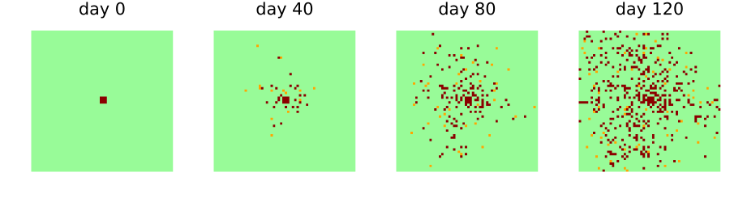

# Using the zoo
Simon Frost

- [Overview](#overview)
- [Finding a model](#finding-a-model)
- [What a model is, and is not](#what-a-model-is-and-is-not)
- [Building and running a model](#building-and-running-a-model)
- [Replicates](#replicates)
- [Any backend](#any-backend)
- [Models with callbacks](#models-with-callbacks)

## Overview

EcologicalCellularAutomata collects published cellular automata for
plant diseases and pests. Each model is a CellularAutomataCore
`CAModel`, so it runs with the core’s schemes, backends, callbacks and
ensembles. Each also carries metadata: its source, what the source
compared it with, and how faithfully it follows the source. This
vignette shows how to find a model, read what it is and is not, build
it, and run it.

``` julia
ENV["GKSwstype"] = "100"
using EcologicalCellularAutomata
using CellularAutomataCore
using Plots
using Statistics
```

## Finding a model

``` julia
list_models()
```

    26-element Vector{Symbol}:
     :bark_beetle_forest
     :barrier_island
     :bt_cotton_refuge
     :bt_crop_three_layer
     :cassava_mealybug
     :coffee_ant_fungus
     :coffee_rust
     :cvc_citrus
     :domany_kinzel_viral
     :dune_formation
     ⋮
     :pine_wilt_casim
     :potato_moth_farmers
     :resistance_regional
     :rhizoctonia_contact
     :rootworm_rotation
     :sudden_oak_death
     :telenomus_release
     :tuta_absoluta_asia
     :western_x_orchard

The models can be filtered by category or by fidelity:

``` julia
(diseases=list_models(; category="plant disease"),
 pests=list_models(; category="agricultural pest"),
 reproductions=list_models(; fidelity=:reproduction))
```

    (diseases = [:coffee_rust, :cvc_citrus, :domany_kinzel_viral, :fungus_dispersal, :grapevine_leafroll, :rhizoctonia_contact, :sudden_oak_death, :western_x_orchard], pests = [:bt_cotton_refuge, :bt_crop_three_layer, :cassava_mealybug, :coffee_ant_fungus, :huffaker_mites, :ipydisp_dispersal, :potato_moth_farmers, :resistance_regional, :rootworm_rotation, :telenomus_release, :tuta_absoluta_asia], reproductions = [:domany_kinzel_viral, :eab_management, :emerald_ash_borer, :fungus_dispersal, :ipydisp_dispersal, :mpb_multiscale, :potato_moth_farmers, :rhizoctonia_contact, :rootworm_rotation, :telenomus_release])

## What a model is, and is not

`model_info` returns the metadata of a model:

``` julia
info = model_info(:fungus_dispersal)
```

    fungus_dispersal: Fungus dispersal among permissive and resistant hosts
      plant disease: a hypothetical phytopathogenic fungus on a crop of permissive and resistant hosts
      source: Ferreira, I. E. de P., Moral, R. de A., Ferreira, C. P. and Godoy, W. A. C. (2013). Modelling fungus dispersal scenarios using cellular automata. Ecological Informatics 14, 53-58. https://doi.org/10.1016/j.ecoinf.2012.11.005
      fidelity: reproduction
      reproduces: Figure 3 (infected hosts over 120 days for all-permissive, mixed and all-resistant fields) and Figure 1 (infected hosts at day 120 against the daily propagule load).
      schemes: Synchronous
      deviations: 6

The fidelity says how close the model is to its source. A *reproduction*
is the source’s model with the source’s parameters. An *adaptation*
fills gaps in the source, or departs from it, and lists every such
choice. An *inspired* model takes only the source’s ideas. Even a
reproduction makes choices where its source is silent:

``` julia
foreach(d -> println("- ", d), info.deviations)
```

    - The boundary is not stated in the source; the field is finite with nothing beyond its edges (no wrap-around), so propagules leaving it are lost.
    - The latency convention is not stated; a host infected in the step from day t first disperses in the step from day t + latency. A latency of 0 is treated as 1, since a synchronous step cannot infect and disperse at once.
    - The nine initial infectious hosts form a 3 x 3 block at the centre; the source says only 'at its centre'.
    - The seasonal load is real-valued (not rounded) and evaluated at day t + 1 for the step from time t.
    - The source does not say how the 50% mixed field of its Figure 3 was laid out; the random layout draws each host independently.
    - Bands are vertical and start with a permissive band at the first column; the source gives the width (15) but not the orientation.

A table of the whole zoo:

``` julia
for id in list_models()
    m = model_info(id)
    println(rpad(id, 22), rpad(m.fidelity, 14), m.organism)
end
```

    bark_beetle_forest    adaptation    spruce bark beetle
    barrier_island        adaptation    dune-building grasses (burial-tolerant) and woody shrubs (burial-intolerant)
    bt_cotton_refuge      adaptation    Spodoptera frugiperda and Helicoverpa armigera
    bt_crop_three_layer   adaptation    cotton bollworm (target pest), a mirid (secondary pest) and a natural enemy
    cassava_mealybug      adaptation    the cassava mealybug and the green lacewing as its biological control
    coffee_ant_fungus     adaptation    the ant Azteca instabilis, its scale insect Coccus viridis and the fungus Lecanicillium lecanii
    coffee_rust           adaptation    Hemileia vastatrix (coffee leaf rust)
    cvc_citrus            adaptation    Xylella fastidiosa (citrus variegated chlorosis), transmitted by sharpshooter leafhoppers
    domany_kinzel_viral   reproduction  a lytic virus with heritable replicative ability
    dune_formation        adaptation    dune-building plants (pioneer and stabilizing species)
    eab_management        reproduction  emerald ash borer (Agrilus planipennis)
    emerald_ash_borer     reproduction  emerald ash borer (Agrilus planipennis)
    fungus_dispersal      reproduction  a hypothetical phytopathogenic fungus
    grapevine_leafroll    adaptation    grapevine leafroll-associated viruses, spread by mealybugs
    huffaker_mites        adaptation    the six-spotted mite Eotetranychus sexmaculatus and the predatory mite Typhlodromus occidentalis
    ipydisp_dispersal     reproduction  biological control agents (parasitoids and predators of crop pests)
    mpb_multiscale        reproduction  mountain pine beetle (Dendroctonus ponderosae)
    pine_wilt_casim       adaptation    the pine wood nematode Bursaphelenchus xylophilus, carried by Monochamus alternatus
    potato_moth_farmers   reproduction  Andean potato tuber moth (Tecia solanivora)
    resistance_regional   adaptation    a key insect pest with a single resistance locus (generic)
    rhizoctonia_contact   reproduction  Rhizoctonia solani (damping-off)
    rootworm_rotation     reproduction  western corn rootworm (Diabrotica virgifera virgifera)
    sudden_oak_death      adaptation    Phytophthora ramorum
    telenomus_release     reproduction  the neotropical brown stink bug Euschistus heros and its egg parasitoid Telenomus podisi
    tuta_absoluta_asia    adaptation    tomato leafminer (Tuta absoluta)
    western_x_orchard     adaptation    Western X phytoplasma (Candidatus Phytoplasma pruni), spread by leafhoppers

## Building and running a model

`build` returns the model, with the source’s parameter values as
defaults:

``` julia
model = build(:fungus_dispersal)
```

    CAModel fungus_dispersal
      Ferreira et al. (2013) fungus dispersal, range 3.0, seasonality none
      states:
        host::Int8 = 0 ∈ 0:2  # 0 healthy, 1 latent, 2 infectious
        resistant::Bool = false  # resistant (true) or permissive
        clock::Int16 = 0  # days since infection
      parameters:
        F_permissive = 0.003  # permissiveness of a permissive host
        F_resistant = 0.001  # permissiveness of a resistant host
        latency = 10  # latent period (days)
        load = 40.0  # daily propagule load (seasonality :none)
        load_max = 270.0  # peak daily load (seasonal)
        peak = 60.0  # day of peak load (:temperate)
        width = 10.0  # width of the season in days (:temperate)
        amplitude = 0.15  # relative amplitude (:tropical)
        period = 20.0  # period in days (:tropical)
      fields: infectious
      rule: LocalRule(<anonymous function>, VonNeumann(1))

`problem` returns a problem with the source’s setup: here a 60 × 60
field with nine infectious hosts in the middle, for 120 days. Keywords
change the setup, and `pmap` changes parameters by name:

``` julia
prob = problem(:fungus_dispersal; seed=1)
sol = solve(prob; saveat=40)
plot([heatmap(u.host'; c=[:palegreen, :orange, :darkred], clims=(0, 2), colorbar=false,
              aspect_ratio=:equal, framestyle=:none, title="day $t")
      for (t, u) in zip(sol.t, sol.u)]...; layout=(1, 4), size=(900, 250))
```



Healthy hosts are green, latent hosts orange and infectious hosts dark
red. Changing a parameter, here halving the daily propagule load:

``` julia
half = solve(problem(:fungus_dispersal; seed=1, pmap=(; load=20.0)); save_everystep=false)
(full_load=fungus_infected(sol.u[end]), half_load=fungus_infected(half.u[end]))
```

    (full_load = 446, half_load = 193)

## Replicates

The models are stochastic, and a single run says little. Most problem
constructors draw their initial state from `seed` as well, so replicates
are problems built with different seeds. Here the infected hosts at day
120 over ten replicates:

``` julia
finals = [fungus_infected(solve(problem(:fungus_dispersal; seed=s);
                                save_everystep=false).u[end]) for s in 1:10]
(mean=mean(finals), sd=round(std(finals); digits=1))
```

    (mean = 471.9, sd = 43.7)

The core’s `EnsembleProblem` runs replicates in parallel. Its
`prob_func` builds each replicate’s problem from SciMLBase’s ensemble
context, whose `sim_id` numbers the replicates:

``` julia
ens = EnsembleProblem(problem(:rhizoctonia_contact);
                      prob_func=(prob, ctx) -> problem(:rhizoctonia_contact; seed=ctx.sim_id))
runs = solve(ens, Synchronous(), EnsembleThreads(); trajectories=50, save_everystep=false)
mean(rhizoctonia_infected(r.u[end]) for r in runs.u)
```

    20.46

## Any backend

A model is specified once. The core’s backends run it, and those that
support it agree exactly, because every random number comes from a
counter-based generator keyed by the seed, the cell, the time and a draw
number. The viral front model on three backends:

``` julia
prob = problem(:domany_kinzel_viral; L=2000, tspan=200, seed=3)
threaded = solve(prob; backend=ArrayBackend(), save_everystep=false).u[end]
serial = solve(prob; backend=ArrayBackend(; threaded=false), save_everystep=false).u[end]
reference = solve(prob; backend=ReferenceBackend(), save_everystep=false).u[end]
threaded == serial == reference
```

    true

## Models with callbacks

Some sources describe steps that no local rule can express. Mites in the
Huffaker model act one at a time, and their moves write two cells.
Insecticide in the Bt cotton model is sprayed when either pest reaches a
share of the whole field. Such parts are callbacks stored with the
problem, so `solve` runs them without being told:

``` julia
prob = problem(:bt_cotton_refuge; n=200, initial=50, scenario=:insecticide)
keys(prob.kwargs)
```

    (:callback,)

They draw their random numbers from a generator seeded by the problem’s
seed and the time, so a run is reproducible:

``` julia
a = solve(prob; save_everystep=false).u[end]
b = solve(prob; save_everystep=false).u[end]
a == b
```

    true

The following vignettes take the models one at a time. Each compares the
model with its source’s results and repeats its deviations.
