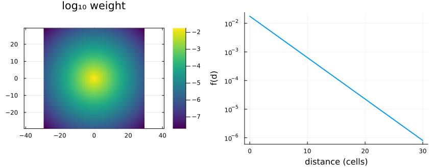
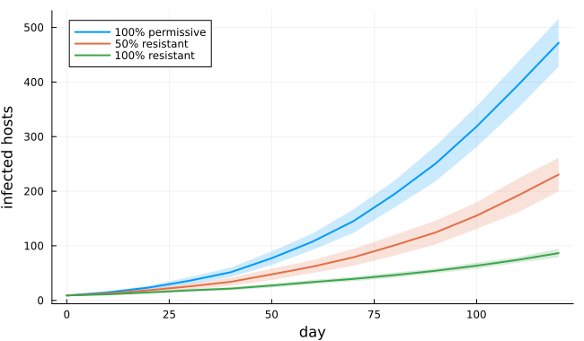
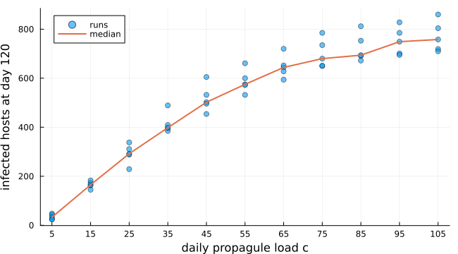
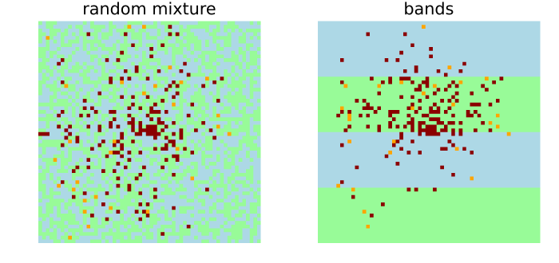
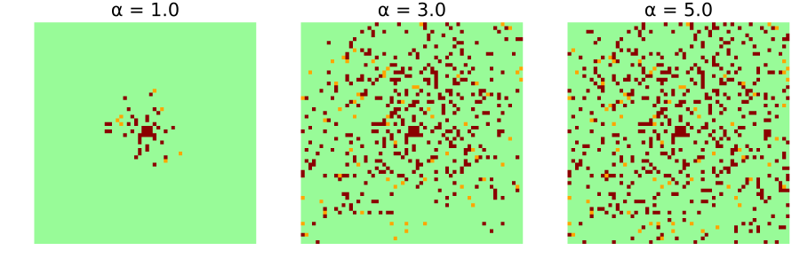
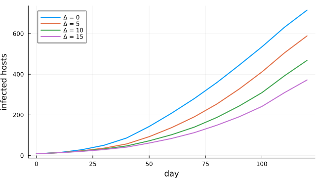
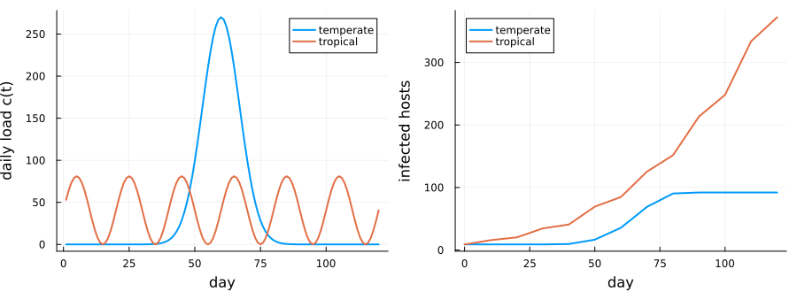

# Fungus dispersal among resistant and permissive hosts
Simon Frost

- [Overview](#overview)
- [The model](#the-model)
- [Permissive, mixed and resistant
  fields](#permissive-mixed-and-resistant-fields)
- [Daily load of propagules](#daily-load-of-propagules)
- [Arrangement of resistant hosts](#arrangement-of-resistant-hosts)
- [Propagule range](#propagule-range)
- [Latent period](#latent-period)
- [Seasons](#seasons)
- [Deviations from the source](#deviations-from-the-source)

## Overview

Planting resistant hosts among susceptible ones is one way to slow a
fungal disease. Ferreira et al. ([2013](#ref-Ferreira2013)) built a
cellular automaton to ask how much it helps, and whether the arrangement
of the resistant hosts matters. They also asked how the outcome depends
on how far propagules travel, the latent period, the daily load of
propagules and the season. Their pathogen is hypothetical, and the model
was not validated against data, so the results are scenarios, not
forecasts. This model is a **reproduction**.

``` julia
ENV["GKSwstype"] = "100"
using EcologicalCellularAutomata
using CellularAutomataCore
using Plots
using Statistics
```

## The model

A 60 × 60 field of hosts is updated once a day. A healthy host becomes
latent with probability

`F (1 − ∏ᵢ (1 − f(dᵢ))^c)`,

where the product runs over every infectious host `i` in the field, at
distance `dᵢ`. `c` is the daily load of propagules from each infectious
host. `f(d) = exp(−d/α) / (2πα²)` is the chance that one propagule lands
on a host at distance `d`, so propagules travel `α` cells on average.
`F` is the host’s permissiveness: 0.003 for a permissive host and 0.001
for a resistant one, so resistant hosts are not immune. A latent host
becomes infectious after `Δ = 10` days and stays infectious.

The product over every infectious host is a sum of logarithms, which is
the core’s kernel field: a convolution of the infectious hosts with
weights `−log(1 − f(d))`. The kernel reaches across the whole field, as
dispersal in the source has no cutoff:

``` julia
w, total = fungus_kernel(3.0; radius=59)
plot(heatmap(-29:29, -29:29, log10.(w[31:89, 31:89]); aspect_ratio=:equal, c=:viridis,
             title="log₁₀ weight", framestyle=:box),
     plot(0:30, [exp(-d / 3) / (2π * 9) for d in 0:30]; yscale=:log10, lw=2, legend=false,
          xlabel="distance (cells)", ylabel="f(d)");
     layout=(1, 2), size=(850, 330), bottom_margin=4Plots.mm)
```



## Permissive, mixed and resistant fields

The source’s Figure 3 follows the number of infected hosts, latent or
infectious, over 120 days in 10 runs each of three fields: all
permissive, half resistant, and all resistant. Each starts with nine
infectious hosts in the middle:

``` julia
curves(layout; runs=10) = [[fungus_infected(u)
                            for u in solve(problem(:fungus_dispersal; layout, seed=s);
                                           saveat=10).u] for s in 1:runs]
layouts = (:permissive, :random, :resistant)
results = Dict(l => curves(l) for l in layouts)
fig = plot(; xlabel="day", ylabel="infected hosts", legend=:topleft, size=(650, 380))
for (l, label) in zip(layouts, ("100% permissive", "50% resistant", "100% resistant"))
    plot!(fig, 0:10:120, mean(results[l]); label, lw=2,
          ribbon=std(results[l]), fillalpha=0.2)
end
fig
```



``` julia
[(field=l, day_120=round(mean(last.(results[l])); digits=1),
  sd=round(std(last.(results[l])); digits=1)) for l in layouts]
```

    3-element Vector{@NamedTuple{field::Symbol, day_120::Float64, sd::Float64}}:
     (field = :permissive, day_120 = 471.9, sd = 43.7)
     (field = :random, day_120 = 230.5, sd = 30.7)
     (field = :resistant, day_120 = 86.6, sd = 7.6)

The source reads about 500, 290 and 100 infected hosts at day 120. The
permissive field agrees to within the spread of the runs. The resistant
field is about an eighth lower and the mixed field about a fifth lower.
The source does not say how it laid out its mixed field. Here each host
is resistant independently with probability one half. The source does
not state its latency convention either. Dispersing one day sooner (a
latency of 9 here) raises the permissive field to about 494, but leaves
the mixed field at about 244 and the resistant field at about 88, so
those gaps remain unexplained.

## Daily load of propagules

The source’s Figure 1 varies the daily load `c` from 5 to 105 propagules
per infectious host:

``` julia
loads = 5:10:105
final(load; runs=5) = [fungus_infected(solve(problem(:fungus_dispersal; seed=s,
                                                     pmap=(; load=Float64(load)));
                                             save_everystep=false).u[end]) for s in 1:runs]
by_load = [final(c) for c in loads]
scatter(repeat(collect(loads); inner=5), reduce(vcat, by_load); label="runs", alpha=0.6,
        xlabel="daily propagule load c", ylabel="infected hosts at day 120",
        xticks=loads, legend=:topleft, size=(650, 360))
plot!(loads, median.(by_load); label="median", lw=2)
```



The source’s medians read about 50, 345, 560, 680 and 780 at loads 5,
25, 45, 65 and 105:

``` julia
[(load=c, median=median(by_load[k])) for (k, c) in enumerate(loads) if c in (5, 25, 45, 65, 105)]
```

    5-element Vector{@NamedTuple{load::Int64, median::Float64}}:
     (load = 5, median = 33.0)
     (load = 25, median = 292.0)
     (load = 45, median = 502.0)
     (load = 65, median = 644.0)
     (load = 105, median = 758.0)

The response is non-linear and saturating, as in the source. It lies
below the source’s medians by about a third at the smallest load and by
a few percent at the largest. The other latency convention does not
change the smallest loads, so this gap also remains unexplained.

## Arrangement of resistant hosts

The source compared a random mixture with alternating bands of
permissive and resistant hosts 15 columns wide. It found no significant
difference in the number infected (p \> 0.05):

``` julia
bands = [fungus_infected(solve(problem(:fungus_dispersal; layout=:bands, seed=s);
                               save_everystep=false).u[end]) for s in 1:10]
mixture = last.(results[:random])
(random=(mean=mean(mixture), sd=round(std(mixture); digits=1)),
 bands=(mean=mean(bands), sd=round(std(bands); digits=1)),
 t=round((mean(bands) - mean(mixture)) /
         sqrt(var(bands) / 10 + var(mixture) / 10); digits=2))
```

    (random = (mean = 230.5, sd = 30.7), bands = (mean = 255.6, sd = 39.2), t = 1.6)

``` julia
pick(layout; seed=1) = solve(problem(:fungus_dispersal; layout, seed);
                             save_everystep=false).u[end]
mapof(u, title) = heatmap(u.host' .+ 3 .* u.resistant'; aspect_ratio=:equal,
                          framestyle=:none, colorbar=false, title,
                          c=[:palegreen, :orange, :darkred, :lightblue, :orange, :darkred],
                          clims=(0, 5))
plot(mapof(pick(:random), "random mixture"), mapof(pick(:bands), "bands");
     layout=(1, 2), size=(700, 330))
```



Permissive hosts are green and resistant hosts blue; latent and
infectious hosts are orange and dark red. The maps are transposed, so
the bands, which run along columns, are drawn across. A Welch statistic
of this size, over ten runs each, is no evidence of a difference. That
agrees with the source.

## Propagule range

The kernel is fixed when the model is built, so the mean range `α` is a
keyword of the problem. Short ranges give separate local clusters. Long
ranges scatter infections that merge across the field:

``` julia
plot([mapof(solve(problem(:fungus_dispersal; range=α, seed=2); save_everystep=false).u[end],
            "α = $α") for α in (1.0, 3.0, 5.0)]...; layout=(1, 3), size=(900, 300))
```



## Latent period

A longer latent period delays every generation of infection:

``` julia
fig = plot(; xlabel="day", ylabel="infected hosts", legend=:topleft, size=(650, 360))
for Δ in (0, 5, 10, 15)
    runs = [[fungus_infected(u)
             for u in solve(problem(:fungus_dispersal; seed=s, pmap=(; latency=Δ));
                            saveat=10).u] for s in 1:5]
    plot!(fig, 0:10:120, mean(runs); label="Δ = $Δ", lw=2)
end
fig
```



## Seasons

The source contrasts two seasons with about the same total load over 120
days. A temperate season has a single peak,
`c(t) = 270 exp(−(t − 60)²/10²)`. A tropical one has regular pulses,
`c(t) = 270 × 0.15 (sin(2πt/20) + 1)`:

``` julia
t = 1:120
loadplot = plot(t, [270 .* exp.(-(t .- 60) .^ 2 ./ 100) 270 * 0.15 .* (sin.(2π .* t ./ 20) .+ 1)];
                label=["temperate" "tropical"], lw=2, xlabel="day", ylabel="daily load c(t)")
season(s) = [[fungus_infected(u)
              for u in solve(problem(:fungus_dispersal; seasonality=s, seed=k);
                             saveat=10).u] for k in 1:5]
temperate, tropical = season(:temperate), season(:tropical)
growth = plot(0:10:120, [mean(temperate) mean(tropical)]; label=["temperate" "tropical"],
              lw=2, xlabel="day", ylabel="infected hosts", legend=:topleft)
plot(loadplot, growth; layout=(1, 2), size=(900, 330), bottom_margin=4Plots.mm,
     left_margin=3Plots.mm)
```



As in the source, the tropical season infects many more hosts than the
temperate one. In the temperate season the nine initial hosts infect a
cohort during the peak around day 60. That cohort becomes infectious ten
days later, when the load has almost gone, so the epidemic stops at
about 90 hosts. The tropical pulses keep returning, and each new cohort
of infectious hosts meets one.

## Deviations from the source

``` julia
foreach(d -> println("- ", d), model_info(:fungus_dispersal).deviations)
```

    - The boundary is not stated in the source; the field is finite with nothing beyond its edges (no wrap-around), so propagules leaving it are lost.
    - The latency convention is not stated; a host infected in the step from day t first disperses in the step from day t + latency. A latency of 0 is treated as 1, since a synchronous step cannot infect and disperse at once.
    - The nine initial infectious hosts form a 3 x 3 block at the centre; the source says only 'at its centre'.
    - The seasonal load is real-valued (not rounded) and evaluated at day t + 1 for the step from time t.
    - The source does not say how the 50% mixed field of its Figure 3 was laid out; the random layout draws each host independently.
    - Bands are vertical and start with a permissive band at the first column; the source gives the width (15) but not the orientation.

```@raw html
<div id="refs" class="references csl-bib-body hanging-indent">
```

```@raw html
<div id="ref-Ferreira2013" class="csl-entry">
```

Ferreira, Iuri Emmanuel de Paula, Rafael de Andrade Moral, Cláudia Pio
Ferreira, and Wesley Augusto Conde Godoy. 2013. “Modelling Fungus
Dispersal Scenarios Using Cellular Automata.” *Ecological Informatics*
14: 53–58. <https://doi.org/10.1016/j.ecoinf.2012.11.005>.

```@raw html
</div>
```

```@raw html
</div>
```
