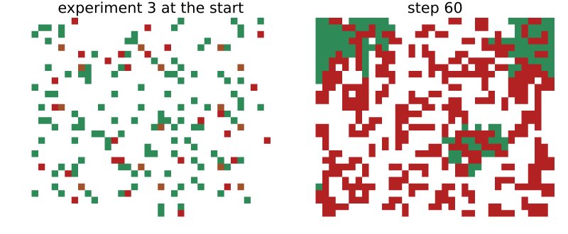
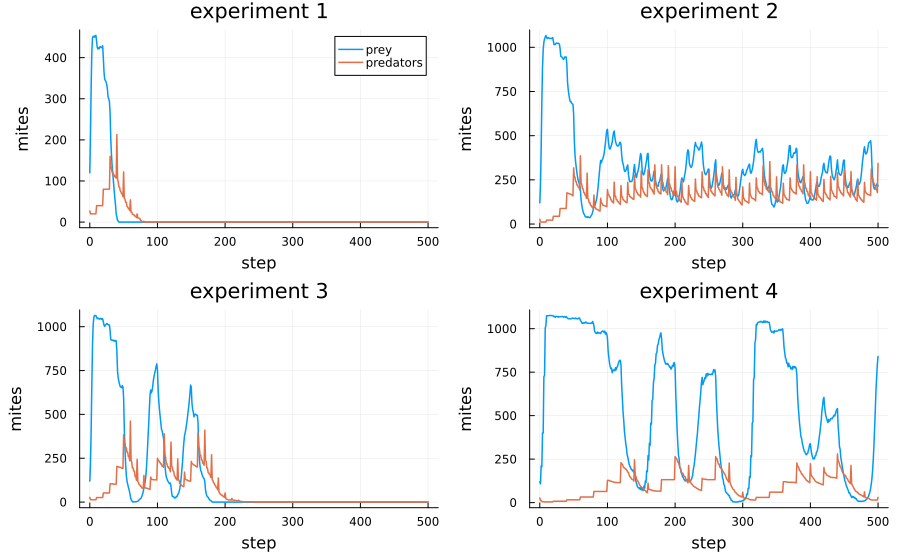
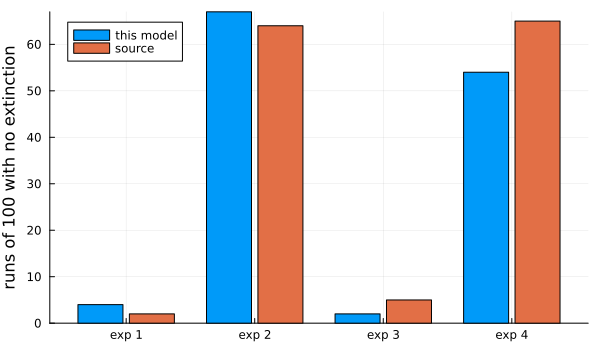

# Huffaker’s mites
Simon Frost

- [Overview](#overview)
- [The model](#the-model)
- [One run of each experiment](#one-run-of-each-experiment)
- [A hundred runs of each](#a-hundred-runs-of-each)
- [Posts](#posts)
- [Deviations from the source](#deviations-from-the-source)

## Overview

In a classic experiment, Huffaker ([1958](#ref-Huffaker1958)) kept
six-spotted mites, a pest of citrus, with a predatory mite on trays of
oranges. On a small, simple universe the predators ate the prey and both
died out. Sustained oscillations needed a large, complex universe:
oranges partly covered, barriers of petroleum jelly, and wooden posts
from which prey could float on air currents to distant oranges. Zsoldos
and Stepler ([2024](#ref-Zsoldos2024)) rebuilt the experiment as a
cellular automaton in the style of Wa-Tor. They asked how often each
universe oscillates. This model follows their published code and is an
**adaptation**. It differs in the rule for posts and in how oscillations
are counted.

``` julia
ENV["GKSwstype"] = "100"
using EcologicalCellularAutomata
using CellularAutomataCore
using Plots
using Statistics
```

## The model

Each cell is part of an orange and holds at most one mite. Every step,
the mites alive at its start act once each, in a random order:

- a predator with a prey next to it eats it, moves into its cell and
  gains one unit of energy;
- otherwise a mite moves to a random empty neighbour. A predator that
  moves without eating loses a unit of energy, and dies when it has
  none.
- A mite that moves and has reached its fertility threshold leaves an
  offspring in the cell it left.

Prey breed at every move (threshold 1) and predators every tenth
(threshold 10). A predator starts with one unit of energy, so it starves
at its first move without a meal. A move writes two cells, which no
local rule can do. The step is therefore a callback stored with the
problem, and the model’s own rule leaves cells unchanged:

``` julia
prob = problem(:huffaker_mites; experiment=3, seed=1)
model = build(:huffaker_mites)
```

    CAModel huffaker_mites
      Zsoldos & Stepler (2024) predator and prey mites on oranges
      states:
        mite::Int8 = 0 ∈ 0:2  # 0 empty, 1 prey, 2 predator
        fertility::Int16 = 0  # steps since the mite last bred
        energy::Int16 = 0  # the mite's life points
        post::Bool = false  # a wooden post
      parameters:
        F_prey = 1  # prey fertility threshold
        F_predator = 10  # predator fertility threshold
        L_predator = 1  # initial energy of a predator
        loss = 1  # energy a predator loses moving without eating
        gain = 1  # energy a predator gains by eating
        prey_energy = 10  # energy of a prey (never changes)
      rule: LocalRule(<anonymous function>, VonNeumann(1))

The four experiments of the source are four universes:

1.  four cells per orange (a 20 × 24 grid);
2.  nine cells per orange (30 × 36);
3.  as 2, with 18 wooden posts;
4.  as 3, with the fertility thresholds, the predators’ starting energy
    and their energy loss doubled.

``` julia
showgrid(u; title="") = heatmap(u.mite .+ 3 .* u.post; aspect_ratio=:equal, colorbar=false,
                                framestyle=:none, title, clims=(0, 5),
                                c=[:white, :seagreen, :firebrick, :sienna, :seagreen,
                                   :firebrick])
plot(showgrid(prob.u0; title="experiment 3 at the start"),
     showgrid(solve(remake(prob; tspan=60); save_everystep=false).u[end]; title="step 60");
     layout=(1, 2), size=(800, 330))
```



Prey are green, predators red and empty posts brown.

## One run of each experiment

Each panel shows a run with the most common outcome of its experiment
(found below): both species dead after one peak in experiment 1,
oscillations that end in extinction in experiment 3, and persistence in
experiments 2 and 4. Each is the first seed that gives that outcome:

``` julia
function typical(experiment, outcome)
    for seed in 1:100
        prey, pred = huffaker_counts(solve(problem(:huffaker_mites; experiment, seed)))
        huffaker_outcome(prey, pred) == outcome && return prey, pred
    end
end
function runplot(experiment, outcome)
    prey, pred = typical(experiment, outcome)
    return plot(0:500, [prey pred]; label=["prey" "predators"], lw=1.5,
                title="experiment $experiment", xlabel="step", ylabel="mites",
                legend=experiment == 1 ? :topright : false)
end
plot(runplot(1, :both_extinct_immediately), runplot(2, :no_extinction),
     runplot(3, :both_extinct), runplot(4, :no_extinction);
     layout=(2, 2), size=(900, 560), left_margin=4Plots.mm, bottom_margin=3Plots.mm)
```



As in the source’s Figure 4, prey first fill the empty universe, and the
predators then catch up. In the small universe they crash together. The
larger universes oscillate irregularly, with predators lagging prey.

## A hundred runs of each

The source ran each experiment 100 times. It classified every run by
eye, as oscillating if the populations made at least three peaks, and by
which species died out. A classifier is needed here instead. It counts
peaks of the smoothed prey count that rise and fall by at least a fifth
of its maximum (`count_peaks`), and `huffaker_outcome` turns the peaks
and the extinctions into the source’s categories:

``` julia
categories = (:both_extinct_immediately, :both_extinct, :prey_extinct,
              :predator_extinct_immediately, :predator_extinct, :no_extinction)
function outcomes(experiment; runs=100, posts=:code)
    out = Dict(c => 0 for c in categories)
    for s in 1:runs
        prey, pred = huffaker_counts(solve(problem(:huffaker_mites; experiment, seed=s,
                                                   posts)))
        out[huffaker_outcome(prey, pred)] += 1
    end
    return out
end
table = Dict(e => outcomes(e) for e in 1:4)
source = Dict(1 => (89, 9, 0, 0, 0, 2), 2 => (25, 11, 0, 0, 0, 64),
              3 => (49, 46, 0, 0, 0, 5), 4 => (15, 20, 0, 0, 0, 65))
for e in 1:4
    println("experiment $e")
    for (k, c) in enumerate(categories)
        println("  ", rpad(c, 30), lpad(table[e][c], 4), lpad(source[e][k], 6))
    end
end
```

    experiment 1
      both_extinct_immediately        76    89
      both_extinct                    20     9
      prey_extinct                     0     0
      predator_extinct_immediately     0     0
      predator_extinct                 0     0
      no_extinction                    4     2
    experiment 2
      both_extinct_immediately        22    25
      both_extinct                    10    11
      prey_extinct                     1     0
      predator_extinct_immediately     0     0
      predator_extinct                 0     0
      no_extinction                   67    64
    experiment 3
      both_extinct_immediately        43    49
      both_extinct                    49    46
      prey_extinct                     6     0
      predator_extinct_immediately     0     0
      predator_extinct                 0     0
      no_extinction                    2     5
    experiment 4
      both_extinct_immediately        17    15
      both_extinct                    24    20
      prey_extinct                     4     0
      predator_extinct_immediately     1     0
      predator_extinct                 0     0
      no_extinction                   54    65

The first column is this model and the second the source. The category
that does not depend on the classifier, runs in which neither species
dies out by step 500, is the cleanest comparison:

``` julia
oscillating(t) = t[:both_extinct] + t[:predator_extinct] + t[:no_extinction]
bar_x = 1:4
plot(bar_x .- 0.2, [table[e][:no_extinction] for e in 1:4]; seriestype=:bar,
     bar_width=0.35, label="this model", xticks=(bar_x, ["exp 1", "exp 2", "exp 3", "exp 4"]),
     ylabel="runs of 100 with no extinction", legend=:topleft, size=(600, 350))
plot!(bar_x .+ 0.2, [source[e][6] for e in 1:4]; seriestype=:bar, bar_width=0.35,
      label="source")
```



``` julia
[(experiment=e, no_extinction=(table[e][:no_extinction], source[e][6]),
  oscillating=(oscillating(table[e]), sum(source[e][[2, 5, 6]]))) for e in 1:4]
```

    4-element Vector{@NamedTuple{experiment::Int64, no_extinction::Tuple{Int64, Int64}, oscillating::Tuple{Int64, Int64}}}:
     (experiment = 1, no_extinction = (4, 2), oscillating = (24, 11))
     (experiment = 2, no_extinction = (67, 64), oscillating = (77, 75))
     (experiment = 3, no_extinction = (2, 5), oscillating = (51, 51))
     (experiment = 4, no_extinction = (54, 65), oscillating = (78, 85))

Each pair is this model, then the source. The source’s pattern is
reproduced: - **Experiment 1** almost always crashes. - **Nine cells per
orange** let about two thirds of the runs persist. - **Posts** make
almost every run end in extinction, most of them after oscillating. -
**Doubled life-history parameters** bring persistence back, in 54 runs
against the source’s 65.

The share of oscillating runs matches the source in experiments 2 and 3.
In experiment 1 the classifier counts 20 runs as oscillating before
extinction where the source’s eye counted 9. A few runs in experiments 3
and 4 end with the prey dead but well-fed predators still alive at step
500. The source has no such runs. These predators would starve within a
few steps, so the source may have counted them as runs in which both
species died.

## Posts

The source’s text says a prey on a post may jump to another post. Its
published code has the post rule commented out, and that version lets
every prey, wherever it stands, move to any empty post. The model uses
the code’s rule by default (`posts = :code`). The text’s rule is
`posts = :text`:

``` julia
text = outcomes(3; posts=:text)
[(rule=r, no_extinction=t[:no_extinction], oscillating=oscillating(t),
  both_extinct=t[:both_extinct] + t[:both_extinct_immediately])
 for (r, t) in (("code", table[3]), ("text", text))]
```

    2-element Vector{@NamedTuple{rule::String, no_extinction::Int64, oscillating::Int64, both_extinct::Int64}}:
     (rule = "code", no_extinction = 2, oscillating = 51, both_extinct = 92)
     (rule = "text", no_extinction = 38, oscillating = 74, both_extinct = 59)

The two rules give very different universes. The code’s rule offers
every prey a long jump at every step, and only 2 runs of 100 persist.
The text’s rule offers it only to prey that reach a post, and 38
persist. The source reports 5 persisting runs for experiment 3, which
matches the code’s rule. This suggests the authors ran something like
their published code. Under the code’s rule, posts lower persistence
compared with nine cells per orange alone, in the source and here. So
the posts do not give Huffaker’s result on their own.

## Deviations from the source

``` julia
foreach(d -> println("- ", d), model_info(:huffaker_mites).deviations)
```

    - The step follows the source's published code, as a step callback on the lattice state, since mites act one at a time and a move writes two cells; the model's own rule leaves cells unchanged.
    - The published code's post rule is commented out and lets every prey move to any empty post; it is the default (posts = :code). The rule in the source's text (a prey on a post may jump to another) is posts = :text. The code used for experiments 3 and 4 was not published.
    - Oscillation is counted by an explicit rule (at least three peaks of the smoothed prey count, each a rise and fall of a fifth of its maximum); the source classified its runs by eye.
    - Initial mites are placed on distinct uniformly random cells, as in the source's code; its text says one prey per orange.
    - In experiment 4 the energy gained per meal stays 1; the source does not say whether it was doubled with the other parameters.

```@raw html
<div id="refs" class="references csl-bib-body hanging-indent">
```

```@raw html
<div id="ref-Huffaker1958" class="csl-entry">
```

Huffaker, C. B. 1958. “Experimental Studies on Predation: Dispersion
Factors and Predator-Prey Oscillations.” *Hilgardia* 27 (14): 343–83.
<https://doi.org/10.3733/hilg.v27n14p343>.

```@raw html
</div>
```

```@raw html
<div id="ref-Zsoldos2024" class="csl-entry">
```

Zsoldos, Hanna, and Isabel Stepler. 2024. “Predator-Prey Oscillations in
a Cellular Automaton of Huffaker’s Mite Experiment.” *SIAM Undergraduate
Research Online* 17: 54–67. <https://doi.org/10.1137/22S1529452>.

```@raw html
</div>
```

```@raw html
</div>
```
