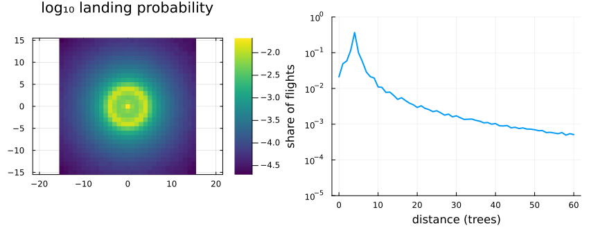
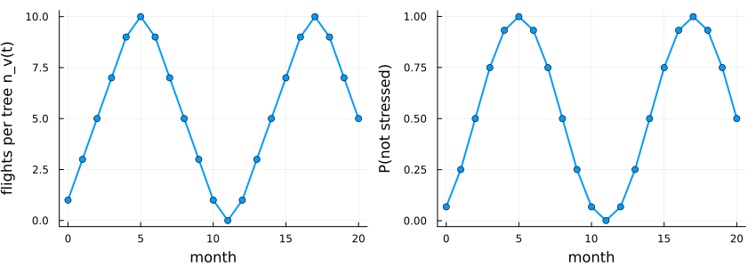
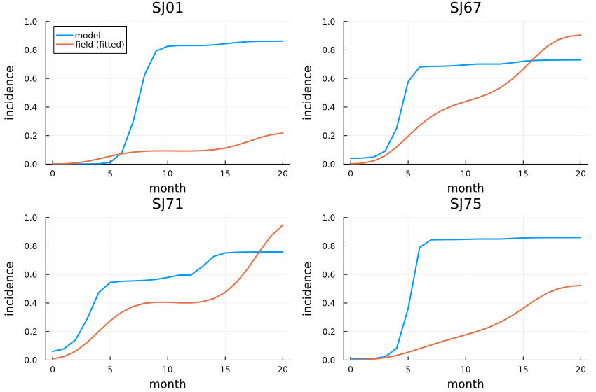
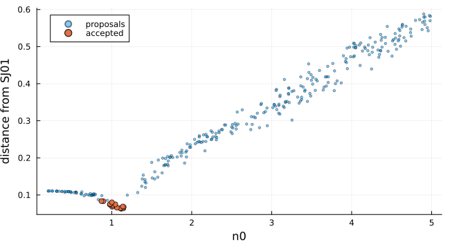
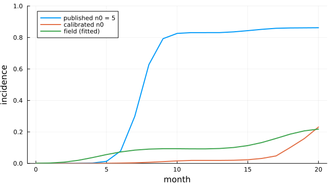

# Citrus variegated chlorosis
Simon Frost

- [Overview](#overview)
- [Flights](#flights)
- [The model](#the-model)
- [The four groves, as published](#the-four-groves-as-published)
- [Calibrating one grove](#calibrating-one-grove)
- [Deviations from the source](#deviations-from-the-source)

## Overview

Citrus variegated chlorosis, caused by the bacterium *Xylella
fastidiosa*, is spread between orange trees by sharpshooter leafhoppers.
Martins et al. ([2000](#ref-Martins2000)) modelled an orange grove as a
cellular automaton. Each diseased tree sends vector flights of
Lévy-distributed length to other trees each month. A tree under water or
nutritional stress resists infection, and one seasonal cycle drives both
the vectors and the stress. They report that the model reproduces the
double-sigmoid progress of the disease in four groves. This model is an
**adaptation**. The source’s text and published parameters, read
literally, spread the disease much faster than its figures show. This
vignette shows the mismatch, then calibrates the model to one grove with
the core’s approximate Bayesian computation.

``` julia
ENV["GKSwstype"] = "100"
using EcologicalCellularAutomata
using CellularAutomataCore
using Plots
using Random
using Statistics
```

## Flights

A flight has length `|X|`, where `X` is a symmetric stable variate of
index 0.68 and location 4. It goes in a uniform direction and lands on
the nearest tree. The tail is heavy: most flights land within a few
trees, but some cross the grove. `cvc_flight_kernel` estimates the
chance of landing on each offset from ten million sampled flights:

``` julia
K = cvc_flight_kernel()
r = 0:60
radial = [sum(K[i, j] for i in axes(K, 1), j in axes(K, 2)
              if round(Int, hypot(i - 200, j - 200)) == d) for d in r]
plot(heatmap(-15:15, -15:15, log10.(K[185:215, 185:215] .+ 1e-9); aspect_ratio=:equal,
             c=:viridis, title="log₁₀ landing probability", framestyle=:box),
     plot(r, radial; xlabel="distance (trees)", ylabel="share of flights", lw=2,
          legend=false, yscale=:log10, ylims=(1e-5, 1));
     layout=(1, 2), size=(850, 330), bottom_margin=4Plots.mm)
```



``` julia
(within_10=round(sum(K[190:210, 190:210]); digits=3), lost_beyond_199=round(1 - sum(K); digits=3))
```

    (within_10 = 0.86, lost_beyond_199 = 0.019)

## The model

The source has each diseased tree choose its targets. Here each healthy
tree asks instead how likely it is to be a target of any diseased tree:
`1 − ∏ₓ (1 − K(y − x))^{n_v(t)}`. That gives every tree the same chance
of being targeted, and it is a kernel field. The kernel reaches across
the grove, so the field is computed by FFT. The grove sits in a corner
of a torus twice its size, and the rest of the torus is masked, so
flights that leave the grove are lost, as in the source.

A targeted healthy tree is infected unless it is stressed. An untargeted
healthy tree draws its stress afresh each month. The number of flights
and the chance of not being stressed follow one sinusoid of period 12
months:

``` julia
p = defaults(build(:cvc_citrus; kernel=K))
t = 0:20
phase = 2π .* t ./ p.period .+ p.phase
nv = p.n0 .+ trunc.(p.n0 .* sin.(phase))
pnst = p.p_min .+ (1 - 2p.p_min) .* (1 .+ sin.(phase)) ./ 2
plot(plot(t, nv; lw=2, marker=:circle, legend=false, ylabel="flights per tree n_v(t)"),
     plot(t, pnst; lw=2, marker=:circle, legend=false, ylabel="P(not stressed)");
     layout=(1, 2), size=(850, 300), xlabel="month", bottom_margin=4Plots.mm,
     left_margin=3Plots.mm)
```



In the summer months, around month 5, vectors fly most and few trees are
stressed, so infection is fast. Around month 11 it all but stops. This
is the source of the double sigmoid.

## The four groves, as published

The source’s Table 2 gives each grove’s initial incidence and minimum
probability of not being stressed. Its Table 1 gives the logistic curves
fitted to each grove’s observed incidence. Ten runs per grove with the
published parameters:

``` julia
groves = (:SJ01, :SJ67, :SJ71, :SJ75)
months = 0:20
incidence(grove; runs=10, pmap=(;)) = mean([cvc_incidence.(solve(problem(:cvc_citrus; grove,
                                                                          kernel=K, seed=s,
                                                                          pmap)).u)
                                            for s in 1:runs])
published = Dict(g => incidence(g) for g in groves)
plot([plot(months, [published[g] cvc_field_curve.(g, months)]; lw=2, title=String(g),
           label=["model" "field (fitted)"], legend=g == :SJ01 ? :topleft : false,
           ylims=(0, 1), xlabel="month", ylabel="incidence") for g in groves]...;
     layout=(2, 2), size=(850, 560), left_margin=3Plots.mm)
```



``` julia
[(grove=g, model_month_20=round(published[g][end]; digits=2),
  field_month_20=round(cvc_field_curve(g, 20); digits=2)) for g in groves]
```

    4-element Vector{@NamedTuple{grove::Symbol, model_month_20::Float64, field_month_20::Float64}}:
     (grove = :SJ01, model_month_20 = 0.86, field_month_20 = 0.22)
     (grove = :SJ67, model_month_20 = 0.73, field_month_20 = 0.9)
     (grove = :SJ71, model_month_20 = 0.76, field_month_20 = 0.95)
     (grove = :SJ75, model_month_20 = 0.86, field_month_20 = 0.52)

In every grove the model shoots up in the first summer, far more steeply
than the field, and then all but stops. By then almost every tree that
is not stressed in the summer has been reached. The trees left are those
that were stressed whenever flights reached them, and the second summer
adds comparatively few of them. The model therefore overshoots the slow
groves, SJ01 and SJ75. It misses the second rise of SJ67 and SJ71, whose
field incidence keeps growing to 0.9 and more. The source’s Figure 7
instead follows the field, ending near 0.28, 0.92, 0.87 and 0.41 for the
four groves. An independent literal implementation, in which diseased
trees choose their targets, gives the same fast spread. The mismatch
therefore comes from the source’s description, not from the way targets
are drawn here. Something the source does not report must differ: how a
flight length becomes a tree, the time step, or the treatment of
negative draws.

## Calibrating one grove

The core’s `abc_rejection` runs the model for proposals drawn from a
prior. It scores each run with a distance from the observations and
keeps the closest. Here the parameter is the mean number of flights
`n0`. The observations are grove SJ01’s fitted curve at each month, and
the distance is the root mean square difference between the curves:

``` julia
observed = cvc_field_curve.(:SJ01, months)
prob = problem(:cvc_citrus; grove=:SJ01, kernel=K)
distance(sol, obs) = sqrt(mean(abs2, cvc_incidence.(sol.u) .- obs))
prior(rng) = merge(prob.p, (; n0=0.2 + 4.8rand(rng)))
res = abc_rejection(prob, prior, distance, observed; n=300, keep=15, rng=Xoshiro(1))
```

    ABCResult: 15 of 300 proposals accepted, distances 0.063 to 0.0834

``` julia
n0s = [s.n0 for s in res.samples]
scatter([q.n0 for q in res.proposals], res.proposal_distances; ms=2, alpha=0.5,
        label="proposals", xlabel="n0", ylabel="distance from SJ01", size=(650, 350))
scatter!(n0s, res.distances; ms=4, label="accepted")
```



``` julia
(n0_mean=round(mean(n0s); digits=2), n0_range=round.(extrema(n0s); digits=2),
 distance=round(res.distances[1]; digits=3))
```

    (n0_mean = 1.04, n0_range = (0.87, 1.15), distance = 0.063)

The accepted runs have about one flight per diseased tree a month, a
fifth of the published five. With that value the grove’s final incidence
comes out right, but not its timing:

``` julia
fitted = incidence(:SJ01; pmap=(; n0=mean(n0s)))
plot(months, [published[:SJ01] fitted observed]; lw=2, ylims=(0, 1), xlabel="month",
     ylabel="incidence", label=["published n0 = 5" "calibrated n0" "field (fitted)"],
     legend=:topleft, size=(650, 360))
```



The field incidence rises within the first summer. The calibrated model
stays low until the second summer, then rises as steeply as the
published one. One parameter cannot give both the early growth and the
plateau. The source’s fit must rest on details it does not report.

## Deviations from the source

``` julia
foreach(d -> println("- ", d), model_info(:cvc_citrus).deviations)
```

    - Each healthy tree is targeted with probability 1 - prod_x (1 - K(y - x))^n_v over the diseased trees x ('pull'), instead of each diseased tree choosing n_v distinct targets ('push'): each tree's chance of being targeted is the same, but targets of one source are not drawn jointly, and distinctness is dropped.
    - The source does not say how a flight length becomes a lattice site: a flight of length |X| (X symmetric stable, index 0.68, location 4, scale 1) goes in a uniform direction and lands on the nearest tree. The kernel is estimated from 10^7 sampled flights.
    - INT in the number of flights truncates towards zero; the source does not say how negative values are treated.
    - The time step is one month, inferred from the source's period of 12 and its phase described as two months.
    - Stress for the next step is drawn with p_nst at the current step; the initial stress probability, not given in the source, is 1 - p_nst(0).
    - The redundant vector label tau of the source (always equal to the disease state) is not kept.
    - Read literally, the source's parameters make the disease spread much faster than its Figure 7; the published parameters are kept as defaults, and the vignette shows the mismatch.

```@raw html
<div id="refs" class="references csl-bib-body hanging-indent">
```

```@raw html
<div id="ref-Martins2000" class="csl-entry">
```

Martins, M. L., G. Ceotto, S. G. Alves, C. C. B. Bufon, J. M. Silva, and
F. F. Laranjeira. 2000. “Cellular Automata Model for Citrus Variegated
Chlorosis.” *Physical Review E* 62 (5): 7024–30.
<https://doi.org/10.1103/PhysRevE.62.7024>.

```@raw html
</div>
```

```@raw html
</div>
```
