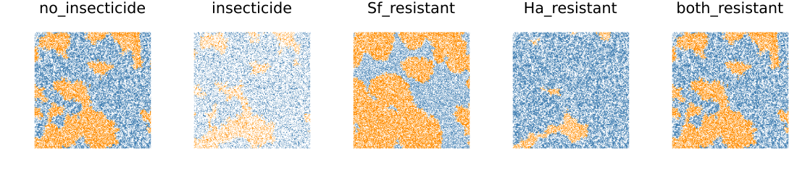
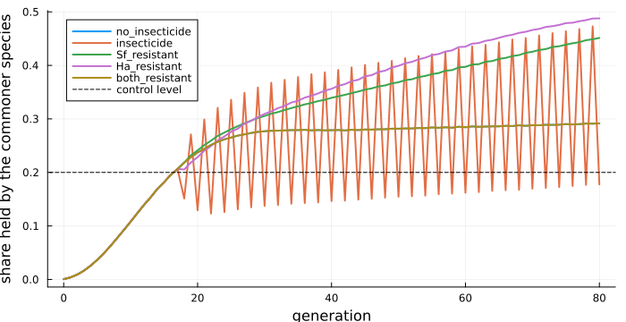
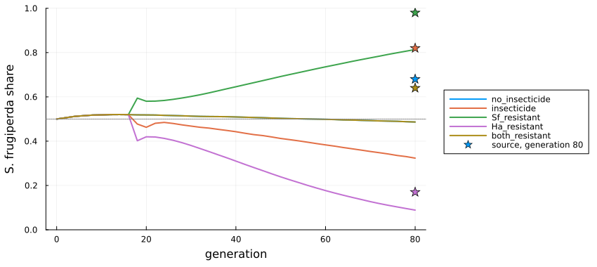

# Two pests in a Bt cotton refuge
Simon Frost

- [Overview](#overview)
- [The model](#the-model)
- [The five scenarios](#the-five-scenarios)
- [Dominance](#dominance)
- [The unstated choices](#the-unstated-choices)
- [Deviations from the source](#deviations-from-the-source)

## Overview

Bt cotton is planted with a refuge of non-Bt cotton, where susceptible
pests survive and slow the evolution of resistance to Bt. Two
caterpillars, *Spodoptera frugiperda* and *Helicoverpa armigera*,
compete in such refuges, and insecticides are sprayed there. Malaquias
et al. ([2021](#ref-Malaquias2021)) built a cellular automaton of a
refuge from field data on how well each species survives alone and
together, at low and high density. They asked which species comes to
dominate under five insecticide and resistance scenarios. The model has
no Bt plants in it: every cell is a refuge plant, and resistance means
resistance to the insecticide.

The source leaves several mechanisms unstated: the encounter and
colonisation probabilities, the role of adult emergence, how resistance
works, and where the first insects are placed. Its Table 1 also
contradicts its Figure 1. This model is an **adaptation** that fills
these gaps in stated ways. It reproduces some of the source’s results
and not others, and the vignette shows which.

``` julia
ENV["GKSwstype"] = "100"
using EcologicalCellularAutomata
using CellularAutomataCore
using Plots
using Statistics
```

## The model

A 1000 × 1000 torus of plants, each empty or holding one of the two
species, is updated once a generation from its Moore neighbours:

- an occupied plant loses its larva to natural enemies with probability
  0.25; then, in a sprayed generation, to insecticide with probability
  0.99, unless its species is resistant; then to competition;
- survival in competition depends on density (high if at least four
  neighbours are occupied) and on whether the larva meets the other
  species, which it does with probability equal to the share of its
  neighbours holding that species;
- an empty plant is colonised by *S. frugiperda* with probability
  `0.86 n₁R₁ / (n₁R₁ + n₂R₂)`, and failing that by *H. armigera*
  likewise, where `nᵢ` are the neighbours holding each species and `Rᵢ`
  their fecundities (400 and 725).

The insecticide is sprayed in every generation in which either species
occupies at least a fifth of the field. That decision needs the whole
field, so it is a callback stored with the problem.

``` julia
model = build(:bt_cotton_refuge)
```

    CAModel bt_cotton_refuge
      Malaquias et al. (2021) S. frugiperda and H. armigera in a Bt cotton refuge
      states:
        plant::Int8 = 0 ∈ 0:2  # 0 empty, 1 S. frugiperda, 2 H. armigera
      parameters:
        mortality = 0.25  # natural mortality and dispersal
        kill = 0.99  # insecticide mortality
        spray = false  # this generation is sprayed (set by the callback)
        resistant_Sf = false  # S. frugiperda resists the insecticide
        resistant_Ha = false  # H. armigera resists the insecticide
        escape = 1.0  # probability a resistant larva escapes the spray
        threshold = 0.5  # occupied share of neighbours for high density
        fecundity_Sf = 400.0  # reproductive capacity of S. frugiperda
        fecundity_Ha = 725.06  # reproductive capacity of H. armigera
        emergence = 0.86  # adult emergence, scaling colonisation
        sL_Sf = 0.75  # larval survival
        sL_Ha = 0.8  # larval survival
        sL_Sf_Ha = 0.6  # larval survival
        sL_Ha_Sf = 0.49  # larval survival
        sH_Sf = 0.48  # larval survival
        sH_Ha = 0.22  # larval survival
        sH_Sf_Ha = 0.18  # larval survival
        sH_Ha_Sf = 0.47  # larval survival
      rule: LocalRule(<anonymous function>, Moore(1))

The survival probabilities, as the source’s Figure 1 gives them (the
default) and as its Table 1 does:

``` julia
fig1, tab1 = bt_cotton_survival(:figure1), bt_cotton_survival(:table1)
[(parameter=k, figure_1=fig1[k], table_1=tab1[k]) for k in keys(fig1)]
```

    8-element Vector{@NamedTuple{parameter::Symbol, figure_1::Float64, table_1::Float64}}:
     (parameter = :sL_Sf, figure_1 = 0.75, table_1 = 0.63)
     (parameter = :sL_Ha, figure_1 = 0.8, table_1 = 0.46)
     (parameter = :sL_Sf_Ha, figure_1 = 0.6, table_1 = 0.58)
     (parameter = :sL_Ha_Sf, figure_1 = 0.49, table_1 = 0.9)
     (parameter = :sH_Sf, figure_1 = 0.48, table_1 = 0.31)
     (parameter = :sH_Ha, figure_1 = 0.22, table_1 = 0.38)
     (parameter = :sH_Sf_Ha, figure_1 = 0.18, table_1 = 0.11)
     (parameter = :sH_Ha_Sf, figure_1 = 0.47, table_1 = 0.16)

At low density *H. armigera* survives a little better alone. At high
density *S. frugiperda* does, unless the two meet, when *H. armigera*
wins.

## The five scenarios

Each scenario starts from 500 individuals of each species, scattered at
random, and runs for 80 generations:

``` julia
scenarios = (:no_insecticide, :insecticide, :Sf_resistant, :Ha_resistant, :both_resistant)
runs = Dict(sc => solve(problem(:bt_cotton_refuge; scenario=sc, seed=1); saveat=1)
            for sc in scenarios)
fieldmap(u, title) = heatmap(u[1:250, 1:250]; c=[:white, :darkorange, :steelblue],
                             clims=(0, 2), aspect_ratio=:equal, framestyle=:none,
                             colorbar=false, title)
plot([fieldmap(runs[sc].u[end], String(sc)) for sc in scenarios]...; layout=(1, 5),
     size=(1100, 250))
```



A corner of 250 × 250 plants at generation 80: *S. frugiperda* orange,
*H. armigera* blue, empty plants white. As in the source’s Figure 3,
each species holds large connected domains.

Spraying starts when the commoner species reaches the control level, a
fifth of the field, around generation 17. Here is the share of the field
held by the commoner species:

``` julia
commoner(sol) = [max(count(==(1), u), count(==(2), u)) / length(u) for u in sol.u]
plot(0:80, [commoner(runs[sc]) for sc in scenarios]; lw=2,
     label=permutedims(collect(String.(scenarios))), xlabel="generation",
     ylabel="share held by the commoner species", legend=:topleft, size=(700, 360))
hline!([0.2]; ls=:dash, color=:black, label="control level")
```



Without resistance, a sprayed generation drops below the control level,
the next is not sprayed and climbs back above it, and the field
alternates. With one species resistant, the spray removes only the
other, and the field fills up again. When both are resistant, the spray
changes nothing, and that run is the same as the run without
insecticide, whose curve it hides.

## Dominance

The source’s Figure 4 plots each species’ share of the occupied plants.
Read off that figure, *S. frugiperda* ends at about 0.68, 0.82, 0.98,
0.17 and 0.64 in the five scenarios: it dominates in all but the one
where only *H. armigera* is resistant. Three runs each here:

``` julia
dominance(sc; seeds=1:3) = mean([[bt_cotton_dominance(u).Sf
                                  for u in solve(problem(:bt_cotton_refuge; scenario=sc,
                                                         seed=s); saveat=2).u]
                                 for s in seeds])
dom = Dict(sc => dominance(sc) for sc in scenarios)
source_end = Dict(:no_insecticide => 0.68, :insecticide => 0.82, :Sf_resistant => 0.98,
                  :Ha_resistant => 0.17, :both_resistant => 0.64)
plot(0:2:80, [dom[sc] for sc in scenarios]; lw=2, label=permutedims(collect(String.(scenarios))),
     xlabel="generation", ylabel="S. frugiperda share", legend=:outerright, ylims=(0, 1),
     size=(850, 380), left_margin=4Plots.mm, bottom_margin=5Plots.mm)
scatter!(fill(80, 5), [source_end[sc] for sc in scenarios]; color=1:5, label="source, generation 80",
         marker=:star5, ms=7)
hline!([0.5]; ls=:dot, color=:gray, label="")
```



``` julia
[(scenario=sc, model=round(dom[sc][end]; digits=2), source=source_end[sc]) for sc in scenarios]
```

    5-element Vector{@NamedTuple{scenario::Symbol, model::Float64, source::Float64}}:
     (scenario = :no_insecticide, model = 0.49, source = 0.68)
     (scenario = :insecticide, model = 0.32, source = 0.82)
     (scenario = :Sf_resistant, model = 0.81, source = 0.98)
     (scenario = :Ha_resistant, model = 0.09, source = 0.17)
     (scenario = :both_resistant, model = 0.49, source = 0.64)

The two scenarios in which resistance differs between the species come
out as in the source. *S. frugiperda* dominates when only it is
resistant, and *H. armigera* when only it is. In the other three
scenarios the source has *S. frugiperda* winning, and here *H. armigera*
holds slightly more than half without insecticide or with both species
resistant, and clearly more with insecticide and no resistance. The
first case and the last coincide, as both species escape the spray.

## The unstated choices

The outcome of competition depends on mechanisms the source does not
specify. Four alternative readings, on a 300 × 300 field without
insecticide, three runs each:

``` julia
variants = ["as built" => (;), "Table 1 survival" => bt_cotton_survival(:table1),
            "no emergence factor" => (emergence=1.0,), "equal fecundity" => (fecundity_Ha=400.0,),
            "high density from 5 neighbours" => (threshold=0.625,)]
endshare(pmap) = mean(bt_cotton_dominance(solve(problem(:bt_cotton_refuge; n=300, initial=45,
                                                        seed=s, pmap);
                                                save_everystep=false).u[end]).Sf
                      for s in 1:3)
[(reading=name, Sf_share_at_80=round(endshare(pm); digits=2)) for (name, pm) in variants]
```

    5-element Vector{@NamedTuple{reading::String, Sf_share_at_80::Float64}}:
     (reading = "as built", Sf_share_at_80 = 0.51)
     (reading = "Table 1 survival", Sf_share_at_80 = 0.35)
     (reading = "no emergence factor", Sf_share_at_80 = 0.59)
     (reading = "equal fecundity", Sf_share_at_80 = 0.9)
     (reading = "high density from 5 neighbours", Sf_share_at_80 = 0.49)

The colonisation weights decide the outcome. Table 1’s survival values
favour *H. armigera* still more. With the fecundities the source gives,
*H. armigera* colonises empty plants almost twice as readily, and that
outweighs its poorer survival at high density. With equal fecundities
*S. frugiperda* takes nine tenths of the field. Applying adult emergence
to colonisation tilts the balance a little further towards *H.
armigera*, and leaving it out gives *S. frugiperda* a slight majority,
as in the source’s first scenario. The source’s results must rest on a
colonisation rule that favours *S. frugiperda* more than its description
suggests.

## Deviations from the source

``` julia
foreach(d -> println("- ", d), model_info(:bt_cotton_refuge).deviations)
```

    - Survival values follow the source's Figure 1 and rule text; its Table 1 gives different values, available as bt_cotton_survival(:table1).
    - The encounter probability is not given in the source; a larva meets the other species with probability equal to the share of its eight neighbours holding it.
    - The colonisation probabilities are not given as formulas; an empty cell is colonised by S. frugiperda with probability emergence * n1 R1 / (n1 R1 + n2 R2), and failing that by H. armigera likewise.
    - The role of adult emergence (0.86) is not stated in the source; it scales both colonisation probabilities.
    - The resistance mechanism is not specified (the source gives only an initial resistant frequency of 0.0625 under Hardy-Weinberg equilibrium); a larva of a resistant species escapes the spray with probability escape (default 1).
    - High density means at least half of the eight neighbours occupied (the source writes both 'greater than or equal to' and 'greater than' 0.5).
    - The insecticide acts after natural mortality and before competition; the source orders it after natural mortality only.
    - The spray decision uses the state at the end of the previous generation.
    - The initial individuals are placed on distinct uniformly random cells; the source does not say where they were placed, nor how many replicates it ran.

```@raw html
<div id="refs" class="references csl-bib-body hanging-indent">
```

```@raw html
<div id="ref-Malaquias2021" class="csl-entry">
```

Malaquias, José Bruno, Daniela R. S. Santana, Paulo E. Degrande, et al.
2021. “Shifts in Ecological Dominance Between Two Lepidopteran Species
in Refuge Areas of Bt Cotton.” *Insects* 12 (2): 157.
<https://doi.org/10.3390/insects12020157>.

```@raw html
</div>
```

```@raw html
</div>
```
