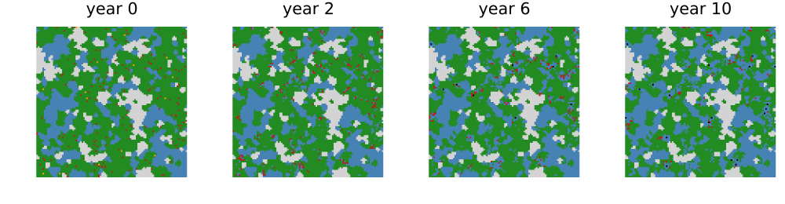
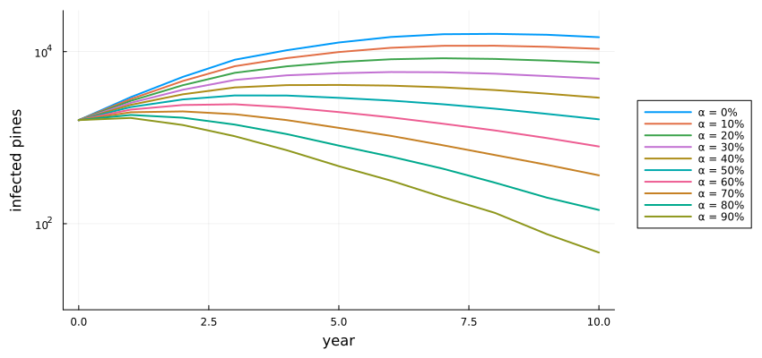
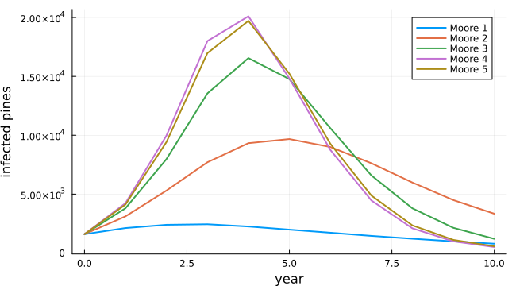

# Pine wilt disease and felling
Simon Frost

- [Overview](#overview)
- [The model](#the-model)
- [A stand-in forest](#a-stand-in-forest)
- [Felling rate](#felling-rate)
- [Neighbourhood size](#neighbourhood-size)
- [Deviations from the source](#deviations-from-the-source)

## Overview

Pine wilt disease is caused by the pine wood nematode, carried from tree
to tree by *Monochamus* beetles. It has killed pine forests across East
Asia since it arrived from North America. Huang et al.
([2012](#ref-Huang2012)) built PWD-CASim, a cellular automaton on a 10 m
raster of a forest in Zhejiang. They used it to ask how far the disease
reaches in a year and how much felling of symptomatic trees it takes to
contain it. This model is an **adaptation**. The source’s forest map is
not published, so a neutral landscape stands in for it. The source also
gives no rule for the death of unfelled trees.

``` julia
ENV["GKSwstype"] = "100"
using EcologicalCellularAutomata
using CellularAutomataCore
using Plots
using Random
using Statistics
```

## The model

Each cell is a 10 m pixel: non-forest, other forest, a healthy pine, an
infected pine (latent or symptomatic), or a dead pine. Each year a
healthy pine is infected with probability `Σₙ wₙ Cₙ / (8n)`, where `Cₙ`
counts the infected pines in the square ring at distance `n` and `wₙ`
are ring weights, capped at 1. Symptomatic pines are felled with
probability `α` a year and otherwise die after four years. The source’s
experiments infect pines directly, without a latent period.

``` julia
model = build(:pine_wilt_casim)
```

    CAModel pine_wilt_casim
      Huang et al. (2012) PWD-CASim, Moore 1, incubation false
      states:
        cover::Int8 = 2 ∈ 0:5  # 0 non-forest, 1 other forest, 2 healthy, 3 latent, 4 symptomatic, 5 dead pine
        years::Int8 = 0  # years latent or symptomatic
      parameters:
        α = 0.6  # felling rate of symptomatic pines per year
        p_latent = 0.8  # share of new infections that are latent (incubation)
        p_stay = 0.1  # probability a latent pine stays latent a year
        max_latent = 2  # longest latent period (years)
        max_symptomatic = 4  # years from symptoms to natural death
      rule: LocalRule(<anonymous function>, Offsets((-1, -1), (0, -1), (1, -1), (-1, 0), (1, 0), (-1, 1), (0, 1), (1, 1)))

The ring weights of the source’s Moore 1 to 5 neighbourhoods:

``` julia
[(moore=k, weights=pine_wilt_weights(k)) for k in 1:5]
```

    5-element Vector{@NamedTuple{moore::Int64, weights::Vector{Float64}}}:
     (moore = 1, weights = [1.0])
     (moore = 2, weights = [1.0, 0.8])
     (moore = 3, weights = [1.0, 0.8, 0.6])
     (moore = 4, weights = [1.0, 0.8, 0.6, 0.4])
     (moore = 5, weights = [1.0, 0.8, 0.5, 0.3, 0.1])

## A stand-in forest

The source used a forest map of Sizhoutou town, resampled to 10 m and
classified into pine, other forest and non-forest; it is not published.
A neutral landscape of 300 × 300 cells, 60% pine, stands in, with 1400
symptomatic and 200 latent pines placed at random:

``` julia
prob = problem(:pine_wilt_casim; seed=1)
sol = solve(prob; saveat=2)
forestmap(u, title) = heatmap(u.cover[1:100, 1:100]'; aspect_ratio=:equal, framestyle=:none,
                              colorbar=false, title, clims=(0, 5),
                              c=[:lightgray, :steelblue, :forestgreen, :orange, :firebrick,
                                 :black])
plot([forestmap(u, "year $t") for (t, u) in zip(sol.t[[1, 2, 4, 6]], sol.u[[1, 2, 4, 6]])]...;
     layout=(1, 4), size=(1000, 260))
```



A corner of 100 × 100 cells (1 km square). Grey is non-forest, blue
other forest, green healthy pine, red symptomatic pine and black dead
pine. Felled pines become other forest.

## Felling rate

The source’s Figure 4 varies the felling rate from 0 to 90% with the
Moore 1 neighbourhood. Five runs each here:

``` julia
rates = 0.0:0.1:0.9
curves = Dict(α => mean([pine_wilt_infected.(solve(problem(:pine_wilt_casim; seed=s,
                                                           pmap=(; α))).u)
                         for s in 1:5]) for α in rates)
plot(0:10, [curves[α] for α in rates]; lw=2, label=permutedims(["α = $(round(Int, 100α))%" for α in rates]),
     xlabel="year", ylabel="infected pines", legend=:outerright, size=(850, 400),
     yscale=:log10, ylims=(10, 3e4), left_margin=5Plots.mm, bottom_margin=5Plots.mm)
```



The source describes three regimes. Below 40% felling, infection grows
quickly. Between 50% and 70% it rises for a few years and then falls. At
80% and 90% it declines from the start. Here:

``` julia
[(felling=round(Int, 100α), peak=round(Int, maximum(curves[α])),
  peak_year=argmax(curves[α]) - 1, year_10=round(Int, curves[α][end])) for α in rates]
```

    10-element Vector{@NamedTuple{felling::Int64, peak::Int64, peak_year::Int64, year_10::Int64}}:
     (felling = 0, peak = 16083, peak_year = 8, year_10 = 14714)
     (felling = 10, peak = 11710, peak_year = 8, year_10 = 10776)
     (felling = 20, peak = 8372, peak_year = 7, year_10 = 7433)
     (felling = 30, peak = 5790, peak_year = 6, year_10 = 4841)
     (felling = 40, peak = 4098, peak_year = 5, year_10 = 2914)
     (felling = 50, peak = 3096, peak_year = 3, year_10 = 1634)
     (felling = 60, peak = 2443, peak_year = 3, year_10 = 790)
     (felling = 70, peak = 2019, peak_year = 2, year_10 = 365)
     (felling = 80, peak = 1836, peak_year = 1, year_10 = 144)
     (felling = 90, peak = 1695, peak_year = 1, year_10 = 46)

The regimes come out as in the source, with one difference. At 80% and
90% infection still rises for the first year before it falls, where the
source’s runs fall from the start. The magnitudes differ more: without
felling, the source’s infection peaks near 51 000 pines and this one
near 16 000. The source’s forest is larger and its pines more
continuous. The unfelled curve falls after year 8 only because infected
pines die after four years, which the source does not state.

## Neighbourhood size

The source’s Figure 3 compares the Moore 1 to 5 neighbourhoods at 60%
felling. It found little difference between Moore 1 and 3 and a jump at
Moore 4 (radius 40 m, a 9 × 9 window), which it read as the range of the
disease:

``` julia
moore = Dict(k => mean([pine_wilt_infected.(solve(problem(:pine_wilt_casim; seed=s,
                                                         moore=k)).u)
                        for s in 1:5]) for k in 1:5)
plot(0:10, [moore[k] for k in 1:5]; lw=2, label=permutedims(["Moore $k" for k in 1:5]),
     xlabel="year", ylabel="infected pines", size=(650, 360))
```



``` julia
[(moore=k, peak=round(Int, maximum(moore[k]))) for k in 1:5]
```

    5-element Vector{@NamedTuple{moore::Int64, peak::Int64}}:
     (moore = 1, peak = 2443)
     (moore = 2, peak = 9676)
     (moore = 3, peak = 16551)
     (moore = 4, peak = 20101)
     (moore = 5, peak = 19715)

Here the peak rises steadily from Moore 1 to Moore 4, and Moore 5 is
like Moore 4. There is no jump at Moore 4. Wider neighbourhoods add more
rings, whose weights sum to more than one, so the infection probability
saturates sooner wherever pines are infected around a tree. How far that
matters depends on how the pines are arranged, and the source’s map,
which may hold the explanation, is not available.

## Deviations from the source

``` julia
foreach(d -> println("- ", d), model_info(:pine_wilt_casim).deviations)
```

    - The source's forest map of Sizhoutou town is not published; a neutral landscape of 300 x 300 cells (60% pine) stands in, and any land cover matrix can be given.
    - The source gives no rule for natural death, although its unfelled runs decline; a symptomatic pine not felled dies after four years and becomes a non-infectious dead pine (a sixth state).
    - The 'no incubation' option used in all the source's experiments is not defined; with incubation = false new infections are symptomatic at once.
    - An infection probability above 1 (possible for Moore 2 and larger) is capped at 1.
    - Density-priority felling is not implemented: its threshold is not defined in the source and no experiment used it.
    - The source ran single runs; replicate runs and their spread are shown here.

```@raw html
<div id="refs" class="references csl-bib-body hanging-indent">
```

```@raw html
<div id="ref-Huang2012" class="csl-entry">
```

Huang, Mingxiang, Chaohui Yu, Dali Zhou, and Fang Bei. 2012. “A Cellular
Automata Model of Pine Wilt Disease Spread and Its Simulation Tool for
Application.” *Proceedings of the 2012 National Conference on
Information Technology and Computer Science*, Advances in intelligent
systems research, 974–78. <https://doi.org/10.2991/citcs.2012.248>.

```@raw html
</div>
```

```@raw html
</div>
```
