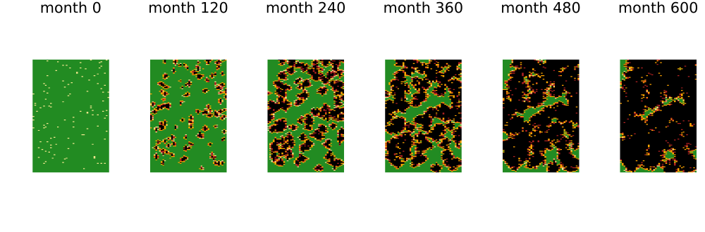

# Grapevine leafroll: roguing, testing and replanting
Simon Frost

- [Overview](#overview)
- [The model](#the-model)
- [The economics without disease](#the-economics-without-disease)
- [Spread without control](#spread-without-control)
- [Strategies](#strategies)
- [Choices the source leaves open](#choices-the-source-leaves-open)
- [Deviations from the source](#deviations-from-the-source)

## Overview

Grapevine leafroll disease is caused by viruses that mealybugs carry
from vine to vine along the trellis. An infected vine yields less and
worse fruit for the rest of its life. Infection stays invisible for a
year or more, so roguing symptomatic vines may come too late. Atallah et
al. ([2015](#ref-Atallah2015)) built a vine-level cellular automaton of
a vineyard with an economic layer. They compared eighteen strategies of
roguing, replanting and virus-testing by their expected net present
value (ENPV) over 50 years. Their finding is that testing the neighbours
of each symptomatic vine pays, by about 18%, while roguing alone does
not.

The journal article is behind a paywall, so this model follows Chapter 2
of the first author’s dissertation ([Atallah 2014](#ref-Atallah2014)),
which reports the same design and results. It is an **adaptation**. The
sources leave unstated when a symptomatic vine is found and what state
the first infections start in, and those choices move the results.

``` julia
ENV["GKSwstype"] = "100"
using EcologicalCellularAutomata
using CellularAutomataCore
using Plots
using Statistics
```

## The model

A 5.2-acre vineyard has 44 trellis rows of 130 vines. Each vine is
healthy, exposed but undetectable, exposed and detectable,
infective-moderate or infective-high, and has an age in months. Each
month:

- a healthy vine is infected at rate 4.2 per infective neighbour along
  its trellis row and 0.014 per infective neighbour in the next rows;
- an infected vine stays undetectable for 4 to 18 months (triangular,
  mode 12);
- an exposed-detectable vine becomes infective-moderate at a mean of 24,
  48 or 72 months for young, mature or old vines;
- infective-moderate becomes infective-high at a mean of 36 months.

A vine earns from 36 months of age: \$0.43 a month if healthy, less if
infected (30%, 50% or 75% less yield and 10% less in price). Roguing and
replanting costs \$7.25 and a virus test \$2.61, discounted at 0.9959 a
month.

``` julia
model = build(:grapevine_leafroll)
```

    CAModel grapevine_leafroll
      Atallah et al. (2015) grapevine leafroll, undetectable period as duration
      states:
        state::Int8 = 0 ∈ 0:4  # 0 H, 1 exposed-undetectable, 2 exposed-detectable, 3 infective-moderate, 4 infective-high
        age::Int16 = 0  # age (months)
        clock::Int16 = 0  # months left undetectable, or months infective
        rogued::Bool = false  # rogued and replanted this month
        tested::Bool = false  # virus-tested this month
      parameters:
        α = 4.2  # infection rate per infective neighbour along the trellis row (1/month)
        β = 0.014  # infection rate per infective neighbour across rows (1/month)
        eu_min = 4.0  # shortest undetectable period (months)
        eu_mode = 12.0  # commonest undetectable period (months)
        eu_max = 18.0  # longest undetectable period (months)
        L_young = 24.0  # mean latency of young vines (months)
        L_mature = 48.0  # mean latency of mature vines (months)
        L_old = 72.0  # mean latency of old vines (months)
        inf_period = 36.0  # mean time infective-moderate (months)
      rule: LocalRule(<anonymous function>, Offsets((-1, 0), (1, 0), (0, -1), (0, 1)))

## The economics without disease

Without disease the vineyard’s value is fixed. It is the check on the
age and time conventions:

``` julia
nodisease = grapevine_npv(solve(problem(:grapevine_leafroll; infected=0.0)))
round(nodisease / 1000; digits=1)
```

    462.7

That is the source’s \$463k.

## Spread without control

Two per cent of the vines start infected. Transmission along a trellis
row is almost certain within a month of a neighbour becoming infective,
and across rows it is rare. But a newly infected vine takes about three
years, on average, to become infective itself. That slows the spread
along a row to a few vines a decade, and over the same decades the rare
jumps across rows add up, so the patches grow in both directions:

``` julia
sol = solve(problem(:grapevine_leafroll; seed=2); saveat=120)
vinemap(u, title) = heatmap(u.state; c=[:forestgreen, :khaki, :orange, :firebrick, :black],
                            clims=(0, 4), colorbar=false, framestyle=:none, title,
                            aspect_ratio=0.5)
plot([vinemap(u, "month $t") for (t, u) in zip(sol.t, sol.u)]...; layout=(1, 6),
     size=(1000, 330))
```



Each column is a trellis row. Healthy vines are green, exposed vines
yellow (undetectable) or orange (detectable), and infective vines red
(moderate) or black (high).

The vineyard’s half-life is the time until half the vines are infected.
The source reports 188 months without control:

``` julia
halflives = [grapevine_half_life(solve(problem(:grapevine_leafroll; seed=s))) for s in 1:20]
(mean=mean(halflives), sd=round(std(halflives); digits=1))
```

    (mean = 235.2, sd = 6.2)

The disease is slower here, by about four years.

## Strategies

The source’s Table 2.5 gives the ENPV of each strategy over 1000 runs.
Twenty runs each here, for the main ones:

- `:none`: no control.
- `:I`, `:Ih`: rogue all infective, or only infective-high, vines.
- `:ImY`: rogue infective-moderate young vines.
- `:ImNS`, `:ImNSEW`: rogue each infective-moderate vine and test its
  two neighbours along the row (or all four neighbours), roguing those
  found exposed-detectable.
- `:ImNS2EW`: also test the second neighbours along the row.

``` julia
strategies = (:none, :I, :Ih, :ImY, :ImNS, :ImNSEW, :ImNS2EW)
source = Dict(:none => 316, :I => -147, :Ih => 284, :ImY => 314, :ImNS => 374,
              :ImNSEW => 374, :ImNS2EW => 309)
enpv(strategy; runs=20, kw...) = [grapevine_npv(solve(problem(:grapevine_leafroll; strategy,
                                                              seed=s, kw...)))
                                  for s in 1:runs] ./ 1000
results = Dict(st => enpv(st) for st in strategies)
[(strategy=st, model=round(mean(results[st])), sd=round(std(results[st]); digits=1),
  source=source[st]) for st in strategies]
```

    7-element Vector{@NamedTuple{strategy::Symbol, model::Float64, sd::Float64, source::Int64}}:
     (strategy = :none, model = 340.0, sd = 3.2, source = 316)
     (strategy = :I, model = 382.0, sd = 3.4, source = -147)
     (strategy = :Ih, model = 330.0, sd = 3.8, source = 284)
     (strategy = :ImY, model = 348.0, sd = 3.0, source = 314)
     (strategy = :ImNS, model = 382.0, sd = 4.8, source = 374)
     (strategy = :ImNSEW, model = 382.0, sd = 5.0, source = 374)
     (strategy = :ImNS2EW, model = 382.0, sd = 4.3, source = 309)

Testing the neighbours along the row comes out as in the source: about
\$382k against \$374k, a gain over no control. Roguing infective-high
vines alone loses value, as in the source. Several results differ:

- With the slower epidemic, no control is worth more than in the source.
- Testing the second neighbours along the row is worth as much as
  testing the first, where the source finds it costs more than it saves.
- Roguing young symptomatic vines gains a little, where the source finds
  it loses a little.
- Roguing every infective vine, which the source finds ruinous at
  −\$147k, is as good here as the spatial strategies.

## Choices the source leaves open

The source does not say when a symptomatic vine is found and rogued. By
default it is rogued after it has been infective for one month, so it
infects its row neighbours first (`delay = 1`). With `delay = 0` it is
rogued as soon as it shows symptoms, and the spatial strategies look
much better than they do in the source:

``` julia
[(strategy=st, delay_0=round(mean(enpv(st; runs=10, delay=0))),
  delay_1=round(mean(results[st]))) for st in (:none, :I, :ImNS)]
```

    3-element Vector{@NamedTuple{strategy::Symbol, delay_0::Float64, delay_1::Float64}}:
     (strategy = :none, delay_0 = 339.0, delay_1 = 340.0)
     (strategy = :I, delay_0 = 457.0, delay_1 = 382.0)
     (strategy = :ImNS, delay_0 = 443.0, delay_1 = 382.0)

The first infections are “exposed” in the source, which does not say
whether they can be detected. Starting them infective (`initial = :Im`)
brings the half-life and the no-control value close to the source’s (188
months and \$316k). But testing neighbours then gains much less than in
the source:

``` julia
hl_im = [grapevine_half_life(solve(problem(:grapevine_leafroll; initial=:Im, seed=s)))
         for s in 1:20]
(half_life=mean(hl_im),
 none=round(mean(enpv(:none; runs=10, initial=:Im))),
 ImNS=round(mean(enpv(:ImNS; runs=10, initial=:Im))))
```

    (half_life = 186.7, none = 307.0, ImNS = 321.0)

No reading tried reproduces every row of the source’s table. Most of
all, none makes roguing every infective vine as costly as it is in the
source.

## Deviations from the source

``` julia
foreach(d -> println("- ", d), model_info(:grapevine_leafroll).deviations)
```

    - The journal article was not read (paywalled); the model follows Chapter 2 of the first author's dissertation (Atallah 2014), whose abstract-level results match the article's.
    - The undetectable period is written in the source as a cumulative probability of time in the state; by default it is drawn as a triangular duration (4, 12, 18 months, rounded up) when a vine is infected, and undetectable = :cdf applies the source's formula as a monthly probability.
    - The initial infections start exposed-undetectable; the source says only 'exposed'. With this start the epidemic is slower than the source's (half-life about 234 months against 188); starting them infective (initial = :Im) matches the source's half-life and no-control value but not its spatial strategies.
    - The source does not say when a symptomatic vine is found; by default it is rogued after it has been infective for a month (delay = 1), so it infects its neighbours first. This reproduces the source's spatial strategies (about $380k against $374k). No reading tried reproduces the source's large losses from roguing every infective vine (strategy I, about -$147k in the source).
    - The order within a month is not stated: revenue is earned on the state at the start of the month, then the disease steps, then management acts on the new state and its costs are charged that month.
    - A replant is not rogued before it is 36 months old (the source's constraint that a replant is never rogued before it bears fruit); protect_replants = false lifts this.
    - Each neighbour of a triggering vine is tested at most once a month; vines already infective are not tested.
    - Vines are productive from 36 months; the source's revenue table leaves 37 to 47 months undefined. This reproduces its no-disease value.
    - The two-vineyard extension of the source's Chapter 3 is not implemented: its long-distance dispersal equations are inconsistent.

```@raw html
<div id="refs" class="references csl-bib-body hanging-indent">
```

```@raw html
<div id="ref-Atallah2014" class="csl-entry">
```

Atallah, Shady S. 2014. “Plant-Level, Spatial, Bioeconomic Models of
Plant Disease Diffusion and Control: Grapevine Leafroll Disease.” PhD
thesis, Cornell University. <https://hdl.handle.net/1813/38920>.

```@raw html
</div>
```

```@raw html
<div id="ref-Atallah2015" class="csl-entry">
```

Atallah, Shady S., Miguel I. Gómez, Jon M. Conrad, and Jan P. Nyrop.
2015. “A Plant-Level, Spatial, Bioeconomic Model of Plant Disease
Diffusion and Control: Grapevine Leafroll Disease.” *American Journal of
Agricultural Economics* 97 (1): 199–218.
<https://doi.org/10.1093/ajae/aau032>.

```@raw html
</div>
```

```@raw html
</div>
```
