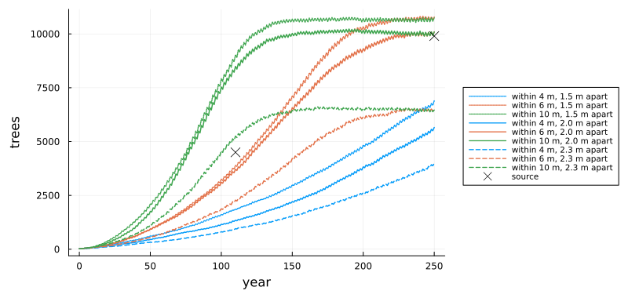
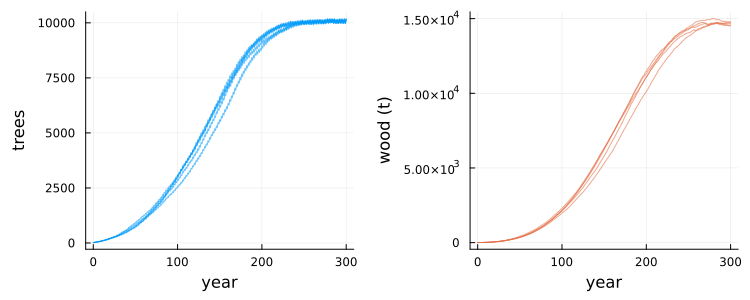
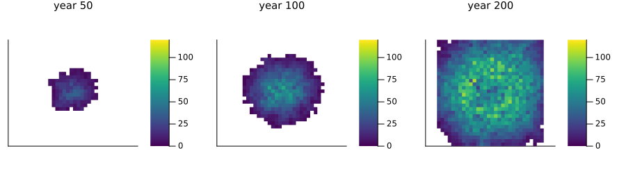
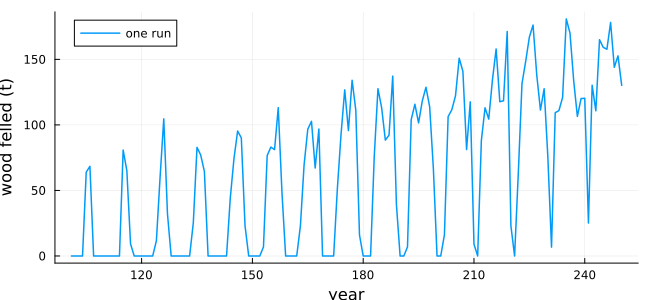
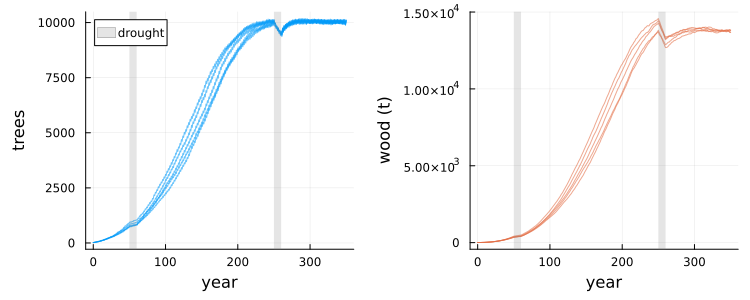
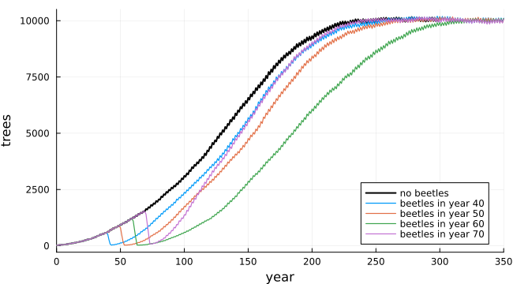

# Bark beetles in a spruce forest
Simon Frost

- [Overview](#overview)
- [The model](#the-model)
- [Calibrating the saplings](#calibrating-the-saplings)
- [The forest without disturbance](#the-forest-without-disturbance)
- [Contaminated ground](#contaminated-ground)
- [Strip harvest](#strip-harvest)
- [Drought](#drought)
- [Bark beetles](#bark-beetles)
- [Deviations from the source](#deviations-from-the-source)

## Overview

Königswieser and Jahn ([2020](#ref-Konigswieser2020)) grew a spruce
forest on a grid of square metres, each holding at most one tree, from a
handful of trees to a forest of 9 ha. Trees age, gain wood, die, and
drop saplings near them, more readily when they have a few neighbours
than when they have none or many. The authors used the forest to ask
what contaminated ground, strip harvests, droughts and bark beetles do
to it. Their main finding concerns the beetles: brought into a young
forest, they either die out at once or wipe out nearly all of it, and
the forest then takes well over a century to recover.

This implementation is an **adaptation**. The source gives most of its
rules with numbers but not how far saplings land, how close to other
trees they may grow, the order of events within a year, or exactly how
beetles are shared among trees. These are chosen below, and the first
two are calibrated to the source’s growth curve.

``` julia
ENV["GKSwstype"] = "100"
using EcologicalCellularAutomata
using CellularAutomataCore
using Plots
using Statistics
```

## The model

Each cell holds at most one tree, with an age, a dry wood mass and a
number of bark beetles. Each year:

- Within every cell (the model’s rule), a tree ages a year and gains 28
  kg of wood until it is 70, then 14 kg until it is 140, approaching the
  source’s “approximately 3000 kg”. It dies with probability 0.05 while
  it is at most 3 years old, 0.01 until 150, and 0.2 after that.
- Beetles on a tree multiply tenfold, three times a year, and each time
  the same number is shared equally among the other trees within 10 m. A
  tree carrying 200 beetles or more at the end of the year dies, and its
  beetles with it.
- Every other year each tree drops a sapling, with a probability that
  depends on its neighbours `n` within 10 m: none with no neighbours (no
  pollination), 1/2 with 1 to 3, certainly with 4 to 9, 1/2 with 10 to
  50, and none with more (no room). The sapling lands in a random cell
  within 6 m and takes root if no tree stands within 2 m of it and at
  most 50 within 10 m.

Beetles, spreading and harvest act tree by tree, each depending on what
was done before it, so they are a callback stored with the problem. The
forest starts from 20 trees aged 10, within 20 m of the centre of a 300
× 300 grid.

``` julia
prob = problem(:bark_beetle_forest; seed=1)
keys(prob.u0), prob.tspan
```

    ((:tree, :age, :mass, :beetles, :fate, :contaminated), (0, 300))

The state at time `t` is the forest at the end of year `t`. We record
the standing trees, their wood in tonnes, the wood felled and the trees
infested each year:

``` julia
function forest(prob; maps=())
    integ = init(prob; save_everystep=false, save_start=false)
    rows = [bark_beetle_counts(integ.u)]
    snapshots = Dict{Int,Matrix{Int}}()
    while integ.t < prob.tspan[2]
        step!(integ)
        push!(rows, bark_beetle_counts(integ.u))
        integ.t in maps && (snapshots[integ.t] = Int.(integ.u.age) .* integ.u.tree)
    end
    return rows, snapshots
end
runs(n; kwargs...) =
    fetch.([Threads.@spawn first(forest(problem(:bark_beetle_forest; seed=s, kwargs...)))
            for s in 1:n])
column(rs, k) = reduce(hcat, [getfield.(r, k) for r in rs])
```

    column (generic function with 1 method)

## Calibrating the saplings

The source says only that saplings land “in a certain radius” and “not
too close to other trees”, and that its authors tuned the radii by
experiment. Its forest grows along an S-shaped curve: about 4000 to 5000
trees after 100 to 120 years, and about 9900 (1100 a hectare) from year
250. How far saplings land sets how fast the forest spreads; how close
they may grow, with the limit of 50 neighbours, sets how dense it
becomes:

``` julia
sweep = [(r, d) for d in (1.5, 2.0, 2.3) for r in (4, 6, 10)]
curves = fetch.([Threads.@spawn getfield.(first(forest(problem(:bark_beetle_forest; seed=1,
                     years=250, pmap=(sapling_radius=r, spacing=d)))), :trees)
                 for (r, d) in sweep])
plot(0:250, reduce(hcat, curves); lw=1.5, xlabel="year", ylabel="trees",
     label=permutedims(["within $r m, $d m apart" for (r, d) in sweep]),
     color=permutedims(repeat([1, 2, 3], 3)),
     ls=permutedims(repeat([:dot, :solid, :dash]; inner=3)),
     legend=:outerright, legendfontsize=7, size=(800, 380), left_margin=5Plots.mm,
     bottom_margin=5Plots.mm)
scatter!([110, 250], [4500, 9900]; color=:black, marker=:x, ms=6, label="source")
```



Saplings landing within 6 m and kept 2 m from other trees (the defaults)
follow the source’s curve; 1.5 m (no tree in the eight cells around)
lets the forest grow too dense, and 2.3 m keeps it far too sparse.

## The forest without disturbance

Five runs of 300 years, as in the source:

``` julia
base = runs(5; years=300)
trees, wood = column(base, :trees), column(base, :mass)
p1 = plot(0:300, trees; color=1, alpha=0.6, label="", xlabel="year", ylabel="trees")
p2 = plot(0:300, wood; color=2, alpha=0.6, label="", xlabel="year", ylabel="wood (t)")
plot(p1, p2; layout=(1, 2), size=(750, 300), left_margin=5Plots.mm, bottom_margin=5Plots.mm)
```



``` julia
(trees_250=round(Int, mean(trees[251, :])), trees_300=round(Int, mean(trees[301, :])),
 wood_250=round(Int, mean(wood[251, :])),
 growth=round(mean(bark_beetle_growth_rate(wood[:, k]) for k in 1:5); digits=2))
```

    (trees_250 = 10073, trees_300 = 10157, wood_250 = 14172, growth = 2.31)

The tree count matches the source’s: about 10 100 trees from year 250,
against its 9900 to 9700. The wood does not. The source’s forest carries
about 21 000 t at year 240, 2.1 t a tree, and grows by 2.67% a year
between years 50 and 200; here it carries about 14 200 t, 1.4 t a tree,
and grows by 2.3%. With the stated mortality, a forest in which young
trees keep replacing old ones averages 1.4 t a tree. Heavier trees need
a forest of older trees than the source’s rules, as written, produce.

``` julia
_, snaps = forest(problem(:bark_beetle_forest; seed=1, years=200); maps=(50, 100, 200))
function block_age(a; b=10)
    m = fill(NaN, size(a) .÷ b)
    for I in CartesianIndices(m)
        block = a[((I[1] - 1) * b + 1):(I[1] * b), ((I[2] - 1) * b + 1):(I[2] * b)]
        any(>(0), block) && (m[I] = mean(filter(>(0), block)))
    end
    return m
end
plot([heatmap(block_age(snaps[y]); aspect_ratio=1, c=:viridis, clims=(0, 120),
              xticks=false, yticks=false, title="year $y", titlefontsize=10,
              colorbar=true) for y in (50, 100, 200)]...;
     layout=(1, 3), size=(900, 260))
```



Each square is the mean age of the trees in a 10 × 10 m block, blank
where there are none. The forest spreads outwards from the centre, with
its youngest trees at the edge.

## Contaminated ground

In the source’s second scenario, trees older than 3 die on a
contaminated patch of 30 × 60 m off the centre. Five runs:

``` julia
contam = runs(5; years=300, contamination=true)
(trees_150=round.(Int, (mean(trees[151, :]), mean(column(contam, :trees)[151, :]))),
 trees_300=round.(Int, (mean(trees[301, :]), mean(column(contam, :trees)[301, :]))),
 wood_300=round.(Int, (mean(wood[301, :]), mean(column(contam, :mass)[301, :]))))
```

    (trees_150 = (6311, 5484), trees_300 = (10157, 9940), wood_300 = (14665, 14489))

Each pair is without and with contamination. As in the source, the patch
slows the forest’s spread from the centre and leaves it with slightly
fewer trees and less wood.

## Strip harvest

From year 101 to 250, the forest is cut in ten strips of 30 m, one a
year in turn, felling every tree older than 90:

``` julia
harv = runs(5; years=250, harvest=true)
felled = column(harv, :felled)
plot(101:250, felled[102:251, 1]; lw=1.5, xlabel="year", ylabel="wood felled (t)",
     label="one run", size=(650, 300))
```



``` julia
(mean_101_250=round(mean(felled[102:251, :]); digits=1),
 mean_196_250=round(mean(felled[197:251, :]); digits=1))
```

    (mean_101_250 = 61.7, mean_196_250 = 105.6)

The yield follows the ten-year cycle of the strips and grows as the
forest fills, as in the source. It is about half the source’s (116.1 t a
year over the 150 years, 188.3 t once the forest is full), as its trees
carry more wood.

## Drought

Droughts of ten years start after years 50 and 250. In a drought,
mortality is 1.2 times its usual value, trees grow half as fast, and
saplings are half as likely. Five runs of 350 years:

``` julia
dry = runs(5; years=350, droughts=(50, 250))
dt, dw = column(dry, :trees), column(dry, :mass)
p1 = plot(0:350, dt; color=1, alpha=0.6, label="", xlabel="year", ylabel="trees")
vspan!(p1, [50, 60, 250, 260]; color=:gray, alpha=0.2, label="drought")
p2 = plot(0:350, dw; color=2, alpha=0.6, label="", xlabel="year", ylabel="wood (t)")
vspan!(p2, [50, 60, 250, 260]; color=:gray, alpha=0.2, label="")
plot(p1, p2; layout=(1, 2), size=(750, 300), left_margin=5Plots.mm, bottom_margin=5Plots.mm)
```



``` julia
change(x, a, b) = round(100 * (mean(x[b + 1, :]) / mean(x[a + 1, :]) - 1); digits=1)
(trees_250_to_260=change(dt, 250, 260), wood_250_to_260=change(dw, 250, 260),
 wood_250_to_350=change(dw, 250, 350))
```

    (trees_250_to_260 = -5.3, wood_250_to_260 = -7.6, wood_250_to_350 = -2.8)

These are percentage changes. As in the source, the early drought hardly
matters, while the later one costs the full forest trees and wood: here
5% of the trees and 8% of the wood, against about 9% and 12% in the
source. The trees return within a few years, as saplings fill the gaps,
but the wood is still 3% short a century later, as the source’s takes
more than a century to recover.

## Bark beetles

The source brings 2000 beetles into a 20 × 20 m patch off the centre
(100 draws of 20 beetles on the trees standing there) in a year between
30 and 70, and follows the forest for 350 years. Three runs for each
year:

``` julia
years_in = 30:5:70
outbreaks = Dict(y => runs(3; years=350, infestation=y) for y in years_in)
summary = [(year=y, run=k, before=r[y + 1].trees,
            after=minimum(getfield.(r[(y + 1):(y + 20)], :trees)),
            last=something(findlast(x -> x.infested > 0, r), 0) - 1, at250=r[251].trees)
           for y in years_in for (k, r) in enumerate(outbreaks[y])]
foreach(println, summary)
```

    (year = 30, run = 1, before = 308, after = 41, last = 31, at250 = 10100)
    (year = 30, run = 2, before = 348, after = 344, last = -1, at250 = 10064)
    (year = 30, run = 3, before = 375, after = 368, last = -1, at250 = 10075)
    (year = 35, run = 1, before = 396, after = 6, last = 37, at250 = 9848)
    (year = 35, run = 2, before = 414, after = 414, last = -1, at250 = 10064)
    (year = 35, run = 3, before = 362, after = 11, last = 37, at250 = 9197)
    (year = 40, run = 1, before = 526, after = 29, last = 42, at250 = 9997)
    (year = 40, run = 2, before = 547, after = 536, last = -1, at250 = 10064)
    (year = 40, run = 3, before = 491, after = 39, last = 42, at250 = 10063)
    (year = 45, run = 1, before = 626, after = 46, last = 47, at250 = 10054)
    (year = 45, run = 2, before = 609, after = 609, last = -1, at250 = 10064)
    (year = 45, run = 3, before = 536, after = 41, last = 47, at250 = 10037)
    (year = 50, run = 1, before = 811, after = 29, last = 53, at250 = 9890)
    (year = 50, run = 2, before = 696, after = 684, last = -1, at250 = 10106)
    (year = 50, run = 3, before = 675, after = 42, last = 52, at250 = 10031)
    (year = 55, run = 1, before = 885, after = 47, last = 57, at250 = 10057)
    (year = 55, run = 2, before = 757, after = 38, last = 57, at250 = 9820)
    (year = 55, run = 3, before = 744, after = 61, last = 57, at250 = 9955)
    (year = 60, run = 1, before = 1103, after = 28, last = 63, at250 = 8698)
    (year = 60, run = 2, before = 923, after = 22, last = 62, at250 = 10123)
    (year = 60, run = 3, before = 927, after = 50, last = 63, at250 = 9956)
    (year = 65, run = 1, before = 1202, after = 46, last = 68, at250 = 9707)
    (year = 65, run = 2, before = 1027, after = 74, last = 67, at250 = 10069)
    (year = 65, run = 3, before = 991, after = 40, last = 69, at250 = 9934)
    (year = 70, run = 1, before = 1407, after = 79, last = 73, at250 = 10107)
    (year = 70, run = 2, before = 1228, after = 23, last = 73, at250 = 9521)
    (year = 70, run = 3, before = 1209, after = 46, last = 73, at250 = 9731)

`before` is the forest when the beetles arrive, `after` its smallest
size in the next 20 years, `last` the last year with beetles (−1 if they
found no tree), and `at250` the forest at year 250. Where beetles find
trees, they kill nearly all of the young forest within two to four
years, leaving at most about 80 trees, and then die out, having no trees
left within reach. The survivors regrow it, about as many trees by year
250 as without beetles in most runs. Whether beetles find trees in their
patch depends on how far the forest has spread by then: in some runs it
reaches the patch before year 40, the source’s first outbreak, and in
others not until year 55.

``` julia
plot(0:300, trees[:, 1]; color=:black, lw=2, label="no beetles", xlims=(0, 350))
for (k, y) in enumerate((40, 50, 60, 70))
    plot!(0:350, getfield.(outbreaks[y][1], :trees); color=k, lw=1.2,
          label="beetles in year $y")
end
plot!(xlabel="year", ylabel="trees", legend=:bottomright, size=(650, 360))
```



Each outbreak sets the forest back by one to four decades, depending
less on when the beetles arrive than on how many trees survive them. The
source’s outbreaks set it back by about ten to thirty years. The source
also finds that the forest overshoots about 200 years after an outbreak,
as the cohort that regrew, being of one age, passes 150 and dies off
together. Regrown here from tens of scattered trees over decades, the
forest is not of one age, and shows no overshoot.

How beetles move determines this. When they kill every tree they reach
in a year, they die with it; they persist only where they are spread
thinly over many neighbours, leaving some trees below 200 at the end of
the year. In the source’s words, “the outbreak only occurs if the trees
have enough neighbors”.

## Deviations from the source

``` julia
foreach(d -> println("- ", d), model_info(:bark_beetle_forest).deviations)
```

    - The source does not say how far saplings land or how close to other trees they may grow; a sapling lands in a random cell of the 13 x 13 m square around its parent and takes root only if no tree stands within 2 m of it. These values were calibrated to the source's growth curve.
    - A sapling also takes root only if at most 50 trees stand within 10 m of its site, reading the source's 'checks afterwards, depending on neighbor count, if this sapling can be planted'. Without this limit the forest settles at about 10,400 trees rather than 10,100.
    - Neighbours are counted in squares (the source's 'radius' around a tree, whose boundaries() returns a search area), and saplings have age 0 and no wood; the source does not state either.
    - The spreading classes overlap in the source (3 and 10 neighbours fall in two classes); they are read as 1-3, 4-9 and 10-50 neighbours.
    - The order of events within a year is not stated. Felled and beetle-killed trees are removed at the start of the next year, then trees age, grow and die by age; harvest, infestation and the beetles' spread follow, and spreading comes last, so trees felled or killed that year still drop saplings. With spreading first, outbreaks nearly always kill every tree, and the forest rarely recovers.
    - Beetles are whole: each neighbour's share is rounded down (whole_beetles = false keeps fractions). The three spreads of a year are each applied to all infested trees at once, and an infested tree keeps its multiplied beetles while the same number is shared out.
    - The wood falls short of the source's: about 14,200 t at year 250 (1.4 t a tree) against about 21,000 t (2.1 t a tree), and a growth rate of 2.3% a year against 2.67% between years 50 and 200. Harvests are correspondingly about half the source's (62 against 116.1 t a year over the 150 years). With the stated mortality, a forest in which young trees keep replacing old ones averages 1.4 t a tree.
    - Drought multiplies mortality by 1.2 (the source's 'increased mortality rate of 20%'); adding 0.2 instead would kill most of the forest in ten years, which the source does not show. The late drought costs 5% of the trees and 8% of the wood here, against about 9% and 12% in the source, and the trees recover within a few years rather than a century.
    - The contaminated patch (rows 90-120, columns 120-180) and the beetles' patch (rows and columns 100-120) are read from the source's figures; trees die on contaminated ground when older than 3 years (the source also says 'after two years').
    - Whether beetles find trees in their patch depends on how far the forest has spread: their first outbreak comes before year 40 in some runs and after year 50 in others, against year 40 in the source. Outbreaks leave tens of survivors, and in a few runs too few to regrow the forest.

```@raw html
<div id="refs" class="references csl-bib-body hanging-indent">
```

```@raw html
<div id="ref-Konigswieser2020" class="csl-entry">
```

Königswieser, C., and A. Jahn. 2020. “MATLAB-Based Modelling and
Simulation of Forest Development: Growth – Harvesting – Draught – Bark
Beetle – Biomass Plant Usage.” *SNE Simulation Notes Europe* 30 (2):
77–84. <https://doi.org/10.11128/sne.30.stn.10517>.

```@raw html
</div>
```

```@raw html
</div>
```
