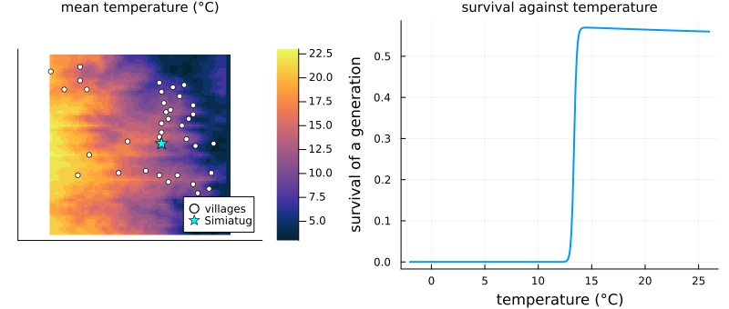
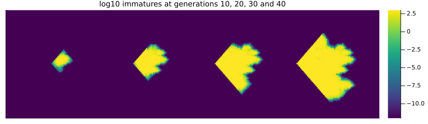
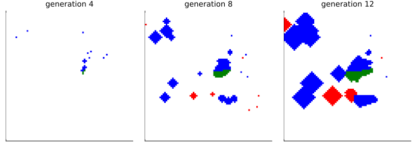
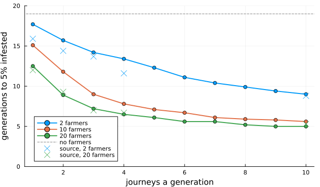
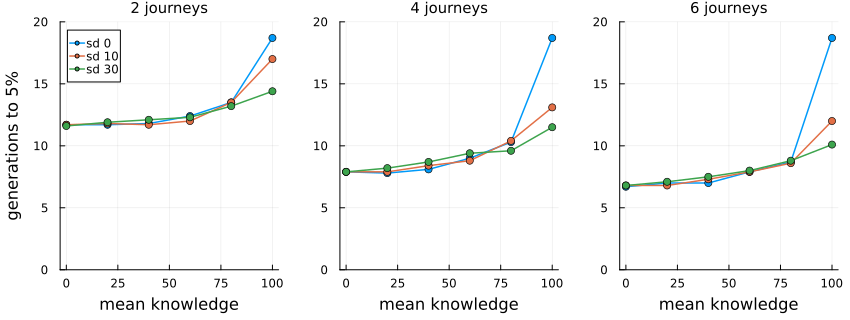

# Potato moths and farmers
Simon Frost

- [Overview](#overview)
- [The valley](#the-valley)
- [The moths alone](#the-moths-alone)
- [Farmers carrying moths](#farmers-carrying-moths)
- [Journeys and farmers](#journeys-and-farmers)
- [Where carriers go](#where-carriers-go)
- [Pest control knowledge](#pest-control-knowledge)
- [Deviations from the source](#deviations-from-the-source)

## Overview

The Guatemalan potato tuber moth, *Tecia solanivora*, reached Ecuador in
1996 and spread through the Andes. Its larvae feed in potato tubers, and
farmers move it over long distances in the sacks of seed potatoes they
buy and carry between villages. Rebaudo et al.
([2011](#ref-Rebaudo2011)) coupled a cellular automaton of the moth in
the Simiatug valley to farmer agents, and asked how farmers’ travel and
their knowledge of pest control speed its invasion. They used the model
in workshops with the farmers themselves.

This implementation is a **reproduction** of the model the authors
published as NetLogo code, with its landscape. That code is a simplified
version of the model their article describes, and the two differ in
several rules, listed at the end. One detail matters for the comparisons
below: the article measures invasion speed as the generations until 5%
of the cells are infested, but does not say what makes a cell infested.

``` julia
ENV["GKSwstype"] = "100"
using EcologicalCellularAutomata
using CellularAutomataCore
using Plots
using Statistics
```

## The valley

The landscape is 80 × 80 cells of 500 m, with 37 village cells.
Simiatug, where the moths start, is the largest (the code gives it 3000
people and every other village 500, figures its authors call invented):

``` julia
land = potato_moth_landscape()
villages = findall(>(0), land.population)
p1 = heatmap(permutedims(land.temperature); c=:thermal, aspect_ratio=1,
             title="mean temperature (°C)", titlefontsize=10, xticks=false, yticks=false)
scatter!(p1, [I[1] for I in villages], [I[2] for I in villages]; color=:white, ms=3,
         label="villages")
scatter!(p1, [50], [41]; color=:cyan, marker=:star5, ms=7, label="Simiatug")
p2 = plot(-2:0.1:26, t -> potato_moth_survival(t, defaults(build(:potato_moth_farmers)));
          xlabel="temperature (°C)", ylabel="survival of a generation", label="",
          lw=2, title="survival against temperature", titlefontsize=10)
plot(p1, p2; layout=(1, 2), size=(800, 340), left_margin=3Plots.mm, bottom_margin=3Plots.mm)
```



Moths survive a generation only above about 13 °C, so the cold heights
of the valley, and Simiatug itself at 12 °C, hold almost none.

## The moths alone

Each generation, a share of the immatures dies, half of the survivors
are gravid females, farmers kill 10% of these, 30% of them fly to the
four neighbouring cells, and those in a cell lay the next generation’s
immatures, up to a ceiling of 1000. Without farmers the moths spread
only by flight:

``` julia
alone = solve(problem(:potato_moth_farmers; farmers=0, generations=40); saveat=10)
heatmap(hcat([permutedims(log10.(u.immature .+ 1e-12)) for u in alone.u[2:end]]...);
        c=:viridis, clims=(-12, 3), xticks=false, yticks=false, size=(860, 250),
        title="log10 immatures at generations 10, 20, 30 and 40", titlefontsize=10)
```



The moths spread a cell a generation, and build up only where it is
warm. Every cell they reach keeps some moths, however few, so what
counts as infested decides how soon 5% of the valley is:

``` julia
baseline = problem(:potato_moth_farmers; farmers=0)
[(threshold=h, generations=potato_moth_invasion_time(baseline; threshold=h))
 for h in (0, 1e-6, 0.01, 1, 10)]
```

    5-element Vector{NamedTuple{(:threshold, :generations)}}:
     (threshold = 0, generations = 13)
     (threshold = 1.0e-6, generations = 17)
     (threshold = 0.01, generations = 18)
     (threshold = 1, generations = 19)
     (threshold = 10, generations = 19)

Counting any moths, as the code’s stopping rule does, takes 13
generations; counting a cell from one immature, 19. The article’s
baseline is about 16.

## Farmers carrying moths

Each generation the farmers make several journeys between villages. A
farmer at a cell with moths buys infested seed potatoes unless its pest
control knowledge protects it; a farmer carrying moths leaves 90
immatures in any cell without them. In the code every farmer buys
infested potatoes. Half the farmers are a red team, half a blue one, and
a cell keeps the colour of whoever first brought it moths:

``` julia
prob = problem(:potato_moth_farmers; farmers=10, moves=4, seed=2, generations=12)
run = solve(prob; saveat=4)
colours = cgrad([:white, :green, :red, :blue], 4; categorical=true)
plot([heatmap(permutedims(u.source .* (u.immature .> 1)); c=colours, clims=(0, 3),
              aspect_ratio=1, colorbar=false, xticks=false, yticks=false,
              title="generation $(Int(t))", titlefontsize=10)
      for (t, u) in zip(run.t[2:end], run.u[2:end])]...; layout=(1, 3), size=(820, 290))
```



Cells with more than one immature, coloured by where their moths came
from: flight from the first infestation (green) or a farmer of either
team. Farmers plant new foci across the warm part of the valley, which
then grow and merge.

``` julia
potato_moth_counts.(run.u)
```

    4-element Vector{@NamedTuple{infested::Int64, biological::Int64, red::Int64, blue::Int64, carriers::Int64}}:
     (infested = 1, biological = 1, red = 0, blue = 0, carriers = 0)
     (infested = 65, biological = 39, red = 0, blue = 26, carriers = 5)
     (infested = 576, biological = 115, red = 25, blue = 441, carriers = 10)
     (infested = 1582, biological = 201, red = 208, blue = 1185, carriers = 10)

## Journeys and farmers

The article’s Fig. 3 gives the generations to 5% infested for 1 to 10
journeys a generation and 2 to 20 farmers. Ten runs each, counting a
cell infested from one immature:

``` julia
speed(; runs=10, threshold=1, kwargs...) =
    mean(fetch.([Threads.@spawn potato_moth_invasion_time(
                     problem(:potato_moth_farmers; seed=s, kwargs...); threshold)
                 for s in 1:runs]))
moves = 1:10
crowds = (2, 10, 20)
grid = [speed(; farmers=n, moves=m) for m in moves, n in crowds]
plot(moves, grid; marker=:circle, lw=2, label=permutedims(["$n farmers" for n in crowds]),
     xlabel="journeys a generation", ylabel="generations to 5% infested",
     ylims=(0, 20), size=(650, 380))
hline!([19]; color=:gray, ls=:dash, label="no farmers")
scatter!([1, 2, 3, 4, 10], [15.9, 14.4, 13.7, 11.6, 8.8]; color=1, marker=:x, ms=6,
         label="source, 2 farmers")
scatter!([1, 2, 3, 4, 10], [12.0, 9.3, 7.0, 6.7, 5.3]; color=3, marker=:x, ms=6,
         label="source, 20 farmers")
```



The crosses are read from the article’s Fig. 3. As there, farmers speed
the invasion most over the first few journeys, after which more journeys
change little, and more farmers speed it further. With 20 farmers the
times agree with the article’s at every number of journeys, and with 2
farmers at 10 journeys. With 2 farmers making fewer journeys they are
half a generation to two generations longer, as the spread by flight
alone is three (19 generations against the article’s 16): the article’s
moths spread faster on their own.

With 10 farmers making 4 journeys, the article’s intermediate case, the
invasion is more than twice as fast as by flight alone, as the article
finds:

``` julia
(farmers_10_moves_4=grid[4, 2], no_farmers=19)
```

    (farmers_10_moves_4 = 7.8, no_farmers = 19)

## Where carriers go

The code sends a farmer at a cell with moths to the village that
minimises its population times its distance: in effect the nearest small
village. The article’s Fig. 4 counts the villages visited by farmers
carrying moths, and finds nearly all visits at Simiatug and the village
nearest it (about 0.46 and 0.41). Here, over 20 generations of ten runs
with 10 farmers making 4 journeys, counting where carriers stand at the
end of each generation:

``` julia
function stops(; runs=10, generations=20)
    visits = zeros(Int, 80, 80)
    for s in 1:runs
        integ = init(problem(:potato_moth_farmers; farmers=10, moves=4, seed=s,
                             generations); save_everystep=false)
        for _ in 1:generations
            step!(integ)
            for I in eachindex(integ.u.carriers)
                visits[I] += count_ones(integ.u.carriers[I])
            end
        end
    end
    return visits
end
visits = stops()
shares = sort([(village=land.village[I], cell=Tuple(I),
                share=round(visits[I] / sum(visits); digits=3)) for I in villages];
              by=x -> -x.share)
(simiatug=only(filter(x -> x.cell == (50, 41), shares)).share, most_visited=first(shares, 4))
```

    (simiatug = 0.007, most_visited = [(village = 23, cell = (54, 56), share = 0.062), (village = 15, cell = (49, 44), share = 0.06), (village = 22, cell = (52, 55), share = 0.059), (village = 20, cell = (62, 52), share = 0.058)])

This does not reproduce the article’s figure. The visits spread over
many villages, none taking more than about 6%; Simiatug, in the cold
where moths barely survive, takes little. As the moths spread, carriers
stand in cells with moths throughout the warm part of the valley, and
the nearest-village rule sends them back and forth between neighbouring
villages everywhere. The article does not give the settings of its Fig.
4, and may have counted its visits early in a run, before the moths had
spread.

## Pest control knowledge

The article’s Fig. 5 varies the farmers’ pest control knowledge: its
mean from 0 to 100 and its spread (standard deviation) from 0 to 30,
with 2, 4 or 6 journeys. The code has no such option: every farmer buys
infested potatoes. Here knowledge is drawn from a normal distribution,
kept within 0 and 100, and a farmer buys infested potatoes with
probability `1 - knowledge/100`. The article gives no rule, and does not
say how many farmers it used; we use 10.

``` julia
means = 0:20:100
spreads = (0, 10, 30)
fig5 = Dict(m => [speed(; farmers=10, moves=m, knowledge=(μ, σ), infection=:probability)
                  for μ in means, σ in spreads]
            for m in (2, 4, 6))
plot([plot(means, fig5[m]; marker=:circle, lw=1.5, ylims=(0, 20),
           label=permutedims(["sd $σ" for σ in spreads]), legend=m == 2 ? :topleft : false,
           xlabel="mean knowledge", ylabel=m == 2 ? "generations to 5%" : "",
           title="$m journeys", titlefontsize=10) for m in (2, 4, 6)]...;
     layout=(1, 3), size=(850, 320), left_margin=4Plots.mm, bottom_margin=5Plots.mm)
```



``` julia
[(journeys=m, knowledge_0=round(fig5[m][1, 1]; digits=1),
  knowledge_100_sd_10=round(fig5[m][end, 2]; digits=1),
  knowledge_100_sd_30=round(fig5[m][end, 3]; digits=1),
  knowledge_100_sd_0=fig5[m][end, 1]) for m in (2, 4, 6)]
```

    3-element Vector{@NamedTuple{journeys::Int64, knowledge_0::Float64, knowledge_100_sd_10::Float64, knowledge_100_sd_30::Float64, knowledge_100_sd_0::Float64}}:
     (journeys = 2, knowledge_0 = 11.7, knowledge_100_sd_10 = 17.0, knowledge_100_sd_30 = 14.4, knowledge_100_sd_0 = 18.7)
     (journeys = 4, knowledge_0 = 7.9, knowledge_100_sd_10 = 13.1, knowledge_100_sd_30 = 11.5, knowledge_100_sd_0 = 18.7)
     (journeys = 6, knowledge_0 = 6.7, knowledge_100_sd_10 = 12.0, knowledge_100_sd_30 = 10.1, knowledge_100_sd_0 = 18.7)

The article finds about 10 to 12, 7.4 to 8.4 and 6.4 to 7 generations
with no knowledge for 2, 4 and 6 journeys, rising with knowledge to
about 13.5 to 15.4, 11.8 to 13.8 and 9.7 to 12.2 at a mean of 100 with
some spread. The runs here agree, except with 2 journeys and a small
spread of knowledge (17 generations against at most 15.4). As in the
article, low knowledge nearly doubles the speed of invasion, the spread
of knowledge matters little except at high knowledge, and a single
farmer of low knowledge among knowledgeable ones speeds the invasion
considerably: with every farmer’s knowledge at 100 nobody carries moths,
and the invasion is that of flight alone (19 generations here, 16 in the
article).

## Deviations from the source

``` julia
foreach(d -> println("- ", d), model_info(:potato_moth_farmers).deviations)
```

    - The model follows the authors' published NetLogo code (CoMSES 2278, version 1.1.0), which its header calls a simplified version of their model. It departs from the article's ODD: gravid females disperse independently of density (30% to the four neighbours) rather than by Eqs. 7-9; reproduction is a logistic map (rate 5, capacity 1000) rather than temperature-dependent Weibull fecundity; habitat quality, rainfall and potato stores are not used; and farmers kill 10% of gravid females each generation, which the article says is not modelled.
    - Farmers choose the village minimising population times distance, as in the code (so mostly the nearest small village), or with probability 0.2 a random one; the article describes a gravity model in which larger villages attract more. Village populations are invented in the source's code.
    - In the code, every farmer's knowledge is a whole number from 0 to 99 and a farmer buys infested potatoes if its knowledge is below 100, so every farmer does. For the article's experiments on knowledge, knowledge = (mean, sd) draws it from a normal distribution kept within 0 and 100, and infection = :probability makes a farmer buy infested potatoes with probability 1 - knowledge/100; neither the article nor the code gives this rule.
    - The article does not say what makes a cell infested. The code stops when more than 4600 cells hold any moths. Counting any moths, every invasion is 2 to 3 generations faster than the article's; counting cells with more than one immature matches the article's results with farmers but not its baseline without them (19 generations against about 16).
    - The number of farmers in the article's Figs 4 and 5 and its replicates are not stated; 10 farmers are used for Fig. 5.
    - Fig. 4 is not reproduced: farmers carrying moths stop at many villages, none taking more than about 6% of their stops, rather than mostly at Simiatug and its nearest village (0.46 and 0.41 in the article, whose settings for that figure are not stated).
    - NetLogo visits patches and farmers in a random order. A cell that takes the origin of a neighbour's moths takes that of a neighbour chosen at random, which has the same distribution as the code's last writer; farmers act in a fresh random order in each pass.
    - The temperature a generation meets is drawn at the end of the previous generation rather than at its start (the same distribution), so that a synchronous rule can compute its neighbours' survivors.
    - Farmers start on a random cell, as the code's random coordinates do, and distances are measured between cell centres; the code measures from the farmer's position, which differs only before its first journey.
    - The article's main text gives a grid of 1600 cells (20 x 20 km); its appendix and code use 6400 (80 x 80 cells of 500 m, 40 x 40 km), as here.

```@raw html
<div id="refs" class="references csl-bib-body hanging-indent">
```

```@raw html
<div id="ref-Rebaudo2011" class="csl-entry">
```

Rebaudo, François, Verónica Crespo-Pérez, Jean-François Silvain, and
Olivier Dangles. 2011. “Agent-Based Modeling of Human-Induced Spread of
Invasive Species in Agricultural Landscapes: Insights from the Potato
Moth in Ecuador.” *Journal of Artificial Societies and Social
Simulation* 14 (3): 7. <https://doi.org/10.18564/jasss.1802>.

```@raw html
</div>
```

```@raw html
</div>
```
