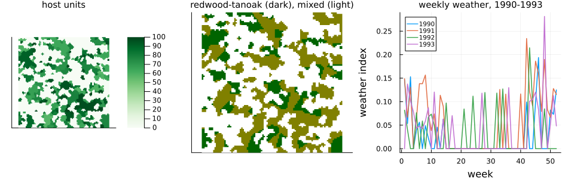
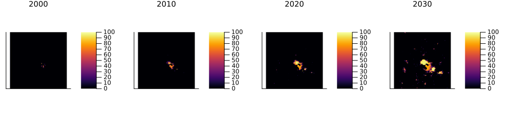
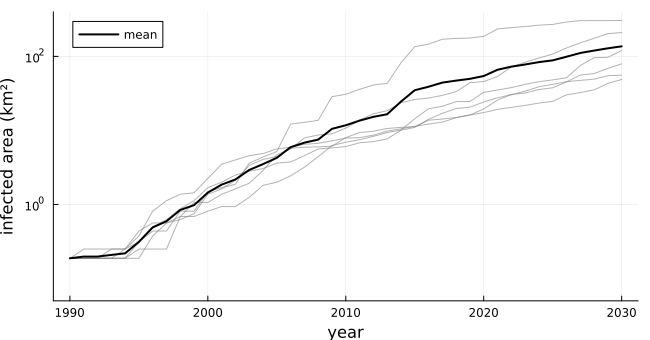
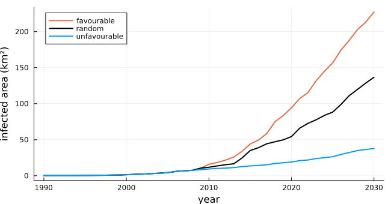
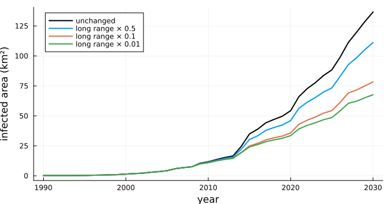

# Sudden oak death
Simon Frost

- [Overview](#overview)
- [Dispersal](#dispersal)
- [Landscape and weather](#landscape-and-weather)
- [An epidemic, 1990 to 2030](#an-epidemic-1990-to-2030)
- [Weather scenarios](#weather-scenarios)
- [Curbing long-distance spread](#curbing-long-distance-spread)
- [Deviations from the source](#deviations-from-the-source)

## Overview

Sudden oak death, caused by the water mould *Phytophthora ramorum*, has
killed millions of tanoaks and oaks in coastal California and Oregon
since the mid-1990s. Its spores are splashed and blown from infected
foliage, mostly a few metres, occasionally kilometres, and only in wet,
mild weather. Meentemeyer et al. ([2011](#ref-Meentemeyer2011)) modelled
its spread across California from 1990 to 2030 on a grid of 250 m cells,
each holding up to 100 units of host vegetation, susceptible or
infected. Infected units release spores when the weather and the season
allow; the spores travel by a mixture of a short-range and a long-range
dispersal kernel, and infect susceptible units where they land. They
predicted a ten-fold increase in infection between 2010 and 2030, much
more in favourable weather, and little benefit from curbing
long-distance spread once the disease is established.

This implementation is an **adaptation**. The source’s statewide maps of
host vegetation and weekly weather were never published, so it runs on a
synthetic landscape with synthetic weather, and reproduces the source’s
qualitative results rather than its areas.

``` julia
ENV["GKSwstype"] = "100"
using EcologicalCellularAutomata
using CellularAutomataCore
using Plots
using Statistics
```

## Dispersal

A spore travels in a random direction a distance drawn from a Cauchy
kernel, with scale 20.57 m with probability `γ = 0.9947` and 9.5 km
otherwise. On cells of 250 m, a spore released at a cell’s centre lands
in each cell with probability given by `sod_kernel`:

``` julia
short = sod_kernel(20.57; radius=4)
long = sod_kernel(9504; radius=99)
(short_in_own_cell=round(short[5, 5]; digits=3),
 short_within_1km=round(sum(short); digits=3),
 long_within_12km=round(sum(long[(100 - 49):(100 + 49), (100 - 49):(100 + 49)]);
                        digits=2))
```

    (short_in_own_cell = 0.906, short_within_1km = 0.989, long_within_12km = 0.62)

As the source says, nearly all spores stay close: about nine in ten
short-range spores land in their own cell (93% in the source). The rare
long-range spores spread over tens of kilometres.

Because each infected unit releases a Poisson number of spores and each
lands independently, the spores landing in a cell are Poisson, with a
mean that is the sum over all infected cells of their spores times the
probability of landing there: a convolution. The model computes it as
two kernel fields of the core package, the long-range one by fast
Fourier transform, on a torus twice the landscape’s size whose padding
is masked, so spores leaving the landscape are lost.

## Landscape and weather

The synthetic landscape is 100 × 100 cells (25 × 25 km). Half the cells
hold host vegetation, in clusters; a third of the forest is
redwood-tanoak, the rest mixed evergreen. Redwood-tanoak forest takes
part in transmission from January to September, mixed evergreen from
February to September.

``` julia
prob = problem(:sudden_oak_death; seed=1)
n = 100
hosts = prob.u0.S[1:n, 1:n] .+ prob.u0.I[1:n, 1:n]
p1 = heatmap(Float64.(hosts); c=:Greens, aspect_ratio=1, title="host units",
             titlefontsize=10, xticks=false, yticks=false)
p2 = heatmap(Float64.(prob.u0.forest[1:n, 1:n]);
             c=cgrad([:white, :darkgreen, :olive], 3; categorical=true), aspect_ratio=1,
             title="redwood-tanoak (dark), mixed (light)", titlefontsize=10,
             xticks=false, yticks=false, colorbar=false)
w = prob.p.weather
p3 = plot(1:52, reshape(w[1:(52 * 4)], 52, 4); lw=1.5, xlabel="week",
          ylabel="weather index", label=permutedims(string.(1990:1993)),
          title="weekly weather, 1990-1993", titlefontsize=10, legendfontsize=7)
plot(p1, p2, p3; layout=(1, 3), size=(950, 300), left_margin=3Plots.mm,
     bottom_margin=4Plots.mm)
```



Each week’s weather index is the share of its days with rain times the
source’s suitability of its mean temperature for sporulation; it enters
both at the source of the spores and where they land. The source used
kriged weather at 250 m for 1990 to 2008. Here a coastal climate is
drawn at random: wet, mild winters and springs, dry summers, and wetter
and drier years. Its overall wetness is the one choice made to match the
source: with it, infection grows about ten-fold from 2010 to 2030.

## An epidemic, 1990 to 2030

The pathogen arrives at three cells near the centre in 1990, each with
one infected unit. Six runs:

``` julia
function epidemic(; snapshots=(), kwargs...)
    integ = init(problem(:sudden_oak_death; kwargs...); save_everystep=false)
    area = Float64[]
    maps = Dict{Int,Matrix{Float64}}()
    for year in 1990:2030
        for _ in 1:52
            step!(integ)
        end
        push!(area, sod_infected_area(integ.u))
        year in snapshots && (maps[year] = Float64.(integ.u.I[1:n, 1:n]))
    end
    return area, maps
end
ensemble(; seeds=1:6, kwargs...) =
    fetch.([Threads.@spawn first(epidemic(; seed=s, kwargs...)) for s in seeds])
_, maps = epidemic(; seed=1, snapshots=(2000, 2010, 2020, 2030))
plot([heatmap(maps[y]; c=:inferno, clims=(0, 100), aspect_ratio=1, title="$y",
              titlefontsize=10, xticks=false, yticks=false)
      for y in (2000, 2010, 2020, 2030)]...; layout=(1, 4), size=(1000, 230))
```



``` julia
random = ensemble()
A = reduce(hcat, random)
p = plot(1990:2030, A; color=:gray, alpha=0.6, label="", xlabel="year",
         ylabel="infected area (km²)", yscale=:log10, ylims=(0.05, 400))
plot!(p, 1990:2030, mean(A; dims=2); color=:black, lw=2, label="mean", size=(650, 340))
```



``` julia
(area_2010=round(mean(A[21, :]); digits=1), area_2030=round(mean(A[41, :]); digits=1),
 increase=round(mean(A[41, :]) / mean(A[21, :]); digits=1))
```

    (area_2010 = 12.0, area_2030 = 137.5, increase = 11.4)

Infected units multiply locally, cell by cell, while the rare long-range
spores start new foci kilometres away, which then grow in turn. The
infected area grows about ten-fold from 2010 to 2030, as in the source,
though here over a landscape of 300 km² of forest rather than
California’s.

## Weather scenarios

The source ranks its observed years by their total weather index and
draws the years after 2008 at random from the better half (favourable),
the worse half (unfavourable), or all of them (random). Six runs each:

``` julia
scenarios = Dict(w => reduce(hcat, ensemble(; weather=w))
                 for w in (:favourable, :random, :unfavourable))
p = plot(; xlabel="year", ylabel="infected area (km²)", size=(650, 340), legend=:topleft)
for (w, c) in ((:favourable, 2), (:random, :black), (:unfavourable, 1))
    plot!(p, 1990:2030, mean(scenarios[w]; dims=2); lw=2, color=c, label=string(w))
end
p
```



``` julia
(favourable=round(mean(scenarios[:favourable][41, :]); digits=1),
 random=round(mean(scenarios[:random][41, :]); digits=1),
 unfavourable=round(mean(scenarios[:unfavourable][41, :]); digits=1))
```

    (favourable = 227.8, random = 137.5, unfavourable = 37.8)

As in the source, the weather after 2008 makes a large difference by
2030: favourable weather gives several times the infection of
unfavourable (about five-fold in the source), and random weather a
little over half that of favourable (half in the source).

## Curbing long-distance spread

The source asks what reducing long-distance dispersal from 2009 would
achieve, for example by stopping the movement of infected plants.
Multiplying the long-range share of spores by 0.5, 0.1 or 0.01:

``` julia
curbs = Dict(f => reduce(hcat, ensemble(; management=(2009, f))) for f in (0.5, 0.1, 0.01))
p = plot(1990:2030, mean(scenarios[:random]; dims=2); lw=2, color=:black,
         label="unchanged", xlabel="year", ylabel="infected area (km²)", size=(650, 340),
         legend=:topleft)
for (k, f) in enumerate((0.5, 0.1, 0.01))
    plot!(p, 1990:2030, mean(curbs[f]; dims=2); lw=2, color=k, label="long range × $f")
end
p
```



``` julia
(unchanged=round(mean(scenarios[:random][41, :]); digits=1),
 curbed=[round(mean(curbs[f][41, :]); digits=1) for f in (0.5, 0.1, 0.01)])
```

    (unchanged = 137.5, curbed = [112.0, 78.5, 67.3])

Curbing long-distance spread slows the epidemic but does not stop it:
the foci already established keep growing and merging by short-range
spread, and even a hundred-fold cut leaves about half the infected area
by 2030. The source finds a smaller benefit, about a third less.

## Deviations from the source

``` julia
foreach(d -> println("- ", d), model_info(:sudden_oak_death).deviations)
```

    - The source's statewide host-index, forest-type and weekly weather rasters at 250 m were never published, so the model runs on a synthetic landscape of 100 x 100 cells (25 x 25 km): host units from a random cluster landscape on half the cells, a third of them redwood-tanoak forest and the rest mixed evergreen. Its statewide results (infected areas in km², invasion probabilities by ecoregion, validation statistics) cannot be reproduced.
    - Weather is synthetic and the same across the landscape: each week's index is the share of rainy days times the source's temperature suitability, from a seasonal cycle of rain and temperature with wetter and drier years. The overall wetness (0.5) was chosen so that infection grows about ten-fold from 2010 to 2030, the source's headline result; with wetness 1 the landscape is infected by about 2010.
    - The source releases spore units as particles. Since emissions are Poisson and each lands independently, the spore units landing in a cell are Poisson with a mean given by a convolution of the infected units with the landing probabilities; this is computed as two kernel fields (short and long range). New infections in a week are Poisson, capped at the cell's susceptible units at the start of the week; in the source, each landing spore unit meets the units left by those before it.
    - The kernel's mixture weight gamma = 0.9947 is read as the share of spore units dispersing at short range, each range with a normalised half-Cauchy distance, which gives the source's 'over 99%' short-range dispersal and about 93% of it within the source cell (91% here). Long-range spores travelling beyond the landscape's width are lost, as are those leaving the landscape.
    - The source scales spore units so that one spore unit is at most one infection and retains them by the ratio of actual to maximal infectivity and susceptibility, described only in words; here an infected unit releases spore units at rate beta w and a spore unit infects with probability w S / nmax, with w the week's weather index at both source and destination, as in Eq. 1.
    - Weeks are assigned to months by week w lying in month ceil(12 w / 52) for the seasons of the forest types; the source does not say how.
    - The infection starts from one infected unit in each of three host cells near the landscape's centre; the source's three introduction sites and their initial loads are not given.
    - Management multiplies the long-range share of spore units by a factor from a given year, removing the rest; the source does not say whether they were moved to short range instead.

```@raw html
<div id="refs" class="references csl-bib-body hanging-indent">
```

```@raw html
<div id="ref-Meentemeyer2011" class="csl-entry">
```

Meentemeyer, Ross K., Nik J. Cunniffe, Alex R. Cook, et al. 2011.
“Epidemiological Modeling of Invasion in Heterogeneous Landscapes:
Spread of Sudden Oak Death in California (1990–2030).” *Ecosphere* 2
(2): art17. <https://doi.org/10.1890/ES10-00192.1>.

```@raw html
</div>
```

```@raw html
</div>
```
