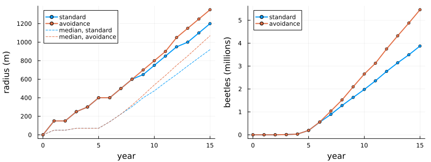
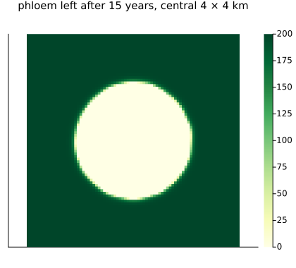
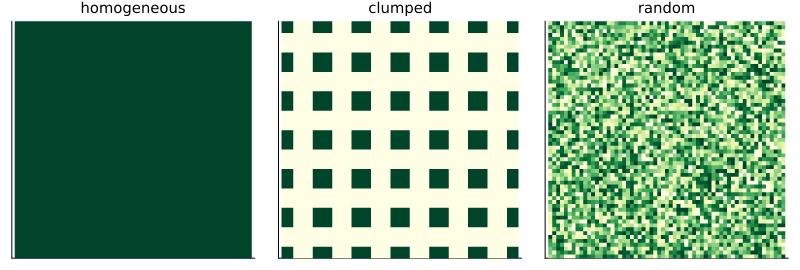

# Emerald ash borer
Simon Frost

- [Overview](#overview)
- [The model](#the-model)
- [Spread year by year](#spread-year-by-year)
- [The arrangement of ash](#the-arrangement-of-ash)
- [How many founders](#how-many-founders)
- [Deviations from the source](#deviations-from-the-source)

## Overview

The emerald ash borer, *Agrilus planipennis*, a beetle from Asia found
near Detroit in 2002, has killed hundreds of millions of ash trees in
North America. Its larvae feed in the phloem under the bark, girdling
the tree. Mercader et al. ([2011](#ref-Mercader2011)) asked how far an
infestation spreads from a single point, and how that depends on where
the ash is and on how the females choose where to lay. Their model is a
coupled map lattice: cells of 50 m hold amounts of ash phloem and
numbers of beetles, which spread, breed and eat phloem each year.

This implementation is a **reproduction** of the model’s two behaviours
in its published code, and an inferred version of a third; it reproduces
the source’s radii of infestation year by year.

``` julia
ENV["GKSwstype"] = "100"
using EcologicalCellularAutomata
using CellularAutomataCore
using Plots
using Random
using Statistics
```

## The model

Each year:

- adults emerge from larvae that took one year, and from those that took
  two;
- they disperse from their cell by a negative exponential kernel
  (`b = 0.037` per metre), normalised over the cells within 50 cells;
  with **avoidance**, cells without phloem are treated as 1.8 km further
  away;
- each female lays `r0 = 10.35` female offspring, as far as the phloem
  allows at `C = 0.0113` m² per larva, which the larvae eat;
- a share `-0.194 ln(x) + 0.986` of the larvae, `x` larvae per m² of
  phloem, take two years to develop.

The model is deterministic. The landscape is surrounded by a border of 2
cells where dispersing beetles are lost, as in the source’s code.

``` julia
prob = problem(:emerald_ash_borer)
size(prob.u0.phloem), sum(prob.u0.phloem[3:(end - 2), 3:(end - 2)])
```

    ((209, 209), 8.405e6)

The landscape is 205 × 205 cells (about 10 × 10 km) holding 8,405,000 m²
of phloem, here spread evenly, 200 m² a cell. One hundred adults start
at its centre.

## Spread year by year

``` julia
function spread(; years=15, kwargs...)
    integ = init(problem(:emerald_ash_borer; years, kwargs...); save_everystep=false)
    out = [eab_spread(integ.u)]
    while integ.t < years
        step!(integ)
        push!(out, eab_spread(integ.u))
    end
    return out, integ.u
end
avoid, final = spread()
standard, _ = spread(; behaviour=:standard)
Int.(getfield.(avoid, :radius))
```

    16-element Vector{Int64}:
        0
      150
      150
      250
      300
      400
      400
      500
      600
      700
      800
      900
     1050
     1150
     1250
     1350

These are the radii of infestation, from year 0 to year 15, with
avoidance: the farthest cell from the origin holding at least one larva.
They are those of the source’s Fig. 9, year by year.

``` julia
p1 = plot(0:15, [getfield.(standard, :radius) getfield.(avoid, :radius)]; marker=:circle,
          ms=3, lw=2, label=["standard" "avoidance"], xlabel="year", ylabel="radius (m)",
          legend=:topleft)
plot!(p1, 0:15, [getfield.(standard, :median) getfield.(avoid, :median)]; ls=:dash,
      color=[1 2], label=["median, standard" "median, avoidance"])
p2 = plot(0:15, [getfield.(standard, :beetles) getfield.(avoid, :beetles)] ./ 1e6;
          lw=2, marker=:circle, ms=3, label=["standard" "avoidance"], xlabel="year",
          ylabel="beetles (millions)", legend=:topleft)
plot(p1, p2; layout=(1, 2), size=(850, 320), left_margin=4Plots.mm,
     bottom_margin=4Plots.mm)
```



Without avoidance, larvae fill the cells near the origin, eat them out,
and the beetles emerging there keep laying in empty cells nearby. With
avoidance they fly over the eaten-out core to fresh ash, so the
infestation spreads further and holds more beetles: after 15 years 1350
m and 5.5 million here, against 1200 m and 3.9 million without (the
source: 1350 m and about 5.3 million, 1200 m and about 3.8 million).

``` julia
heatmap(final.phloem[3:(end - 2), 3:(end - 2)][63:143, 63:143]; aspect_ratio=1, c=:YlGn,
        title="phloem left after 15 years, central 4 × 4 km", titlefontsize=10,
        xticks=false, yticks=false, size=(420, 380))
```



## The arrangement of ash

The source compares three landscapes with the same total phloem: even,
clumped (blocks of 5 × 5 cells separated by gaps of 5 empty cells) and
random (cells holding 0 to 400 m² at random).

``` julia
plot([heatmap(eab_environment(k; rng=Random.Xoshiro(1))[73:133, 73:133]; aspect_ratio=1,
              c=:YlGn, title=string(k), titlefontsize=10, xticks=false, yticks=false,
              colorbar=false)
      for k in (:homogeneous, :clumped, :random)]...; layout=(1, 3), size=(800, 270))
```



The central 3 × 3 km of each. Fifteen years in each landscape, with each
behaviour, and the source’s values read from its Figs 4 and 5 (radius in
m, beetles in millions):

``` julia
source = Dict((:homogeneous, :standard) => (1200, 3.8),
              (:homogeneous, :avoidance) => (1350, 5.3),
              (:homogeneous, :resource_bias) => (1350, 5.3),
              (:clumped, :standard) => (750, 1.0), (:clumped, :avoidance) => (1650, 9.0),
              (:clumped, :resource_bias) => (2600, 10.5),
              (:random, :standard) => (1200, 3.8), (:random, :avoidance) => (1500, 6.2),
              (:random, :resource_bias) => (2050, 11.0))
cases = [(e, b) for e in (:homogeneous, :clumped, :random)
         for b in (:standard, :avoidance, :resource_bias)]
finals = fetch.([Threads.@spawn eab_spread(solve(problem(:emerald_ash_borer; environment=e,
                                                         behaviour=b); saveat=15).u[end])
                 for (e, b) in cases])
[(environment=e, behaviour=b, radius=r.radius, beetles=round(r.beetles / 1e6; digits=2),
  source=source[(e, b)]) for ((e, b), r) in zip(cases, finals)]
```

    9-element Vector{@NamedTuple{environment::Symbol, behaviour::Symbol, radius::Float64, beetles::Float64, source::Tuple{Int64, Float64}}}:
     (environment = :homogeneous, behaviour = :standard, radius = 1200.0, beetles = 3.88, source = (1200, 3.8))
     (environment = :homogeneous, behaviour = :avoidance, radius = 1350.0, beetles = 5.46, source = (1350, 5.3))
     (environment = :homogeneous, behaviour = :resource_bias, radius = 1350.0, beetles = 5.46, source = (1350, 5.3))
     (environment = :clumped, behaviour = :standard, radius = 750.0, beetles = 1.02, source = (750, 1.0))
     (environment = :clumped, behaviour = :avoidance, radius = 1650.0, beetles = 8.39, source = (1650, 9.0))
     (environment = :clumped, behaviour = :resource_bias, radius = 2050.0, beetles = 9.65, source = (2600, 10.5))
     (environment = :random, behaviour = :standard, radius = 1200.0, beetles = 3.45, source = (1200, 3.8))
     (environment = :random, behaviour = :avoidance, radius = 1450.0, beetles = 6.27, source = (1500, 6.2))
     (environment = :random, behaviour = :resource_bias, radius = 1850.0, beetles = 9.04, source = (2050, 11.0))

Standard and avoidance reproduce the source in every landscape. Clumping
hinders a beetle that does not avoid empty ground: most of its offspring
land in the gaps, so in the clumped landscape it spreads only 750 m. A
beetle that avoids empty ground spreads furthest there, as each clump is
eaten out and the beetles fly to the next. The source’s third behaviour,
a bias towards cells rich in phloem, is inferred here from its
description; it reproduces the homogeneous result, and spreads further
than avoidance in the other two landscapes, as in the source, but less
far.

## How many founders

The source compares 100 and 1,000 founders, and reports the difference
in the final number of beetles as 67.5, 21.8 and 10.3% in the clumped,
homogeneous and random landscapes:

``` julia
envs = (:clumped, :homogeneous, :random)
founders = fetch.([Threads.@spawn eab_spread(solve(problem(:emerald_ash_borer; environment=e,
                                                           founders=f); saveat=15).u[end])
                   for e in envs for f in (100, 1000)])
[(environment=e, beetles_100=round(founders[2k - 1].beetles / 1e6; digits=2),
  beetles_1000=round(founders[2k].beetles / 1e6; digits=2),
  difference=round(100 * (founders[2k].beetles - founders[2k - 1].beetles) /
                   founders[2k].beetles; digits=1),
  radius_1000=founders[2k].radius)
 for (k, e) in enumerate(envs)]
```

    3-element Vector{@NamedTuple{environment::Symbol, beetles_100::Float64, beetles_1000::Float64, difference::Float64, radius_1000::Float64}}:
     (environment = :clumped, beetles_100 = 8.39, beetles_1000 = 4.24, difference = -98.0, radius_1000 = 1650.0)
     (environment = :homogeneous, beetles_100 = 5.46, beetles_1000 = 6.84, difference = 20.2, radius_1000 = 1600.0)
     (environment = :random, beetles_100 = 6.27, beetles_1000 = 6.84, difference = 8.3, radius_1000 = 1650.0)

In the homogeneous and random landscapes, ten times as many founders
give an infestation about 20% and 8% larger after 15 years (21.8% and
10.3% in the source), far from ten times larger, as the phloem near the
origin limits it. In the clumped landscape the number of beetles swings
from year to year, as the clumps are eaten out and the beetles fly to
the next, and at year 15 the run with 1,000 founders happens to be in a
trough; the source, whose clumped runs also oscillate strongly, finds
67.5% more.

## Deviations from the source

``` julia
foreach(d -> println("- ", d), model_info(:emerald_ash_borer).deviations)
```

    - The source's Eq. 1 is misprinted; dispersal is normalised source by source over the 101 x 101 window clipped at the edge of the lattice, as the source's code does, with the distance of a cell from itself 0.25 cells.
    - Avoidance adds 1.8 km (36 cells of 50 m), as the text says, to the distance of cells without phloem; the code's example uses 18 cells. The results barely change.
    - Of the source's five foraging behaviours, Standard and Avoidance (the two in its code) are implemented as described. 'Resource Bias All' is inferred from the text: cells whose initial phloem is at or above the landscape's upper quartile are 33% nearer and those at or below the lower quartile 33% further, with no bias when the quartiles are equal. It reproduces the homogeneous result (1350 m) but spreads less than the source on the clumped (2050 against 2600 m) and random (1850 against 2050 m) landscapes. 'Stress bias' and 'Resource Bias Within 200 m', not in the code and ambiguously described, are not implemented.
    - The clumped landscape is 5 x 5 blocks of cells separated by 5 empty cells, one centred, rescaled to the source's total of 8,405,000 m² (762.4 m² a cell, against the 784.4 m² the source states, which does not divide its total among whole blocks). The random landscape puts the 17 levels from 0 to 400 m² on equal numbers of cells as far as they divide, sets the centre to 200 m² if it would be empty, and rescales to the total; the source does not say how its levels were matched to the total.
    - The radius of infestation is the largest distance from the origin of a cell with at least one larva, floored to whole cells and times 50 m, as the source's code computes it; with this rule the source's year-by-year radii are reproduced exactly.
    - The cluster-gradient, habitat-quality and Saginaw County experiments are not included; the Saginaw phloem map is not published.

```@raw html
<div id="refs" class="references csl-bib-body hanging-indent">
```

```@raw html
<div id="ref-Mercader2011" class="csl-entry">
```

Mercader, Rodrigo J., Nathan W. Siegert, Andrew M. Liebhold, and Deborah
G. McCullough. 2011. “Influence of Foraging Behavior and Host Spatial
Distribution on the Localized Spread of the Emerald Ash Borer, *Agrilus
Planipennis*.” *Population Ecology* 53 (2): 271–85.
<https://doi.org/10.1007/s10144-010-0233-6>.

```@raw html
</div>
```

```@raw html
</div>
```
