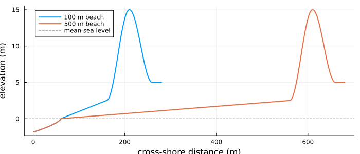
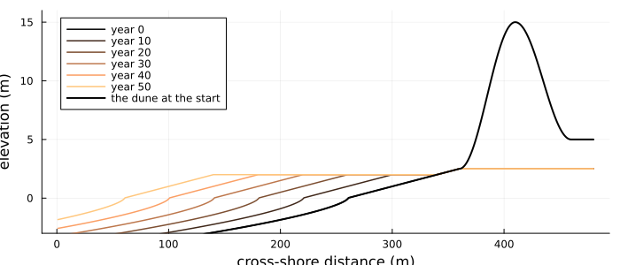
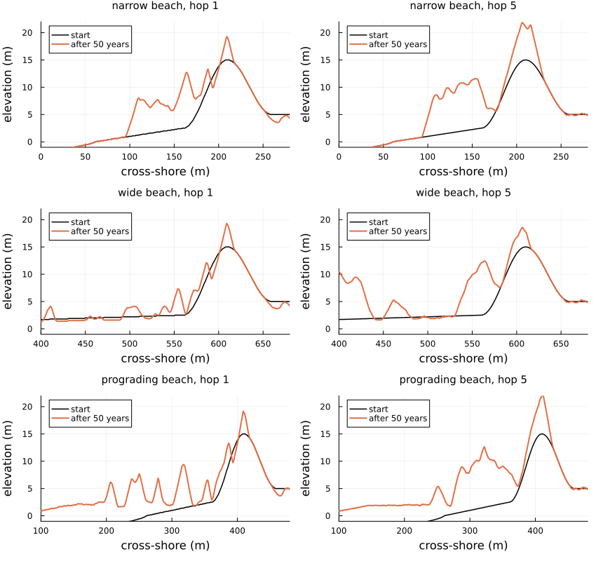
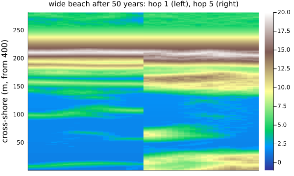
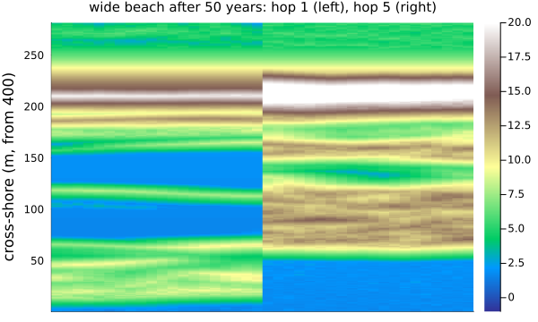

# Coastal dunes
Simon Frost

- [Overview](#overview)
- [The model](#the-model)
  - [Profiles from pieces](#profiles-from-pieces)
- [The same potential transport](#the-same-potential-transport)
- [Fifty years of dune growth](#fifty-years-of-dune-growth)
- [Deviations from the source](#deviations-from-the-source)

## Overview

Coastal foredunes grow where wind blows sand off the beach and dune
plants trap it. Teixeira et al. ([2023](#ref-Teixeira2023)) study this
with DuBeVeg, a cellular automaton in the family of Werner’s sand-slab
model: the surface is a stack of slabs on each cell, slabs are picked up
and hop downwind until they land, avalanches keep slopes below the angle
of repose, the sea resets the beach below the water level, and two kinds
of plant grow or die back with the sand they gain. In the original model
a slab hops one cell; the authors make it hop a saltation length of 5
cells, with slabs five times thinner so that the potential transport is
the same, and let vegetation trap slabs part-way through a hop. On a
wide beach this changes how the dune grows.

This implementation is an **adaptation**: the authors’ code is not
published, the sea is forced by synthetic water levels, the domain is
narrower, and several constants come from the base model’s
documentation.

``` julia
ENV["GKSwstype"] = "100"
using EcologicalCellularAutomata
using CellularAutomataCore
using Plots
using Random
using Statistics
```

## The model

Each aeolian iteration (50 a year), every bare, dry cell outside the
shadow of higher ground gives up a slab with probability `(1 - ρ) 0.5`,
where `ρ` is its plant cover. A slab moves landward and, at the end of
each hop of `L` cells, lands with probability `ρ (1 - 0.1) + 0.1`
(always in the shadow); with `L = 5`, it can also land part-way through
a hop on cells whose plant cover is at least 0.3. Every second iteration
the sea, with run-up from waves, resets the cells it reaches towards the
reference beach; once a year the plants grow or die back with the sand
each cell gained.

The beach rises from the shoreline to the foot of a foredune 15 m high
and 100 m wide; the source compares a narrow beach of 100 m with a wide
one of 500 m.

``` julia
plot(; xlabel="cross-shore distance (m)", ylabel="elevation (m)", size=(700, 300),
     legend=:topleft)
for (beach, c) in ((100, 1), (500, 2))
    prof = dune_profile(; beach, h=0.02)
    plot!(prof.elevation .* 0.02; lw=2, color=c, label="$beach m beach")
end
hline!([0]; color=:gray, ls=:dash, label="mean sea level")
```



### Profiles from pieces

A profile is built by joining pieces from the sea to the land: a Dean
shoreface, a straight beach, the dune ridge and the plateau behind it. A
piece runs from one elevation to another, and `*` joins two pieces only
where the first ends at the elevation where the second starts. Joining
is associative and an empty piece changes nothing, so profiles compose
like paths between elevations (morphisms in a category whose objects are
elevations), and a scenario is a composite:

``` julia
narrow = shoreface_segment(60) * slope_segment(100, 0, 2.5) *
         ridge_segment(100, 2.5, 15, 5) * flat_segment(20, 5; kind=:hinterland)
(narrow, profile_heights(narrow, 280; h=0.02) == dune_profile(; beach=100).elevation)
```

    (ProfileSegment(shoreface * beach * dune * hinterland: -1.8391426377445272 → 5.0 m over 280 m), true)

The reference surface the sea works towards is the same profile with the
dune and the land behind it levelled at the dune’s foot.
`reference_profile` does this piece by piece, so it respects joins: it
maps composites to composites.

Teixeira et al.’s third scenario is a **prograding** beach, which builds
out 4 m a year, from 100 m to 300 m wide over 50 years. In their Fig. 2b
the profile below a berm at 2 m moves seaward and the berm lengthens.
With pieces, that is one more piece: the beach is cut where it reaches 2
m and a level berm of `4t` m is joined in. Level pieces at one elevation
add, a berm of `a` m joined to one of `b` m being a berm of `a + b` m,
so building out is time acting on the profile by joining berms.
`problem(:dune_formation; scenario=:prograding)` puts the narrow beach
on a domain 200 m longer out to sea, anchored at the land, and replaces
the reference surface with the year’s at the end of every year; the sea,
resetting cells towards it, builds the beach out.

``` julia
plot(; xlabel="cross-shore distance (m)", ylabel="elevation (m)", size=(700, 300),
     legend=:topleft, ylims=(-3, 16))
for y in 0:10:50
    ref = reference_profile(dune_landform(; beach=100, offshore=260, berm=4y))
    plot!(profile_heights(ref, 480); lw=1.5, color=cgrad(:copper)[y / 50], label="year $y")
end
plot!(profile_heights(dune_landform(; beach=100, offshore=260), 480); color=:black, lw=2,
      label="the dune at the start")
```



## The same potential transport

The source’s Eq. 3 gives the potential transport
`Q = h L (pe0 / pd0) n`: with slabs of 0.1 m hopping 1 cell or of 0.02 m
hopping 5, 25 m³ per metre of beach a year. On a bare, dry beach the
slabs crossing a line do carry that:

``` julia
function flat_flux(h, L; rows=40, iterations=20)
    p = merge(defaults(build(:dune_formation)),
              (; h, L, rho_star=Inf, hydro_every=10^6, iterations=10^6))
    total = 0
    for t in 1:iterations
        u = (topo=fill(Int32(round(2.9 / h)), rows, 400), pioneer=zeros(rows, 400),
             stabilizer=zeros(rows, 400), balance=zeros(Int32, rows, 400),
             zref=zeros(Int32, rows, 400), sea=zeros(rows, 400))
        u.topo[:, 200:end] .= round(Int32, 3.1 / h)
        total += dune_step!(u, p, t, Random.Xoshiro(t))
    end
    return round(total * h * 50 / (rows * iterations); digits=1)
end
(hop_1=flat_flux(0.1, 1), hop_5=flat_flux(0.02, 5))
```

    (hop_1 = 24.6, hop_5 = 24.9)

## Fifty years of dune growth

One run of 50 years for each beach and representation, on 20 rows of 1 m
(the source runs 400 rows five times). We record the sand crossing the
dune toe, the first cell above 3 m, each year, and the dune’s volume and
width every ten years.

``` julia
function dune_run(scenario, representation; years=50, rows=20, seed=1)
    prob = problem(:dune_formation; scenario, representation, alongshore=rows, years, seed)
    p, u, h = prob.p, deepcopy(prob.u0), prob.p.h
    flux = zeros(years)
    measures = [dune_measures(u; h)]
    profiles = [vec(mean(u.topo; dims=1)) .* h]
    for t in 1:(50years)
        crossed = dune_step!(u, p, t, Random.Xoshiro(hash((prob.seed, t, :dune))))
        flux[cld(t, 50)] += crossed * h / rows
        if t % 500 == 0
            push!(measures, dune_measures(u; h))
            push!(profiles, vec(mean(u.topo; dims=1)) .* h)
        end
    end
    return (; flux, measures, profiles, final=u.topo .* h)
end
cases = [(s, r) for s in (:narrow, :wide, :prograding) for r in (:default, :saltation)]
runs = Dict(zip(cases, fetch.([Threads.@spawn dune_run(c...) for c in cases])))
nothing
```

The same runs drive the integrator: `dune_step!` with the generator
seeded from the problem’s seed and the iteration is what `solve` runs at
each step.

``` julia
plot([begin
          r = runs[(s, rep)]
          plot(r.profiles[1]; color=:black, lw=1.5, label="start",
               title="$s beach, hop $(rep === :saltation ? 5 : 1)", titlefontsize=10,
               xlabel="cross-shore (m)", ylabel="elevation (m)", legend=:topleft,
               xlims=s === :wide ? (400, 680) : s === :prograding ? (100, 480) : (0, 280),
               ylims=(-1, 22))
          plot!(r.profiles[end]; color=2, lw=2, label="after 50 years")
      end
      for (s, rep) in cases]...; layout=(3, 2), size=(850, 800))
```



``` julia
heatmap(hcat(permutedims(runs[(:wide, :default)].final[:, 400:end]),
             permutedims(runs[(:wide, :saltation)].final[:, 400:end])); c=:terrain,
        clims=(-1, 20), xticks=false, ylabel="cross-shore (m, from 400)", size=(600, 360),
        title="wide beach after 50 years: hop 1 (left), hop 5 (right)", titlefontsize=10)
```



``` julia
source_volume = Dict((:narrow, :default) => 1500, (:narrow, :saltation) => 1611,
                     (:wide, :default) => 1563, (:wide, :saltation) => 2234,
                     (:prograding, :default) => 1540, (:prograding, :saltation) => 2130)
source_width = Dict((:narrow, :default) => 145, (:narrow, :saltation) => 150,
                    (:wide, :default) => 220, (:wide, :saltation) => 230,
                    (:prograding, :default) => 304, (:prograding, :saltation) => 218)
[(beach=s, hop=rep === :saltation ? 5 : 1,
  toe_flux=round(mean(runs[(s, rep)].flux[2:end]); digits=1),
  volume_gain=round(Int,
                    runs[(s, rep)].measures[end].volume - runs[(s, rep)].measures[1].volume),
  source_gain=source_volume[(s, rep)] - 1150,
  width=round(Int, runs[(s, rep)].measures[end].width), source_width=source_width[(s, rep)])
 for (s, rep) in cases]
```

    6-element Vector{@NamedTuple{beach::Symbol, hop::Int64, toe_flux::Float64, volume_gain::Int64, source_gain::Int64, width::Int64, source_width::Int64}}:
     (beach = :narrow, hop = 1, toe_flux = 14.8, volume_gain = 382, source_gain = 350, width = 180, source_width = 145)
     (beach = :narrow, hop = 5, toe_flux = 17.1, volume_gain = 629, source_gain = 461, width = 183, source_width = 150)
     (beach = :wide, hop = 1, toe_flux = 13.3, volume_gain = 326, source_gain = 413, width = 375, source_width = 220)
     (beach = :wide, hop = 5, toe_flux = 22.5, volume_gain = 981, source_gain = 1084, width = 340, source_width = 230)
     (beach = :prograding, hop = 1, toe_flux = 11.9, volume_gain = 352, source_gain = 390, width = 284, source_width = 304)
     (beach = :prograding, hop = 5, toe_flux = 18.4, volume_gain = 790, source_gain = 980, width = 233, source_width = 218)

The sand crossing the dune toe, in m³ per metre a year, the gain in dune
volume over 50 years and the dune’s width after them, against the
source’s medians (from an initial volume of about 1150 m³/m; the medians
of the narrow and wide beaches are in its text, those of the prograding
beach and the wide beach’s widths with hops of 1 cell read from its Fig.
4). As in the source, hops of 5 cells carry sand across a wide beach to
the dune close to the potential transport, while single-cell hops build
bedforms on the beach that hold sand back. So the dune gains much more
with hops of 5 cells on the wide beach, here as in the source; on the
narrow beach the two differ less.

``` julia
plot(1:50, [runs[c].flux for c in cases]; lw=1.5,
     label=permutedims(["$(c[1]), hop $(c[2] === :saltation ? 5 : 1)" for c in cases]),
     xlabel="year", ylabel="flux at the dune toe (m³/m/yr)", ylims=(0, 30),
     size=(650, 340), legend=:bottomright)
hline!([25]; color=:gray, ls=:dash, label="potential transport")
```



On the prograding beach the model follows the source closely. With hops
of one cell the beach builds out faster than the dune can follow, and a
row of small separate foredunes forms on it, near the shoreline; the
dune is then the widest of the three beaches (284 m against the source’s
304 m). With hops of 5 cells the sand reaches the old dune, which grows
a wide new ridge in front of it, as wide as on the wide beach (233 m
against 218 m), and the flux at the dune toe rises over the 50 years as
the beach widens, as in the source’s Fig. 5c. The gains in volume are
352 and 790 m³/m, against about 390 and 980.

The dunes of the narrow and wide beaches grow wider than the source’s,
most on the wide beach: embryo dunes and bumps on the upper beach rise
above 3 m and move the dune toe seaward faster.

## Deviations from the source

``` julia
foreach(d -> println("- ", d), model_info(:dune_formation).deviations)
```

    - The source forces the sea with observed water levels at Scheveningen (1970-2020), the highest in each spring-neap cycle; here a synthetic series stands in: 1 m plus a Gumbel-distributed surge of scale 0.3 m, 25 a year.
    - The domain is 20 to 100 rows of 1 m alongshore (400 in the source) and only the cross-shore profile from 60 m offshore to 20 m behind the dune (1250 cells in the source). The initial profile is a Dean-like shoreface, a linear beach and a smooth dune ridge to 15 m read from the source's figure; the beach rises to 2.5 m at the dune foot, as the figure shows, where the text says 3 m (with 3 m, small bumps on the upper beach count as the dune).
    - Slab transport is synchronous, as in DuBeVeg's code: all pick-ups are drawn from the state at the start of an iteration, with the shadow and the probabilities fixed for its duration.
    - Part-way through a hop (Eq. 5), a slab lands only where vegetation is at least rho_star, and the shadow does not force it to; after a failed landing at a hop's end the next hop begins. Slabs reaching the land side of the domain are lost.
    - The shadow test uses the continuous threshold i tan(15°) rather than DuBeVeg's floored one.
    - Constants not in the source come from DuBeVeg: the growth functions of the pioneer (burial -1.4, 0.2, 0.6, 2.0, 2.2 m/yr, peak 0.2) and stabilizer (-1.4, -0.65, 0, 0.2, 2.8, peak 0.05), lateral expansion 0.2 and establishment 0.05 a year (stabilizers establishing only where the sand balance is zero), the wave run-up relation, the dissipation by the inverse water depth summed from the sea, and the least wave probability 0.1. Plant cover is multiplied each year by the chance that the sea did not reset the cell. The initial split of species is not stated: pioneers seaward of the crest, stabilizers behind.
    - The dune is wider than in the source after 50 years on the narrow and wide beaches, most on the wide beach (about 340 m with hops of 5 cells and 375 m with hops of 1, against about 230 and 220; on the narrow beach about 180 against 145-150), as embryo dunes and bumps on the upper beach move the dune toe seaward faster.
    - The prograding beach builds out through the sea alone: the reference surface is replaced at the end of each year by the profile with a berm 4 m longer, the profile below the berm moved seaward within a domain extending 200 m further out (the source's profile reaches a depth of closure of 8 m, beyond the domain here), and the sea's resets move the beach towards it; the shoreline then follows the reference about a year behind.
    - The sensitivity to rho_star is not included; one run per case on 20 rows replaces the source's five runs on 400.

```@raw html
<div id="refs" class="references csl-bib-body hanging-indent">
```

```@raw html
<div id="ref-Teixeira2023" class="csl-entry">
```

Teixeira, Manuel, Erik M. Horstman, and Kathelijne M. Wijnberg. 2023.
“Conceptualizing Aeolian Sediment Transport in a Cellular Automata Model
to Simulate the Bio-Geomorphological Evolution of Beach–Dune Systems.”
*Journal of Marine Science and Engineering* 11 (7): 1278.
<https://doi.org/10.3390/jmse11071278>.

```@raw html
</div>
```

```@raw html
</div>
```
