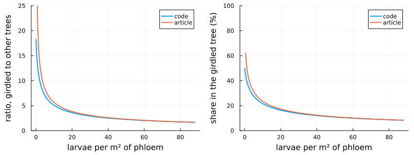
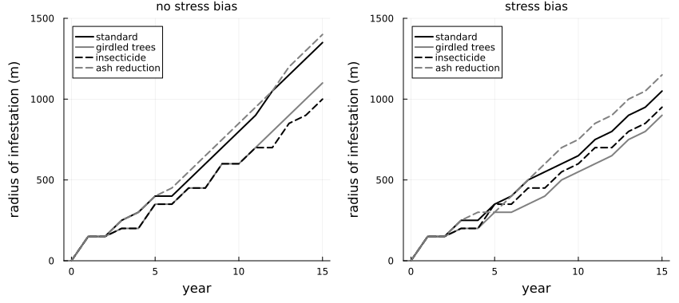
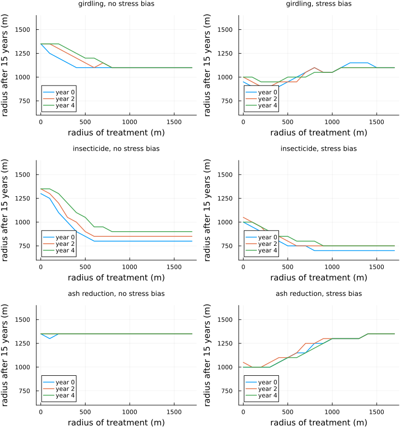
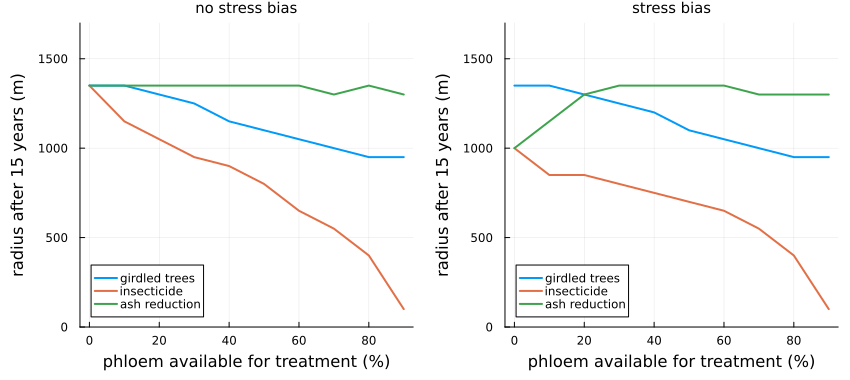
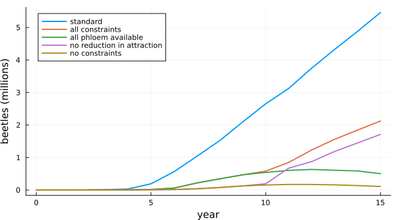

# Managing emerald ash borer outliers
Simon Frost

- [Overview](#overview)
- [The treatments](#the-treatments)
- [Treating within 300 m](#treating-within-300-m)
- [The radius of treatment and the year it
  starts](#the-radius-of-treatment-and-the-year-it-starts)
- [How many trees can be treated](#how-many-trees-can-be-treated)
- [The limits on girdling](#the-limits-on-girdling)
- [The article’s ratio](#the-articles-ratio)
- [Deviations from the source](#deviations-from-the-source)

## Overview

The emerald ash borer spreads over long distances when people move
infested wood, founding outlier colonies far ahead of the main front.
Once one is found, what should be done there? Mercader et al.
([2011b](#ref-Mercader2011b)) took their model of local spread (Mercader
et al. ([2011a](#ref-Mercader2011)); see the emerald ash borer vignette)
and added three treatments in a circle around the origin of an outlier:

- **ash reduction**: harvesting the large trees, removing their phloem
  and the larvae in it, once;
- **girdling**: girdling one large tree a cell each year, which draws
  egg-laying females to it, and destroying it with its larvae;
- **insecticide**: protecting the large trees with a systemic
  insecticide, which kills the larvae laid in them and keeps their
  phloem from being eaten.

Large trees (27.9 cm in diameter or more) hold half the phloem by
default. The authors also asked how the results change if females are
drawn to stressed trees.

This implementation is a **reproduction** of the authors’ R code (the
article’s Supplemental Appendix S1): it follows the code where the code
and the text differ, as the deviations below list, and with the code’s
indexing and the same tolerance for bare cells it gives the code’s
results cell by cell.

``` julia
ENV["GKSwstype"] = "100"
using EcologicalCellularAutomata
using CellularAutomataCore
using Plots
```

## The treatments

The landscape is 100 × 100 cells of 50 m, each with 200 m² of ash
phloem, with 100 adults released at the cell (51, 51). Treated cells lie
within a radius of that origin. Without treatment the model is the base
model with avoidance, as the code runs it: a dispersal window of 40
cells, no border, and cells with 0.9 adults or fewer dispersing none.
Its radius of infestation after 15 years is 1350 m.

``` julia
radii(sol) = [eab_spread(u).radius for u in sol.u]
simulate(; kw...) = solve(problem(:eab_management; kw...); saveat=1)
untreated = simulate()
radii(untreated)'
```

    1×16 adjoint(::Vector{Float64}) with eltype Float64:
     0.0  150.0  150.0  250.0  250.0  350.0  …  1000.0  1150.0  1250.0  1350.0

A girdled tree of 10.32 m² takes a share of the larvae laid in its cell
given by the ratio of the density of larvae on girdled to other trees.
The article gives that ratio as `20.468 x^-0.559` at a density `x` per
m², fitted at 16 outlier sites in Michigan; the code uses
`18.25 (x + 1)^-0.533`, at least 1, which stays finite at low densities.
The ratio falls as density rises: in a cell of 200 m², a girdled tree
takes about half the eggs at the low densities ahead of a front, and 8%
where the phloem is full.

``` julia
x = 0:0.5:88
code = max.(18.25 .* (x .+ 1) .^ -0.533, 1)
text = 20.468 .* x .^ -0.559
taken(y) = 100 .* 10.32 .* y ./ (10.32 .* y .+ (200 - 10.32))
plot(plot(x, [code text]; ylabel="ratio, girdled to other trees", ylims=(0, 25),
          label=["code" "article"]),
     plot(x, [taken(code) taken(text)]; ylabel="share in the girdled tree (%)",
          ylims=(0, 100), label=["code" "article"]);
     xlabel="larvae per m² of phloem", lw=2, layout=(1, 2), size=(850, 320),
     left_margin=5Plots.mm, bottom_margin=5Plots.mm)
```



Under the **stress bias**, dispersing females favour cells with girdled
trees (seven times as attractive, in every treated cell) or stressed
trees, whose attraction is 7 × 3 × the share of phloem lost, kept
between 1 and 7, so that a cell is fully attractive once it has lost a
third of its phloem.

## Treating within 300 m

The source’s main comparison treats every cell within 300 m of the
origin from the start and follows the infestation for 15 years.

``` julia
treatments = (:none, :girdling, :insecticide, :ash_reduction)
labels = ["standard" "girdled trees" "insecticide" "ash reduction"]
runs = Dict((tr, sb) => simulate(; treatment=tr, stress_bias=sb)
            for tr in treatments for sb in (false, true))
plot([plot(0:15, [radii(runs[(tr, sb)]) for tr in treatments]; label=labels,
           title=sb ? "stress bias" : "no stress bias", titlefontsize=10, xlabel="year",
           ylabel="radius of infestation (m)", lw=2, legend=:topleft, ylims=(0, 1500),
           color=[:black :gray :black :gray], ls=[:solid :solid :dash :dash])
      for sb in (false, true)]...; layout=(1, 2), size=(850, 380), left_margin=5Plots.mm,
     bottom_margin=5Plots.mm)
```



``` julia
code = Dict((:none, false) => (1350, 5.50), (:girdling, false) => (1150, 4.32),
            (:insecticide, false) => (1000, 3.64), (:ash_reduction, false) => (1350, 5.40),
            (:none, true) => (1000, 2.42), (:girdling, true) => (850, 2.11),
            (:insecticide, true) => (800, 1.82), (:ash_reduction, true) => (1000, 2.51))
article = Dict((:none, false) => (1350, 5.45), (:girdling, false) => (1150, 4.45),
               (:insecticide, false) => (950, 3.3), (:ash_reduction, false) => (1350, 5.3),
               (:none, true) => (1100, 2.5), (:girdling, true) => (950, 2.1),
               (:insecticide, true) => (850, 1.8), (:ash_reduction, true) => (1150, 2.8))
[(; treatment=tr, stress_bias=sb, radius=Int(radii(runs[(tr, sb)])[end]),
  code_radius=code[(tr, sb)][1], article_radius=article[(tr, sb)][1],
  beyond=round(eab_beyond(runs[(tr, sb)].u[end], 300) / 1e6; digits=2),
  code_beyond=code[(tr, sb)][2], article_beyond=article[(tr, sb)][2])
 for sb in (false, true) for tr in treatments]
```

    8-element Vector{@NamedTuple{treatment::Symbol, stress_bias::Bool, radius::Int64, code_radius::Int64, article_radius::Int64, beyond::Float64, code_beyond::Float64, article_beyond::Float64}}:
     (treatment = :none, stress_bias = 0, radius = 1350, code_radius = 1350, article_radius = 1350, beyond = 5.48, code_beyond = 5.5, article_beyond = 5.45)
     (treatment = :girdling, stress_bias = 0, radius = 1150, code_radius = 1150, article_radius = 1150, beyond = 4.39, code_beyond = 4.32, article_beyond = 4.45)
     (treatment = :insecticide, stress_bias = 0, radius = 1000, code_radius = 1000, article_radius = 950, beyond = 3.64, code_beyond = 3.64, article_beyond = 3.3)
     (treatment = :ash_reduction, stress_bias = 0, radius = 1350, code_radius = 1350, article_radius = 1350, beyond = 5.33, code_beyond = 5.4, article_beyond = 5.3)
     (treatment = :none, stress_bias = 1, radius = 1000, code_radius = 1000, article_radius = 1100, beyond = 2.46, code_beyond = 2.42, article_beyond = 2.5)
     (treatment = :girdling, stress_bias = 1, radius = 850, code_radius = 850, article_radius = 950, beyond = 2.09, code_beyond = 2.11, article_beyond = 2.1)
     (treatment = :insecticide, stress_bias = 1, radius = 800, code_radius = 800, article_radius = 850, beyond = 1.79, code_beyond = 1.82, article_beyond = 1.8)
     (treatment = :ash_reduction, stress_bias = 1, radius = 1000, code_radius = 1000, article_radius = 1150, beyond = 2.51, code_beyond = 2.51, article_beyond = 2.8)

The radius after 15 years and the beetles beyond the treated area
(millions), here, in the authors’ code (run in R on the same settings)
and in the article’s Fig. 4, read by eye. The radii are the code’s. As
in the article:

- insecticide slows the spread most, then girdling;
- ash reduction barely reduces the beetles beyond the treated area;
- the stress bias slows the spread, since dispersing females stay among
  the stressed trees near the origin.

The code itself departs from the article in two places: insecticide is a
little weaker (1000 m against 950 without the bias), and with the stress
bias every radius is 50–150 m smaller than the article’s, although the
beetles beyond the treated area agree except under ash reduction (2.5
million against 2.8).

## The radius of treatment and the year it starts

The source then treated every cell out to radii of 0 to 1700 m, starting
in the first year or up to four years later, when an outlier might be
found.

``` julia
rs = 0:100:1700
starts = (0, 2, 4)
cases = [(tr, sb, st, r) for tr in (:girdling, :insecticide, :ash_reduction)
         for sb in (false, true) for st in starts for r in rs]
final = Vector{Float64}(undef, length(cases))
Threads.@threads for i in eachindex(cases)
    tr, sb, st, r = cases[i]
    prob = problem(:eab_management; treatment=tr, stress_bias=sb, start=st, radius=r)
    final[i] = eab_spread(solve(prob).u[end]).radius
end
sweep = Dict(cases .=> final)
plot([plot(rs, [[sweep[(tr, sb, st, r)] for r in rs] for st in starts];
           label=permutedims(["year $st" for st in starts]), lw=1.5,
           title="$(replace(String(tr), '_' => ' ')), $(sb ? "" : "no ")stress bias",
           titlefontsize=9, ylims=(600, 1650), xlabel="radius of treatment (m)",
           ylabel="radius after 15 years (m)", legend=:bottomleft)
      for tr in (:girdling, :insecticide, :ash_reduction) for sb in (false, true)]...;
     layout=(3, 2), size=(800, 860))
```



The results follow the source’s Fig. 5:

- **Insecticide:** the radius falls to 800 m as the treated radius grows
  (700 m with the stress bias), as in the source. Later starts weaken
  it.
- **Girdling:** the radius falls to 1100 m once the treated circle
  passes 300–800 m, depending on the start, and stays there.
- **Under the stress bias:** girdling helps most at small radii (850 m
  at 200–300 m) and less at large ones, where the girdled cells draw
  beetles outwards, as the source found. Ash reduction, which never
  changes the radius without the bias, widens the spread with it as the
  treated circle grows, from 1000 m to 1350 m.

## How many trees can be treated

The source varied the share of the phloem in large trees, and so the
share that can be treated, from 0 to 90%. Here the whole lattice is
treated.

``` julia
shares = 0:0.1:0.9
share_cases = [(tr, sb, s) for tr in (:girdling, :insecticide, :ash_reduction)
               for sb in (false, true) for s in shares]
share_final = Vector{Float64}(undef, length(share_cases))
Threads.@threads for i in eachindex(share_cases)
    tr, sb, s = share_cases[i]
    prob = problem(:eab_management; treatment=tr, stress_bias=sb, share=s, radius=1700)
    share_final[i] = eab_spread(solve(prob).u[end]).radius
end
by_share = Dict(share_cases .=> share_final)
plot([plot(100 .* shares,
           [[by_share[(tr, sb, s)] for s in shares]
            for tr in (:girdling, :insecticide, :ash_reduction)];
           label=["girdled trees" "insecticide" "ash reduction"], lw=2,
           title=sb ? "stress bias" : "no stress bias", titlefontsize=10,
           xlabel="phloem available for treatment (%)",
           ylabel="radius after 15 years (m)", ylims=(0, 1700), legend=:bottomleft)
      for sb in (false, true)]...; layout=(1, 2), size=(850, 380), left_margin=5Plots.mm,
     bottom_margin=5Plots.mm)
```



Insecticide’s effect grows steadily with the share treated, to 100 m at
90% (about 200 m in the source’s Fig. 3). Girdling helps less, because
each cell girdles only one tree a year and the large trees run out. Ash
removal barely changes the spread (1300–1350 m), as in the source.

## The limits on girdling

Girdling is limited in two ways: only large trees can be girdled, and
girdled trees draw fewer eggs as densities rise. The source’s Fig. 6
lifts each limit in turn, girdling throughout the lattice.

``` julia
scenarios = [("standard", (; treatment=:none)),
             ("all constraints", (; treatment=:girdling)),
             ("all phloem available", (; treatment=:girdling, share=1.0)),
             ("no reduction in attraction",
              (; treatment=:girdling, pmap=(; attraction_decline=false))),
             ("no constraints",
              (; treatment=:girdling, share=1.0, pmap=(; attraction_decline=false)))]
beetles = [[eab_spread(u).beetles / 1e6 for u in simulate(; radius=1700, kw...).u]
           for (_, kw) in scenarios]
plot(0:15, beetles; label=permutedims(first.(scenarios)), lw=2, xlabel="year",
     ylabel="beetles (millions)", legend=:topleft, size=(650, 360))
```



Each limit lifted cuts the population further. With neither, the
infestation stays small, as in the source.

## The article’s ratio

With the ratio printed in the article, which grows without bound at low
densities, girdled trees take nearly all the larvae laid ahead of the
front, and girdling within 300 m holds the radius to 1050 m rather than
the code’s 1150 m; capped at its value at 1 larva per m², it gives 1100
m.

``` julia
article_ratio(cap) = (; girdle_a=20.468, girdle_shift=0.0, girdle_b=-0.559, girdle_min=0.0,
                      girdle_max=cap)
[(; ratio=name,
  radius=eab_spread(solve(problem(:eab_management; treatment=:girdling, pmap)).u[end]).radius)
 for (name, pmap) in (("code", (;)), ("article", article_ratio(Inf)),
                      ("article, capped", article_ratio(20.468)))]
```

    3-element Vector{@NamedTuple{ratio::String, radius::Float64}}:
     (ratio = "code", radius = 1150.0)
     (ratio = "article", radius = 1050.0)
     (ratio = "article, capped", radius = 1100.0)

## Deviations from the source

``` julia
foreach(d -> println("- ", d), model_info(:eab_management).deviations)
```

    - The model follows the source's code, which departs from the article's text in several ways, all kept: the ratio of larval density on girdled to other trees is 18.25 (x + 1)^-0.533, at least 1, where the text gives 20.468 x^-0.559 (girdle_a, girdle_shift, girdle_b and girdle_max select the text's form, which needs a cap at low densities); dispersal spans 40 cells rather than the base model's 50, and the beetles of a cell holding no more than 0.9 are lost; the landscape has no border, so dispersal is normalised within it.
    - Under the stress bias, as in the code, a cell's attraction is 7 x lost / (max(A0, 3) / 3), kept within 1 and 7, where lost is the phloem lost since the start by any means (the code's attempt to exclude removed phloem reads a year not yet computed and has no effect), rather than rising linearly from 1 as the text suggests; every treated cell under girdling attracts 7-fold from the first year, before treatment starts and after its large trees are gone.
    - As in the code, under ash reduction the adults landing on the large trees of a treated cell are removed in the year treatment starts, the larvae are laid on all the phloem, and the large trees left are removed after the larvae have fed, while the larvae laid in them are kept; the code then sets every cell's large-tree phloem to its whole phloem, which affects nothing else in its runs.
    - As in the code, insecticide kills the larvae laid in a treated cell's large-tree phloem (their density times its area), and feeding is then reduced again by the unprotected share of the phloem.
    - Large trees hold a share of each cell's phloem, as in the code, and a cell has none where that share is at most 6.32 m²; a cell girdles one tree of 10.32 m² a year while its large-tree phloem lasts.
    - As in the base model, transposed = true reproduces the code's indexing of each cell's beetles (from the cell with row and column swapped; nothing changes on the symmetric landscapes of the source), and bare sets the phloem at or below which a cell counts as without phloem (0 by default, as the code, where round-off decides; 1e-9 makes every eaten cell bare).
    - The extra runs of the source's Appendix S2 (dispersal rates other than 0.037, and landscapes with phloem drawn from a normal distribution) are not included; the parameter b and the phloem keyword allow them.

```@raw html
<div id="refs" class="references csl-bib-body hanging-indent">
```

```@raw html
<div id="ref-Mercader2011" class="csl-entry">
```

Mercader, Rodrigo J., Nathan W. Siegert, Andrew M. Liebhold, and Deborah
G. McCullough. 2011a. “Influence of Foraging Behavior and Host Spatial
Distribution on the Localized Spread of the Emerald Ash Borer, *Agrilus
Planipennis*.” *Population Ecology* 53 (2): 271–85.
<https://doi.org/10.1007/s10144-010-0233-6>.

```@raw html
</div>
```

```@raw html
<div id="ref-Mercader2011b" class="csl-entry">
```

Mercader, Rodrigo J., Nathan W. Siegert, Andrew M. Liebhold, and Deborah
G. McCullough. 2011b. “Simulating the Effectiveness of Three Potential
Management Options to Slow the Spread of Emerald Ash Borer (*Agrilus
Planipennis*) Populations in Localized Outlier Sites.” *Canadian Journal
of Forest Research* 41 (2): 254–64. <https://doi.org/10.1139/X10-201>.

```@raw html
</div>
```

```@raw html
</div>
```
