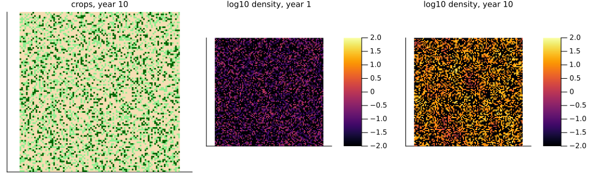
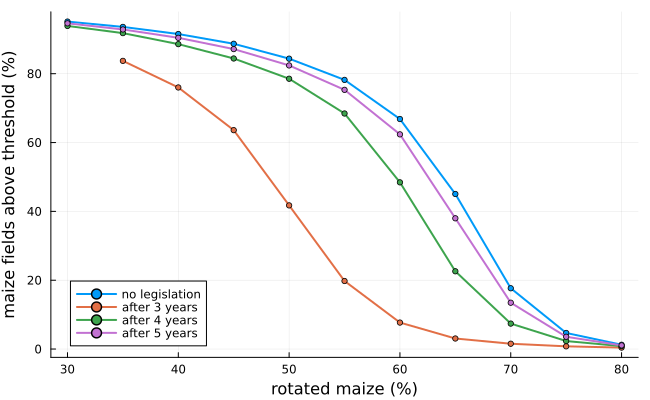
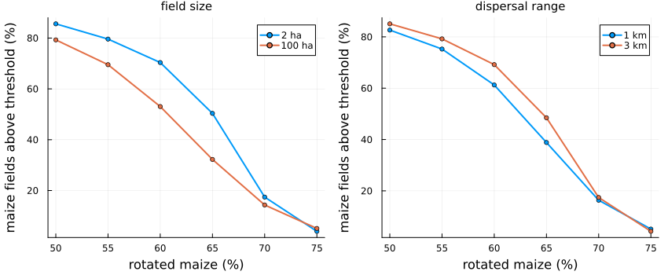

# Crop rotation against the western corn rootworm
Simon Frost

- [Overview](#overview)
- [The crops](#the-crops)
- [Rotation and the law](#rotation-and-the-law)
- [The script and this model](#the-script-and-this-model)
- [Field size and dispersal range](#field-size-and-dispersal-range)
- [Deviations from the source](#deviations-from-the-source)

## Overview

The western corn rootworm *Diabrotica virgifera virgifera* lays its eggs
in maize, and its larvae feed on the roots of the next year’s maize.
Rotating a field to another crop starves them, so rotation is the main
defence, and in parts of Europe the law has required it. Szalai et al.
([2014](#ref-Szalai2014)) asked how much rotation a region needs, and
whether such laws help, with a lattice model of a whole agricultural
region:

- each cell is a field, on a torus of 100 × 100;
- each year a field is in another crop, first-year maize or continuous
  maize, and changes at random with probabilities chosen so that the
  shares of maize and of rotated maize stay as set;
- rootworms grow only in continuous maize, and their populations in a
  field rotated out of maize are lost;
- each year a share of the adults, rising with their density, leaves
  each continuous maize field for the maize fields within its dispersal
  range;
- a field counts as at risk when its density exceeds the economic
  threshold.

This implementation is a **reproduction** of the authors’ R script,
published with the article; run side by side, the two agree in
distribution.

``` julia
ENV["GKSwstype"] = "100"
using EcologicalCellularAutomata
using CellularAutomataCore
using Plots
using Statistics
```

## The crops

The probabilities of staying in or turning to maize keep the shares
fixed. A field in another crop is sown with maize with probability `pE`,
first-year maize stays maize with `pF` and continuous maize with `pC`;
the farmers’ decision factor `Q = pF / pC` says whether they prefer to
rotate young or old maize. Laws that end maize after three, four or five
years change `pC`, which the script finds as the root of a polynomial.

``` julia
[(; policy, rotated,
  probabilities=round.(values(rootworm_probabilities(0.4, 1 - rotated, 1.0, policy)); digits=3))
 for policy in 0:3 for rotated in (0.4, 0.6)
 if rootworm_probabilities(0.4, 1 - rotated, 1.0, policy) !== nothing]
```

    8-element Vector{@NamedTuple{policy::Int64, rotated::Float64, probabilities::Tuple{Float64, Float64, Float64}}}:
     (policy = 0, rotated = 0.4, probabilities = (0.267, 0.6, 0.6))
     (policy = 0, rotated = 0.6, probabilities = (0.4, 0.4, 0.4))
     (policy = 1, rotated = 0.4, probabilities = (0.267, 0.823, 0.823))
     (policy = 1, rotated = 0.6, probabilities = (0.4, 0.457, 0.457))
     (policy = 2, rotated = 0.4, probabilities = (0.267, 0.691, 0.691))
     (policy = 2, rotated = 0.6, probabilities = (0.4, 0.418, 0.418))
     (policy = 3, rotated = 0.4, probabilities = (0.267, 0.644, 0.644))
     (policy = 3, rotated = 0.6, probabilities = (0.4, 0.407, 0.407))

With 40% of the fields in maize and the other parameters at the most
likely values of the source’s Table 1, a run shows the crops and the
rootworms after dispersal in the first and the tenth year:

``` julia
sol = solve(problem(:rootworm_rotation; rotated=0.6, seed=1))
crops(u) = [c == 0 ? 0 : c == 1 ? 1 : 2 for c in u.crop]
plot(heatmap(crops(sol.u[end]); c=cgrad([:wheat, :lightgreen, :darkgreen], 3; categorical=true),
             title="crops, year 10", colorbar=false),
     heatmap(log10.(sol.u[1].pop .+ 0.01); clims=(-2, 2), title="log10 density, year 1"),
     heatmap(log10.(sol.u[end].pop .+ 0.01); clims=(-2, 2), title="log10 density, year 10");
     layout=(1, 3), size=(1000, 300), aspect_ratio=1, ticks=false, titlefontsize=9)
```



The output of a run is the share of maize fields above the threshold,
averaged over years 2 to 10.

## Rotation and the law

The source’s Fig. 5 shows that output against the share of rotated
maize, with all other parameters at their most likely values, without
legislation and with rotation required after three, four or five years
of maize. Ten runs at each point:

``` julia
rots = 0.3:0.05:0.8
labels = ["no legislation", "after 3 years", "after 4 years", "after 5 years"]
curves = Vector{Vector{Float64}}(undef, 4)
Threads.@threads for k in 1:4
    policy = (0, 1, 2, 3)[k]
    curves[k] = [rootworm_probabilities(0.4, 1 - r, 1.0, policy) === nothing ? NaN :
                 mean(rootworm_output(solve(problem(:rootworm_rotation; rotated=r, policy,
                                                    seed=s))) for s in 1:10)
                 for r in rots]
end
plot(100 .* rots, [100 .* c for c in curves]; label=permutedims(labels), lw=2, marker=:circle,
     ms=3, xlabel="rotated maize (%)", ylabel="maize fields above threshold (%)",
     legend=:bottomleft, size=(650, 400))
```



As in the source, nearly every maize field is above the threshold when
less than about 40% of the maize is rotated, and few are above it when
more than about 75% is. A law ending maize after three years needs the
least rotation; after four years, a little less than none; after five
years, about the same as none. The curves sit a few points of rotation
to the right of the source’s Fig. 5 (about 44% of fields above the
threshold at 65% rotated without legislation, against about 35% read
from the figure). The authors’ own script, run with the same parameters,
does the same, so the figure presumably used other values.

## The script and this model

Run 100 times each at 13 points of these curves, the script and this
model give the same distributions of the output, and of its shares in
first-year and continuous maize: the correlations of their empirical
distribution functions are 0.97–1.00, 38 of the 39 Kolmogorov–Smirnov
distances lie below the 5% critical value, and the means differ by at
most 0.05 (0.652 in both at 60% rotated without legislation).

## Field size and dispersal range

Dispersal reaches the fields within the range divided by the side of a
field. The source’s Fig. 6 compares fields of 2 and 100 ha, and ranges
of 1 and 3 km:

``` julia
rots6 = 0.5:0.05:0.75
variant(; kw...) = [mean(rootworm_output(solve(problem(:rootworm_rotation; rotated=r, seed=s,
                                                        pmap=(; kw...)))) for s in 1:10)
                    for r in rots6]
fig6 = [variant(; fieldsize=2.0), variant(; fieldsize=100.0), variant(; range=1000.0),
        variant(; range=3000.0)]
plot(plot(100 .* rots6, [100 .* fig6[1] 100 .* fig6[2]]; label=["2 ha" "100 ha"],
          title="field size"),
     plot(100 .* rots6, [100 .* fig6[3] 100 .* fig6[4]]; label=["1 km" "3 km"],
          title="dispersal range");
     xlabel="rotated maize (%)", ylabel="maize fields above threshold (%)", lw=2, marker=:circle,
     ms=3, layout=(1, 2), size=(850, 350), titlefontsize=10, left_margin=4Plots.mm,
     bottom_margin=4Plots.mm)
```



Larger fields and shorter ranges leave some maize fields out of the
reach of others, and so slightly fewer above the threshold, as the
source found.

## Deviations from the source

``` julia
foreach(d -> println("- ", d), model_info(:rootworm_rotation).deviations)
```

    - Random numbers come from a counter-based generator for each field's crop change and from a generator seeded by the year for growth and emigration, so runs differ from the script's draw by draw and agree in distribution.
    - The state at time 0 is the first year after dispersal; the output averages years 2 to 10 (the saved states at times 1 to 9), as the script's mean(risk[2:evmax]).
    - The defaults are the most likely values of the article's Table 1 (the script's sample run uses other limits for growth and emigration). With them both the script and this model put the curves of the article's Fig. 5 about 3 to 5 percentage points of rotation further right (e.g. 43% of maize fields above the threshold at 65% rotated without legislation, against about 35% read from the figure), so the figure presumably used other values.
    - The Sobol sensitivity analysis and the metamodels of the article are not reproduced.

```@raw html
<div id="refs" class="references csl-bib-body hanging-indent">
```

```@raw html
<div id="ref-Szalai2014" class="csl-entry">
```

Szalai, Márk, József Kiss, Szilvia Kövér, and Stefan Toepfer. 2014.
“Simulating Crop Rotation Strategies with a Spatiotemporal Lattice Model
to Improve Legislation for the Management of the Maize Pest
Diabrotica virgifera virgifera.”
*Agricultural Systems* 124: 39–50.
<https://doi.org/10.1016/j.agsy.2013.10.009>.

```@raw html
</div>
```

```@raw html
</div>
```
