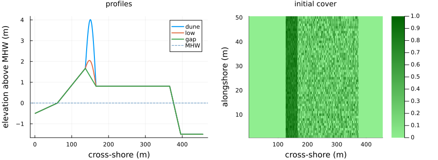
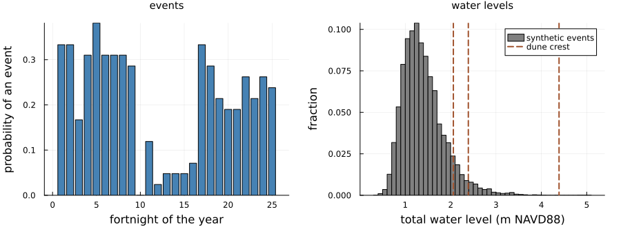
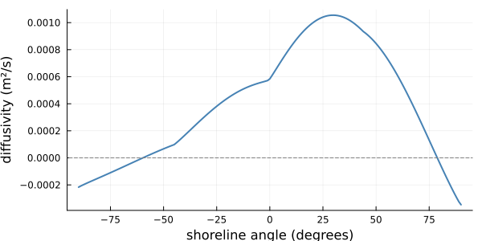
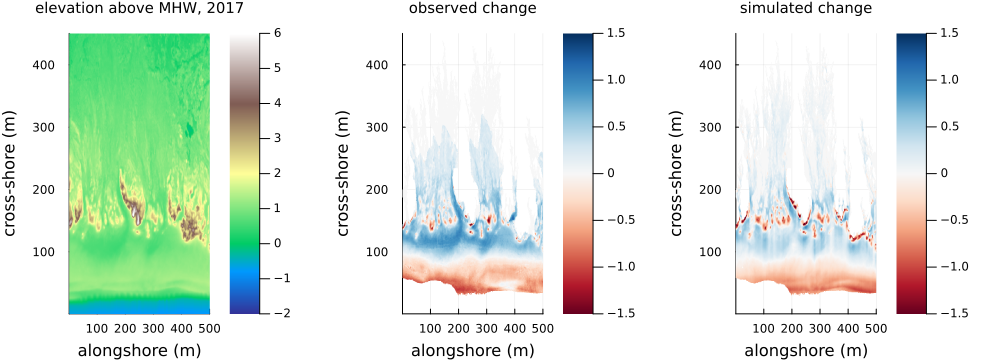
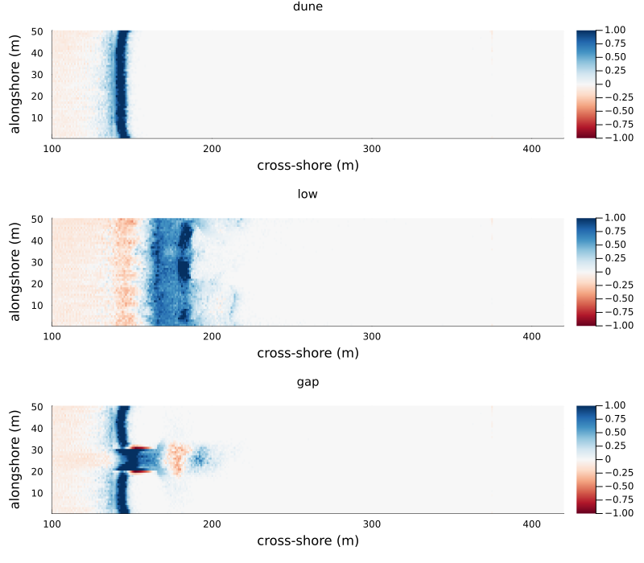
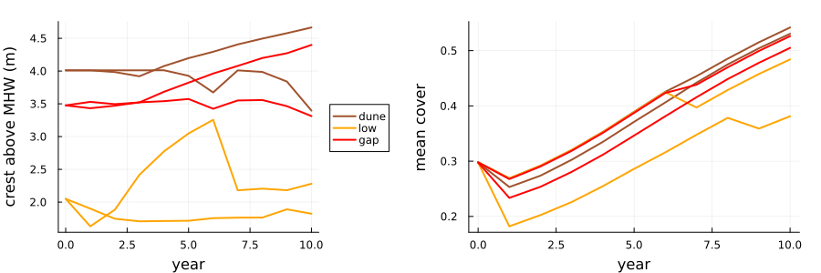
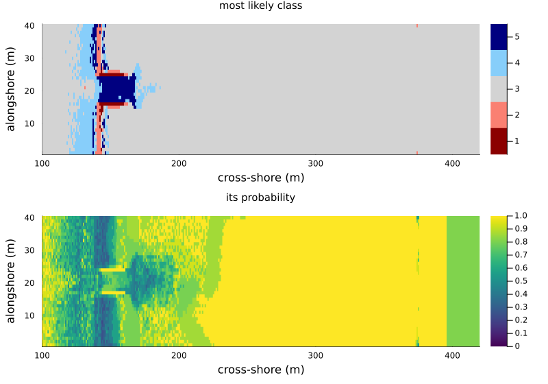

# A barrier island
Simon Frost

- [Overview](#overview)
- [The barrier](#the-barrier)
- [The forcing](#the-forcing)
- [Hurricane Florence](#hurricane-florence)
- [A decade on three barriers](#a-decade-on-three-barriers)
- [What the plants respond to](#what-the-plants-respond-to)
- [Probabilistic projections](#probabilistic-projections)
- [Summary](#summary)
- [Deviations from the source](#deviations-from-the-source)
- [References](#references)

## Overview

MEEB, the Mesoscale Explicit Ecogeomorphic Barrier model of Reeves et
al. ([2025](#ref-Reeves2025)), simulates an undeveloped barrier island
over years to decades, on 1 m cells and weekly steps. It couples four
components:

- **Aeolian**: the sand-slab automaton of DuBeVeg, which the dune model
  of vignette 20 also uses, with saltation hops of 5 ± 2 cells. The wind
  blows each week in one of four directions drawn from a wind rose, and
  the plants the wind sees are their cover smoothed over a few metres.
- **Marine**: every second week a high-water event may strike. Seaward
  of the foredune crest it erodes the beach and dune face by a
  cross-shore sediment flux (Eq. 2-3). Landward of the crest it routes
  overwash, and the sand it carries, cell by cell across the barrier
  (Eq. 4-9), and the plants die wherever it floods.
- **Shoreline**: the ocean shoreline and the shoreface toe move with
  sea-level rise and the sand gained or lost (Eq. 11-14), and the
  shoreline diffuses alongshore with the wave climate (Eq. 19-22).
- **Vegetation**: once a year a burial-tolerant type (dune grasses) and
  a burial-intolerant type (shrubs) grow or die back with their burial,
  and spread to new cells.

The authors calibrate MEEB for North Core Banks, North Carolina, and
test it against lidar of Hurricane Florence (2018) and of 2014 to 2017.
This vignette runs the port in this package, `barrier_island`, which
follows the authors’ code, MEEB 1.0.1, where the paper is brief. It
checks the forcing against the paper’s Table A1, repeats the Florence
hindcast of the marine component, runs a decade on idealised barriers,
looks at one point where the code and the paper differ, and runs the
paper’s probabilistic framework in small.

``` julia
ENV["GKSwstype"] = "100"
using EcologicalCellularAutomata
using CellularAutomataCore
using Plots
using Random
using Statistics
```

## The barrier

The source starts from lidar and imagery of North Core Banks. Those
arrays are 100 MB each and are not shipped here, so
`problem(:barrier_island)` builds an idealised barrier, every row the
same profile: a shoreface of the equilibrium slope below mean high water
(MHW, 0.39 m NAVD88), a beach rising to a dune toe 1.67 m above MHW (the
paper’s mean dune toe height), a foredune 4 m above MHW (the tall
foredunes of North Core Banks reach about 5 m), a level interior, a
back-barrier slope and a bay 1.5 m below MHW. Dune grasses cover the
foredune, and shrubs half the interior, at the paper’s initial densities
of 0.4 to 1. `scenario = :gap` removes the foredune in the middle fifth
of the rows, and `:low` lowers it to 2 m above MHW.

``` julia
MHW = 0.39
profiles = (dune=barrier_profile(), low=barrier_profile(; dune=2.0),
            gap=barrier_profile(; dune=0.0))
p1 = plot(xlabel="cross-shore (m)", ylabel="elevation above MHW (m)", legend=:topright,
          title="profiles", titlefontsize=10)
for (name, z) in pairs(profiles)
    plot!(p1, z .- MHW; lw=2, label=string(name))
end
hline!(p1, [0]; color=:steelblue, ls=:dash, label="MHW")
prob = problem(:barrier_island; alongshore=50, seed=1)
p2 = heatmap(prob.u0.spec1 .+ prob.u0.spec2; c=:greens, clims=(0, 1),
             xlabel="cross-shore (m)", ylabel="alongshore (m)", title="initial cover",
             titlefontsize=10)
plot(p1, p2; layout=(1, 2), size=(900, 330), margin=4Plots.mm)
```

```@raw html
<div id="fig-barrier">
```



Figure 1: The idealised barrier (sea to the left): the profiles of the
three scenarios against MHW, and the initial cover of the two plant
types (dune grasses on the foredune, shrubs in the interior).

```@raw html
</div>
```

## The forcing

The shoreface depth, its equilibrium slope and its response rate follow
from the wave climate and the sediment (Eq. 15-18). Table A1 gives 20.07
m, 0.00822 and 5926 m³/m/yr:

``` julia
sf = barrier_shoreface()
(depth=round(sf.D; digits=2), equilibrium_slope=round(sf.S_eq; digits=5),
 response_rate=round(Int, sf.k))
```

    (depth = 20.07, equilibrium_slope = 0.00822, response_rate = 5926)

High-water events occur at most once a fortnight, with a probability
that depends on the fortnight of the year, from the 1979 to 2020 record
of North Core Banks (the paper’s Fig. 4b). An event is one of 9999
synthetic storms from a copula model of that record. Its total water
level is the still water level plus the runup of Stockdon et al. (2006)
on the local beach, so it varies alongshore with the beach slope.

``` julia
storms = barrier_storms()
slope = 1.67 / 76                      # the idealised beach, from MHW to the dune toe
HL = storms[:, 1] .* 9.8 .* storms[:, 4] .^ 2 ./ 2π
twl = storms[:, 3] .+ 1.1 .* (0.35 .* slope .* sqrt.(HL) .+
                              sqrt.((0.75 .* slope .* sqrt.(HL)) .^ 2 .+ 0.06^2 .* HL) ./ 2)
crests = (dune=MHW + 4, low=MHW + 2, gap=maximum(profiles.gap))
q1 = bar(prob.p.pstorm; color=:steelblue, legend=false, xlabel="fortnight of the year",
         ylabel="probability of an event", title="events", titlefontsize=10)
q2 = histogram(twl; bins=60, color=:gray, normalize=:probability, legend=:topright,
               label="synthetic events", xlabel="total water level (m NAVD88)",
               ylabel="fraction", title="water levels", titlefontsize=10)
vline!(q2, collect(values(crests)); lw=2, ls=:dash, color=[:sienna :orange :red],
       label=["dune crest" "low dune crest" "gap"])
plot(q1, q2; layout=(1, 2), size=(900, 330), margin=4Plots.mm)
```

```@raw html
<div id="fig-storms">
```



Figure 2: The storm climate of North Core Banks: the probability of an
event in each fortnight of the year (left; the paper’s Fig. 4b), and the
total water levels of the synthetic events on the barrier’s beach
(right), against the crests of the three scenarios.

```@raw html
</div>
```

``` julia
(events_a_year=round(sum(prob.p.pstorm); digits=1),
 above_gap=round(mean(twl .> crests.gap); digits=3),
 above_low_dune=round(mean(twl .> crests.low); digits=3),
 above_dune=round(mean(twl .> crests.dune); digits=4))
```

    (events_a_year = 5.3, above_gap = 0.086, above_low_dune = 0.037, above_dune = 0.0003)

There are about five events a year. On this beach almost none of them
overtops the foredune 4 m above MHW (3 in 10,000). About 4% overtop the
low dune, and 9% the gap, whose highest point is the dune toe.

Alongshore, the shoreline diffuses at a rate set by the wave climate
(Eq. 20-22): 60% of waves come from the left, looking offshore, and 39%
at high angles (beyond 45°). The diffusivity depends on the shoreline’s
angle (the paper’s Fig. 4c):

``` julia
d = barrier_diffusivity()
plot(90:-1:-90, d ./ (365 * 24 * 3600); lw=2, color=:steelblue, legend=false,
     xlabel="shoreline angle (degrees)", ylabel="diffusivity (m²/s)", size=(600, 300))
hline!([0]; color=:gray, ls=:dash)
```

```@raw html
<div id="fig-diffusivity">
```



Figure 3: The wave-climate-averaged shoreline diffusivity against the
shoreline angle (the paper’s Fig. 4c).

```@raw html
</div>
```

## Hurricane Florence

The paper tests the marine component on Hurricane Florence, which made
landfall in September 2018 and washed over much of North Core Banks.
Starting from lidar of 2017, it runs one event (a total water level of
3.32 m NAVD88 for 83 hours, in hourly steps of 50 substeps) and compares
the change with lidar of October 2018. It scores the change with the
Brier skill score (Eq. 24), one minus the squared error relative to that
of predicting no change, over the cells above MHW in both surveys that
the simulated or the observed overwash reached: landward of the crest,
seaward of it, and both. Its Table 1 gives 0.65, 0.69 and 0.46 at the
test site of its Fig. 5a, the one that MEEB’s own test script runs. That
site ships with this package, `barrier_florence_site()`, cropped from
MEEB’s input files. The event is deterministic, so the port should
reproduce these scores.

``` julia
site = barrier_florence_site()
p = merge(defaults(build_barrier_island()), (; overwash_substeps=50))
u = (topo=copy(site.before), spec1=site.spec1, spec2=site.spec2,
     veg=clamp.(site.spec1 .+ site.spec2, 0, 1))
crest = barrier_crest(site.before, site.MHW)[1]
florence = barrier_event!(u, p, site.Rhigh, site.duration; rng=Random.Xoshiro(13))
rows, cols = size(u.topo)
dry = (u.topo .> site.MHW) .& (site.after .> site.MHW)
observed_overwash = site.overwash .& dry
seaward = [c < crest[r] for r in 1:rows, c in 1:cols] .& dry
observed = site.after .- site.before
observed[.!(observed_overwash .| seaward)] .= 0     # change elsewhere is not the storm's
reached = (observed_overwash .| florence.flooded) .& dry
skill(mask) = round(brier_skill_score(florence.change, observed, zeros(rows, cols), mask);
                    digits=2)
[(where="landward and seaward", port=skill(reached), Table_1=0.65),
 (where="seaward of the crest", port=skill(seaward), Table_1=0.69),
 (where="landward of the crest", port=skill(reached .& .!seaward), Table_1=0.46)]
```

    3-element Vector{@NamedTuple{where::String, port::Float64, Table_1::Float64}}:
     (where = "landward and seaward", port = 0.65, Table_1 = 0.65)
     (where = "seaward of the crest", port = 0.69, Table_1 = 0.69)
     (where = "landward of the crest", port = 0.46, Table_1 = 0.46)

``` julia
panel(z, title; c=:RdBu, clims=(-1.5, 1.5)) =
    heatmap(permutedims(z[:, 1:450]); c, clims, title, titlefontsize=10,
            xlabel="alongshore (m)", ylabel="cross-shore (m)")
plot(panel(site.before .- site.MHW, "elevation above MHW, 2017"; c=:terrain, clims=(-2, 6)),
     panel(ifelse.(reached .| seaward, observed, NaN), "observed change"),
     panel(ifelse.(reached .| seaward, florence.change, NaN), "simulated change");
     layout=(1, 3), size=(1000, 360), margin=4Plots.mm)
```

```@raw html
<div id="fig-florence">
```



Figure 4: Hurricane Florence at the test site of the paper’s Fig. 5a
(sea at the bottom): the elevation before the storm, and the observed
and simulated change (m) seaward of the crest and wherever the observed
or simulated water reached.

```@raw html
</div>
```

The port reproduces all three scores of Table 1 at this site. The same
code, run on MEEB 1.0.1’s input files at the three other test sites of
the paper’s Fig. 5, also matches Table 1 to two decimals:

- Fig. 5b: 0.64, 0.64 and 0.40, against 0.64, 0.64 and 0.40;
- Fig. 5c: 0.22, 0.19 and 0.21, against 0.22, 0.19 and 0.20;
- Fig. 5d: 0.79, 0.79 and 0.56, against 0.79, 0.79 and 0.56.

Those three sites are not shipped. The beach equation, the overwash
routing, the detection of the crest and the avalanching thus behave as
the authors’ code does.

The paper also tests the aeolian component (its Fig. 6 and the second
half of Table 1). It runs the whole model from lidar of April 2014 to
September 2017, 3.44 years with the hindcast storms and 6 mm/yr of
sea-level rise. It scores the elevation change within a foredune field,
and also the change in the height of the foredune crest, and averages
the two. The winds are random, so these scores vary from run to run. The
paper reports one run per site.

The port ran the same hindcast at the four test sites of MEEB’s own
script, on MEEB 1.0.1’s input files (not shipped). Each site had four
seeds, with the sedimentation balance cleared weekly as in the code. The
four sites are identified by their position along the island, in metres;
each score is the mean over the seeds, with its range:

| Site  | Cells               | Crest height           | Both                |
|-------|---------------------|------------------------|---------------------|
| 20500 | 0.22 (0.22 to 0.22) | 0.07 (-0.01 to 0.20)   | 0.14 (0.11 to 0.21) |
| 22400 | 0.04 (0.03 to 0.05) | 0.08 (0.03 to 0.16)    | 0.06 (0.04 to 0.10) |
| 8400  | 0.24 (0.24 to 0.24) | -0.02 (-0.06 to 0.01)  | 0.11 (0.09 to 0.12) |
| 4000  | 0.22 (0.22 to 0.23) | -0.05 (-0.06 to -0.03) | 0.09 (0.08 to 0.10) |

Table 1 gives 0.24, 0.04 and 0.14 (Fig. 6a); 0.03, 0.03 and 0.03 (6b);
0.23, 0.22 and 0.23 (6c); and 0.23, -0.03 and 0.10 (6d). The paper does
not say which panel is which site. The cell-by-cell scores match Table
1’s to within 0.02 at every site, among them the one site where the
model has almost no skill (0.03 in Table 1, 0.04 here). Three of the
four crest scores lie within the port’s range over seeds. The paper’s
0.22 lies at the top of one site’s range, which reaches 0.20.

Both the paper and the port find that the model “tends to underestimate
the vertical extent of dune growth”. The observed crests rose 0.17 to
0.57 m, and the simulated ones rose 0.0 to 0.1 m. With the balance kept
over the year instead, the scores are nearly the same over these 3.4
years.

## A decade on three barriers

Ten years on each scenario, two runs each, on 50 rows of 1 m with no
sea-level rise. Each run records the foredune crest height above MHW,
the subaerial volume, the plant cover and the shoreline every year, and
the events.

``` julia
function barrier_run(scenario; rows=50, years=10, seed=1, pmap=(;))
    prob = problem(:barrier_island; scenario, alongshore=rows, years, seed, pmap)
    p, u = prob.p, deepcopy(prob.u0)
    start = copy(u.topo)
    measures = [barrier_measures(u, p.MHW)]
    twl = Float64[]
    for t in 1:(50years)
        r = barrier_step!(u, p, t, Random.Xoshiro(hash((prob.seed, t, :barrier))),
                          Random.Xoshiro(hash((prob.seed, t, :barrier_storm))))
        r.event && push!(twl, r.twl)
        t % 50 == 0 && push!(measures, barrier_measures(u, p.MHW + p.RSLR * t / 50))
    end
    return (; measures, twl, start, final=copy(u.topo), u)
end
cases = [(s, seed) for s in (:dune, :low, :gap) for seed in 1:2]
runs = Dict(zip(cases, fetch.([Threads.@spawn barrier_run(s; seed) for (s, seed) in cases])))
gain(r, cols) = sum(r.final[:, cols] .- r.start[:, cols]) / size(r.start, 1)   # m³/m
[(scenario=s, seed=seed, events=length(r.twl),
  above_its_crest=count(>(crests[s]), r.twl),
  crest_start=round(r.measures[1].crest; digits=2),
  crest_end=round(r.measures[end].crest; digits=2),
  highest_end=round(mean(maximum(r.final[k, :]) for k in 1:50) - MHW; digits=2),
  beach_and_dune=round(gain(r, 61:166); digits=1),
  interior=round(gain(r, 167:396); digits=1),
  cover_start=round(r.measures[1].cover; digits=2),
  cover_end=round(r.measures[end].cover; digits=2),
  shoreline_moved=round(r.measures[end].shoreline - r.measures[1].shoreline; digits=1))
 for ((s, seed), r) in sort(collect(runs); by=first)]
```

    6-element Vector{@NamedTuple{scenario::Symbol, seed::Int64, events::Int64, above_its_crest::Int64, crest_start::Float64, crest_end::Float64, highest_end::Float64, beach_and_dune::Float64, interior::Float64, cover_start::Float64, cover_end::Float64, shoreline_moved::Float64}}:
     (scenario = :dune, seed = 1, events = 60, above_its_crest = 0, crest_start = 4.01, crest_end = 4.67, highest_end = 4.74, beach_and_dune = 8.6, interior = -0.0, cover_start = 0.3, cover_end = 0.53, shoreline_moved = 1.4)
     (scenario = :dune, seed = 2, events = 52, above_its_crest = 0, crest_start = 4.01, crest_end = 3.4, highest_end = 4.03, beach_and_dune = 9.0, interior = -0.0, cover_start = 0.3, cover_end = 0.54, shoreline_moved = 1.4)
     (scenario = :gap, seed = 1, events = 60, above_its_crest = 6, crest_start = 3.48, crest_end = 4.4, highest_end = 4.51, beach_and_dune = 10.0, interior = 1.3, cover_start = 0.3, cover_end = 0.51, shoreline_moved = 1.7)
     (scenario = :gap, seed = 2, events = 52, above_its_crest = 9, crest_start = 3.48, crest_end = 3.31, highest_end = 3.75, beach_and_dune = 9.8, interior = 0.0, cover_start = 0.3, cover_end = 0.53, shoreline_moved = 1.5)
     (scenario = :low, seed = 1, events = 60, above_its_crest = 4, crest_start = 2.05, crest_end = 1.82, highest_end = 2.1, beach_and_dune = -2.4, interior = 18.3, cover_start = 0.3, cover_end = 0.38, shoreline_moved = 2.3)
     (scenario = :low, seed = 2, events = 52, above_its_crest = 4, crest_start = 2.05, crest_end = 2.28, highest_end = 2.83, beach_and_dune = 9.2, interior = -0.0, cover_start = 0.3, cover_end = 0.48, shoreline_moved = 1.4)

The middle fifth of the rows, the gap in the `:gap` barrier:

``` julia
middle = 21:30
[(scenario=s, seed=seed,
  highest_point=round(mean(maximum(r.final[k, 61:170]) for k in middle) - MHW; digits=2),
  beach_and_dune=round(sum(r.final[middle, 61:166] .- r.start[middle, 61:166]) / 10;
                       digits=1),
  interior=round(sum(r.final[middle, 167:396] .- r.start[middle, 167:396]) / 10; digits=1),
  biggest_events=round.(sort(r.twl; rev=true)[1:3]; digits=2))
 for ((s, seed), r) in sort(collect(runs); by=first) if s !== :dune]
```

    4-element Vector{@NamedTuple{scenario::Symbol, seed::Int64, highest_point::Float64, beach_and_dune::Float64, interior::Float64, biggest_events::Vector{Float64}}}:
     (scenario = :gap, seed = 1, highest_point = 3.25, beach_and_dune = 21.6, interior = 3.9, biggest_events = [3.0, 2.92, 2.69])
     (scenario = :gap, seed = 2, highest_point = 2.72, beach_and_dune = 18.2, interior = 0.3, biggest_events = [3.12, 2.51, 2.49])
     (scenario = :low, seed = 1, highest_point = 2.07, beach_and_dune = -1.2, interior = 18.7, biggest_events = [2.98, 2.85, 2.64])
     (scenario = :low, seed = 2, highest_point = 2.76, beach_and_dune = 9.6, interior = -0.0, biggest_events = [3.1, 2.5, 2.49])

Sand blows off the beach onto the foredune. On the continuous dune and
the low one, the beach and dune gain about 9 m³ per metre of coast in
ten years, and the interior, where the shrubs stop all entrainment, does
not change. The crest that MEEB’s procedure finds rises from 4.01 to
4.67 m above MHW in the first run. In the second it falls to 3.40 m,
though the dune was never overtopped. A new ridge 3.6 m high has grown
on the dune’s seaward face, and AutoMorph’s rule takes the most seaward
peak within 10% of the highest; the old crest still stands at 4.03 m.
Plant cover rises from 0.30 to about 0.53 as the grasses spread onto the
beach and the shrubs fill the interior. With no sea-level rise the
shoreline still moves about 1.4 m landward, because the storms move sand
from the shoreface onto the beach (Eq. 13, qbd).

The low dune shows how much the timing of storms matters. In the first
run, events of 2.6 to 3.0 m NAVD88 come early and overtop it. Their
overwash carries 18.7 m³ per metre into the interior of the middle rows,
and the beach and dune lose sand. In the second run the early events are
smaller, and the dune grows to 2.8 m above MHW. Even its event of 3.1 m
then fails to overtop it, and nothing reaches the interior. The gap does
not stay open. Sand blown into it builds a dune 2.7 to 3.3 m above MHW
where there was none, and the gap’s beach and dune gain about twice as
much as elsewhere (18 to 22 m³/m). Only the first run’s early events
wash over it before it closes, with 3.9 m³/m in the interior behind.

``` julia
plot([heatmap(runs[(s, 1)].final .- runs[(s, 1)].start; c=:RdBu, clims=(-1, 1),
              title=string(s), titlefontsize=10, xlabel="cross-shore (m)",
              ylabel="alongshore (m)", xlims=(100, 420))
      for s in (:dune, :low, :gap)]...; layout=(3, 1), size=(800, 700), margin=3Plots.mm)
```

```@raw html
<div id="fig-decade">
```



Figure 5: Elevation change (m) over ten years on the three barriers
(first seed; sea to the left).

```@raw html
</div>
```

``` julia
c1 = plot(xlabel="year", ylabel="crest above MHW (m)", legend=:outerright)
c2 = plot(xlabel="year", ylabel="mean cover", legend=false)
for (s, col) in zip((:dune, :low, :gap), (:sienna, :orange, :red)), seed in 1:2
    r = runs[(s, seed)]
    plot!(c1, 0:10, [m.crest for m in r.measures]; color=col, lw=2,
          label=seed == 1 ? string(s) : "")
    plot!(c2, 0:10, [m.cover for m in r.measures]; color=col, lw=2)
end
plot(c1, c2; layout=(1, 2), size=(900, 300), margin=4Plots.mm)
```

```@raw html
<div id="fig-crest">
```



Figure 6: The foredune crest above MHW, as MEEB’s procedure finds it,
and the plant cover each year (both seeds).

```@raw html
</div>
```

## What the plants respond to

The paper says growth depends on “the net erosion/deposition over the
course of the preceding year” (Sect. 2.1). MEEB’s code clears its
sedimentation balance at the end of every weekly step, so at the yearly
vegetation update its plants see only that week’s burial. The port
follows the paper by default (`balance_period = :year`); `:week` follows
the code.

``` julia
weekly = Dict(seed => barrier_run(:dune; seed, pmap=(; balance_period=:week)) for seed in 1:2)
[(balance=b, seed=seed, crest_end=round(r.measures[end].crest; digits=2),
  beach_and_dune=round(gain(r, 61:166); digits=1),
  grass_on_the_dune=round(mean(r.u.spec1[:, 126:166]); digits=2),
  cover_end=round(r.measures[end].cover; digits=2))
 for (b, set) in (("year", Dict(k => runs[(:dune, k)] for k in 1:2)), ("week", weekly))
 for (seed, r) in sort(collect(set); by=first)]
```

    4-element Vector{@NamedTuple{balance::String, seed::Int64, crest_end::Float64, beach_and_dune::Float64, grass_on_the_dune::Float64, cover_end::Float64}}:
     (balance = "year", seed = 1, crest_end = 4.67, beach_and_dune = 8.6, grass_on_the_dune = 0.55, cover_end = 0.53)
     (balance = "year", seed = 2, crest_end = 3.4, beach_and_dune = 9.0, grass_on_the_dune = 0.61, cover_end = 0.54)
     (balance = "week", seed = 1, crest_end = 4.46, beach_and_dune = 8.5, grass_on_the_dune = 0.51, cover_end = 0.53)
     (balance = "week", seed = 2, crest_end = 3.4, beach_and_dune = 8.6, grass_on_the_dune = 0.6, cover_end = 0.54)

Over a decade on this barrier the difference is small. With the code’s
weekly balance, grass covers a little less of the dune (about 0.5 and
0.6 against 0.55 and 0.61), and the first run’s crest ends 0.2 m lower.
The dune gains almost the same sand. Grass grows fastest under moderate
burial, about 0.5 m a year at the peak of its curve, and a single week
rarely brings that much. So under the code’s balance the grasses grow
close to their rate at no burial, whichever cells the wind is building.
The effect would grow with time and with the burial the dunes receive.

## Probabilistic projections

The paper’s probabilistic framework (Sect. 2.6, Fig. 8) runs batches of
duplicate simulations, which differ only in their random storms, winds
and plants, for each bin of a distribution of the external forcing,
weights their outcomes by the bin’s probability, and maps the most
likely class of elevation change and how certain it is. Its bins are
three rates of sea-level rise to 2050 under SSP5-8.5: 6.8, 9.6 and 12.4
mm/yr, with probabilities 0.26, 0.55 and 0.19. Its classes are more than
0.5 m of erosion, 0.1 to 0.5 m of erosion, within 0.1 m, 0.1 to 0.5 m of
deposition, and more than 0.5 m of deposition, as in MEEB’s code. The
paper runs 32 duplicates for 32 years on 500 m of North Core Banks; here
there are four for ten years, on 40 rows of the barrier with a gap.

``` julia
bins, weights = (0.0068, 0.0096, 0.0124), (0.26, 0.55, 0.19)
edges = (-Inf, -0.5, -0.1, 0.1, 0.5, Inf)
labels = ["major erosion", "minor erosion", "negligible", "minor deposition",
          "major deposition"]
ensemble = [(b, k) for b in 1:3 for k in 1:4]
outcomes = fetch.([Threads.@spawn barrier_run(:gap; rows=40, seed=100b + k,
                                              pmap=(; RSLR=bins[b]))
                   for (b, k) in ensemble])
classify(Δ) = findfirst(i -> edges[i] <= Δ < edges[i + 1], 1:5)
joint = zeros(5, size(outcomes[1].final)...)
for ((b, k), r) in zip(ensemble, outcomes), I in CartesianIndices(r.final)
    joint[classify(r.final[I] - r.start[I]), I] += weights[b] / 4
end
likely = [argmax(view(joint, :, I)) for I in CartesianIndices(outcomes[1].final)]
certainty = [maximum(view(joint, :, I)) for I in CartesianIndices(outcomes[1].final)]
land = 61:396                          # the barrier, shoreline to bay
[(class=labels[c], share_of_barrier=round(mean(likely[:, land] .== c); digits=3),
  mean_certainty=count(likely[:, land] .== c) > 0 ?
                 round(mean(certainty[:, land][likely[:, land] .== c]); digits=2) : missing)
 for c in 1:5]
```

    5-element Vector{@NamedTuple{class::String, share_of_barrier::Float64, mean_certainty::Float64}}:
     (class = "major erosion", share_of_barrier = 0.004, mean_certainty = 0.58)
     (class = "minor erosion", share_of_barrier = 0.009, mean_certainty = 0.46)
     (class = "negligible", share_of_barrier = 0.921, mean_certainty = 0.93)
     (class = "minor deposition", share_of_barrier = 0.044, mean_certainty = 0.56)
     (class = "major deposition", share_of_barrier = 0.022, mean_certainty = 0.62)

Over ten years most of this barrier, the vegetated interior, most likely
changes by less than 0.1 m, and that is near certain. The change is on
the beach and dune:

- deposition on the upper beach;
- erosion in a strip along the foot of the dune, where storms cut the
  dune face, and along the walls of the gap;
- major deposition filling the gap, where the wind builds a dune.

Each of these is most likely with a probability of only 0.3 to 0.6.
Behind the gap the duplicates disagree too, as behind the dunes in the
paper’s Fig. 8, with its “small but very real possibility” of overwash.
The bay is the one place where the bins differ clearly. Its floor is
held 1.5 m below a rising MHW, so it rises by more than 0.1 m only at
the fastest rate, and “negligible” there has the probability 0.81 =
0.26 + 0.55. Elsewhere ten years of sea-level rise, at most 0.12 m,
moves few cells across a class boundary, so the bins differ mostly
through their random storms. Over the paper’s 32 years they would
separate more.

``` julia
colours = cgrad([:darkred, :salmon, :lightgray, :lightskyblue, :navy], 5; categorical=true)
plot(heatmap(likely; c=colours, clims=(0.5, 5.5), xlims=(100, 420), title="most likely class",
             titlefontsize=10, xlabel="cross-shore (m)", ylabel="alongshore (m)",
             colorbar_ticks=(1:5, labels)),
     heatmap(certainty; c=:viridis, clims=(0, 1), xlims=(100, 420), title="its probability",
             titlefontsize=10, xlabel="cross-shore (m)", ylabel="alongshore (m)");
     layout=(2, 1), size=(800, 560), margin=3Plots.mm)
```

```@raw html
<div id="fig-probabilistic">
```



Figure 7: The most likely class of elevation change after ten years on
the barrier with a gap (rows 17 to 24), weighted over three rates of
sea-level rise and four duplicates each, and the probability of that
class (the paper’s Fig. 8).

```@raw html
</div>
```

## Summary

| Question | Result |
|----|----|
| Does the forcing match Table A1? | Yes: the shoreface depth, equilibrium slope and response rate to the digits given |
| Does the marine component match the paper’s hindcast of Hurricane Florence? | Yes: all three Brier skill scores at the shipped site, and at the three other test sites run on MEEB’s files, to two decimals |
| Does the aeolian component match the paper’s 2014 to 2017 hindcast? | Yes, within the variation between seeds: cell-by-cell scores within 0.02 at all four sites (run on MEEB’s files), three of four crest scores within the port’s range; dune growth is underestimated, as the paper finds |
| Does a tall foredune protect the barrier? | Yes: in ten years of North Carolina’s storms nothing overtops 4 m above MHW, and the dune grows |
| Does a low dune? | It depends on the storms’ timing: overtopped early, it sends 19 m³/m into the interior; spared early, it grows out of reach |
| Does a gap stay open? | No: wind-blown sand builds a dune in it within a few years, after at most a little washover |
| Does the code’s weekly balance matter? | A little over ten years: slightly less dune grass and a lower crest |

## Deviations from the source

``` julia
foreach(d -> println("- ", d), model_info(:barrier_island).deviations)
```

    - The domain is an idealised barrier (a shoreface, a linear beach to a dune toe 1.67 m above MHW, a foredune, a level interior, a back-barrier slope and bay) with uniform rows, in place of the lidar and imagery of North Core Banks the source starts from, which are not shipped (MEEB's initial elevations are 100 MB each); initial plant cover follows the paper's density classes (0.4 to 1). Only the test site of Fig. 5a is shipped, for the Florence hindcast, cropped to the 701 m cross-shore that hold the barrier and rounded to the millimetre (its scores are unchanged to two decimals).
    - The source code is followed where the paper is brief: the dune crest procedure, the beach slopes for runup, the storm probabilities by fortnight and the synthetic and hindcast events of North Core Banks are MEEB 1.0.1's. Its erosive timescale (1.48 with 25 beach substeps in each of 25 overwash substeps an hour) is used, where Table A1 gives Te = 0.68 and swaps the two substeps.
    - By default the plants respond to their burial over the year (balance_period = :year), as the paper says; MEEB's code clears the balance every week, so its plants respond to the burial of the week of the vegetation update only (balance_period = :week).
    - Slabs and shadows use open boundaries, as the paper says; MEEB's code rolls the arrays, so slabs blown off one side reappear on the other and can land after a hop, and for seaward and alongshore-up winds its last column or row is not blocked.
    - Avalanching applies to cells above MHW; MEEB's code compares the elevation in slabs with MHW in metres, so its test is nearly always true.
    - Cells are 1 m only (MEEB 1.0.1's default and the paper's resolution); the shoreline equations of the code are in cells and per row, which agree with metres only there.
    - Where a beach slope for runup is not finite, the previous row's is used (0.03 in the first row), as MEEB 1.1.0 does; 1.0.1 has no guard. Savitzky-Golay windows longer than the coast are shortened to it, and even ones by one; MEEB 1.0.1 needs at least 11 rows.
    - The random numbers are Julia's, so runs match MEEB in distribution, not draw for draw.

## References

```@raw html
<div id="refs" class="references csl-bib-body hanging-indent">
```

```@raw html
<div id="ref-Reeves2025" class="csl-entry">
```

Reeves, Ian R. B., Andrew D. Ashton, Erika E. Lentz, Christopher R.
Sherwood, Davina L. Passeri, and Sara L. Zeigler. 2025. “Projecting
Management-Relevant Change of Undeveloped Coastal Barriers with the
Mesoscale Explicit Ecogeomorphic Barrier Model (MEEB) V1.0.”
*Geoscientific Model Development* 18 (23): 9319–48.
<https://doi.org/10.5194/gmd-18-9319-2025>.

```@raw html
</div>
```

```@raw html
</div>
```
