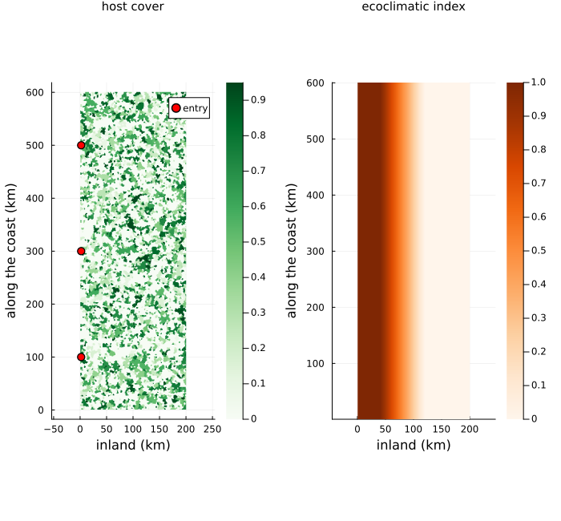
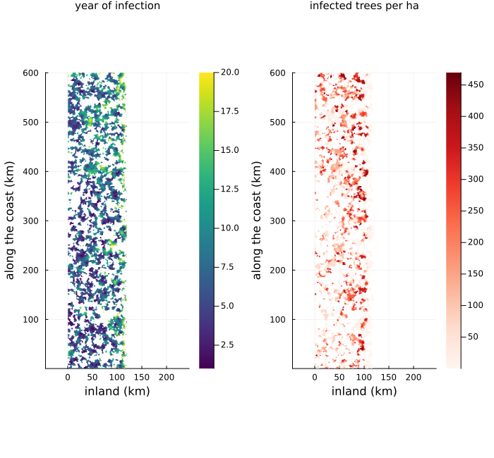
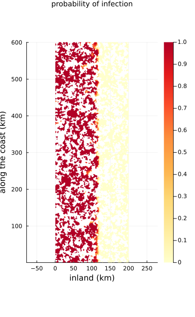
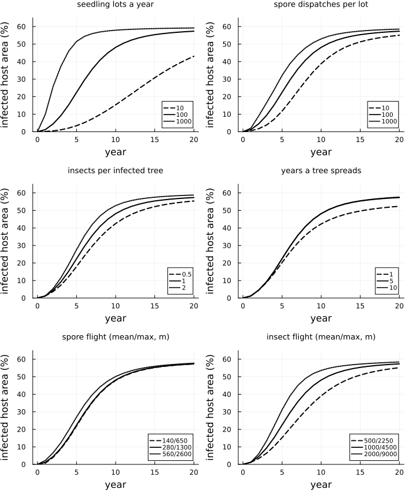

# Pitch canker in Europe
Simon Frost

- [Overview](#overview)
- [The model](#the-model)
- [The synthetic coast](#the-synthetic-coast)
- [Twenty years from three entry
  points](#twenty-years-from-three-entry-points)
- [Sensitivity](#sensitivity)
- [Gaps in the forest](#gaps-in-the-forest)
- [Insect flight distributions](#insect-flight-distributions)
- [Summary](#summary)
- [Deviations from the source](#deviations-from-the-source)
- [References](#references)

## Overview

Pitch canker, caused by the fungus *Fusarium circinatum*, attacks pines
and Douglas fir, killing branches and sometimes whole trees. By the
2000s it had reached plantations and nurseries in northern Spain,
Portugal, France and Italy, carried in seed and seedlings. Möykkynen et
al. ([2015](#ref-Moykkynen2015)) modelled how it could spread through
Europe from its points of entry, on cells of 1 km in yearly steps.
Infected seedling lots are carried from nurseries or ports to forests up
to 300 km away and release spores where they are planted. An infected
tree then spreads the fungus for five years before it dies, by spores
carried a few hundred metres to its own and nearby cells, and by
insects, mostly bark beetles, flying about a kilometre to another tree.
Infection succeeds in proportion to the healthy trees in a cell and to
the cell’s climatic suitability, an ecoclimatic index from 0 to 1. The
authors predicted spread to the pine forests of northern Spain and
south-west France, and argued that because spores fly so short a
distance, the fungus “cannot easily cross spatial discontinuities in the
distribution of host species”.

This implementation is an **adaptation**. The source’s European maps of
host cover and climatic suitability were not published, and its program
is available only from the authors, so the model runs on a synthetic
coast. It reproduces the source’s mechanisms and the directions of its
sensitivity analyses, not its maps.

``` julia
ENV["GKSwstype"] = "100"
using EcologicalCellularAutomata
using CellularAutomataCore
using Plots
using Statistics
```

## The model

Each cell of 1 km² holds up to `N_max` = 500 trees per hectare × 100 ha
= 50,000 host trees, in proportion to its host cover. Every infection,
whatever carries it, takes one healthy tree with probability (Eq. 1 of
the source)

`p = (N_healthy / N_max) × EI`.

Spores from a cell’s spreading trees give a density
`N_spreading / N_max` at the cell’s midpoint, falling as
`exp(-d / 280 m)` out to 1,300 m (Eqs. 2-3), and a cell gains
`N_healthy × EI × density` infections from them (Eq. 4). On 1 km cells
that reach covers only the cell itself and its four orthogonal
neighbours, whose weight is small:

``` julia
(neighbour_weight=round(exp(-1000 / 280); digits=4),
 diagonal_distance_m=round(Int, hypot(1000, 1000)))
```

    (neighbour_weight = 0.0281, diagonal_distance_m = 1414)

The model is a cellular automaton for the spores and the ageing of
infected trees, and a callback for the seedling lots and the insects,
which act at a distance one tree at a time:

``` julia
model = build_pitch_canker()
(layers=length(model.states), parameters=length(model.parameters))
```

    (layers = 12, parameters = 17)

## The synthetic coast

The coast runs along the left edge of a landscape 600 km long and 200 km
deep. Host cover is patchy, half the cells holding none; the ecoclimatic
index is 1 on a coastal strip 40 km wide and falls to 0 at 120 km, as
the source’s index is highest on the coasts. Three entry points on the
coast stand in for Gijón and Bilbao, about 200 km apart, from the first
year, and Brindisi from the fourth, each sending 100 infected seedling
lots a year (Table 2 of the source).

``` julia
prob = problem_pitch_canker(; seed=1)
u0 = prob.u0
entries = prob.p.entries
function panel(A, title; kw...)
    heatmap(A; aspect_ratio=:equal, xlabel="inland (km)", ylabel="along the coast (km)",
            title, titlefontsize=10, kw...)
end
plot(panel(u0.coverage, "host cover"; c=:Greens),
     panel(u0.ei_now, "ecoclimatic index"; c=:Oranges),
     layout=(1, 2), size=(700, 650))
scatter!([e.j for e in entries], [e.i for e in entries]; subplot=1, label="entry",
         c=:red, ms=5)
```

```@raw html
<div id="fig-landscape">
```



Figure 1: The synthetic coast: host cover (left) and ecoclimatic index
(right), with the three entry points.

```@raw html
</div>
```

## Twenty years from three entry points

``` julia
sol = solve(prob, Synchronous())
area = [pitch_canker_infected_area(u) for u in sol.u]
u = sol.u[end]
(infected_area_percent=round.(area[[6, 11, 16, 21]]; digits=1),
 cells_infected=count(>(0), u.infected_year),
 trees_alive_infected=sum(pitch_canker_infected(u)), trees_dead=sum(u.dead))
```

    (infected_area_percent = [21.8, 47.1, 54.5, 56.5], cells_infected = 33814, trees_alive_infected = 324273460, trees_dead = 356202196)

``` julia
year = Float64.(u.infected_year)
year[year .== 0] .= NaN
alive = pitch_canker_infected(u) ./ 100
alive = map(x -> x > 0 ? x : NaN, alive)
plot(panel(year, "year of infection"; c=:viridis),
     panel(alive, "infected trees per ha"; c=:Reds),
     layout=(1, 2), size=(700, 650))
```

```@raw html
<div id="fig-one-run">
```



Figure 2: One run: the year each cell was first infected (left) and the
infected trees per hectare still alive after 20 years (right).

```@raw html
</div>
```

Over 10 runs, the probability that each cell is infected within 20 years
(the source’s Fig. 6):

``` julia
runs = [solve(remake(prob; seed=s), Synchronous()).u[end] for s in 1:10]
P = sum(r -> r.infected_year .> 0, runs) ./ 10
P[u0.coverage .== 0] .= NaN
panel(P, "probability of infection"; c=:YlOrRd, size=(400, 650))
```

```@raw html
<div id="fig-probability">
```



Figure 3: The probability that each cell is infected within 20 years,
over 10 runs on the same landscape.

```@raw html
</div>
```

## Sensitivity

The source changed one parameter at a time and followed the “percentage
of infected host area” over 20 years, 10 runs each (its Fig. 8). The
source does not define the measure; here it is the host area of the
cells holding any infected or dead tree, as a share of all host area.
Each run below draws its own landscape from its seed, the same ten for
every setting.

``` julia
# the share of host trees infected or dead, the other reading of the source's measure
function tree_share(v)
    hit = sum(pitch_canker_infected(v)) + sum(v.dead)
    return 100 * hit / (sum(v.hosts) + hit)
end
function curve(; lots=100, spreading_years=5, pmap=(;), seeds=1:10)
    runs = map(seeds) do seed
        es = [merge(e, (; lots)) for e in pitch_canker_entries(600)]
        solve(problem_pitch_canker(; seed, entries=es, spreading_years, pmap),
              Synchronous()).u
    end
    m(f) = vec(mean(reduce(hcat, [f.(r) for r in runs]); dims=2))
    return (; area=m(pitch_canker_infected_area), trees=m(tree_share))
end
settings = [("seedling lots a year", [(; lots=l) for l in (10, 100, 1000)], ["10", "100", "1000"]),
            ("spore dispatches per lot",
             [(; pmap=(; dispatches=d)) for d in (10, 100, 1000)], ["10", "100", "1000"]),
            ("insects per infected tree",
             [(; pmap=(; insects_per_tree=k)) for k in (0.5, 1.0, 2.0)], ["0.5", "1", "2"]),
            ("years a tree spreads", [(; spreading_years=y) for y in (1, 5, 10)],
             ["1", "5", "10"]),
            ("spore flight (mean/max, m)",
             [(; pmap=(; spore_mean=a, spore_max=b))
              for (a, b) in ((140.0, 650.0), (280.0, 1300.0), (560.0, 2600.0))],
             ["140/650", "280/1300", "560/2600"]),
            ("insect flight (mean/max, m)",
             [(; pmap=(; insect_mean=a, insect_max=b))
              for (a, b) in ((500.0, 2250.0), (1000.0, 4500.0), (2000.0, 9000.0))],
             ["500/2250", "1000/4500", "2000/9000"])]
results = [[curve(; s...) for s in set] for (_, set, _) in settings]
curves = [[r.area for r in rs] for rs in results]
[(setting=name, at_year_10=round.(getindex.(c, 11); digits=1),
  at_year_20=round.(getindex.(c, 21); digits=1))
 for ((name, _, _), c) in zip(settings, curves)]
```

    6-element Vector{@NamedTuple{setting::String, at_year_10::Vector{Float64}, at_year_20::Vector{Float64}}}:
     (setting = "seedling lots a year", at_year_10 = [15.4, 48.2, 57.9], at_year_20 = [43.0, 57.4, 59.2])
     (setting = "spore dispatches per lot", at_year_10 = [38.8, 48.2, 53.0], at_year_20 = [55.0, 57.4, 58.6])
     (setting = "insects per infected tree", at_year_10 = [42.5, 48.2, 52.8], at_year_20 = [55.4, 57.4, 58.8])
     (setting = "years a tree spreads", at_year_10 = [42.3, 48.2, 48.2], at_year_20 = [52.4, 57.4, 57.6])
     (setting = "spore flight (mean/max, m)", at_year_10 = [47.9, 48.2, 50.1], at_year_20 = [57.3, 57.4, 57.7])
     (setting = "insect flight (mean/max, m)", at_year_10 = [39.1, 48.2, 53.6], at_year_20 = [55.2, 57.4, 58.4])

``` julia
plots = map(zip(settings, curves)) do ((name, _, labels), cs)
    p = plot(; title=name, titlefontsize=9, xlabel="year", ylabel="infected host area (%)",
             legend=:bottomright, legendfontsize=7, ylim=(0, 65))
    for (c, l, s) in zip(cs, labels, (:dash, :solid, :dot))
        plot!(p, 0:20, c; label=l, ls=s, lw=2, c=:black)
    end
    p
end
plot(plots...; layout=(3, 2), size=(700, 850))
```

```@raw html
<div id="fig-sensitivity">
```



Figure 4: One-at-a-time sensitivity of the infected host area (mean of
10 runs), as the source’s Fig. 8: the baseline value of each parameter
is the middle line.

```@raw html
</div>
```

Four of the six parameters move the infected area the way the source
found. Ten seedling lots a year spread the fungus far more slowly than
100, and 1,000 faster still (15, 48 and 58% at year 10), where the
source found 100 and 1,000 nearly the same. More spore dispatches per
lot spread it faster, and so, by a little, do more insects per tree. A
tree that spreads for one year instead of five slows it, and ten years
add nothing, as in the source. The two flight distances do not match. A
longer spore flight changes almost nothing here (48 to 50%), where the
source found it mattered, and a longer insect flight changes a lot (39
to 54%), where the source found no effect.

Both differences come from the measure. A cell counts as infected once
it holds one infected tree, so anything that seeds new cells raises the
area. Insects flying farther reach more cells, while spores, on cells of
1 km, never leave a cell and its four neighbours; a longer spore flight
only weights those neighbours more. Measured instead as the share of
host trees infected or dead, the same runs give:

``` julia
[(setting=name, trees_at_year_10=round.([r.trees[11] for r in rs]; digits=1))
 for ((name, _, _), rs) in zip(settings, results)]
```

    6-element Vector{@NamedTuple{setting::String, trees_at_year_10::Vector{Float64}}}:
     (setting = "seedling lots a year", trees_at_year_10 = [0.5, 4.4, 22.2])
     (setting = "spore dispatches per lot", trees_at_year_10 = [0.6, 4.4, 15.4])
     (setting = "insects per infected tree", trees_at_year_10 = [1.1, 4.4, 17.1])
     (setting = "years a tree spreads", trees_at_year_10 = [0.4, 4.4, 4.4])
     (setting = "spore flight (mean/max, m)", trees_at_year_10 = [3.9, 4.4, 11.5])
     (setting = "insect flight (mean/max, m)", trees_at_year_10 = [3.7, 4.4, 4.8])

With that reading the insect flight has almost no effect, as the source
found, and the longest spore flight a large one, but the number of
insects per tree then matters a great deal, which the source did not
find, and 1,000 lots a year spread much faster than 100. Neither reading
reproduces all six panels, and without the source’s program which one it
used cannot be settled.

The curves here also level off, near 58%, once the suitable strip of
coast is full: almost every forest cell in the strip is infected in
every run, and none beyond it
(<a href="#fig-probability" class="quarto-xref">Figure 3</a>). The
source’s curves, over the whole of Europe, are still rising after 20
years.

## Gaps in the forest

The source’s conclusion that the fungus cannot easily cross gaps in its
hosts can be checked directly. Two blocks of forest, each 20 km wide,
are separated by a gap without hosts; ten seedling lots are planted
once, 3 km from the edge of the first block, and the question is
whether, within 20 years, any tree of the second block is infected, with
spores alone or with insects too:

``` julia
function crossed(gap, insects; seed)
    m, n = 40, 40 + gap
    cov = [j <= 20 || j > 20 + gap ? 0.5 : 0.0 for _ in 1:m, j in 1:n]
    p = problem_pitch_canker(; coverage=cov, ei=ones(m, n), years=20, seed,
                             entries=[(; i=20, j=18, first=1, last=1, lots=10)],
                             pmap=(; transport_max=0.0,
                                   insects_per_tree=insects ? 1.0 : 0.0))
    v = solve(p, Synchronous()).u[end]
    return any(>(0), v.infected_year[:, (21 + gap):end])
end
[(gap_km=g, spores_only=count(s -> crossed(g, false; seed=s), 1:10),
  with_insects=count(s -> crossed(g, true; seed=s), 1:10)) for g in 0:5]
```

    6-element Vector{@NamedTuple{gap_km::Int64, spores_only::Int64, with_insects::Int64}}:
     (gap_km = 0, spores_only = 10, with_insects = 10)
     (gap_km = 1, spores_only = 0, with_insects = 10)
     (gap_km = 2, spores_only = 0, with_insects = 10)
     (gap_km = 3, spores_only = 0, with_insects = 10)
     (gap_km = 4, spores_only = 0, with_insects = 0)
     (gap_km = 5, spores_only = 0, with_insects = 0)

Spores alone never cross a gap of even 1 km: from a cell’s midpoint they
reach at most 1,300 m, which covers only the four neighbouring cells.
Insects, flying up to 4,500 m, cross gaps of up to 3 km in every run and
never one of 4 km, whose far side lies 4.5 km from the midpoint of the
last forest cell. In this model a strip of 4 km without hosts stops the
fungus unless infected seedlings are carried across it, which is the
source’s conclusion: its spread can be stopped by isolating infected
forests and preventing new arrivals.

## Insect flight distributions

The source also compared an exponential distribution of insect flights
with Weibull distributions of shape 1 and 1.5, all of mean 1,500 m, each
with and without a cut at 4,500 m (its Fig. 9), and found little
difference, the cut slowing the spread slightly. A Weibull distribution
of shape 1 is the exponential, so two distributions remain:

``` julia
fig9 = [("exponential", (; insect_distribution=:exponential)),
        ("Weibull, shape 1.5", (; insect_distribution=:weibull, insect_shape=1.5))]
[(distribution=name, cut=cut,
  at_year_10=round(curve(; pmap=merge(q, (; insect_mean=1500.0,
                                          insect_max=cut ? 4500.0 : Inf))).area[11];
                   digits=1))
 for (name, q) in fig9 for cut in (false, true)]
```

    4-element Vector{@NamedTuple{distribution::String, cut::Bool, at_year_10::Float64}}:
     (distribution = "exponential", cut = 0, at_year_10 = 52.8)
     (distribution = "exponential", cut = 1, at_year_10 = 50.3)
     (distribution = "Weibull, shape 1.5", cut = 0, at_year_10 = 51.3)
     (distribution = "Weibull, shape 1.5", cut = 1, at_year_10 = 50.7)

As in the source, the shape of the distribution matters little (52.8
against 51.3% at year 10 without a cut), and cutting flights at 4,500 m
slows the spread slightly (to 50.3 and 50.7%).

## Summary

| Claim of the source | Source | Here |
|:---|:---|:---|
| The fungus spreads from its entry points into nearby forests where the climate suits it | maps of Europe (Figs. 6, 7) | yes: almost every forest cell where the climate allows infection is reached in every run, and none where it does not |
| Sensitivity of the infected host area (Fig. 8) | six panels | four of six directions match; the spore and insect flight distances do not (a different three match when the measure counts trees) |
| The shape and cut of the insect flight distribution matter little (Fig. 9) | small differences, the cut slower | yes |
| Spores cannot cross gaps in the hosts | argued from the short spore flights | yes: spores cross no gap, insects up to 3 km |
| Maps of Europe, and spread under a changing climate over 100 years (Figs. 5, 10, 11) | maps | not repeated: the host and climate maps are not published |

## Deviations from the source

``` julia
foreach(d -> println("- ", d), model_info(:pitch_canker).deviations)
```

    - The source's European host rasters (European Forest Institute species maps) and CLIMEX ecoclimatic index maps were not published with the article, and its program (PitchCanker) is available only from the authors, so the model runs on a synthetic coast of 600 x 200 cells (600 km along the coast, 200 km inland): patchy host coverage from a random cluster landscape, half the cells without hosts, and an index that is 1 on a coastal strip 40 km wide and falls to 0 at 120 km, with three entry points on the coast in place of Gijón, Bilbao and Brindisi.
    - The insects of each cell are drawn together (insect_method = :pooled): given the healthy trees when they set out, the numbers infecting each nearby cell, over all their tries, are a multinomial draw with the per-insect probabilities. This agrees in distribution with flying each insect (insect_method = :each, as the source does) as long as one cell's insects take few of any cell's healthy trees, and makes runs fast when millions of trees spread.
    - The source does not say whether a seedling lot infects a tree where it is planted; here it infects only through its spore dispatches, as its Fig. 2 draws them.
    - Flight distances above their maximum (1,300 m for spores, 4,500 m for insects) are drawn again; the source does not say how the distributions are truncated.
    - An insect that fails to infect flies again from its tree; a flight landing outside the lattice or on a cell without healthy hosts is a failed try. The source does not say where later tries start.
    - Within a year the spores act first, then the seedling lots, then the insects, all from the trees spreading at the start of the year, and each infection lowers the healthy trees at once; the source gives no order. Spore infections from several donor cells are summed before rounding.
    - A fractional number of insects (0.5 per tree in Fig. 8c) is rounded at random cell by cell.
    - The infected host area is the host area of cells with any infected or dead tree, as a percentage of all host area; the source does not define it.
    - The ecoclimatic index is interpolated from the current climate in the first year (2005) to the future climate in 2100; the source interpolates between its 1961-1990 and 2071-2100 maps without saying which year each stands for.

## References

```@raw html
<div id="refs" class="references csl-bib-body hanging-indent">
```

```@raw html
<div id="ref-Moykkynen2015" class="csl-entry">
```

Möykkynen, Timo, Paolo Capretti, and Timo Pukkala. 2015. “Modelling the
Potential Spread of *Fusarium Circinatum*, the Causal Agent of Pitch
Canker in Europe.” *Annals of Forest Science* 72 (2): 169–81.
<https://doi.org/10.1007/s13595-014-0412-2>.

```@raw html
</div>
```

```@raw html
</div>
```
