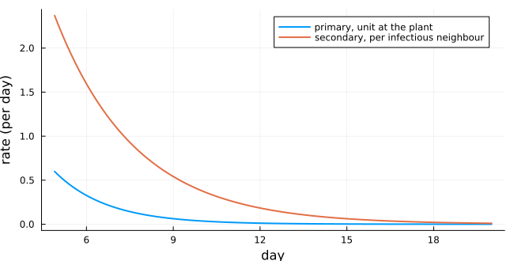
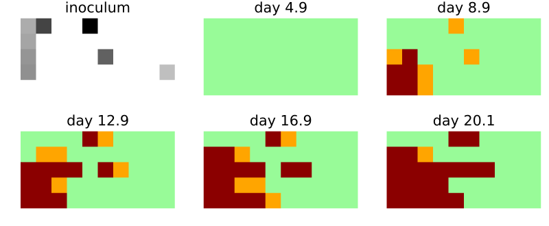
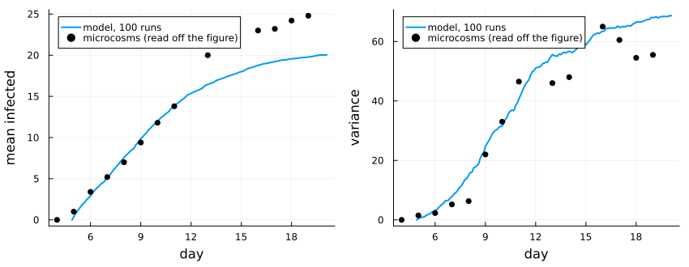
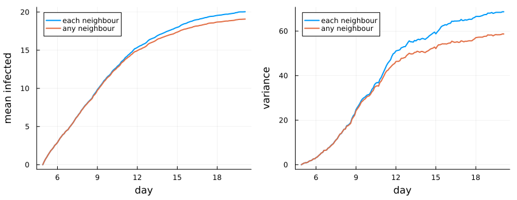

# Rhizoctonia solani: primary and secondary infection
Simon Frost

- [Overview](#overview)
- [The model](#the-model)
- [One microcosm](#one-microcosm)
- [Mean and variance](#mean-and-variance)
- [A choice the source leaves open](#a-choice-the-source-leaves-open)
- [Deviations from the source](#deviations-from-the-source)

## Overview

*Rhizoctonia solani* causes damping-off of seedlings. It infects a plant
in two ways: from inoculum in the soil (primary infection) and from a
neighbouring infected plant through the mycelium (secondary infection).
Kleczkowski et al. ([1997](#ref-Kleczkowski1997)) estimated the rates of
both from single-plant experiments. They put them into a cellular
automaton of a microcosm of 50 radish seedlings. They then compared the
mean and the variance of the epidemics it predicts with those of five
replicate microcosms. This model is a **reproduction**: all its
parameters come from the source’s Table 1.

``` julia
ENV["GKSwstype"] = "100"
using EcologicalCellularAutomata
using CellularAutomataCore
using Plots
using Statistics
```

## The model

The plants stand on a 5 × 10 lattice, 20 mm apart, and nothing lies
beyond the edges. A plant is susceptible (0), latent (1) or infectious
(2). A step is 0.1 day, starting at day `τ_p = 4.9`, when primary
infection begins. In each step a susceptible plant becomes latent at a
total rate `R`:

- each inoculum unit in the plant’s 20 mm square, at distance `x`, adds
  `C_p (1 + η_p x) exp(−σ_p x) exp(−d_p t)`;
- each infectious von Neumann neighbour adds
  `C_s exp(−σ_s x_d²) exp(−d_s t)`.

The plant becomes latent with probability `1 − exp(−R Δt)`. Latent
plants become infectious after an exponential latent period of mean 3.89
days.

``` julia
model = build(:rhizoctonia_contact)
```

    CAModel rhizoctonia_contact
      Kleczkowski et al. (1997) Rhizoctonia solani primary and secondary infection, secondary per_neighbour
      states:
        plant::Int8 = 0 ∈ 0:2  # 0 susceptible, 1 latent, 2 infectious
      parameters:
        a_p = 1.09  # amplitude of primary infection
        σ_p = 0.277  # spatial decay of primary infection (1/mm)
        η_p = 0.49  # critical-exponential correction (1/mm)
        d_p = 0.55  # temporal decay of primary infection (1/d)
        τ_p = 4.898  # time offset of primary infection (d)
        a_s = 14.9  # amplitude of secondary infection
        σ_s = 0.00099  # spatial decay of secondary infection (1/mm²)
        d_s = 0.36  # temporal decay of secondary infection (1/d)
        τ_s = 3.73  # time offset of secondary infection (d)
        latent_period = 3.89  # mean latent period 1/g (d)
        x_d = 20.0  # distance between plants (mm)
        dt = 0.1  # length of a step (d)
      covariates: pathozone
      rule: LocalRule(<anonymous function>, VonNeumann(1))

Both rates fall with time. Primary infection fades as the inoculum
decays, and secondary infection fades as the seedlings become less
susceptible:

``` julia
p = defaults(model)
Cp = p.a_p * p.d_p * exp(p.d_p * p.τ_p)
Cs = p.a_s * p.d_s * exp(p.d_s * p.τ_s)
days = 4.9:0.1:20
plot(days, [Cp * exp.(-p.d_p .* days) Cs * exp(-p.σ_s * p.x_d^2) * exp.(-p.d_s .* days)];
     label=["primary, unit at the plant" "secondary, per infectious neighbour"],
     xlabel="day", ylabel="rate (per day)", lw=2, size=(650, 330))
```



## One microcosm

Each run places 10 inoculum units at random in the 100 × 200 mm box. The
covariate `pathozone` holds, for each plant, the sum over the units in
its square of `(1 + η_p x) exp(−σ_p x)`:

``` julia
prob = problem(:rhizoctonia_contact; seed=9)
sol = solve(prob; saveat=40)
cover = heatmap(prob.covariates.pathozone; c=:Greys, colorbar=false, aspect_ratio=:equal,
                framestyle=:none, title="inoculum")
snaps = [heatmap(u; c=[:palegreen, :orange, :darkred], clims=(0, 2), colorbar=false,
                 aspect_ratio=:equal, framestyle=:none,
                 title="day $(round(d; digits=1))")
         for (d, u) in zip(rhizoctonia_days(sol), sol.u)]
plot(cover, snaps...; layout=(2, 3), size=(800, 330))
```



The first panel shades each plant by the inoculum in its square (darker
is more). Latent plants are orange and infectious plants dark red.
Primary infections start the epidemic next to the inoculum, and
secondary infection then spreads it to neighbouring plants.

## Mean and variance

The source’s Figure 2 compares the mean and the variance of the number
of infected plants over 100 runs with those of the five microcosms.
Latent and infectious plants both count as infected, since both show
damping-off. The data below were read off that figure, so they are
approximate.

``` julia
data_day = [4, 5, 6, 7, 8, 9, 10, 11, 13, 14, 16, 17, 18, 19]
data_mean = [0, 1.0, 3.4, 5.2, 7.0, 9.4, 11.8, 13.8, 20.0, 21.2, 23.0, 23.2, 24.2, 24.8]
data_var = [0, 1.5, 2.3, 5.2, 6.3, 22, 33, 46.5, 46, 48, 65, 60.5, 54.5, 55.5]

function ensemble(secondary; runs=100)
    sols = [solve(problem(:rhizoctonia_contact; seed=s, secondary)) for s in 1:runs]
    Y = [rhizoctonia_infected(sol.u[k]) for sol in sols, k in eachindex(sols[1].u)]
    return rhizoctonia_days(sols[1]), vec(mean(Y; dims=1)), vec(var(Y; dims=1))
end
d, m, v = ensemble(:per_neighbour)
plot(plot(d, m; label="model, 100 runs", lw=2, xlabel="day", ylabel="mean infected",
          legend=:topleft),
     plot(d, v; label="model, 100 runs", lw=2, xlabel="day", ylabel="variance",
          legend=:topleft);
     layout=(1, 2), size=(850, 330), bottom_margin=5Plots.mm, left_margin=4Plots.mm)
scatter!(data_day, data_mean; subplot=1, label="microcosms (read off the figure)", c=:black)
scatter!(data_day, data_var; subplot=2, label="microcosms (read off the figure)", c=:black)
```



The model follows the source’s model curves closely. The source’s curves
pass about 7.5, 13, 17, 20 and 21.8 plants at days 8, 10, 12.5, 15.5 and
20, and its variance about 20, 33, 45, 57 and 66 at days 8, 10, 12, 15
and 20:

``` julia
at(day) = argmin(abs.(d .- day))
[(day=day, mean=round(m[at(day)]; digits=1), variance=round(v[at(day)]; digits=1))
 for day in (8, 10, 12.5, 15.5, 20)]
```

    5-element Vector{NamedTuple{(:day, :mean, :variance)}}:
     (day = 8, mean = 7.6, variance = 15.0)
     (day = 10, mean = 11.9, variance = 31.5)
     (day = 12.5, mean = 15.8, variance = 52.7)
     (day = 15.5, mean = 18.4, variance = 62.4)
     (day = 20, mean = 20.0, variance = 68.7)

As in the source, the model settles below the data’s final level, at
about 20 of 50 plants. It also follows the sharp rise of the variance
after day 8, about one latent period after the first primary infections.

## A choice the source leaves open

The source’s rule for secondary infection applies “if an infectious host
is located in the immediate neighbourhood”. It does not say whether two
infectious neighbours infect faster than one. The model counts each
infectious neighbour, as independent sources of infection would. With
`secondary = :any` it counts one however many there are:

``` julia
d2, m2, v2 = ensemble(:any)
plot(plot(d, [m m2]; label=["each neighbour" "any neighbour"], lw=2, xlabel="day",
          ylabel="mean infected", legend=:topleft),
     plot(d, [v v2]; label=["each neighbour" "any neighbour"], lw=2, xlabel="day",
          ylabel="variance", legend=:topleft);
     layout=(1, 2), size=(850, 330), bottom_margin=5Plots.mm, left_margin=4Plots.mm)
```



The two readings agree until about day 10, when plants with several
infectious neighbours become common. After that the literal reading
falls behind, in the mean and still more in the variance:

``` julia
(each_neighbour=(mean=round(m[end]; digits=1), variance=round(v[end]; digits=1)),
 any_neighbour=(mean=round(m2[end]; digits=1), variance=round(v2[end]; digits=1)))
```

    (each_neighbour = (mean = 20.0, variance = 68.7), any_neighbour = (mean = 19.1, variance = 58.7))

The source’s model reaches about 21.8 plants and a variance of about 66
by day 20, so counting each neighbour is the closer reading.

## Deviations from the source

``` julia
foreach(d -> println("- ", d), model_info(:rhizoctonia_contact).deviations)
```

    - How rates combine is not stated in the source; independent hazards add: each inoculum unit in a plant's square and each infectious neighbour contributes its rate, and a step turns the total rate R into the probability 1 - exp(-R dt). The literal reading of the secondary rule (one rate if any neighbour is infectious) is available with secondary = :any.
    - The source's secondary rule is printed without dt; it is read as the rate r_s times dt, as for primary infection, since r_s alone exceeds 1 per day.
    - Plant positions are not given; plant (i, j) stands at the centre of the (i, j)-th 20 mm square of the 100 x 200 mm rectangle, so the squares tile it.
    - The delay term of secondary infection is dropped, as the source says it is subsumed into the latent period; it has no effect after day tau_p, when the runs start.
    - The run length is not stated; runs last 152 steps of 0.1 d, to day 20.1, which covers the source's Figure 2.
    - The latent period is 3.89 d, from the source's Table 1; its text gives 3.98 d.

<div id="refs" class="references csl-bib-body hanging-indent">

<div id="ref-Kleczkowski1997" class="csl-entry">

Kleczkowski, A., C. A. Gilligan, and D. J. Bailey. 1997. “Scaling and
Spatial Dynamics in Plant–Pathogen Systems: From Individuals to
Populations.” *Proceedings of the Royal Society B: Biological Sciences*
264 (1384): 979–84. <https://doi.org/10.1098/rspb.1997.0135>.

</div>

</div>
