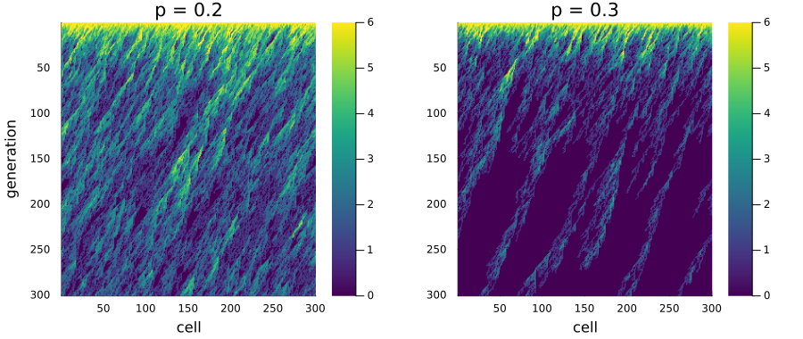
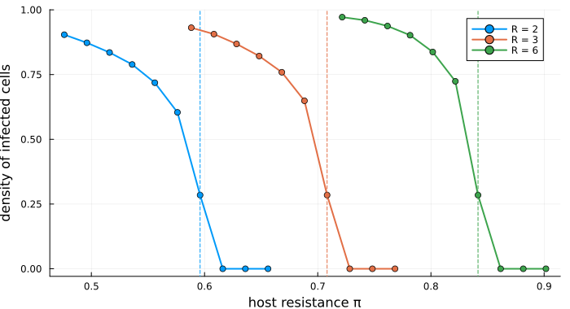
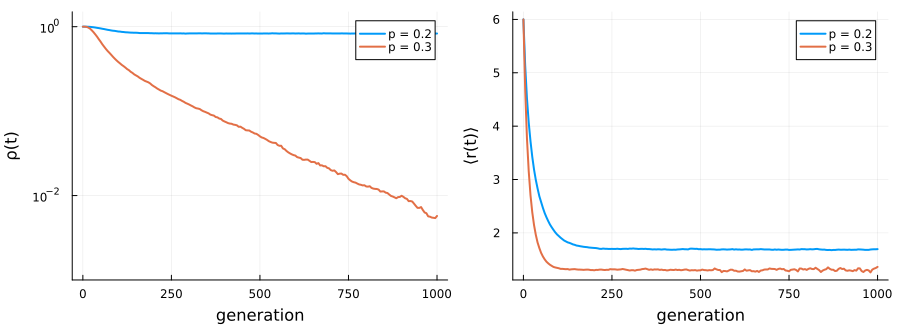
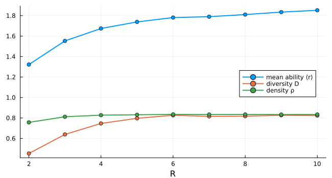

# Viral fronts in host tissue
Simon Frost

- [Overview](#overview)
- [The model](#the-model)
- [Two fronts](#two-fronts)
- [An exact threshold](#an-exact-threshold)
- [Survival and extinction over
  time](#survival-and-extinction-over-time)
- [More offspring do not help](#more-offspring-do-not-help)
- [Deviations from the source](#deviations-from-the-source)

## Overview

A plant virus spreads through a leaf cell by cell. In a well-mixed host,
a virus that makes more offspring always spreads faster. Capitán et al.
([2011](#ref-Capitan2011)) asked whether space changes this. Their model
is a multicomponent generalisation of the Domany–Kinzel automaton.
Neighbouring virions compete for the same cells, and the host resists
infection. The answer is that a finite host resistance can stop the
infection however many offspring each virion makes. This model is a
**reproduction**.

``` julia
ENV["GKSwstype"] = "100"
using EcologicalCellularAutomata
using CellularAutomataCore
using Plots
using Statistics
```

## The model

The model follows only the front of the infection. A ring of `L` cells
is the current row of tissue, and each generation infects the next row.
Time is therefore the second dimension of the tissue. A cell holds the
replicative ability `r ∈ 0:R` of the virion that infected it, the number
of infective offspring it makes. Cell `i` of the next row receives the
offspring of cells `i` and `i + 1`:

- all `n = r₁ + r₂` virions fail to infect with probability `πⁿ`, where
  `π` is the host’s resistance;
- otherwise one of them infects. It descends from each parent in
  proportion to the parent’s offspring, and it loses one unit of ability
  with probability `p` or gains one with probability `q` (up to `R`).

``` julia
model = build(:domany_kinzel_viral; R=6)
```

    CAModel domany_kinzel_viral
      Capitán et al. (2011) multicomponent Domany-Kinzel automaton, R = 6
      states:
        r::Int8 = 6 ∈ 0:6  # replicative ability (0: empty)
      parameters:
        π = 0.1  # host resistance: probability that one virion fails to infect
        p = 0.2  # probability of a deleterious mutation
        q = 0.01  # probability of a beneficial mutation
      rule: LocalRule(<anonymous function>, Offsets((1,),))

`viral_transition` gives the probability of each outcome, the source’s
equations 2 and 3:

``` julia
[round(viral_transition(r, 3, 1; π=0.1, p=0.2, q=0.01, R=6); digits=4) for r in 0:6]
```

    7-element Vector{Float64}:
     0.0501
     0.1975
     0.1525
     0.5924
     0.0075
     0.0
     0.0

## Two fronts

The front is drawn generation by generation, top to bottom. Each row is
the ring at one time, coloured by replicative ability. With deleterious
mutations at `p = 0.2` the infection persists. At `p = 0.3` it dies out:

``` julia
function spacetime(p; L=300, T=300, seed=2)
    sol = solve(problem(:domany_kinzel_viral; L, tspan=T, seed, pmap=(; π=0.1, p, q=0.01)))
    return permutedims(reduce(hcat, sol.u))
end
plot(heatmap(spacetime(0.2); c=cgrad(:viridis; categorical=true), clims=(0, 6),
             yflip=true, xlabel="cell", ylabel="generation", title="p = 0.2"),
     heatmap(spacetime(0.3); c=cgrad(:viridis; categorical=true), clims=(0, 6),
             yflip=true, xlabel="cell", title="p = 0.3");
     layout=(1, 2), size=(900, 380), left_margin=4Plots.mm, bottom_margin=4Plots.mm)
```



Within a few generations the ability falls from 6 to between 1 and 3.
Mutation pushes it down, and competition gives little advantage to the
fitter virions, because each cell is won by only one virion.

## An exact threshold

Without mutation (`p = q = 0`) every virion keeps the ability `R`. A
cell is then infected unless all its parents’ offspring fail, which is
directed bond percolation. The source deduces the critical resistance
from the known percolation threshold: `π_c = 0.3552998^(1/R)`. Above it
the infection dies out. The density of infected cells after 3000
generations on a ring of 2000 cells:

``` julia
πc(R) = 0.3552998^(1 / R)
function density(R, π; L=2000, T=3000, seeds=1:2)
    return mean(viral_density(solve(problem(:domany_kinzel_viral; L, R, tspan=T, seed=s,
                                            pmap=(; π, p=0.0, q=0.0));
                                    save_everystep=false).u[end]) for s in seeds)
end
fig = plot(; xlabel="host resistance π", ylabel="density of infected cells",
           legend=:topright, size=(700, 380))
for (R, c) in ((2, 1), (3, 2), (6, 3))
    πs = range(πc(R) - 0.12, πc(R) + 0.06; length=10)
    plot!(fig, πs, [density(R, π) for π in πs]; label="R = $R", lw=2, marker=:circle,
          color=c)
    vline!(fig, [πc(R)]; label="", ls=:dash, color=c)
end
fig
```



The dashed lines are the exact thresholds, 0.596, 0.708 and 0.842. For
each `R` the density falls to zero at the first resistance tried beyond
the threshold. At the threshold itself some infection is still left
after 3000 generations, because a front at the critical point dies out
slowly, as a power of time.

## Survival and extinction over time

The source’s Figure 4 follows a front of 100 000 cells with `R = 6`,
`π = 0.1` and `q = 0.01`. The density of infected cells and the mean
ability of the virions are shown for the two mutation rates:

``` julia
series = map((0.2, 0.3)) do p
    sol = solve(problem(:domany_kinzel_viral; L=100_000, tspan=1000, seed=1,
                        pmap=(; π=0.1, p, q=0.01)); saveat=5)
    (p=p, t=sol.t, ρ=viral_density.(sol.u), r=viral_mean_ability.(sol.u))
end
plot(plot([s.t for s in series], [s.ρ for s in series]; yscale=:log10, lw=2,
          label=["p = 0.2" "p = 0.3"], xlabel="generation", ylabel="ρ(t)",
          ylims=(1e-3, 1.5)),
     plot([s.t for s in series], [s.r for s in series]; lw=2, label=["p = 0.2" "p = 0.3"],
          xlabel="generation", ylabel="⟨r(t)⟩");
     layout=(1, 2), size=(900, 330), left_margin=4Plots.mm, bottom_margin=5Plots.mm)
```



``` julia
[(p=s.p, ρ_at_1000=round(s.ρ[end]; sigdigits=2), r_at_1000=round(s.r[end]; digits=2))
 for s in series]
```

    2-element Vector{@NamedTuple{p::Float64, ρ_at_1000::Float64, r_at_1000::Float64}}:
     (p = 0.2, ρ_at_1000 = 0.83, r_at_1000 = 1.7)
     (p = 0.3, ρ_at_1000 = 0.0057, r_at_1000 = 1.36)

As in the source, the front survives at `p = 0.2`, with a density near
0.8 and a mean ability near 1.7. At `p = 0.3` its density decays
steadily towards extinction, while the few surviving virions keep a mean
ability near 1.3.

## More offspring do not help

In a well-mixed host the virus would spread whenever
`(1 − π) R (1 − p) > 1`. With `π = 0.1` and `p = 0.2` that holds for any
`R ≥ 2`, and the mean ability would grow with `R`. The source’s Figure
5a shows instead that in space the mean ability saturates. Here it is
averaged over generations 2000 to 3000 on a front of 10 000 cells:

``` julia
function equilibrium(R; L=10_000)
    sol = solve(problem(:domany_kinzel_viral; L, R, tspan=3000, seed=R,
                        pmap=(; π=0.1, p=0.2, q=0.01)); saveat=2000:20:3000)
    return (r=mean(viral_mean_ability.(sol.u)), D=mean(viral_diversity.(sol.u)),
            ρ=mean(viral_density.(sol.u)))
end
Rs = 2:10
eq = [equilibrium(R) for R in Rs]
plot(Rs, [[e.r for e in eq] [e.D for e in eq] [e.ρ for e in eq]]; marker=:circle, lw=2,
     label=["mean ability ⟨r⟩" "diversity D" "density ρ"], xlabel="R",
     legend=:right, size=(650, 350))
```



The mean ability rises steeply from about 1.3 at `R = 2` to about 1.75
at `R = 5`, then only slowly, by about 0.1 more up to `R = 10`. The
density and the diversity level off from `R = 6`. The source reads the
same curve as reaching a plateau near 1.7. Either way, a virion that
could make ten offspring gains almost nothing. Its offspring compete
with each other and with their neighbours for the same few cells, and
deleterious mutations pull their ability back down. A host resistance
that stops a weak virus therefore stops a strong one as well. This is
the hindrance in the source’s title.

## Deviations from the source

``` julia
foreach(d -> println("- ", d), model_info(:domany_kinzel_viral).deviations)
```

    - None in the rule. The source states neither the number of replicates nor the grid of its phase diagrams; the vignette uses its own, smaller, runs.

<div id="refs" class="references csl-bib-body hanging-indent">

<div id="ref-Capitan2011" class="csl-entry">

Capitán, José A., José A. Cuesta, Susanna C. Manrubia, and Jacobo
Aguirre. 2011. “Severe Hindrance of Viral Infection Propagation in
Spatially Extended Hosts.” *PLoS ONE* 6 (8): e23358.
<https://doi.org/10.1371/journal.pone.0023358>.

</div>

</div>
