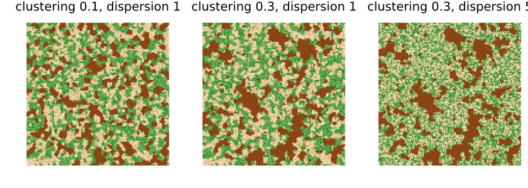
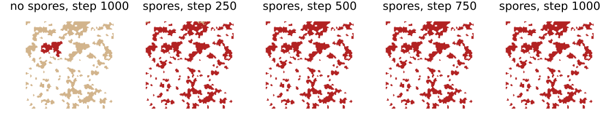
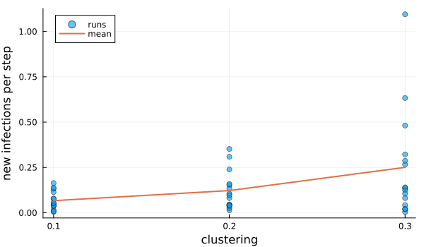
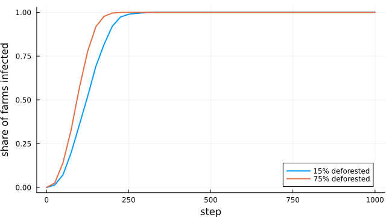

# Coffee leaf rust in fragmented landscapes
Simon Frost

- [Overview](#overview)
- [Landscapes](#landscapes)
- [The model](#the-model)
- [Clustering, without spores](#clustering-without-spores)
- [With spores](#with-spores)
- [The archived code](#the-archived-code)
- [Deviations from the source](#deviations-from-the-source)

## Overview

Coffee leaf rust, *Hemileia vastatrix*, spreads within a farm by rain
splash and between farms by wind-borne spores. Forest canopy between
farms may slow the spores. Beasley et al. ([2022](#ref-Beasley2022))
combined a cellular automaton for spread within patches of coffee with
random walks of spores through the surrounding matrix. They asked how
the clustering of coffee and the amount and arrangement of deforestation
change the rate of spread.

The authors published their code, and it differs from their paper in
ways that change its behaviour. Spores are filtered by position because
of an operator-precedence mistake, walks stop at a hard-coded index,
spore infection is confined to one quadrant, and every spore infects
next to the last spore’s end point. In the archived runs almost all
infections came from the automaton. This model is an **adaptation** that
follows the rules the authors describe. Their archived numbers can
therefore not be reproduced exactly. The vignette reproduces their main
claim with the automaton alone, then shows what intact spores change.

``` julia
ENV["GKSwstype"] = "100"
using EcologicalCellularAutomata
using CellularAutomataCore
using Plots
using Random
using Statistics
```

## Landscapes

A simulated landscape is 120 × 120 cells: a 100 × 100 study area and a
buffer of 10. A quarter of it is coffee, placed by a neutral landscape
model whose clustering parameter sets the size of the patches. The rest
is forest or deforested land, from a second neutral landscape. Forest
canopy cover is uniform on 0.6 to 1, and deforested canopy on 0 to 0.3.
More deforestation `dispersion` means more, smaller deforested patches:

``` julia
showland(coffee, canopy; title="") = heatmap(ifelse.(coffee .> 0, -0.5, canopy);
                                             c=cgrad([:saddlebrown, :wheat, :forestgreen]),
                                             clims=(-0.5, 1), aspect_ratio=:equal,
                                             framestyle=:none, colorbar=false, title)
plot([showland(coffee_rust_landscape(Xoshiro(2); clustering=c, deforestation=0.45,
                                     dispersion=d)...; title="clustering $c, dispersion $d")
      for (c, d) in ((0.1, 1), (0.3, 1), (0.3, 5))]...; layout=(1, 3), size=(900, 320))
```



Coffee is dark brown. The matrix shades from pale (deforested) to green
(forest).

## The model

A susceptible coffee farm with `N` infected Moore neighbours is infected
in a step with probability `0.1 (N + 1) / 10`. That is the mean of the
archived code’s `0.1 × Beta(N + 1, 9 − N)` draw, which gives each farm
the same distribution of outcomes. Between patches, each infected farm
on the edge of a patch releases a spore into a neighbouring matrix cell.
The spore walks to random matrix neighbours with a credit of 10, paying
the canopy cover of each cell it enters, so it travels farther over
deforested land. It then infects a susceptible farm next to where it
stops with probability 0.5. The automaton is the model’s rule. The
spores are a callback stored with the problem:

``` julia
prob = problem(:coffee_rust; clustering=0.3, seed=3)
(model=build(:coffee_rust), callbacks=keys(prob.kwargs))
```

    (model = CAModel coffee_rust with states (coffee, canopy) and parameters (scale, credit, spore_infection), callbacks = (:callback,))

One run, with and without spores:

``` julia
withspores = solve(prob; saveat=250)
nospores = solve(problem(:coffee_rust; clustering=0.3, seed=3, spores=false); saveat=250)
rustmap(u, title) = heatmap(ifelse.(u.coffee .== 0, NaN, Float64.(u.coffee));
                            c=[:tan, :firebrick], clims=(1, 2), aspect_ratio=:equal,
                            framestyle=:none, colorbar=false, title)
plot(rustmap(nospores.u[end], "no spores, step 1000"),
     [rustmap(u, "spores, step $t") for (t, u) in zip(withspores.t[2:end], withspores.u[2:end])]...;
     layout=(1, 5), size=(1100, 240))
```



Healthy farms are tan and infected farms red. Without spores the rust
stays in the patch where it started. With spores it reaches patches
across the landscape within a few hundred steps.

## Clustering, without spores

The source measured the rate of spread: the mean number of new
infections per step over 1000 steps. It found clustering of coffee to be
the main driver, with the highest expected and maximum rates at
clustering 0.3 and little difference between 0.1 and 0.2. Its archived
runs are dominated by the automaton. Here the automaton alone, over 15
landscapes for each clustering:

``` julia
rates(clustering; spores, runs=15, kw...) =
    [coffee_rust_rate(solve(problem(:coffee_rust; clustering, spores, seed=s, kw...);
                            save_everystep=false)) for s in 1:runs]
ca_only = Dict(c => rates(c; spores=false) for c in (0.1, 0.2, 0.3))
[(clustering=c, mean=round(mean(ca_only[c]); digits=3),
  max=round(maximum(ca_only[c]); digits=3)) for c in (0.1, 0.2, 0.3)]
```

    3-element Vector{@NamedTuple{clustering::Float64, mean::Float64, max::Float64}}:
     (clustering = 0.1, mean = 0.067, max = 0.164)
     (clustering = 0.2, mean = 0.122, max = 0.352)
     (clustering = 0.3, mean = 0.25, max = 1.095)

``` julia
scatter(repeat([0.1, 0.2, 0.3]; inner=15), vcat(ca_only[0.1], ca_only[0.2], ca_only[0.3]);
        alpha=0.6, label="runs", xlabel="clustering", ylabel="new infections per step",
        xticks=[0.1, 0.2, 0.3], size=(600, 350))
plot!([0.1, 0.2, 0.3], [mean(ca_only[c]) for c in (0.1, 0.2, 0.3)]; lw=2, label="mean")
```



As in the source, larger patches spread rust faster, with the highest
mean and maximum rates at clustering 0.3. The rates are skewed: most
runs stay in a small patch, while a few start in a large one and spread
far. The source reports means of about 0.15, 0.17 and 0.35 and maxima of
1.1, 1.0 and 2.1. It found little difference between 0.1 and 0.2, where
here the mean roughly doubles at each step. The landscape generators
here are reimplementations of the source’s, which may account for part
of the difference. It multiplies the prevalence inside the buffer by the
coffee count of the whole landscape, which inflates its rates by about
1.4. This model counts infections inside the buffer only.

## With spores

When spores walk and infect as the authors describe, they carry rust
from patch to patch every step, and the landscape matters much less:

``` julia
spore = Dict(c => rates(c; spores=true, runs=5) for c in (0.1, 0.3))
[(clustering=c, ca_only=round(mean(ca_only[c]); digits=2),
  with_spores=round(mean(spore[c]); digits=2)) for c in (0.1, 0.3)]
```

    2-element Vector{@NamedTuple{clustering::Float64, ca_only::Float64, with_spores::Float64}}:
     (clustering = 0.1, ca_only = 0.07, with_spores = 2.51)
     (clustering = 0.3, ca_only = 0.25, with_spores = 2.56)

With intact spores the rate is ten times or more that of the automaton
alone, and clustering no longer matters. Every farm inside the buffer is
infected by about step 250. Whether spores slow over forest matters only
in how soon that happens. Here is the share of farms infected over time,
for little and much deforestation:

``` julia
fig = plot(; xlabel="step", ylabel="share of farms infected", legend=:bottomright,
           size=(650, 360))
for (d, label) in ((0.15, "15% deforested"), (0.75, "75% deforested"))
    curves = [coffee_rust_prevalence.(solve(problem(:coffee_rust; deforestation=d, seed=s);
                                            saveat=25).u) for s in 1:5]
    plot!(fig, 0:25:1000, mean(curves); label, lw=2)
end
fig
```



Deforested land lets spores travel farther before they land, so rust
spreads through the landscape sooner. The source’s conclusion that
clustering drives spread holds for its archived runs, in which spores
rarely infected. With spores that disperse as described, the matrix
would matter more.

## The archived code

`spores = :archived` moves spores as the authors’ archived code does,
errors included (see [`coffee_rust_spores_archived!`](@ref) for the
rules). As in that code, the first infected farm may also lie in the
buffer. Spores then almost never infect, so rust rarely leaves the patch
where it started:

``` julia
archived = [coffee_rust_prevalence(solve(problem(:coffee_rust; clustering=c, seed=s,
                                                 spores=:archived)).u[end])
            for c in (0.1, 0.3), s in 1:12]
[(clustering=c, median_share_infected=round(median(archived[k, :]); digits=3),
  largest=round(maximum(archived[k, :]); digits=3)) for (k, c) in enumerate((0.1, 0.3))]
```

    2-element Vector{@NamedTuple{clustering::Float64, median_share_infected::Float64, largest::Float64}}:
     (clustering = 0.1, median_share_infected = 0.009, largest = 0.056)
     (clustering = 0.3, median_share_infected = 0.06, largest = 0.425)

The authors’ repository holds the outputs of their simulated landscapes:
50 runs for each of 75 settings of deforestation, its dispersion and the
clustering of coffee. For each clustering, we pooled the 25 settings of
deforestation and dispersion: 1250 archived runs against 300 runs of
this model. The distributions of the share of inner farms infected after
100, 250, 500 and 1000 steps agree:

- the correlations between the two empirical cumulative distribution
  functions are 0.995 to 0.999;
- the Kolmogorov–Smirnov distances are 0.036 to 0.081, all below the 5%
  critical value of 0.087;
- the means agree within 5%.

A share of 30.7% of the archived runs start in the buffer, as a start
anywhere implies (30.6%).

## Deviations from the source

``` julia
foreach(d -> println("- ", d), model_info(:coffee_rust).deviations)
```

    - By default the model follows the authors' intended rules, not their archived code, which differs from the paper and has errors that change its behaviour: spores filtered by an operator-precedence mistake, walks stopped at a hard-coded index, spore infection confined to one quadrant, and every spore infecting next to the last spore's end point. spores = :archived reproduces that code's behaviour (written from a description of it, as the code has no licence), with the first infection anywhere in the landscape, as there; a spore with no open move steps by (1, 1), as Python 3.8's random.choices does with zero weights (later versions raise an error).
    - The CA infects a susceptible farm with N infected Moore neighbours with probability 0.1 (N + 1) / 10, the mean of the archived code's 0.1 x Beta(N + 1, 9 - N) draw, which gives each farm the same distribution of outcomes; the paper's Beta(N, 8 - N) is available as ca_rule = :paper.
    - Nothing lies beyond the landscape's edges, as in the archived code; the paper says the rasters had reflective boundaries.
    - Spores are released only into matrix cells inside the landscape, walk to admissible Moore neighbours (matrix, canopy above zero) with a credit of 10 (the archived code's value; the paper gives none), and are discarded at the end of each step, as in the archived code.
    - The neutral landscape generators are reimplementations of NLMpy's randomClusterNN and randomElementNN, with a different random number generator and tie-breaking.
    - The rate of spread counts new infections among the farms inside the buffer; the source multiplies the inner prevalence by the coffee count of the whole landscape.
    - Only simulated landscapes are provided; the Costa Rican rasters are not redistributed.

<div id="refs" class="references csl-bib-body hanging-indent">

<div id="ref-Beasley2022" class="csl-entry">

Beasley, Emily M., Natalia Aristizábal, Edgar M. Bueno, and Easton R.
White. 2022. “Spatially Explicit Models Predict Coffee Rust Spread in
Fragmented Landscapes.” *Landscape Ecology* 37 (8): 2165–78.
<https://doi.org/10.1007/s10980-022-01473-1>.

</div>

</div>
