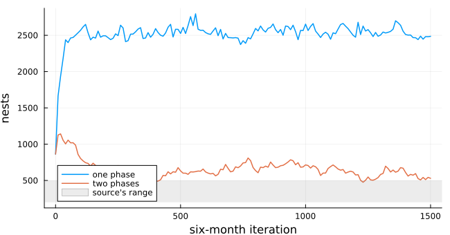
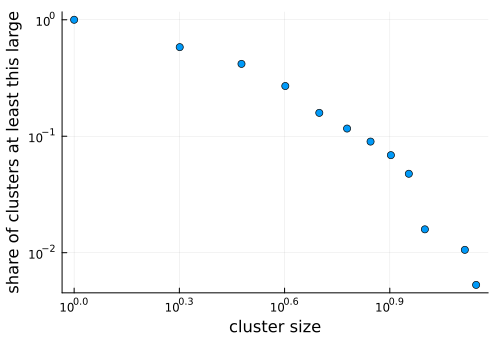
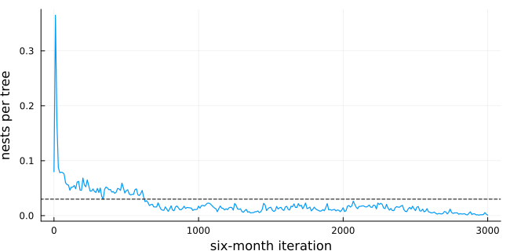
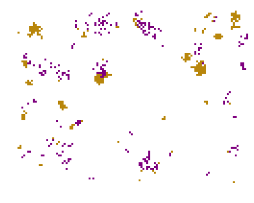

# Ant nests and a fungus on a coffee farm
Simon Frost

- [Overview](#overview)
- [The model](#the-model)
- [Colonisation first, then death](#colonisation-first-then-death)
- [The fungus](#the-fungus)
- [Deviations from the source](#deviations-from-the-source)

## Overview

On an organic coffee farm in Mexico, the ant *Azteca instabilis* nests
in shade trees and tends scale insects, which the fungus *Lecanicillium
lecanii* attacks. The fungus also attacks the coffee rust and the green
coffee scale, so the ants’ spatial pattern matters for pest control.
Vandermeer et al. ([2008](#ref-Vandermeer2008)) showed that a simple
automaton of nests reproduces the clustered pattern seen in a 45 ha
census. New nests appear next to old ones, and phorid flies kill nests
where they are dense. Jackson et al. ([2009](#ref-Jackson2009)) replaced
the flies with the fungus, which spreads between neighbouring nests and
kills them. This model is an **adaptation**. The sources leave the order
of updates open, and that order turns out to decide the density of
nests.

``` julia
ENV["GKSwstype"] = "100"
using EcologicalCellularAutomata
using CellularAutomataCore
using Plots
using Statistics
```

## The model

The farm is a 90 × 120 torus of shade trees. A tree is empty (0), holds
a nest whose scale insects are free of the fungus (1), or holds one
whose scale insects are infected (2). A step is six months. With `N`
occupied and `F` infected Moore neighbours:

- an empty tree next to a nest gains a satellite nest with probability
  `0.0035 + 0.035 N`;
- an uninfected nest is infected with probability `0.63 F`, or `0.007`
  from the soil if no neighbour is infected;
- an infected nest dies with probability 0.35.

``` julia
model = build(:coffee_ant_fungus)
```

    CAModel coffee_ant_fungus
      Jackson et al. (2009) Azteca nests and Lecanicillium, mortality fungus, two phase(s)
      states:
        tree::Int8 = 0 ∈ 0:2  # 0 empty, 1 nest, 2 nest with infected scale insects
      parameters:
        s0 = 0.0035  # satellite expansion intercept
        s1 = 0.035  # satellite expansion per occupied neighbour
        v = 0.35  # death probability of an infected nest
        t0 = 0.0  # transmission intercept
        t1 = 0.63  # transmission per infected neighbour
        a = 0.007  # background infection probability
        m0 = 0.116  # phorid mortality intercept (:phorid)
        m1 = 0.036  # phorid mortality per occupied neighbour (:phorid)
      rule: LocalRule(<anonymous function>, Moore(1))

The base model of Vandermeer et al. ([2008](#ref-Vandermeer2008)) has no
fungus. A nest dies with probability `0.116 + 0.036 N`, as phorid flies
find dense clusters of nests.

## Colonisation first, then death

Each iteration of the sources draws colonisation for every empty tree
and death for every nest. They do not say whether a nest founded in the
iteration counts as a neighbour when deaths are drawn. Here are the base
model’s nests over time, with both phases drawn from the same state (one
phase) and with deaths drawn after colonisation (two phases):

``` julia
function nests(; mortality, phases, iterations=1500, seed=1)
    sol = solve(problem(:coffee_ant_fungus; mortality, phases, iterations, seed);
                saveat=phases === :two ? 20 : 10)
    return ant_iterations(sol.t; phases), [count(!=(0), u) for u in sol.u], sol.u
end
t1, n1, _ = nests(; mortality=:phorid, phases=:one)
t2, n2, base = nests(; mortality=:phorid, phases=:two)
plot(t1, n1; label="one phase", lw=1.5, xlabel="six-month iteration", ylabel="nests",
     size=(650, 340))
plot!(t2, n2; label="two phases", lw=1.5)
hspan!([200, 500]; alpha=0.15, color=:gray, label="source's range")
```



Drawn from the same state, the population settles near 2500 nests, five
times the 200 to 500 that Vandermeer et al.
([2008](#ref-Vandermeer2008)) reports. When deaths count the new nests,
it settles about a hundred above that range. The two-phase reading is
much closer and is the default. Its spatial pattern is clumped. The
mean/variance ratio of nests in 3 × 3 squares is well below 1, the value
for nests placed at random:

``` julia
late = base[end-50:end]
(nests=round(mean(count(!=(0), u) for u in late)),
 mean_variance=round(mean(filter(!isnan, mean_variance_ratio.(late))); digits=2))
```

    (nests = 604.0, mean_variance = 0.54)

The source reports ratios of 0.4 to 0.5, a little below this one. The
cluster sizes of the base model fall off roughly as a power law, which
Vandermeer et al. ([2008](#ref-Vandermeer2008)) read as robust
criticality:

``` julia
sizes = cluster_sizes(base[end], !=(0); space=Torus(90, 120), neighbourhood=Moore(1))
s = sort(unique(sizes))
ccdf = [count(>=(x), sizes) / length(sizes) for x in s]
scatter(s, ccdf; xscale=:log10, yscale=:log10, legend=false, xlabel="cluster size",
        ylabel="share of clusters at least this large", size=(500, 340))
```



## The fungus

With the fungus in place of the flies, at the parameters fitted by
Jackson et al. ([2009](#ref-Jackson2009)), both readings again differ:

``` julia
tf, nf, fungus = nests(; mortality=:fungus, phases=:two, iterations=3000)
plot(tf, nf ./ 10_800; lw=1.2, legend=false, xlabel="six-month iteration",
     ylabel="nests per tree", size=(650, 320))
hline!([0.03]; ls=:dash, color=:black)
```



``` julia
late = fungus[end-100:end]
d = [count(!=(0), u) / 10_800 for u in late]
m = filter(!isnan, mean_variance_ratio.(late))
(density=round(mean(d); digits=3), range=round.(extrema(d); digits=3),
 mean_variance=round(mean(m); digits=2), infected_share=round(mean(count(==(2), u) / max(1, count(!=(0), u))
                                                                 for u in late); digits=2))
```

    (density = 0.01, range = (0.001, 0.026), mean_variance = 0.33, infected_share = 0.55)

The field census gives 0.03 nests per tree (dashed) and a ratio of 0.42.
Jackson et al. ([2009](#ref-Jackson2009))’s Figure 7 shows the density
wandering between about 0.005 and 0.065 for 20 000 iterations, and the
ratio between 0.25 and 0.55. With two phases the model’s density stays
near 0.05 for some 600 iterations and then falls to about 0.015. Over
the last stretch it averages 0.01 and drifts down, with the ratio inside
the source’s range. At the fitted parameters this reading of the model
lies close to the extinction of the ants, below the field density. With
one phase, as before, there are several times too many nests:

``` julia
_, nf1, one = nests(; mortality=:fungus, phases=:one, iterations=1500)
round(mean(count(!=(0), u) for u in one[end-50:end]) / 10_800; digits=3)
```

    0.219

A snapshot of the two-phase model at iteration 500, while nests are
still common: clusters of nests, many of them carrying the fungus,
separated by empty trees.

``` julia
heatmap(fungus[findfirst(==(500), tf)]; c=[:white, :darkgoldenrod, :purple], clims=(0, 2),
        colorbar=false, aspect_ratio=:equal, framestyle=:none, size=(500, 400))
```



Nests with healthy scale insects are gold and infected ones purple.

## Deviations from the source

``` julia
foreach(d -> println("- ", d), model_info(:coffee_ant_fungus).deviations)
```

    - The source's iteration draws colonisation for empty trees and mortality for nests but does not say in which order; by default an iteration is two steps, colonisation then infection and mortality counting the new nests, which brings the densities close to the source's (phases = :one applies both to the same state and gives several times more nests).
    - Within a step the source updates 'cell by cell' without saying how; the default is synchronous, and RandomSequential() gives an in-place sweep in random order.
    - Initial conditions are not stated; nests are placed at random with density 0.08, all uninfected.
    - The quadrat size for the mean/variance ratio is not stated for the model; it is 3 x 3 trees (about 20 m), the scale the base model's authors matched to the Moore neighbourhood.
    - An infection probability t0 + t1 F above 1 is clipped to 1; the source does not say.
    - New nests start uninfected; the source does not say.

<div id="refs" class="references csl-bib-body hanging-indent">

<div id="ref-Jackson2009" class="csl-entry">

Jackson, Doug, John H. Vandermeer, and Ivette Perfecto. 2009. “Spatial
and Temporal Dynamics of a Fungal Pathogen Promote Pattern Formation in
a Tropical Agroecosystem.” *The Open Ecology Journal* 2: 62–73.
<https://doi.org/10.2174/1874213000902010062>.

</div>

<div id="ref-Vandermeer2008" class="csl-entry">

Vandermeer, John, Ivette Perfecto, and Stacy M. Philpott. 2008.
“Clusters of Ant Colonies and Robust Criticality in a Tropical
Agroecosystem.” *Nature* 451: 457–59.
<https://doi.org/10.1038/nature06477>.

</div>

</div>
