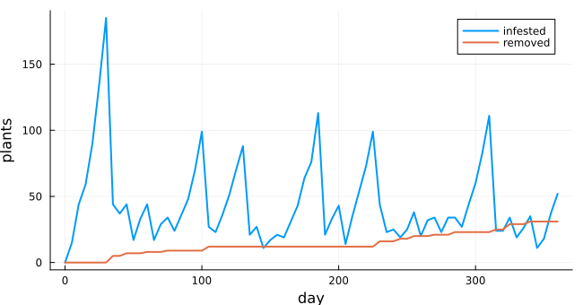
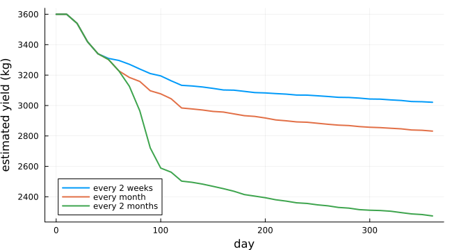
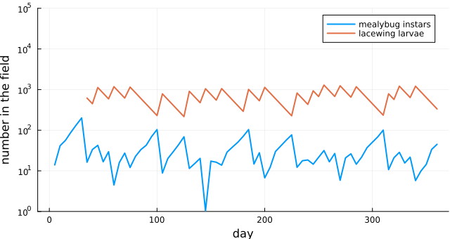

# Cassava mealybugs and green lacewings
Simon Frost

- [Overview](#overview)
- [The model](#the-model)
- [A season with releases every two
  weeks](#a-season-with-releases-every-two-weeks)
- [Release intervals](#release-intervals)
- [Larvae and mealybugs](#larvae-and-mealybugs)
- [Deviations from the source](#deviations-from-the-source)

## Overview

The cassava mealybug arrived in Thailand in 2008 and spread through its
cassava fields. Green lacewing larvae eat mealybugs and can be bred and
released. Promrak and Rattanakul ([2015](#ref-Promrak2015)) built a
cellular automaton of a small cassava field. Each plant carries the life
stages of mealybugs and lacewings, mealybugs spread to nearby plants and
are blown in by wind, infested plants are surveyed and removed, and
lacewing larvae are released. They asked how often releases should be
made. Promrak and Rattanakul ([2017](#ref-Promrak2017)) drew the same
model’s algorithm as flowcharts, which this implementation follows. It
is an **adaptation**. The sources leave out a few rules, and the release
sizes they state do not explain the totals they report.

``` julia
ENV["GKSwstype"] = "100"
using EcologicalCellularAutomata
using CellularAutomataCore
using Plots
using Statistics
```

## The model

A 40 × 40 field has one cassava plant per square metre. Each plant is
susceptible, infested or removed, and carries real-valued numbers of
mealybug eggs, instars and adults and of lacewing eggs, larvae, pupae
and adults. Each day:

- within every plant, the life stages follow the source’s difference
  equations, and a lacewing larva eats up to 20 mealybugs of each stage.
  That is the model’s rule.
- In a sweep over the plants in random order, wind brings instars from
  outside (more often on the two border rows). Infested plants pass
  instars to plants up to three cells away (with probability 0.05, 0.005
  or 0.0005 by ring), and a plant whose mealybugs are all gone is
  cleared. Every 14 days from day 31 about 60 plants are surveyed, and
  infested ones found are removed.
- While the last survey found mealybugs, 1000 larvae are released (800
  if fewer than half the surveyed plants were infested), split over the
  infested plants, at the chosen interval.

The sweep and the releases need the whole field, so they are a callback
stored with the problem. It also keeps the field’s memory of releases.

``` julia
prob = problem(:cassava_mealybug; interval=14, seed=1)
keys(prob.kwargs)
```

    (:callback,)

## A season with releases every two weeks

``` julia
sol = solve(prob; saveat=5)
counts(s) = [count(==(s), u.state) for u in sol.u]
plot(sol.t, [counts(1) counts(2)]; label=["infested" "removed"], lw=2, xlabel="day",
     ylabel="plants", size=(650, 340))
```



Mealybugs blow in from the first day and spread. Infestation peaks
before the first survey, at day 31, which finds them and starts the
releases. The larvae clear the infested plants within days. New
mealybugs keep arriving, so infestation then rises and falls between
about 15 and 110 plants with each round of releases, while removals
accumulate at each survey. The source’s Figure 3 shows the same course:
about 235 plants infested at day 30, a sharp fall at the first release,
and 20 to 90 afterwards.

## Release intervals

The source compared releases every two weeks, every month and every two
months. Ten runs each, with the estimated yield over the season. A plant
infested for two weeks loses all its yield if this happens in the first
four months, three tenths in the next three, and a tenth afterwards:

``` julia
function season(interval; runs=10)
    yields = Vector{Vector{Float64}}()
    released = Float64[]
    for s in 1:runs
        integ = init(problem(:cassava_mealybug; interval, seed=s); saveat=10)
        sol = solve!(integ)
        push!(yields, cassava_yield.(sol.u))
        push!(released, integ.p.released)
    end
    return mean(yields), released
end
intervals = (14, 30, 60)
results = Dict(iv => season(iv) for iv in intervals)
plot(0:10:360, [results[iv][1] for iv in intervals]; lw=2,
     label=["every 2 weeks" "every month" "every 2 months"], xlabel="day",
     ylabel="estimated yield (kg)", size=(650, 360), legend=:bottomleft)
```



``` julia
[(interval=iv, yield=round(results[iv][1][end]), released=round(mean(results[iv][2])))
 for iv in intervals]
```

    3-element Vector{@NamedTuple{interval::Int64, yield::Float64, released::Float64}}:
     (interval = 14, yield = 3021.0, released = 15120.0)
     (interval = 30, yield = 2832.0, released = 9280.0)
     (interval = 60, yield = 2274.0, released = 6000.0)

Starting from 3600 kg, the source’s yields end near 2960 kg with
releases every two weeks and near 2915 kg with the other two intervals,
about 50 kg apart. Releases every two weeks agree with the source here.
Longer intervals cost much more yield than in the source, because
infestation builds up between releases. The source’s cumulative releases
also climb to about 36 000 larvae in steps of about 3000, the same for
all three intervals. That is several times more than here, and more than
its stated release sizes of 1000 and 800 explain. The source must have
released more, or released at every survey that found mealybugs whatever
the interval, but its text does not say.

## Larvae and mealybugs

The populations over the field, with releases every two weeks. The
source’s Figure 4 shows instars peaking near 220 before the first
release and then between about 10 and 80, and larvae between about 1000
and 3000:

``` julia
plot(sol.t, [[sum(max.(u.Pi, 0)) for u in sol.u] [sum(u.Mi) for u in sol.u]]; lw=2,
     label=["mealybug instars" "lacewing larvae"], xlabel="day", ylabel="number in the field",
     yscale=:log10, ylims=(1, 1e5), size=(650, 340))
```



The instars follow the source closely. The larvae number a few hundred
to about 1200, fewer than in the source, as the releases here are
smaller.

## Deviations from the source

``` julia
foreach(d -> println("- ", d), model_info(:cassava_mealybug).deviations)
```

    - The model follows the 2015 experiment (40 x 40 field, 30 C, larval releases at three intervals) with the algorithm drawn in the 2017 paper's flowcharts.
    - The mealybug count m1 above which plants surveyed in days 121 to 210 are removed is not given; by default (m1 = Inf) plants are not removed in those days.
    - The survey sample is not given exactly; 60 plants are sampled on each survey day, about what the 2017 paper's design (every second row, every eleventh plant) gives on a 40 x 40 field.
    - Released larvae are split evenly over the infested plants; the source says only that they are released at random on infested plants. The source's cumulative releases rise in steps of about 3000, which its stated release sizes (1000 and 800) do not explain.
    - The last survey's findings are kept until the next survey, and releases follow every interval days from the first release while they show infestation.
    - Counts are real numbers and, as in the source's equations, are not clamped at zero, so predation can take a stage below zero; a plant is cleared when its total is not positive (the source's 'P not > 0'), and its counts are then set to zero. An infested plant passes on an instar only if it has at least one.
    - Predation is min(20 Mi, P) for each mealybug stage, the source's min(20, P/Mi) times Mi without division by zero.
    - The yield class of a plant is the worst it has reached: never infested for two weeks, or infested for two weeks in days 1-120, 121-210 or 211-360.

<div id="refs" class="references csl-bib-body hanging-indent">

<div id="ref-Promrak2015" class="csl-entry">

Promrak, Jirapond, and Chontita Rattanakul. 2015. “Simulation Study of
the Spread of Mealybugs in a Cassava Field: Effect of Release Frequency
of a Biological Control Agent.” *Kasetsart Journal (Natural Science)* 49
(6): 963–70.

</div>

<div id="ref-Promrak2017" class="csl-entry">

Promrak, Jirapond, and Chontita Rattanakul. 2017. “Effect of Increased
Global Temperatures on Biological Control of Green Lacewings on the
Spread of Mealybugs in a Cassava Field: A Simulation Study.” *Advances
in Difference Equations* 2017: 161.
<https://doi.org/10.1186/s13662-017-1218-y>.

</div>

</div>
