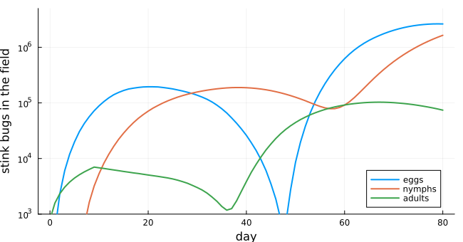
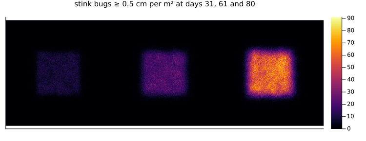
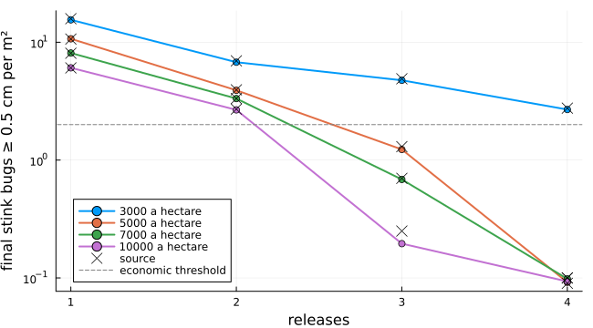

# Releasing Telenomus podisi against the brown stink bug
Simon Frost

- [Overview](#overview)
- [The model](#the-model)
- [A season without wasps](#a-season-without-wasps)
- [Release strategies](#release-strategies)
- [When parasitised eggs give new
  wasps](#when-parasitised-eggs-give-new-wasps)
- [Deviations from the source](#deviations-from-the-source)

## Overview

The neotropical brown stink bug, *Euschistus heros*, is the main pest of
soybean in Brazil. The tiny wasp *Telenomus podisi* lays its eggs in
stink bug eggs, and its larvae kill them. It is bred and released in
fields as a biological control. Weber et al. ([2022](#ref-Weber2022))
built a lattice model of a soybean field in which individual stink bugs
and wasps develop, move, lay eggs and die. They used it to compare 128
release strategies: how many releases, how many wasps, and in strips or
at points how far apart. They published the model’s C code with their
preprint.

This implementation is a **reproduction**. One detail needs care. Read
literally, the posted code never lets a stink bug stay in its cell, and
an arriving insect overwrites one already there. That collapses the
population to a few hundred adults, which cannot have produced the
published results. Moving as the paper describes reproduces them, as
shown below.

``` julia
ENV["GKSwstype"] = "100"
using EcologicalCellularAutomata
using CellularAutomataCore
using Plots
using Statistics
```

## The model

The field is 200 × 200 cells of 1 m², about 30 soybean plants each (4
ha). Only females are modelled. Each cell holds stink bug nymphs and
adults as counts by age, up to 60 egg masses, and wasps as counts by
age. Cells have room for 500 nymphs, 300 adults and 550 wasps. Each day:

- Within every cell (the model’s rule), insects age and die: adult stink
  bugs at 3% a day, nymphs at 1.4%, wasps at 5.66%. Nymphs become adults
  at 30 days, adults die at 37 and wasps at 26. Egg masses hatch at 5
  days, giving 3 female nymphs from 11 eggs. Parasitised eggs are
  removed when the wasps would emerge, at 14 days: in the source’s main
  experiment the wasps’ offspring are not followed.
- Stink bugs move up to 3 m along each axis, most staying put. Adults of
  at least 13 days lay a mass of 11 eggs nearby with probability 0.7.
- Each wasp flies to a random cell within 8 m that holds unparasitised
  eggs, or anywhere within 8 m if none does. From its second day it
  parasitises `⌊13.6 e^(-0.102 (age - 1))⌋` eggs there and in the cells
  around it, 12 on the second day falling to 1 on the 25th.
- 8000 adult stink bugs colonise the central 81 × 81 m over the first 10
  days. Wasps are released in the central hectare from day 4, a week
  apart.

Movement, egg laying and parasitism happen insect by insect, and each
depends on what the insects before it did. So they, colonisation and
releases are a callback stored with the problem.

``` julia
prob = problem(:telenomus_release; seed=1)
keys(prob.u0), keys(prob.kwargs)
```

    ((:nymphs, :adults, :masses, :wasps), (:callback,))

The state at time `t` is the field at the start of day `t`, so the
source’s step `s` is time `s + 1` here.

## A season without wasps

We step an integrator through the season, recording the totals and the
source’s measure of damage each day. The measure is stink bugs of at
least 0.5 cm (adults and nymphs older than 12 days) per m² in the
central hectare, where 2 is the economic threshold. Three runs:

``` julia
day_row(u) = merge(telenomus_counts(u), (; et=telenomus_et(u)))
size_class(u) = [sum(Int, u.adults[I]) + sum(Int, u.nymphs[I][13:end])
                 for I in CartesianIndices(u.adults)]
function season(prob; maps=())
    integ = init(prob; save_everystep=false, save_start=false)
    rows = [day_row(integ.u)]
    snapshots = Dict{Int,Matrix{Int}}()
    while integ.t < 80
        step!(integ)
        push!(rows, day_row(integ.u))
        integ.t in maps && (snapshots[integ.t] = size_class(integ.u))
    end
    return rows, snapshots
end
control = [season(problem(:telenomus_release; seed=s); maps=(31, 61, 80)) for s in 1:3]
step_of(i) = i - 2   # row i is time i - 1, the end of source step i - 2
peak(r, k) = (n=maximum(getfield.(r, k)), step=step_of(argmax(getfield.(r, k))))
[(final=round(r[end].et; digits=2), first_over=step_of(findfirst(x -> x.et > 2, r)),
  eggs=peak(r, :eggs), nymphs=peak(r, :nymphs), adults=peak(r, :adults))
 for r in first.(control)]
```

    3-element Vector{@NamedTuple{final::Float64, first_over::Int64, eggs::@NamedTuple{n::Int64, step::Int64}, nymphs::@NamedTuple{n::Int64, step::Int64}, adults::@NamedTuple{n::Int64, step::Int64}}}:
     (final = 39.87, first_over = 25, eggs = (n = 2636788, step = 78), nymphs = (n = 1641751, step = 79), adults = (n = 103071, step = 66))
     (final = 39.4, first_over = 25, eggs = (n = 2572548, step = 78), nymphs = (n = 1608310, step = 79), adults = (n = 100799, step = 66))
     (final = 39.08, first_over = 25, eggs = (n = 2608001, step = 78), nymphs = (n = 1618154, step = 79), adults = (n = 101749, step = 66))

Each row gives the final measure, the step at which it first exceeds the
threshold, and the peak of each stage with its step. The source reports,
over 15 runs:

- a final measure of 39.37 (± 0.13), about 18 times the threshold;
- the threshold first exceeded at step 26, one step after it is here;
- peaks of 2 597 177 eggs at step 78, 1 618 391 nymphs at step 79 and
  101 526 adults at step 66.

The runs here agree to within about 1.5%, at the same steps.

``` julia
rows = first(control[1])
plot(0:80, [getfield.(rows, :eggs) getfield.(rows, :nymphs) getfield.(rows, :adults)];
     label=["eggs" "nymphs" "adults"], lw=2, yscale=:log10, ylims=(1e3, 5e6),
     xlabel="day", ylabel="stink bugs in the field", legend=:bottomright,
     size=(650, 340))
```



Colonists lay eggs from the start. Their offspring take 35 days to
become adults, so adults dwindle until the first generation emerges from
about day 37. Its eggs then rise steeply, while the field holds no eggs
for a few days around day 47, between the generations.

``` julia
maps = control[1][2]
heatmap(hcat([maps[d] for d in (31, 61, 80)]...); aspect_ratio=1, c=:inferno,
        xticks=false, yticks=false, size=(750, 290), titlefontsize=10,
        title="stink bugs ≥ 0.5 cm per m² at days 31, 61 and 80")
```



Stink bugs stay close to the central square where they colonised the
field: moving about half a metre a day, they spread only a few metres in
a season, while their numbers there rise.

## Release strategies

The source’s Table S1 gives the final measure of each strategy. Here are
the 16 strategies of strips 25 m apart: 1 to 4 releases of 3000 to 10
000 wasps a hectare, three runs each, in parallel:

``` julia
final_et(prob) = telenomus_et(solve(prob; save_everystep=false, save_start=false).u[end])
function strategy(; seeds=1:3, kwargs...)
    tasks = [Threads.@spawn final_et(problem(:telenomus_release; seed=s, kwargs...))
             for s in seeds]
    return fetch.(tasks)
end
sizes = (3000, 5000, 7000, 10000)
grid = [mean(strategy(; releases=r, per_ha=N)) for r in 1:4, N in sizes]
source = [15.85 10.65 8.07 6.06; 6.96 3.95 3.33 2.71; 4.90 1.30 0.70 0.25;
          2.76 0.10 0.09 0.10]
[(releases=r, per_ha=N, here=round(grid[r, k]; digits=2), source=source[r, k])
 for r in 1:4 for (k, N) in enumerate(sizes)]
```

    16-element Vector{@NamedTuple{releases::Int64, per_ha::Int64, here::Float64, source::Float64}}:
     (releases = 1, per_ha = 3000, here = 15.5, source = 15.85)
     (releases = 1, per_ha = 5000, here = 10.7, source = 10.65)
     (releases = 1, per_ha = 7000, here = 8.11, source = 8.07)
     (releases = 1, per_ha = 10000, here = 6.07, source = 6.06)
     (releases = 2, per_ha = 3000, here = 6.77, source = 6.96)
     (releases = 2, per_ha = 5000, here = 3.91, source = 3.95)
     (releases = 2, per_ha = 7000, here = 3.33, source = 3.33)
     (releases = 2, per_ha = 10000, here = 2.67, source = 2.71)
     (releases = 3, per_ha = 3000, here = 4.76, source = 4.9)
     (releases = 3, per_ha = 5000, here = 1.23, source = 1.3)
     (releases = 3, per_ha = 7000, here = 0.69, source = 0.7)
     (releases = 3, per_ha = 10000, here = 0.2, source = 0.25)
     (releases = 4, per_ha = 3000, here = 2.69, source = 2.76)
     (releases = 4, per_ha = 5000, here = 0.09, source = 0.1)
     (releases = 4, per_ha = 7000, here = 0.1, source = 0.09)
     (releases = 4, per_ha = 10000, here = 0.09, source = 0.1)

Every strategy agrees with the source to within about 0.2. As the source
concludes, only three or four releases of at least 5000 wasps keep the
final measure below the threshold of 2. Two large releases (2 × 10 000)
do worse than three smaller ones (3 × 5000), even with more wasps in
total: each release protects only the eggs laid while its wasps live.

``` julia
plot(1:4, grid; marker=:circle, lw=2, label=permutedims(["$N a hectare" for N in sizes]),
     xlabel="releases", ylabel="final stink bugs ≥ 0.5 cm per m²", yscale=:log10,
     xticks=1:4, size=(650, 360), legend=:bottomleft)
scatter!(vec(repeat(1:4, 1, 4)), vec(source); marker=:x, ms=6, color=:black,
         label="source")
hline!([2]; color=:gray, ls=:dash, label="economic threshold")
```



How far apart the releases are matters only when they are sparse. With
four releases of 5000, the source gives 0.12 for points 25 m apart, 1.99
for points 50 m apart, and 0.87 for strips 50 m apart. Five runs each:

``` julia
[(mode=m, spacing=s,
  runs=round.(strategy(; seeds=1:5, releases=4, per_ha=5000, mode=m, spacing=s);
              digits=2))
 for (m, s) in ((:points, 25), (:points, 50), (:strips, 50))]
```

    3-element Vector{@NamedTuple{mode::Symbol, spacing::Int64, runs::Vector{Float64}}}:
     (mode = :points, spacing = 25, runs = [0.13, 0.12, 0.09, 0.13, 0.11])
     (mode = :points, spacing = 50, runs = [2.41, 2.39, 2.2, 2.55, 2.05])
     (mode = :strips, spacing = 50, runs = [0.84, 0.65, 0.61, 0.62, 0.76])

Points 25 m apart agree with the source. At 50 m the runs here differ
from it by more than its standard errors (0.11 at most): points end near
2.3 against its 1.99, and strips near 0.7 against its 0.87. The ranking
is the same, with sparse points the worst. With four points a hectare,
much of the field lies beyond the wasps’ 8 m reach, and each point gets
more wasps than its cell holds, so they spill into the neighbouring
cells. The source’s results do not show why these two strategies differ
here.

## When parasitised eggs give new wasps

In the source’s second configuration, parasitised eggs give a new
generation of wasps (70% female, 82% surviving), which goes on
searching. The source reports that every strategy then ends below the
threshold, and that a single release of 7000 wasps, or two of 3000, may
be enough. Three runs each:

``` julia
[(releases=r, per_ha=N,
  final=round(mean(strategy(; releases=r, per_ha=N, offspring=true)); digits=2))
 for (r, N) in ((1, 3000), (1, 7000), (2, 3000))]
```

    3-element Vector{@NamedTuple{releases::Int64, per_ha::Int64, final::Float64}}:
     (releases = 1, per_ha = 3000, final = 1.06)
     (releases = 1, per_ha = 7000, final = 0.4)
     (releases = 2, per_ha = 3000, final = 0.21)

Every strategy here also ends below the threshold, a single release of
3000 at about half of it.

## Deviations from the source

``` julia
foreach(d -> println("- ", d), model_info(:telenomus_release).deviations)
```

    - Stink bugs move as the source describes them: a draw of no movement keeps the insect in its cell, and a full cell makes it draw again. Read literally, the posted C code never lets a stink bug stay and makes an arrival overwrite insects at the destination; that collapses the population (to under 1000 adults) and cannot have produced the published results.
    - Insects of the same age in a cell are counts rather than individual storage places, so a cell's insects move in order of age rather than of storage place; egg masses keep their 60 places.
    - Cells holding wasps are visited in a uniformly random order; the source draws a random entry and searches outwards for the nearest unvisited one.
    - Random integers are drawn uniformly; the source's integer draws, which scale rand() and assume RAND_MAX = 32767, can rarely give one more than their range.
    - Wasp fecundity is 13.62737 exp(-0.10221 (age - 1)), as in the code; the preprint prints the product as a sum.
    - The adult stink bug death rate is the code's 0.03 a day; the preprint's table (70% viability over 24 days) implies 0.0147.
    - The state at time t is the field at the start of day t, after that day's colonists and releases, so the source's step s is time s + 1, and the colonists of the next day are included in the first nine steps.
    - As in the source, the economic-threshold measure counts 101 x 101 cells and divides by 100 x 100.

<div id="refs" class="references csl-bib-body hanging-indent">

<div id="ref-Weber2022" class="csl-entry">

Weber, Igor Daniel, Adriano Gomes Garcia, Adeney de Freitas Bueno,
Regiane Cristina de Oliveira de Freitas Bueno, and Wesley Augusto Conde
Godoy. 2022. “Release Strategies of *Telenomus Podisi* for Control of
*Euschistus Heros*: A Computational Modeling Approach.” *Pest Management
Science* 78 (11): 4544–56. <https://doi.org/10.1002/ps.7074>.

</div>

</div>
