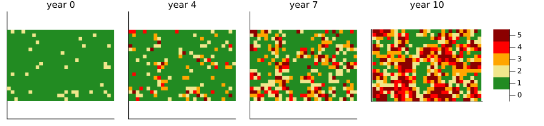
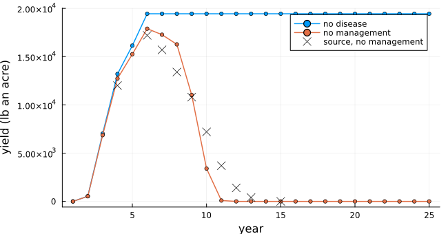
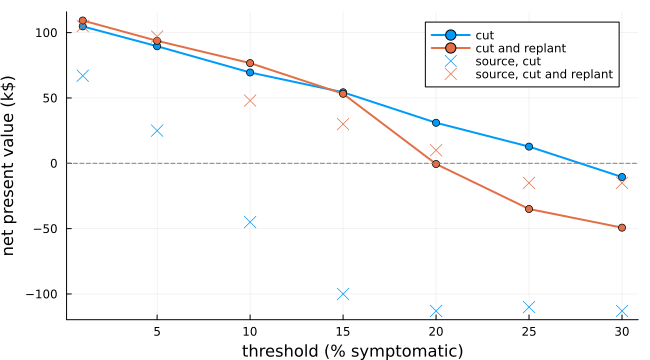

# Western X disease in a cherry orchard
Simon Frost

- [Overview](#overview)
- [The model](#the-model)
- [Calibrating the unknowns](#calibrating-the-unknowns)
- [Removing, replanting and testing](#removing-replanting-and-testing)
- [The removal threshold](#the-removal-threshold)
- [Deviations from the source](#deviations-from-the-source)

## Overview

Western X disease, caused by a phytoplasma that leafhoppers carry from
tree to tree, has spread through the cherry orchards of the Pacific
Northwest since 2015. Infected trees bear small, pale, unmarketable
fruit, there is no cure, and the infection is invisible for a year or
more before symptoms appear. Ghorbani et al. ([2026](#ref-Ghorbani2026))
modelled an acre of cherries as a grid of trees passing through five
disease states, and asked what removing, replanting and testing trees is
worth over 25 years. Their main analysis lets a grower choose actions
from uncertain beliefs about which trees are infected (a partially
observable Markov decision process, solved by rollout); they compare it
with fixed strategies.

This implementation is an **adaptation**. It implements the orchard and
the fixed strategies, not the decision model. The source does not give
the monthly rates of infection or the point at which a block is not
harvested; both are calibrated below to its results without management.

``` julia
ENV["GKSwstype"] = "100"
using EcologicalCellularAutomata
using CellularAutomataCore
using Plots
using Statistics
```

## The model

The orchard is 20 × 30 trees, planted together. Each month:

- an unvisited tree is inoculated by a leafhopper with probability
  `α + β k` a year (converted to a month), where `k` counts the
  symptomatic trees among its eight neighbours: `α = 1.5%` covers
  leafhoppers from elsewhere, and each symptomatic neighbour adds `β`;
- a visited (inoculated) tree becomes infected, an infected one visible
  (symptomatic), and a visible one high, each with probability 1/2 at
  every full year it has spent in its state;
- trees age, and yield and cost by age, as in the source’s crop budget;
  disease cuts the yield by 10, 25, 50 and 75% in the four states.

Between 2 and 8% of the trees start visited.

``` julia
prob = problem(:western_x_orchard; seed=1)
sol = solve(prob; saveat=12)
colours = cgrad([:white, :forestgreen, :khaki, :orange, :red, :darkred], 6; categorical=true)
plot([heatmap(sol.u[y + 1].state; c=colours, clims=(-0.5, 5.5), aspect_ratio=1,
              colorbar=y == 10, xticks=false, yticks=false, title="year $y",
              titlefontsize=10) for y in (0, 4, 7, 10)]...;
     layout=grid(1, 4; widths=[0.22, 0.22, 0.22, 0.34]), size=(900, 210))
```



States from green (unvisited) through yellow (visited), orange
(infected) and red (visible) to dark red (high). Infection spreads from
the first trees to their neighbours, and the orchard is largely diseased
within a decade.

## Calibrating the unknowns

The source gives `β` as 10 to 20% a symptomatic tree, without saying
whether that is a yearly or a monthly probability, and says that growers
stop harvesting a badly diseased block without saying when. Its baseline
without management has a total yield of 103,516 lb an acre over 25 years
and a net present value of -\$166,765; yields fall to zero by year 15
(its Fig. 5). Read as a monthly probability, even the smallest `β`
leaves the orchard 40% symptomatic by year 6. Read as yearly, `β = 0.2`
with no harvest once 25% of the trees are symptomatic gives, over 100
runs:

``` julia
runs(; n=100, kwargs...) =
    fetch.([Threads.@spawn solve(problem(:western_x_orchard; seed=s, kwargs...); saveat=1)
            for s in 1:n])
function summarise(sols; kw...)
    es = [western_x_economics(s; kw...) for s in sols]
    return (yield=round(Int, mean(sum(e.yield) for e in es)),
            npv=round(Int, mean(e.npv for e in es)),
            yearly=mean(reduce(hcat, [e.yield for e in es]); dims=2)[:])
end
baseline = summarise(runs())
healthy = summarise(runs(; n=1, disease=false))
(baseline=(baseline.yield, baseline.npv), healthy=(healthy.yield, healthy.npv))
```

    (baseline = (101315, -169013), healthy = (425700, 179758))

against the source’s 103,516 lb and -\$166,765 for the baseline, and
424,959 lb and \$170,046 for an orchard without disease.

``` julia
plot(1:25, [healthy.yearly baseline.yearly]; marker=:circle, ms=3, lw=1.5,
     label=["no disease" "no management"], xlabel="year", ylabel="yield (lb an acre)",
     size=(650, 340), legend=:topright)
scatter!([4, 6, 7, 8, 9, 10, 11, 12, 13, 15],
         [12000, 17200, 15700, 13400, 10800, 7200, 3700, 1400, 400, 0]; color=:black,
         marker=:x, ms=6, label="source, no management")
```



The crosses are read from the source’s Fig. 5. The yield here holds up a
little longer and then falls more steeply, but the totals agree. The
value of the disease to a grower, the difference in net present value,
is about \$349,000 an acre here and \$337,000 in the source.

The source’s damage equation multiplies a diseased tree’s cost, as well
as its yield, by its damage factor. Doing so would make diseased trees
cheap to keep, and the baseline’s value about -\$46,000; costs are not
scaled here.

## Removing, replanting and testing

The source’s fixed strategies, deciding every other year: cut every
symptomatic tree once 1% of the trees are symptomatic, with or without
replanting (its scenarios 2 and 3); and, from year 4, also test a tenth
of the trees around each symptomatic tree, at \$300 a test, cutting
those found infected (its scenarios 6 and 7). The source does not say
how many trees it tests:

``` julia
strategies = [(:threshold_cut, 270_564, 67_291), (:threshold_replant, 399_438, 105_225),
              (:test_cut, 257_196, 55_867), (:test_replant, 405_732, 116_763)]
results = Dict(s => summarise(runs(; strategy=s)) for (s, _, _) in strategies)
[(strategy=s, yield=results[s].yield, source_yield=y, npv=results[s].npv, source_npv=v)
 for (s, y, v) in strategies]
```

    4-element Vector{@NamedTuple{strategy::Symbol, yield::Int64, source_yield::Int64, npv::Int64, source_npv::Int64}}:
     (strategy = :threshold_cut, yield = 278663, source_yield = 270564, npv = 104541, source_npv = 67291)
     (strategy = :threshold_replant, yield = 349930, source_yield = 399438, npv = 108824, source_npv = 105225)
     (strategy = :test_cut, yield = 269034, source_yield = 257196, npv = 76434, source_npv = 55867)
     (strategy = :test_replant, yield = 349445, source_yield = 405732, npv = 66294, source_npv = 116763)

Every strategy is worth more than \$220,000 an acre over doing nothing,
here as in the source, and replanting adds yield. The agreement is
otherwise rough. Cut-only is worth more here, and cut and replant yields
less. Testing lowers the value of both here, while the source finds that
testing with replanting gives the most value of its fixed strategies:
its testing finds more hidden infections for its cost than the share and
the timing assumed here allow.

## The removal threshold

The source’s Fig. 6 asks how long a grower can wait: the net present
value of removal against the share of symptomatic trees at which it
starts. Forty runs each:

``` julia
thresholds = (0.01, 0.05, 0.1, 0.15, 0.2, 0.25, 0.3)
sweep = Dict((s, θ) => summarise(runs(; n=40, strategy=s, pmap=(; threshold=θ))).npv
             for s in (:threshold_cut, :threshold_replant) for θ in thresholds)
cut = [sweep[(:threshold_cut, θ)] for θ in thresholds]
replant = [sweep[(:threshold_replant, θ)] for θ in thresholds]
plot(100 .* collect(thresholds), [cut replant] ./ 1000; marker=:circle, lw=2,
     label=["cut" "cut and replant"], xlabel="threshold (% symptomatic)",
     ylabel="net present value (k\$)", size=(650, 360))
scatter!(100 .* collect(thresholds), [67, 25, -45, -100, -113, -110, -113]; color=1,
         marker=:x, ms=6, label="source, cut")
scatter!(100 .* collect(thresholds), [105, 97, 48, 30, 10, -15, -15]; color=2, marker=:x,
         ms=6, label="source, cut and replant")
hline!([0]; color=:gray, ls=:dash, label="")
```



As in the source, waiting costs money, and replanting keeps removal
paying at higher thresholds: cutting and replanting stops paying at
about 20% symptomatic here and 22% in the source. Cut-only loses value
more slowly with the threshold here than in the source, where it stops
paying at about 7%.

## Deviations from the source

``` julia
foreach(d -> println("- ", d), model_info(:western_x_orchard).deviations)
```

    - The source's decision model (scenarios 4 and 5: belief updates and a rollout solver) is not implemented; only the fixed strategies are.
    - The source gives the inoculation rate as 1.5% a year plus 10-20% for each symptomatic neighbour, without saying whether these are yearly or monthly probabilities or whether the neighbour effect adds to or multiplies the rate. Here alpha + beta k is a yearly probability, converted to a monthly one, with beta = 0.2; read as monthly, the orchard is 42% symptomatic by year 6, far faster than the source's yields allow.
    - The source's growers do not harvest a badly diseased block, without a threshold; here no revenue is earned in a month in which 25% or more of the trees are symptomatic. With beta = 0.2 this reproduces the source's baseline total yield and net present value. Yields collapse somewhat more steeply than in its Fig. 5.
    - The source's Eq. 6 multiplies the cost of a tree, as well as its yield, by its damage factor; with that, the baseline's net present value is about -$46,000 against -$166,765. Costs are not scaled here (scale_costs = true scales them).
    - A tree moves to the next disease state with probability 1/2 at each full year it has spent in its state (the source: transitions take a year and succeed half the time). The source's table also lists a return from the last state to the first 'for modeling purposes', which is not used: the last state is final.
    - Management decides every other year, as the source says of its decisions: threshold strategies from year 2, testing strategies from year 4. Threshold strategies cut every symptomatic tree once 1% or more are symptomatic. The source does not say when or how often its threshold rule acts.
    - Testing reaches a share test_share = 0.1 of the trees within radius 1 of each symptomatic tree; the source does not give the share. Tests detect visited and infected trees with probability 0.85 and never report an unvisited tree as positive; the source does not give the false-positive rate.
    - The strategies agree with the source only roughly. Cut-only at 1% gives 278,663 lb and $104,541 against 270,564 lb and $67,291; cut and replant 349,930 lb and $108,824 against 399,438 lb and $105,225; testing with cut-only 269,034 lb and $76,434 against 257,196 lb and $55,867; testing with cut and replant 349,445 lb and $66,294 against 405,732 lb and $116,763. Testing here lowers the value of cut and replant, where in the source it raises it. Over removal thresholds (Fig. 6), cut and replant becomes unprofitable near 20% (source: about 22%), but cut-only only near 27% (source: about 7%).
    - The disease-free orchard's net present value is $179,758 against $170,046, with monthly discounting at 5% a year; the source's discounting convention is not stated.
    - The grid has 600 trees; the source's table gives 605 trees an acre.

<div id="refs" class="references csl-bib-body hanging-indent">

<div id="ref-Ghorbani2026" class="csl-entry">

Ghorbani, Khashi, Shady S. Atallah, and R. Karina Gallardo. 2026. “The
Bioeconomics of Perennial Crop Disease Management Under Partial
Observability: Evidence from Western X Disease in Cherry Orchards.”
*Agricultural and Applied Economics Association Annual Meeting* (Kansas
City, MO). <https://doi.org/10.22004/ag.econ.404852>.

</div>

</div>
