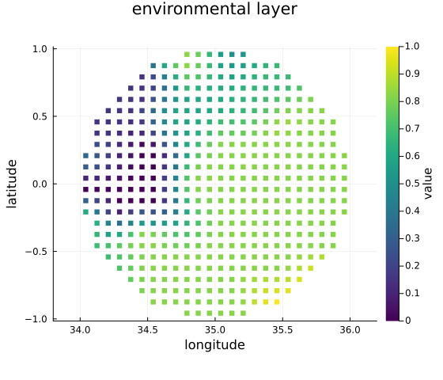
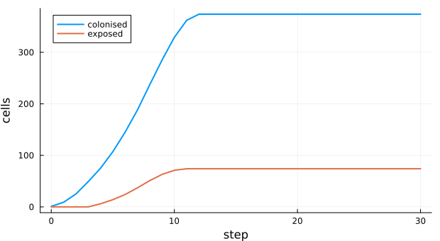
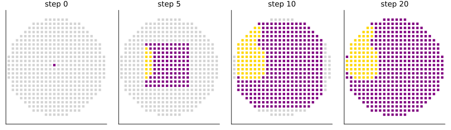

# Dispersal of biological control agents
Simon Frost

- [Overview](#overview)
- [The grid and the neighbourhood](#the-grid-and-the-neighbourhood)
- [A release](#a-release)
- [How fast it arrives](#how-fast-it-arrives)
- [Matching the released code](#matching-the-released-code)
- [Deviations from the source](#deviations-from-the-source)

## Overview

When a parasitoid or predator is released against a crop pest, where
will it be in a year? iPyDisp ([Agboka et al. 2024](#ref-Agboka2024)) is
a desktop tool that answers with a cellular automaton on a map:

- the region is cut into a grid of cells about a kilometre or more
  across;
- a released agent reaches every cell within its travel distance in one
  time step;
- a cell it reaches is colonised if its environment suits the agent
  (each layer, such as temperature or rainfall, lies within bounds), and
  only exposed if not;
- exposed cells pass the agent on as well.

This implementation is a **reproduction** of the tool’s released code.
The model is deterministic, and on the same grid, constraints and
release sites every cell’s state at every step equals that of the tool’s
own functions.

``` julia
ENV["GKSwstype"] = "100"
using EcologicalCellularAutomata
using CellularAutomataCore
using Plots
```

## The grid and the neighbourhood

iPyDisp lays a grid of square cells, `cellsize × 0.00833` degrees across
(about `cellsize` km at the equator), over the region’s bounding box,
keeps the cells inside the region, and joins two cells when their
centroids are closer than the travel distance on a sphere of radius 6371
km. With cells of about 9.3 km and a travel distance of 15 km, each
cell’s neighbours are its eight surrounding cells; with 20 km, cells two
away in a straight line join too.

``` julia
ex = ipydisp_example()
g = ex.grid
[(travel=d, most_neighbours=maximum(length, ipydisp_neighbours(g.lat, g.lon, d)))
 for d in (10, 15, 20, 30)]
```

    4-element Vector{@NamedTuple{travel::Int64, most_neighbours::Int64}}:
     (travel = 10, most_neighbours = 4)
     (travel = 15, most_neighbours = 8)
     (travel = 20, most_neighbours = 12)
     (travel = 30, most_neighbours = 36)

The example region is an ellipse in central Kenya with one synthetic
environmental layer: cells are suitable when it exceeds 0.3.

``` julia
suitable = ipydisp_suitable(ex.constraints, length(g.lat))
scatter(g.lon, g.lat; zcolor=ex.constraints[1][1], markershape=:square, markersize=3.2,
        markerstrokewidth=0, c=:viridis, aspect_ratio=1, label=false,
        xlabel="longitude", ylabel="latitude", title="environmental layer",
        colorbar_title="value", size=(560, 480))
```



## A release

One release at the centre, followed for 30 steps (months, say).

``` julia
prob = problem(:ipydisp_dispersal; steps=30)
sol = solve(prob; saveat=1)
counts = ipydisp_counts.(sol.u)
plot(0:30, [getfield.(counts, :colonised) getfield.(counts, :exposed)];
     label=["colonised" "exposed"], lw=2, xlabel="step", ylabel="cells", size=(620, 340))
```



``` julia
colours = [:lightgray, :gold, :purple]
plot([scatter(g.lon, g.lat; color=colours[sol.u[t + 1].status .+ 1], markershape=:square,
              markersize=2.4, markerstrokewidth=0, aspect_ratio=1, label=false,
              title="step $t", titlefontsize=10, ticks=false)
      for t in (0, 5, 10, 20)]...; layout=(1, 4), size=(900, 260))
```



Colonised cells are purple, exposed ones yellow. The front advances one
cell a step in every direction, through unsuitable cells as well as
suitable ones, since exposed cells pass the agent on. So unsuitable
patches do not slow the spread; they only stay uncolonised.

## How fast it arrives

iPyDisp’s validation compares the step at which a known site is first
reached with the time the agent was found there. Without constraints,
with cells joined to their eight neighbours, the step at which a cell is
reached is its Chebyshev distance in cells from the release.

``` julia
plain = problem(:ipydisp_dispersal; constraints=[], steps=40)
reached = fill(-1, length(g.lat))
let integ = init(plain)
    reached[integ.u.status .== 2] .= 0
    for t in 1:40
        step!(integ)
        reached[(reached .< 0) .& (integ.u.status .== 2)] .= t
    end
end
s = findfirst(==(0), reached)
cheb = [max(abs(g.row[k] - g.row[s]), abs(g.col[k] - g.col[s])) for k in eachindex(reached)]
(all_reached=all(>=(0), reached), equals_chebyshev_distance=reached == cheb)
```

    (all_reached = true, equals_chebyshev_distance = true)

With a longer travel distance the front moves faster. With 20 km, cells
two away in a straight line join, but cells two away on a diagonal do
not, so the front covers the region in fewer steps.

``` julia
fast = problem(:ipydisp_dispersal; grid=g, neighbours=ipydisp_neighbours(g.lat, g.lon, 20),
               constraints=[], steps=40)
function steps_to_all(prob)
    integ = init(prob)
    t = 0
    while any(==(0), integ.u.status)
        step!(integ)
        t += 1
    end
    return t
end
(travel_15km=steps_to_all(plain), travel_20km=steps_to_all(fast))
```

    (travel_15km = 12, travel_20km = 9)

## Matching the released code

The tool is a desktop application, but its model is three functions and
two loops: the distance, the neighbourhood of the exposed and colonised
cells, the constraint test, the building of the neighbourhood and the
update. Run headless in Python on the same grids, with travel distances
of 7.5, 12 and 15 km, two constraint layers and several release sites,
they give exactly the neighbourhoods and the states of every cell at
every step that this model gives, for 25 to 40 steps. The grid built
from a bounding box is the same as well. One difference remains. The
tool clips cells at the edge of the region’s polygon and places them at
the centroid of their part inside. Here a cell is kept or dropped whole.

## Deviations from the source

``` julia
foreach(d -> println("- ", d), model_info(:ipydisp_dispersal).deviations)
```

    - Written from the released Python code (MIT licence, github.com/Vansnoden/iPyDisp, also SoftwareImpacts/SIMPAC-2023-462); the paper's text was not available.
    - Cells are kept where a predicate holds at the centroid of their square; iPyDisp clips the grid to a shapefile and places cut cells at the centroid of their part inside it. With a grid exported from iPyDisp the runs are identical.
    - Constraint layers are vectors of values per cell; iPyDisp reads them from GeoTIFFs at the cell centroids, clamping out-of-range indices to the last row or column.
    - The example setting (an ellipse in central Kenya with one synthetic constraint) is synthetic; the software ships with no data.

<div id="refs" class="references csl-bib-body hanging-indent">

<div id="ref-Agboka2024" class="csl-entry">

Agboka, Komi Mensah, John Odindi, Elfatih M. Abdel-Rahman, Onisimo
Mutanga, and Henri E. Z. Tonnang. 2024. “A Visual and Spatial Tool for
Tracking, Mapping and Forecasting the Dispersal of Biological Control
Agents.” *Software Impacts* 19: 100609.
<https://doi.org/10.1016/j.simpa.2023.100609>.

</div>

</div>
