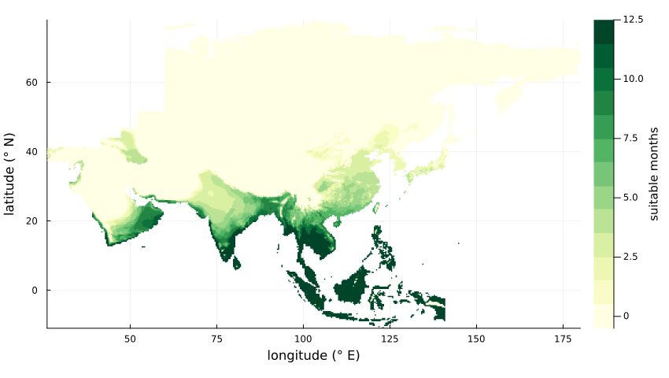
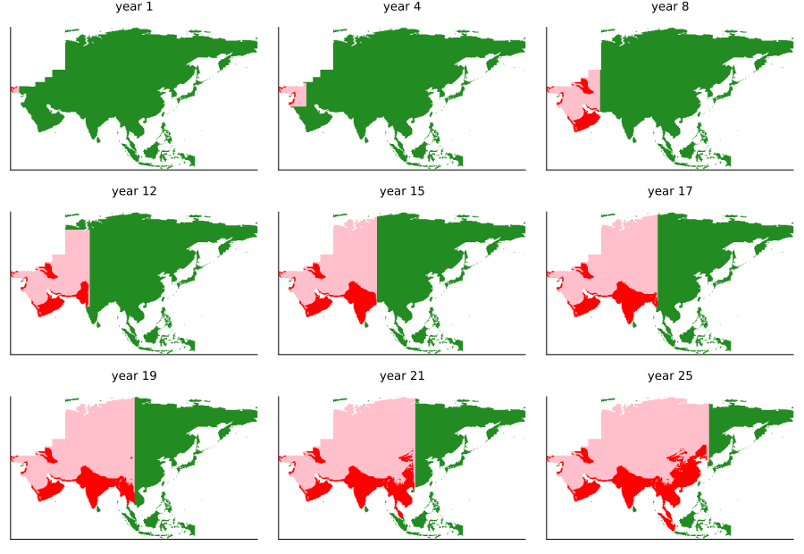

# The tomato leafminer across Asia
Simon Frost

- [Overview](#overview)
- [The climate](#the-climate)
- [The invasion](#the-invasion)
- [The timing against the records](#the-timing-against-the-records)
- [How far the moth flies in a
  month](#how-far-the-moth-flies-in-a-month)
- [Deviations from the source](#deviations-from-the-source)

## Overview

The tomato leafminer *Tuta absoluta* left South America for Spain in
2006, crossed Africa within a decade, and was first found in Asia, in
Turkey, in 2009. By 2018 it was in India, Nepal, Bangladesh, Central
Asia and probably Myanmar. Could it have spread that fast by flying?
Guimapi et al. ([2020](#ref-Guimapi2020)) asked with the cellular
automaton that Guimapi et al. ([2016](#ref-Guimapi2016)) had built for
Africa:

- the land is cut into cells, and time into months;
- a cell next to the invasion becomes **invaded** in a month whose mean
  temperature is at least 22 °C and mean relative humidity at least 55%,
  and **exposed** otherwise: the moth may cross it but cannot establish;
- an exposed cell becomes invaded in a later suitable month;
- exposed and invaded cells both carry the invasion on.

Their answer was no: flight alone would take about 20–25 years to reach
Southeast Asia, so the pest must have travelled with traded tomatoes and
people.

This implementation is an **adaptation**. The authors’ code and data are
not published, so the climate is the CRU CL 2.0 climatology ([New et al.
2002](#ref-New2002)) on cells of 1/3 degree, bundled with the package,
and the reach of a month is set from the timing of the source’s maps
rather than from its text, as explained below.

``` julia
ENV["GKSwstype"] = "100"
using EcologicalCellularAutomata
using CellularAutomataCore
using Plots
```

## The climate

The bundled climate holds the monthly mean temperature and relative
humidity of each land cell of Asia. A cell can be invaded only in a
month that meets both thresholds. Much of Asia never does: the north is
too cold, and the deserts and steppes of the west and the interior are
too dry in the months that are warm enough.

``` julia
c = tuta_climate()
months = dropdims(sum((c.temperature .>= 22) .& (c.humidity .>= 55); dims=3); dims=3)
suitable = [c.land[I] ? Float64(months[I]) : NaN for I in CartesianIndices(c.land)]
lats = reverse(c.lat)                    # rows run from the north; plots want rising latitude
northup(M) = reverse(M; dims=1)
heatmap(c.lon, lats, northup(suitable); c=cgrad(:YlGn, 13; categorical=true), clims=(-0.5, 12.5),
        aspect_ratio=1, xlims=(26, 180), ylims=(-11, 78), xlabel="longitude (° E)",
        ylabel="latitude (° N)", colorbar_title="suitable months", size=(850, 480),
        left_margin=3Plots.mm, bottom_margin=3Plots.mm)
```



## The invasion

The run starts in January from İzmir, near the first record in Turkey,
and lasts 25 years. Each cell records the month in which it was first
reached and the month in which it was invaded, so one run gives the maps
of every year.

``` julia
prob = problem(:tuta_absoluta_asia)
u = solve(prob; save_everystep=false).u[end]
function snapshot(u, year)
    m = 12 * year
    return [!u.land[I] ? NaN :
            0 <= u.invaded[I] <= m ? 2.0 : 0 <= u.reached[I] <= m ? 1.0 : 0.0
            for I in CartesianIndices(u.land)]
end
colours = cgrad([:forestgreen, :pink, :red], 3; categorical=true)
plot([heatmap(c.lon, lats, northup(snapshot(u, y)); c=colours, clims=(-0.5, 2.5), colorbar=false,
              aspect_ratio=1, xlims=(26, 180), ylims=(-11, 78), title="year $y",
              titlefontsize=9, ticks=false)
      for y in (1, 4, 8, 12, 15, 17, 19, 21, 25)]...; layout=(3, 3), size=(900, 620))
```



Green cells are susceptible, pink exposed and red invaded. As in the
source’s Fig. 2, the invasion crosses Anatolia in its first four years
and the Levant, Iraq and Arabia by its eighth, establishing only in the
south-west of Arabia; it crosses Iran and Central Asia as exposed land,
reaches the Indian subcontinent after 12–15 years and Indochina,
southern China and the Malay peninsula after 17–21. Korea is reached
overland only in the last months; Taiwan, the Philippines and Japan are
never reached, as the sea is too wide to cross. The source’s maps colour
every cell the invasion has reached, exposed or invaded, in red. They
leave northern Asia, Mongolia and Tibet untouched, where here the
invasion crosses them as exposed land; the deviations below explain why.

## The timing against the records

``` julia
places = [("India", 2015, 28.6, 77.2), ("Nepal", 2016, 27.7, 85.3),
          ("Bangladesh", 2016, 23.8, 90.4), ("Kyrgyzstan", 2017, 42.9, 74.6),
          ("Tajikistan", 2018, 38.6, 68.8), ("Myanmar", 2018, 16.8, 96.2),
          ("Thailand", nothing, 13.8, 100.5), ("Vietnam", nothing, 21.0, 105.8),
          ("southern China", nothing, 23.1, 113.3), ("Malaysia", nothing, 3.1, 101.7),
          ("Taiwan", nothing, 23.7, 121.0), ("Philippines", nothing, 14.6, 121.0)]
yrs(x) = x === nothing ? missing : round(x; digits=1)
[(; place, recorded=year === nothing ? missing : year - 2009,
  reached=yrs(tuta_arrival(u, lat, lon).reached),
  invaded=yrs(tuta_arrival(u, lat, lon).invaded))
 for (place, year, lat, lon) in places]
```

    12-element Vector{NamedTuple{(:place, :recorded, :reached, :invaded)}}:
     (place = "India", recorded = 6, reached = 12.5, invaded = 12.6)
     (place = "Nepal", recorded = 7, reached = 14.5, invaded = 14.5)
     (place = "Bangladesh", recorded = 7, reached = 15.8, invaded = 15.8)
     (place = "Kyrgyzstan", recorded = 8, reached = 11.8, invaded = missing)
     (place = "Tajikistan", recorded = 9, reached = 10.4, invaded = missing)
     (place = "Myanmar", recorded = 9, reached = 17.5, invaded = 17.5)
     (place = "Thailand", recorded = missing, reached = 18.3, invaded = 18.3)
     (place = "Vietnam", recorded = missing, reached = 19.7, invaded = 19.7)
     (place = "southern China", recorded = missing, reached = 21.5, invaded = 21.5)
     (place = "Malaysia", recorded = missing, reached = 20.9, invaded = 20.9)
     (place = "Taiwan", recorded = missing, reached = missing, invaded = missing)
     (place = "Philippines", recorded = missing, reached = missing, invaded = missing)

Years after 2009 at which each place was recorded and at which the
simulation first reaches and invades it (at a city: Delhi, Kathmandu,
Dhaka, Bishkek, Dushanbe, Yangon, Bangkok, Hanoi, Guangzhou, Kuala
Lumpur, central Taiwan, Manila). Flight alone is about twice as slow as
the pest was: it reaches India in 12.6 years against 6, and Myanmar in
17.5 against 9, as the source concluded. Kyrgyzstan and Tajikistan,
where the pest was found, are reached but never invaded here: they are
too dry in their warm months.

## How far the moth flies in a month

The source’s text gives the moth’s flight as 100 km a month, through a
Moore neighbourhood of radius 100 km. That is the reach of its Africa
model ([Guimapi et al. 2016](#ref-Guimapi2016)), whose 25 km cells and
100 km neighbourhood carried the invasion from Spain to Kenya in seven
years. In Asia, a reach of about 100 km (three cells here) is far faster
than the source’s maps:

``` julia
fast = solve(problem(:tuta_absoluta_asia; radius=3); save_everystep=false).u[end]
[(; place, radius_1=yrs(tuta_arrival(u, lat, lon).reached),
  radius_3=yrs(tuta_arrival(fast, lat, lon).reached))
 for (place, _, lat, lon) in places]
```

    12-element Vector{NamedTuple{(:place, :radius_1, :radius_3)}}:
     (place = "India", radius_1 = 12.5, radius_3 = 4.2)
     (place = "Nepal", radius_1 = 14.5, radius_3 = 4.8)
     (place = "Bangladesh", radius_1 = 15.8, radius_3 = 5.3)
     (place = "Kyrgyzstan", radius_1 = 11.8, radius_3 = 4.0)
     (place = "Tajikistan", radius_1 = 10.4, radius_3 = 3.5)
     (place = "Myanmar", radius_1 = 17.5, radius_3 = 5.8)
     (place = "Thailand", radius_1 = 18.3, radius_3 = 6.2)
     (place = "Vietnam", radius_1 = 19.7, radius_3 = 6.6)
     (place = "southern China", radius_1 = 21.5, radius_3 = 7.2)
     (place = "Malaysia", radius_1 = 20.9, radius_3 = 7.0)
     (place = "Taiwan", radius_1 = missing, radius_3 = 7.9)
     (place = "Philippines", radius_1 = missing, radius_3 = 10.9)

With a reach of about 100 km the invasion is in India after four years
and in Indochina after six, and it crosses to Taiwan, the Philippines
and Japan, where the source finds no risk of natural spread. The
source’s maps match a reach of one cell a month: one of its 25 km cells,
or one cell of 1/3 degree (about 37 km) here.

## Deviations from the source

``` julia
foreach(d -> println("- ", d), model_info(:tuta_absoluta_asia).deviations)
```

    - The authors' code and data are not published. The climate is the CRU CL 2.0 climatology (monthly mean temperature and relative humidity, 1961-1990; New et al. 2002) on cells of 1/3 degree, bundled under the Open Database License, rather than WorldClim temperature at 1 km and relative humidity from NASA SSE interpolated from 1 degree by inverse distance weighting.
    - The rule is that of Guimapi et al. (2016), which the source applies without its vegetation index and tomato production: a land cell reached by an exposed or invaded Moore neighbour becomes invaded in a month that meets both thresholds and exposed otherwise, and exposed cells carry the invasion on and become invaded in a later suitable month. The source's text states only the change from susceptible to invaded; read alone, the invasion stalls in western Turkey, where no month is both warm and humid enough.
    - The reach in a month is one cell of 1/3 degree (about 37 km), which matches the timing of the source's maps, like one of the 25 km cells of Guimapi et al. (2016); the source's text gives a Moore neighbourhood of radius 100 km (radius = 3 here), which spreads the invasion two to three times as fast and across the seas to Taiwan, the Philippines and Japan.
    - The thresholds are inclusive (at least 22 degC and 55%), as in Guimapi et al. (2016); the source's text says greater than.
    - The study area is the land of Asia within a rough boundary (no Europe west of the Turkish straits, the Black Sea, the Caucasus and the Ural river and mountains; no Africa west of Suez and the Red Sea, nor the Horn of Africa; no New Guinea); a cell is land if at least two of its four 10' cells are. The invasion starts in January in the cell of Izmir; the source marks a point in western Turkey and gives no month.
    - The source's maps colour every cell the invasion has reached, exposed or invaded, in red; here the two are told apart. Exposure is not limited by the climate, as in the temperature-and-humidity runs of Guimapi et al. (2016), where all of Africa is reached; so here the invasion also crosses northern Asia, Mongolia and Tibet as exposed land, which the source's maps leave untouched. Limiting exposure to months of at least 22 degC matches those maps in pattern on cells of 10' with a reach of about 100 km, but spreads about one and a half times as fast as they do and stalls on the Anatolian plateau on the cells of 1/3 degree bundled here.

<div id="refs" class="references csl-bib-body hanging-indent">

<div id="ref-Guimapi2020" class="csl-entry">

Guimapi, Ritter A., Ramasamy Srinivasan, Henri E. Tonnang, Paola
Sotelo-Cardona, and Samira A. Mohamed. 2020. “Exploring the Mechanisms
of the Spatiotemporal Invasion of <span class="nocase">Tuta
absoluta</span> in Asia.” *Agriculture* 10 (4): 124.
<https://doi.org/10.3390/agriculture10040124>.

</div>

<div id="ref-Guimapi2016" class="csl-entry">

Guimapi, Ritter Y. A., Samira A. Mohamed, George O. Okeyo, Frank T.
Ndjomatchoua, Sunday Ekesi, and Henri E. Z. Tonnang. 2016. “Modeling the
Risk of Invasion and Spread of <span class="nocase">Tuta absoluta</span>
in Africa.” *Ecological Complexity* 28: 77–93.
<https://doi.org/10.1016/j.ecocom.2016.08.001>.

</div>

<div id="ref-New2002" class="csl-entry">

New, Mark, David Lister, Mike Hulme, and Ian Makin. 2002. “A
High-Resolution Data Set of Surface Climate over Global Land Areas.”
*Climate Research* 21: 1–25. <https://doi.org/10.3354/cr021001>.

</div>

</div>
