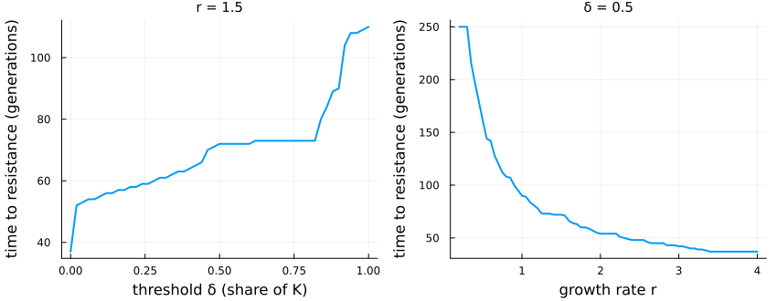
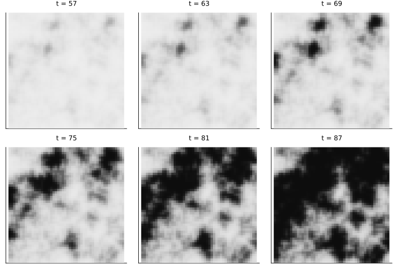
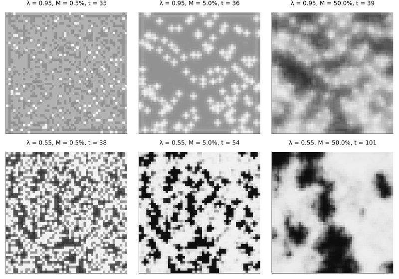

# Pesticide resistance across a region
Simon Frost

- [Overview](#overview)
- [A single field](#a-single-field)
- [A region](#a-region)
- [Migration and refuges](#migration-and-refuges)
- [The factorial](#the-factorial)
- [Deviations from the source](#deviations-from-the-source)

## Overview

Spraying a field selects for resistance in its pests; refuges that are
not sprayed, and pests that move between fields, slow that down. Peck
and Ellner ([1997](#ref-Peck1997)) asked how the economic threshold at
which farmers spray, the life history of the pest and the arrangement of
a region change the time until resistance takes over. Their model is a
lattice of fields:

- each field holds a pest population with one resistance gene, which
  grows logistically each generation;
- resistance costs its carriers a little;
- a treated field whose population passes the economic threshold is
  sprayed, and the spray kills susceptible pests (and some
  heterozygotes);
- a share of every field’s pests then moves to the neighbouring fields;
- refuges are never sprayed, and rotated fields are emptied every other
  generation.

After a random start, the model is deterministic. This implementation is
an **adaptation**: it follows the source’s equations, choosing where
they are ambiguous as the deviations below list.

``` julia
ENV["GKSwstype"] = "100"
using EcologicalCellularAutomata
using CellularAutomataCore
using Plots
using Statistics
```

## A single field

The source first studied one field: 10⁷ pests, a carrying capacity twice
that, a resistance allele starting at a frequency of 0.0005, a spray
killing 75% of susceptibles, a cost of 0.0005 and a dominance of 0.05. A
field on its own is a lattice of one cell.

``` julia
model = build_resistance_regional()
function single(; r=1.5, delta=0.5)
    u0 = (; N=fill(1e7, 1, 1), q=fill(5e-4, 1, 1), sprayed=fill(true, 1, 1),
          rotated=fill(false, 1, 1), K=fill(2e7, 1, 1), neighbours=fill(Int8(0), 1, 1))
    p = merge(defaults(model), (; r, delta, rho=0.75, s=5e-4, h=0.05, Ks=2e7))
    t = resistance_time(solve(CAProblem(model, u0, 250, p; space=Grid(1, 1))))
    return t === nothing ? 250 : t
end
deltas = 0:0.02:1
rs = 0.2:0.05:4
plot(plot(deltas, [single(; delta=d) for d in deltas]; xlabel="threshold δ (share of K)",
          title="r = 1.5"),
     plot(rs, [single(; r) for r in rs]; xlabel="growth rate r", title="δ = 0.5");
     ylabel="time to resistance (generations)", legend=false, lw=2, layout=(1, 2),
     size=(850, 330), titlefontsize=10, left_margin=4Plots.mm, bottom_margin=4Plots.mm)
```



As in the source’s Fig. 2, a higher threshold (spraying less often)
delays resistance in steps, from about 58 generations at δ = 0.2 to 110
at δ = 1, and faster growth hastens it: about 216 generations at r =
0.35, 90 at r = 1 and 37 at r = 3.5. The steps come from the
population’s cycles: as the threshold rises, the cycle sprays in fewer
generations. Spraying every generation (δ = 0) gives 37 generations,
against about 50 in the source.

## A region

The source’s spatial runs use 50 × 50 fields, 55% of them treated, with
half the treated fields’ carrying capacity in the refuges. With half of
each field’s pests migrating each generation (the source’s Fig. 6),
resistance spreads in patches:

``` julia
prob = problem(:resistance_regional; seed=1, pmap=(; s=0.005, delta=0.8, M=0.5))
sol = solve(prob)
println("time to resistance: ", resistance_time(sol))
plot([heatmap(sol.u[t + 1].q; clims=(0, 1), c=cgrad(:grays; rev=true), yflip=true, colorbar=false,
              title="t = $t", titlefontsize=9, ticks=false, aspect_ratio=1)
      for t in (57, 63, 69, 75, 81, 87)]...; layout=(2, 3), size=(800, 540))
```

    time to resistance: 81



Dark fields are resistant. Patches appear after about 60 generations,
grow and merge, and cover most of the region by generation 87;
resistance takes over the region (a mean frequency above one half) at
generation 81. The patches cut across the map of treated fields and
refuges: what makes a field resistant is as much its neighbours as its
own spraying.

## Migration and refuges

The source’s Fig. 7 compares migration of 0.5%, 5% and 50% a generation
with 95% and 55% of fields treated. Here each region is shown when its
mean frequency first passes 0.3:

``` julia
snap = Matrix{Any}(undef, 2, 3)
for (i, lambda) in enumerate((0.95, 0.55)), (j, M) in enumerate((0.005, 0.05, 0.5))
    s = solve(problem(:resistance_regional; lambda, kappa=0.9, seed=3,
                      pmap=(; M, delta=0.45)))
    k = something(findfirst(u -> resistance_summary(u).mean > 0.3, s.u), length(s.u))
    snap[i, j] = heatmap(s.u[k].q; clims=(0, 1), c=cgrad(:grays; rev=true), yflip=true, colorbar=false,
                         ticks=false, aspect_ratio=1, titlefontsize=8,
                         title="λ = $lambda, M = $(100M)%, t = $(k - 1)")
end
plot(permutedims(snap)...; layout=(2, 3), size=(800, 560))
```



With little migration each field follows its own spraying: with 95% of
fields treated, the refuges stay susceptible on their own at 0.5%
migration and with their neighbours, in small crosses, at 5%; with 55%
treated, susceptible and resistant fields form a fine mosaic. With much
migration, resistance forms large smooth patches that ignore the spray
map.

## The factorial

The source ran every combination of the levels of its Table 2 and
averaged the time to resistance over the others. All 41,472 runs of that
factorial, one for each combination:

``` julia
levels = (q0=(5e-4, 5e-3), N0=(1e6, 1e8), r=(0.5, 1.5, 2.5, 3.5), h=(0.05, 0.35, 0.65),
          k=(2, 3), kappa=(0.3, 0.6, 0.9), delta=(0.1, 0.45, 0.8), rho=(0.55, 0.95),
          s=(5e-4, 5e-3), lambda=(0.55, 0.95), psi=(0.0, 0.4), M=(0.005, 0.05, 0.5))
combos = vec(collect(Iterators.product(values(levels)...)))
T = zeros(length(combos))
moran = fill(NaN, length(combos))
Threads.@threads for i in eachindex(combos)
    c = NamedTuple{keys(levels)}(combos[i])
    integ = init(problem(:resistance_regional; N0=c.N0, k=c.k, kappa=c.kappa, q0=c.q0,
                         lambda=c.lambda, psi=c.psi, seed=i,
                         pmap=(; r=c.r, h=c.h, delta=c.delta, rho=c.rho, s=c.s, M=c.M));
                 save_everystep=false)
    T[i] = 250
    for t in 1:250
        step!(integ)
        sm = resistance_summary(integ.u)
        if sm.mean > 0.5
            T[i], moran[i] = t, sm.morans_i
            break
        end
    end
end
level(n) = [c[findfirst(==(n), keys(levels))] for c in combos]
[(; factor=n, levels=levels[n],
  mean_time=[round(mean(T[level(n) .== v]); digits=1) for v in levels[n]])
 for n in (:r, :h, :delta, :M, :psi, :lambda)]
```

    6-element Vector{NamedTuple{(:factor, :levels, :mean_time)}}:
     (factor = :r, levels = (0.5, 1.5, 2.5, 3.5), mean_time = [91.6, 36.6, 27.5, 23.4])
     (factor = :h, levels = (0.05, 0.35, 0.65), mean_time = [85.1, 28.8, 20.5])
     (factor = :delta, levels = (0.1, 0.45, 0.8), mean_time = [38.6, 42.1, 53.7])
     (factor = :M, levels = (0.005, 0.05, 0.5), mean_time = [35.2, 39.7, 59.4])
     (factor = :psi, levels = (0.0, 0.4), mean_time = [42.4, 47.2])
     (factor = :lambda, levels = (0.55, 0.95), mean_time = [52.1, 37.5])

As in the source’s Fig. 3, faster growth and more dominant resistance
hasten resistance most, and a higher threshold and more migration delay
it. The correlations of the time to resistance with the parameters
follow the source’s Table 3:

``` julia
[(; factor=n, correlation=round(cor(Float64.(level(n)), T); digits=3))
 for n in (:h, :r, :rho, :q0, :lambda, :M, :delta, :kappa, :psi, :s, :N0)]
```

    11-element Vector{@NamedTuple{factor::Symbol, correlation::Float64}}:
     (factor = :h, correlation = -0.474)
     (factor = :r, correlation = -0.429)
     (factor = :rho, correlation = -0.245)
     (factor = :q0, correlation = -0.16)
     (factor = :lambda, correlation = -0.131)
     (factor = :M, correlation = 0.188)
     (factor = :delta, correlation = 0.111)
     (factor = :kappa, correlation = 0.031)
     (factor = :psi, correlation = 0.044)
     (factor = :s, correlation = 0.004)
     (factor = :N0, correlation = -0.006)

and the spatial autocorrelation of resistance when it takes over rises
with migration, as in its Fig. 5:

``` julia
[(; M=m, morans_i=round(mean(filter(!isnan, moran[level(:M) .== m])); digits=2))
 for m in levels.M]
```

    3-element Vector{@NamedTuple{M::Float64, morans_i::Float64}}:
     (M = 0.005, morans_i = 0.19)
     (M = 0.05, morans_i = 0.39)
     (M = 0.5, morans_i = 0.81)

One result is not reproduced: in the source, rotating 40% of the fields
delays resistance by about 20 generations when migration is low, which
makes the main effect of migration fall and then rise. Here rotation
changes little at low migration; the source does not say which fields
rotate or when in the generation they are emptied.

## Deviations from the source

``` julia
foreach(d -> println("- ", d), model_info(:resistance_regional).deviations)
```

    - Migration: a share M of each field's pests (rounded down) leaves, split equally among its neighbours in the lattice. The source's equations, read literally, send a share M to each neighbour, which cannot hold for its M = 0.5 (twice the population would leave a field with four neighbours); migration = :per_neighbour gives that reading.
    - Migrants carry their field's allele frequency, and the frequency of a field after migration is the mean of its stayers' and its immigrants', weighted by number; genotypes return to Hardy-Weinberg proportions at the next generation. The source says Hardy-Weinberg does not hold during migration but counts resistant immigrants with q squared.
    - Rotation: a share psi of the fields, drawn at random independently of treatment, is emptied at the end of every other generation (psi_period); an emptied field keeps its last allele frequency, which does not affect the time to resistance (the regional mean first passes 0.5 in a generation when the fields have refilled). The source does not say which fields rotate, when in the generation they are emptied or what an empty field's frequency is.
    - The start: treated fields are exactly round(lambda n^2) fields drawn at random; populations are N0 plus a uniform draw on [-10^6, 10^6], rounded down (the source writes N0 plus or minus sigma, sigma uniform on [0, 10^6]); Ks = k N0 uses the nominal N0. After it, the model is deterministic, as in the source.
    - The defaults are the values of the source's figures (Fig. 7, with M = 0.05); its Table 2 levels are set through the keywords and pmap. The time to resistance is nothing for a run that never reaches it (the factorial above counts such runs as 250 generations, as the source's Fig. 2 suggests).
    - Spraying every generation (delta = 0) in a single field gives resistance after 37 generations, against about 50 in the source's Fig. 2A; the source's check against May and Dobson's approximation (49) assumes resistance stays rare, which exact selection does not.

<div id="refs" class="references csl-bib-body hanging-indent">

<div id="ref-Peck1997" class="csl-entry">

Peck, Steven L., and Stephen P. Ellner. 1997. “The Effect of Economic
Thresholds and Life-History Parameters on the Evolution of Pesticide
Resistance in a Regional Setting.” *The American Naturalist* 149 (1):
43–63. <https://doi.org/10.1086/285978>.

</div>

</div>
