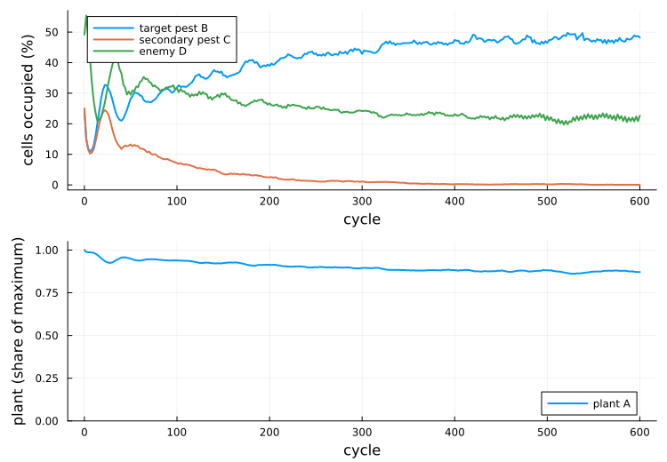
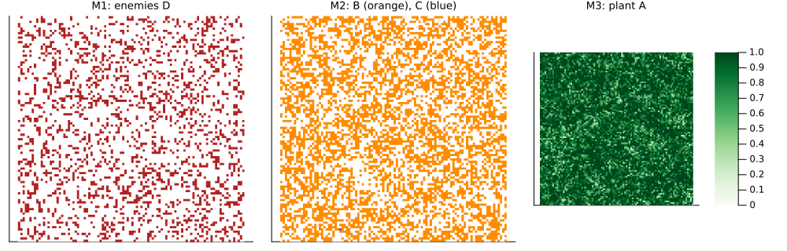
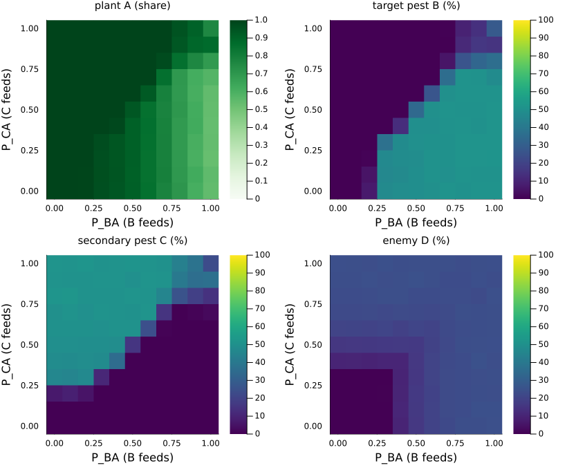
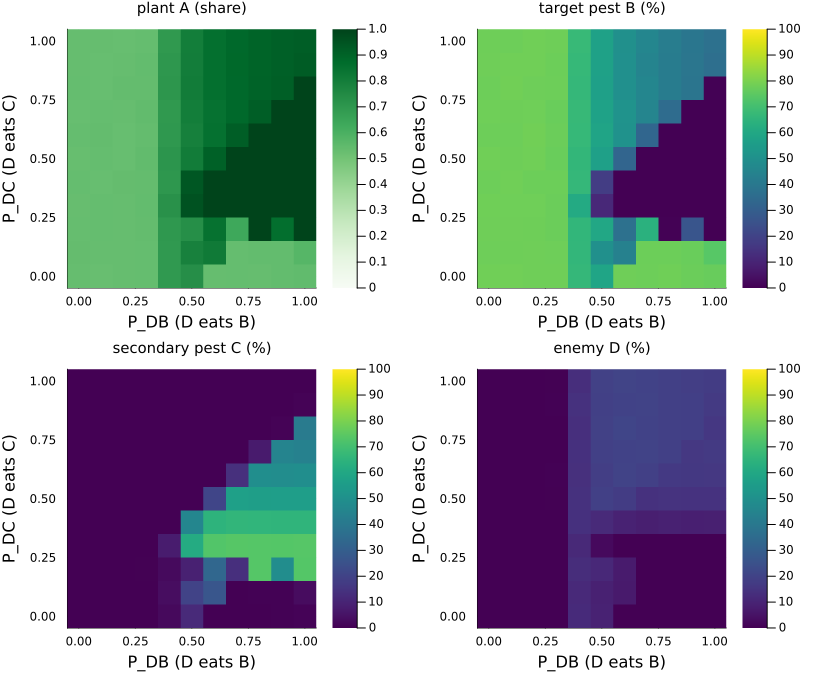

# A Bt crop, two pests and their enemy
Simon Frost

- [Overview](#overview)
- [Pairs as a block rule](#pairs-as-a-block-rule)
- [Feeding: the source’s Fig. 3](#feeding-the-sources-fig-3)
- [Predation: the source’s Fig. 4](#predation-the-sources-fig-4)
- [What is not reproduced](#what-is-not-reproduced)
- [Deviations from the source](#deviations-from-the-source)

## Overview

A crop that makes the Bt toxin suppresses its target pest, but the space
and food that pest leaves may go to other pests. Yang et al.
([2009](#ref-Yang2009)) asked how the feeding of a target pest (the
cotton bollworm, B), a secondary pest (a mirid, C) and their natural
enemy (D) shape such a community, with three stacked lattices:

- layer M3 holds the plant A, a quantity in every cell;
- layer M2 holds at most one pest, B or C, in each cell;
- layer M1 holds at most one enemy in each cell;
- in each cycle, individuals move or breed in contiguous pairs of cells;
  an enemy attacks the pest below it, and a pest eats the plant below
  it, each with a probability; individuals that go hungry too long
  starve.

The Bt toxin enters only as a lower probability that the target pest
feeds. The individuals follow the Penna model of the authors’ earlier
predator-prey automaton ([He et al. 2002](#ref-He2002)): they age, carry
inherited diseases in a 32-bit genome and breed from a maturity age.

The source gives the structure but no parameter values, no rule for the
plant and no details of the pairs or the Penna model. This
implementation is an **adaptation**: it takes the individuals from He et
al. ([2002](#ref-He2002)), chooses the rest (listed below) and aims at
the source’s qualitative results.

``` julia
ENV["GKSwstype"] = "100"
using EcologicalCellularAutomata
using CellularAutomataCore
using Plots
using Statistics
```

## Pairs as a block rule

The source updates “each contiguous pair” of cells on a lattice whose
side is even: an individual next to an empty cell moves into it, or,
once mature, breeds into it. Here the pairs are a random domino tiling:
the lattice is cut into 2 × 2 blocks, the partition shifting by a cell
each cycle (the Margolus scheme), and each block is split into two
horizontal or two vertical pairs at random. Every pair then updates on
its own, and so does each cell’s predation, feeding and survival, so the
whole cycle is one block rule:

``` julia
prob = problem(:bt_crop_three_layer; n=100, cycles=600, seed=1)
sol = solve(prob, Margolus(); saveat=0:2:600)
series = bt_crop_summary.(sol.u)
plot(plot(sol.t, [getfield.(series, :B) getfield.(series, :C) getfield.(series, :D)] ./ 100;
          label=["target pest B" "secondary pest C" "enemy D"], ylabel="cells occupied (%)"),
     plot(sol.t, getfield.(series, :plant); label="plant A", ylabel="plant (share of maximum)",
          ylims=(0, 1.05));
     xlabel="cycle", lw=2, layout=(2, 1), size=(750, 520), left_margin=4Plots.mm)
```



With the target pest feeding a little better than the secondary pest
(0.6 against 0.5) and enemies catching either with probability 0.6, the
target pest takes over the pest layer within a few hundred cycles, and
the enemies settle on it. The layers at the end:

``` julia
u = sol.u[end]
plot(heatmap(u.enemy; c=cgrad([:white, :firebrick]), title="M1: enemies D", colorbar=false),
     heatmap(u.pest; c=cgrad([:white, :darkorange, :royalblue], 3; categorical=true),
             title="M2: B (orange), C (blue)", colorbar=false),
     heatmap(u.plant; c=:Greens, clims=(0, 1), title="M3: plant A");
     layout=(1, 3), size=(1000, 320), aspect_ratio=1, ticks=false, titlefontsize=9)
```



## Feeding: the source’s Fig. 3

The source swept the two pests’ feeding probabilities with the enemy’s
predation fixed above one half. Each point here is the mean of the last
100 of 1000 cycles of one run:

``` julia
function sweep(base, xname, yname; grid=0:0.1:1)
    out = Array{Float64}(undef, length(grid), length(grid), 4)
    Threads.@threads for (i, j) in collect(Iterators.product(eachindex(grid), eachindex(grid)))
        pmap = merge(base, NamedTuple{(xname, yname)}((grid[i], grid[j])))
        integ = init(problem(:bt_crop_three_layer; n=100, cycles=1000, seed=i + 20j, pmap),
                     Margolus(); save_everystep=false)
        acc = zeros(4)
        for t in 1:1000
            step!(integ)
            if t > 900
                s = bt_crop_summary(integ.u)
                acc .+= (s.plant, s.B / 100, s.C / 100, s.D / 100) ./ 100
            end
        end
        out[i, j, :] = acc
    end
    return out
end
function panels(out, xlabel, ylabel; grid=0:0.1:1)
    titles = ["plant A (share)", "target pest B (%)", "secondary pest C (%)", "enemy D (%)"]
    plot([heatmap(grid, grid, permutedims(out[:, :, k]); title=titles[k], xlabel, ylabel,
                  c=k == 1 ? :Greens : :viridis, clims=k == 1 ? (0, 1) : (0, 100))
          for k in 1:4]...; layout=(2, 2), size=(820, 680), titlefontsize=10)
end
fig3 = sweep((; P_DB=0.6, P_DC=0.6), :P_BA, :P_CA)
panels(fig3, "P_BA (B feeds)", "P_CA (C feeds)")
```



As in the source:

- the plant stays near its maximum when the target pest feeds poorly,
  and falls as it feeds better, to about 0.6 when it always feeds
  (0.65–0.70 in the source);
- each pest is absent when it cannot feed, and the secondary pest
  collapses when the target pest feeds better;
- enemies vanish where both pests feed poorly (both probabilities below
  about 0.3).

Read along a column, lowering the target pest’s feeding (the source’s
stand-in for the Bt toxin) hands the pest layer to the secondary pest.
Here the switch is abrupt, once the target pest feeds less well than the
secondary pest; in the source the secondary pest rises more gradually.
At P_CA = 0.5:

``` julia
grid = 0:0.1:1
[(; P_BA=grid[i], B=round(fig3[i, 6, 2]; digits=1), C=round(fig3[i, 6, 3]; digits=1))
 for i in 1:2:11]
```

    6-element Vector{@NamedTuple{P_BA::Float64, B::Float64, C::Float64}}:
     (P_BA = 0.0, B = 0.0, C = 49.5)
     (P_BA = 0.2, B = 0.0, C = 49.0)
     (P_BA = 0.4, B = 0.0, C = 48.8)
     (P_BA = 0.6, B = 50.2, C = 0.0)
     (P_BA = 0.8, B = 50.6, C = 0.0)
     (P_BA = 1.0, B = 51.5, C = 0.0)

## Predation: the source’s Fig. 4

The source then swept the enemy’s predation of the two pests, with the
target pest the better feeder:

``` julia
fig4 = sweep((; P_BA=0.6, P_CA=0.5), :P_DB, :P_DC)
panels(fig4, "P_DB (D eats B)", "P_DC (D eats C)")
```



As in the source:

- enemies that catch the target pest well and the secondary pest with
  probability about 0.2 to 0.5 release the secondary pest, which then
  fills most of the pest layer;
- enemies that catch the secondary pest better than the target pest hold
  it down;
- enemies that catch the target pest well die out when they catch the
  secondary pest with probability below about 0.2; they remove the
  target pest and starve, as in the source, though here the target pest
  then returns;
- the plant is highest where the enemies hold both pests down.

This is the source’s warning: suppressing a primary pest, by an enemy or
a toxin, can let a secondary pest break out.

## What is not reproduced

In the source the two pests share the pest layer over most of both
sweeps: about 80,000 and 105,000 of 250,000 cells with no predation at
all. Here the better feeder excludes the other, as two consumers of one
resource in the same cells are expected to; no plant setting tried let
them coexist. It follows that:

- without enemies, the target pest feeds alone and the plant falls to
  about 0.5, where the source keeps it at about 0.92;
- enemies that catch the target pest with probability below about 0.4
  die out here even when they catch the secondary pest well, since that
  pest has been excluded; for the same reason the plant does not rise to
  its maximum when enemies catch the secondary pest well;
- enemies occupy about 20–26% of cells, against 10–17% in the source.

The source’s coexistence must come from something it does not report,
such as different life histories for the two pests, or runs too short
for exclusion.

## Deviations from the source

``` julia
foreach(d -> println("- ", d), model_info(:bt_crop_three_layer).deviations)
```

    - Contiguous pairs are a random domino tiling: the Margolus partition into 2 x 2 blocks, shifting by one cell each cycle, with each block split into two horizontal or two vertical pairs at random, separately for the enemy and pest layers. The source says only that contiguous pairs change and that the lattice side is even; He et al. (2002), whose individuals the source uses, move each individual to a random empty von Neumann neighbour instead.
    - An individual next to an empty cell moves into it, or in a birth cycle leaves one offspring there; the source says a mature individual breeds into the empty cell. Birth cycles follow He et al. (2002): from the maturity age R, every r cycles; one offspring (the pair has room for one), with the parent's genome and one more deleterious mutation at a random bit, starting at age 0 and no hunger.
    - Individuals are those of He et al. (2002) (the source cites the Penna model without details): 32-bit genomes, death when the diseases expressed up to an individual's age reach a threshold T, or at age 32. The enemy takes He's predator values (maturity 4, births every 4 cycles, T = 7, hunger limit 3) and both pests his prey values (maturity 3, births every cycle, T = 3), with a hunger limit of 2 so that a pest that never eats dies before it can breed (He's prey do not starve). Genomes start clean (He's start random, with an unstated density) and ages uniform below maturity.
    - Hunger rises by U in every cycle in which an individual does not eat (a failed attack, no prey below, a failed or impossible meal) and falls by h after a meal, not below 0; the source says hunger rises after a failed predation and in the survival check. Death when hunger exceeds its limit (the source's larger than).
    - The plant, for which the source gives no rules or values: a quantity in units of its maximum, from which a meal of the target pest takes d_B = 0.2 and of the secondary pest d_C = 0.05 (a pest needs at least that much to feed), regrowing by 0.1 a cycle up to the maximum. The values make the plant fall with the target pest's feeding, not the secondary pest's, as in the source's Fig. 3a.
    - In a cycle, pairs move and breed first, then enemies attack the pest in the same cell, then surviving pests feed on the plant in their cell, then individuals age and the survival checks apply, as in the source's three steps; interactions between layers are within a cell only.
    - The source's fixed probabilities are unstated beyond P_DB = P_DC > 0.5 (Fig. 3) and P_BA > P_CA >= 0.5 (Fig. 4); 0.6, 0.6, 0.6 and 0.5 are used. The source runs 500 x 500 cells for 2000 cycles and does not say whether its surfaces are final values, time averages or replicate means; the vignette averages the last 100 of 1000 cycles of one run on 100 x 100 cells.

<div id="refs" class="references csl-bib-body hanging-indent">

<div id="ref-He2002" class="csl-entry">

He, Mingfeng, Jing Lin, Heng Jiang, and Xin Liu. 2002. “The Two
Populations’ Cellular Automata Model with Predation Based on the Penna
Model.” *Physica A* 312: 243–50.
<https://doi.org/10.1016/S0378-4371(02)00850-6>.

</div>

<div id="ref-Yang2009" class="csl-entry">

Yang, Jun, Zhi-Rui Wang, De-Li Yang, Qing Yang, Jun Yan, and Ming-Feng
He. 2009. “Ecological Risk Assessment of Genetically Modified Crops
Based on Cellular Automata Modeling.” *Biotechnology Advances* 27 (6):
1132–36. <https://doi.org/10.1016/j.biotechadv.2009.05.024>.

</div>

</div>
