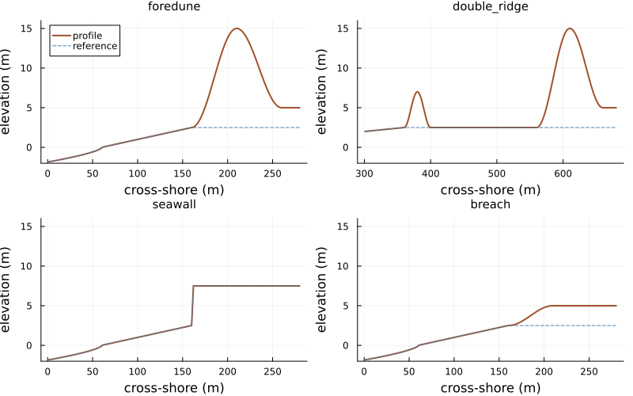
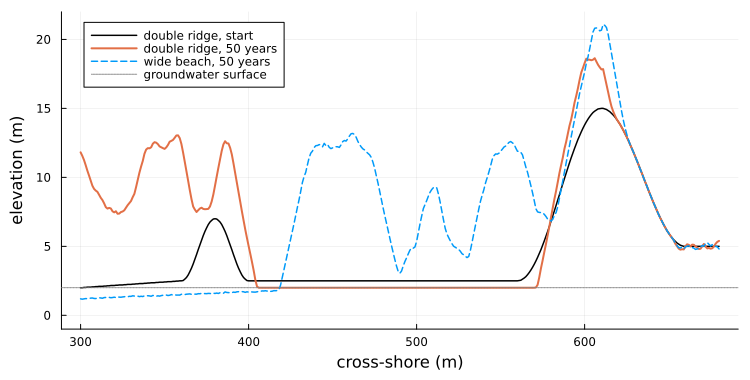
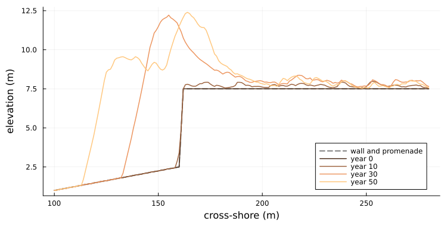
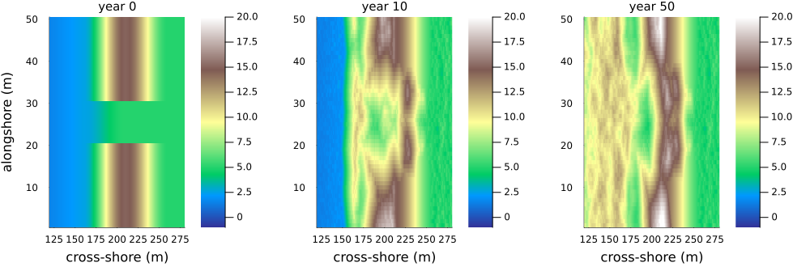

# Dune landforms
Simon Frost

- [Overview](#overview)
- [Landforms from pieces](#landforms-from-pieces)
- [Fifty years on each landform](#fifty-years-on-each-landform)
- [An embryo dune starves the
  foredune](#an-embryo-dune-starves-the-foredune)
- [Sand piles against a seawall](#sand-piles-against-a-seawall)
- [A breach heals from its flanks](#a-breach-heals-from-its-flanks)
- [A landform of one’s own](#a-landform-of-ones-own)
- [Summary](#summary)

## Overview

The coastal dune model of Teixeira et al. ([2023](#ref-Teixeira2023))
(vignette 20) starts from one shape: a beach rising to a single foredune
with a plateau behind it. Real coasts have other shapes. An embryo dune
may grow on the beach in front of the foredune, a seawall may stand
where a dune would be, and a dune may be breached. In this package a
profile is built by joining pieces, so each of these is a short
composite of the same pieces.

The source runs none of these landforms. Running them **tests the
model’s behaviour, not its fidelity**: does it do what geomorphology
leads one to expect on shapes it was not tuned for? One addition is
needed: a seawall must not erode. So the model has a non-erodible layer,
`hard`, below which neither wind, avalanches nor the sea remove sand,
and on which plants grow only once sand covers it. It is empty by
default, and the source’s scenarios run exactly as before.

``` julia
ENV["GKSwstype"] = "100"
using EcologicalCellularAutomata
using CellularAutomataCore
using Plots
using Random
using Statistics
```

## Landforms from pieces

`dune_landform(; form)` builds four shapes, each
`offshore + beach + 120` metres long:

- the source’s **foredune**: shoreface, beach, a ridge rising to 15 m,
  and a plateau;
- a **double ridge**: an embryo dune 40 m wide and 7 m high on the wide
  beach, with a level dune slack 160 m long between it and the foredune;
- a **seawall**: the beach ends at a wall rising to 7.5 m, with a
  promenade behind it in place of the dune and plateau;
- a **breach**: the foredune lowered to a trough rising only to the
  plateau’s 5 m.

Each is a composite of pieces. The kind of each piece says how the model
treats it. The sea’s reference surface levels pieces of kind `:dune` and
everything landward of them, and pieces of kind `:seawall` and
`:promenade` are non-erodible:

``` julia
forms = (foredune=dune_landform(; beach=100), double_ridge=dune_landform(; form=:double_ridge),
         seawall=dune_landform(; form=:seawall, beach=100),
         breach=dune_landform(; form=:breach, beach=100))
map(f -> join(unique(profile_kinds(f, length(f))), " * "), forms)
```

    (foredune = "shoreface * beach * dune * hinterland", double_ridge = "shoreface * beach * dune * slack * hinterland", seawall = "shoreface * beach * seawall * promenade", breach = "shoreface * beach * dune * hinterland")

``` julia
plot([begin
          x = name === :double_ridge ? (301:680) : (1:280)
          plot(x, f.heights[x]; lw=2, color=:sienna, label="profile", title=string(name),
               titlefontsize=10, ylims=(-2, 16), legend=name === :foredune ? :topleft : false)
          plot!(x, reference_profile(f).heights[x]; ls=:dash, color=:steelblue,
                label="reference")
      end
      for (name, f) in pairs(forms)]...; layout=(2, 2), size=(800, 500),
     xlabel="cross-shore (m)", ylabel="elevation (m)")
```

<div id="fig-forms">



Figure 1: The four landforms (land to the right): the source’s foredune
on the narrow beach, the double ridge on the wide beach (shown from 300
m), the seawall and promenade, and the breached foredune. Dashed lines
are the reference surfaces the sea works towards.

</div>

`problem(:dune_formation; scenario)` sets each up: `:double_ridge` on
the wide beach, `:seawall` on the narrow one, and `:blowout`, the narrow
beach with the breach in the middle fifth of the rows and the source’s
foredune in the rest. A `landform` keyword accepts any composite, or one
for each row.

## Fifty years on each landform

Two runs of 50 years on each landform, with hops of 5 cells (the
source’s saltation representation), beside the source’s narrow and wide
beaches. The runs use 20 rows of 1 m, or 50 for the blowout so that the
breach is 10 m wide. Each run records the surface every ten years.

``` julia
function landform_run(scenario; rows=20, years=50, seed=1)
    prob = problem(:dune_formation; scenario, alongshore=rows, years, seed)
    p, u, h = prob.p, deepcopy(prob.u0), prob.p.h
    snaps = [u.topo .* h]
    intact = true
    for t in 1:(50years)
        dune_step!(u, p, t, Random.Xoshiro(hash((prob.seed, t, :dune))))
        t % 500 == 0 && push!(snaps, u.topo .* h)
        intact &= all(u.topo .>= u.hard)
    end
    return (; snaps, intact)
end
cases = [(s, seed) for s in (:narrow, :wide, :double_ridge, :seawall, :blowout) for seed in 1:2]
runs = Dict(zip(cases,
                fetch.([Threads.@spawn landform_run(s; seed, rows=s === :blowout ? 50 : 20)
                        for (s, seed) in cases])))
volume(z, cols) = sum(max.(z[:, cols] .- 3, 0)) / size(z, 1)    # m³/m above 3 m
gain(r, cols) = volume(r.snaps[end], cols) - volume(r.snaps[1], cols)
sand(r, cols) = sum(r.snaps[end][:, cols] .- r.snaps[1][:, cols]) / size(r.snaps[1], 1)
nothing
```

## An embryo dune starves the foredune

The double ridge has the same domain as the wide beach, and its foredune
occupies the same columns (561 to 680). The two can be compared column
for column:

``` julia
[(seed=seed, foredune_gain_wide=round(Int, gain(runs[(:wide, seed)], 561:680)),
  foredune_gain_double=round(Int, gain(runs[(:double_ridge, seed)], 561:680)),
  embryo_and_slack_gain=round(Int, gain(runs[(:double_ridge, seed)], 361:560)),
  embryo_crest=round(maximum(mean(runs[(:double_ridge, seed)].snaps[end][:, 361:400]; dims=1));
                     digits=1),
  slack_lowered=round(-sand(runs[(:double_ridge, seed)], 401:560) / 160; digits=2))
 for seed in 1:2]
```

    2-element Vector{@NamedTuple{seed::Int64, foredune_gain_wide::Int64, foredune_gain_double::Int64, embryo_and_slack_gain::Int64, embryo_crest::Float64, slack_lowered::Float64}}:
     (seed = 1, foredune_gain_wide = 269, foredune_gain_double = 89, embryo_and_slack_gain = 190, embryo_crest = 12.6, slack_lowered = 0.44)
     (seed = 2, foredune_gain_wide = 217, foredune_gain_double = 89, embryo_and_slack_gain = 166, embryo_crest = 12.0, slack_lowered = 0.48)

The embryo dune intercepts the sand. It grows from 7 m to about 12 m,
and the foredune behind it gains less than half what it gains on the
open wide beach. The two ridges together gain a little more than the
single foredune does. The open wide beach grows embryo dunes of its own
(the dashed line in the figure below), as vignette 20 notes, but
starting from bare sand they let more of it through to the foredune.

The bare slack between them loses sand. It is lowered by about half a
metre: from 2.5 m to the groundwater surface, which the model puts at
0.8 times the reference surface, 2.0 m. Below that the sand is wet and
the wind cannot lift it. Deflation down to the water table is how dune
slacks form, and the model does it without being told.

``` julia
x = 300:680
plot(x, vec(mean(runs[(:double_ridge, 1)].snaps[1]; dims=1))[x]; color=:black, lw=1.5,
     label="double ridge, start", xlabel="cross-shore (m)", ylabel="elevation (m)",
     legend=:topleft, size=(750, 380), ylims=(-1, 22), left_margin=4Plots.mm,
     bottom_margin=4Plots.mm)
plot!(x, vec(mean(runs[(:double_ridge, 1)].snaps[end]; dims=1))[x]; color=2, lw=2,
      label="double ridge, 50 years")
plot!(x, vec(mean(runs[(:wide, 1)].snaps[end]; dims=1))[x]; color=1, lw=1.5, ls=:dash,
      label="wide beach, 50 years")
hline!([2.0]; color=:gray, ls=:dot, label="groundwater surface")
```

<div id="fig-double">



Figure 2: Mean profiles after 50 years on the wide beach with and
without an embryo dune (one run each). The embryo dune grows and the
foredune behind it grows less; the slack between them deflates to the
groundwater surface (2 m, dotted).

</div>

## Sand piles against a seawall

On the narrow beach, a seawall stands where the dune foot would be:

``` julia
[(seed=seed, wall_intact=runs[(:seawall, seed)].intact,
  upper_beach_sand=round(Int, sand(runs[(:seawall, seed)], 131:160)),
  promenade_sand=round(Int, sand(runs[(:seawall, seed)], 163:280)),
  promenade_depth_first_20_m=round(mean(runs[(:seawall, seed)].snaps[end][:, 163:182] .-
                                        runs[(:seawall, seed)].snaps[1][:, 163:182]);
                                   digits=1),
  dune_gain_without_wall=round(Int, gain(runs[(:narrow, seed)], 161:280)))
 for seed in 1:2]
```

    2-element Vector{@NamedTuple{seed::Int64, wall_intact::Bool, upper_beach_sand::Int64, promenade_sand::Int64, promenade_depth_first_20_m::Float64, dune_gain_without_wall::Int64}}:
     (seed = 1, wall_intact = 1, upper_beach_sand = 265, promenade_sand = 4, promenade_depth_first_20_m = 0.2, dune_gain_without_wall = 229)
     (seed = 2, wall_intact = 1, upper_beach_sand = 297, promenade_sand = 6, promenade_depth_first_20_m = 0.3, dune_gain_without_wall = 201)

The wall and promenade are never eroded. Sand blown off the beach piles
against the wall, and plants colonise the pile. In 50 years a dune more
than 11 m high grows on the upper beach in front of the wall, higher
than the wall itself. Little sand gets past it: the promenade gains only
a few m³ per metre, 0.2 to 0.3 m near the wall, as the vegetated dune
traps what the wind brings. A dune in front of a seawall shelters what
lies behind it, here without any rule written for it. The balance is
fine, though: with water levels 0.4 m lower (an earlier version of this
model’s synthetic series) the dune was lower and the promenade was
buried by 2 to 3 m near the wall, the familiar nuisance of sand on
seafront boulevards.

``` julia
x = 100:280
z = runs[(:seawall, 1)].snaps
plot(x, dune_landform(; form=:seawall, beach=100).heights[x]; color=:gray, ls=:dash, lw=2,
     label="wall and promenade", xlabel="cross-shore (m)", ylabel="elevation (m)",
     legend=:bottomright, size=(750, 380), left_margin=4Plots.mm, bottom_margin=4Plots.mm)
for (k, y) in enumerate((0, 10, 30, 50))
    plot!(x, vec(mean(z[y ÷ 10 + 1]; dims=1))[x]; color=cgrad(:copper)[k / 4], lw=1.5,
          label="year $y")
end
plot!()
```

<div id="fig-seawall">



Figure 3: Mean profile at the seawall after 0, 10, 30 and 50 years (one
run), against the non-erodible surface (dashed). A dune builds against
the wall, higher than it, and little sand reaches the promenade.

</div>

## A breach heals from its flanks

In the blowout scenario the foredune is breached in 10 of 50 rows, down
to 5 m. The table gives the crest height in the breach every ten years,
and the dune’s gain in volume in the breached and intact rows:

``` julia
gap, rest = 21:30, [1:20; 31:50]
crest(z, rows) = mean(maximum(z[rows, 161:260]; dims=2))
rows_of(r, rows) = (; snaps=[s[rows, :] for s in r.snaps])
[(seed=seed,
  breach_crest_by_decade=[round(crest(z, gap); digits=1) for z in runs[(:blowout, seed)].snaps],
  intact_crest=round(crest(runs[(:blowout, seed)].snaps[end], rest); digits=1),
  gain_breach=round(Int, gain(rows_of(runs[(:blowout, seed)], gap), 161:280)),
  gain_intact=round(Int, gain(rows_of(runs[(:blowout, seed)], rest), 161:280)),
  gain_without_breach=round(Int, gain(runs[(:narrow, seed)], 161:280)))
 for seed in 1:2]
```

    2-element Vector{@NamedTuple{seed::Int64, breach_crest_by_decade::Vector{Float64}, intact_crest::Float64, gain_breach::Int64, gain_intact::Int64, gain_without_breach::Int64}}:
     (seed = 1, breach_crest_by_decade = [5.0, 13.3, 14.2, 15.4, 15.8, 15.7], intact_crest = 18.3, gain_breach = 549, gain_intact = 141, gain_without_breach = 229)
     (seed = 2, breach_crest_by_decade = [5.0, 13.1, 13.9, 14.5, 14.7, 14.8], intact_crest = 16.5, gain_breach = 501, gain_intact = 116, gain_without_breach = 201)

The breach fills within ten years, to a crest of 13 to 14 m. After fifty
its crest stands at about the dune’s original 15 m, though still a metre
or two below the intact rows, which have grown too. Most of the sand
comes from its flanks: the walls of the breach stand 10 m above its
floor, far steeper than the angle of repose, and avalanche into it. The
breached rows gain about four times as much as the intact ones, and the
intact rows gain less than the dune does on the same beach without a
breach. Over all rows, the dune gains about what it gains without a
breach.

``` julia
plot([heatmap(120:280, 1:50, z[:, 120:280]; c=:terrain, clims=(-1, 20), title="year $y",
              titlefontsize=10, xlabel="cross-shore (m)", ylabel=y == 0 ? "alongshore (m)" : "")
      for (y, z) in zip((0, 10, 50), runs[(:blowout, 1)].snaps[[1, 2, 6]])]...;
     layout=(1, 3), size=(1000, 330), left_margin=4Plots.mm, bottom_margin=5Plots.mm)
```

<div id="fig-blowout">



Figure 4: Elevation around the breached foredune at the start and after
10 and 50 years (one run; rows alongshore, cross-shore from 120 m).

</div>

Real breaches often grow into blowouts instead. They do so because the
breach steers and speeds up the wind, which then scours it. By default
the model has no such steering: slabs travel straight along their row
whatever the topography. Vignette 28 adds a wind steered by the
topography, from the linear theory of flow over low hills; the breach
still fills, a little faster.

## A landform of one’s own

Any composite can be run. A common Dutch coastal defence, the
dune-fronted dike, puts a small dune in front of a seawall. Here it is,
with the seawall kept non-erodible behind a dune 40 m wide:

``` julia
own = shoreface_segment(60) * slope_segment(100, 0, 2.5) * ridge_segment(40, 2.5, 8, 2.5) *
      slope_segment(2, 2.5, 7.5; kind=:seawall) * flat_segment(78, 7.5; kind=:promenade)
prob = problem(:dune_formation; landform=own, alongshore=4, years=1)
(cells=size(prob.u0.topo), hard_cells=count(>(typemin(Int32)), prob.u0.hard[1, :]),
 run_up_slope=prob.p.slope)
```

    (cells = (4, 280), hard_cells = 80, run_up_slope = 0.025)

The run-up slope comes from the beach pieces, 2.5 m over 100 m. The
source uses 3 m over the beach width, and the source’s scenarios keep
that.

## Summary

| landform | expected | in the model |
|----|----|----|
| embryo dune on the beach | intercepts sand, starving the foredune | foredune gains less than half; slack deflates to the water table |
| seawall | sand piles against it and blows onto the promenade | a dune higher than the wall in front of it, which shelters the promenade |
| breached foredune | may heal or grow into a blowout | mostly refilled within a decade by avalanching; no growth, even with the wind steered (vignette 28) |

<div id="refs" class="references csl-bib-body hanging-indent">

<div id="ref-Teixeira2023" class="csl-entry">

Teixeira, Manuel, Erik M. Horstman, and Kathelijne M. Wijnberg. 2023.
“Conceptualizing Aeolian Sediment Transport in a Cellular Automata Model
to Simulate the Bio-Geomorphological Evolution of Beach–Dune Systems.”
*Journal of Marine Science and Engineering* 11 (7): 1278.
<https://doi.org/10.3390/jmse11071278>.

</div>

</div>
