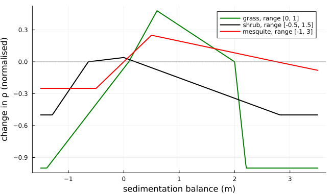
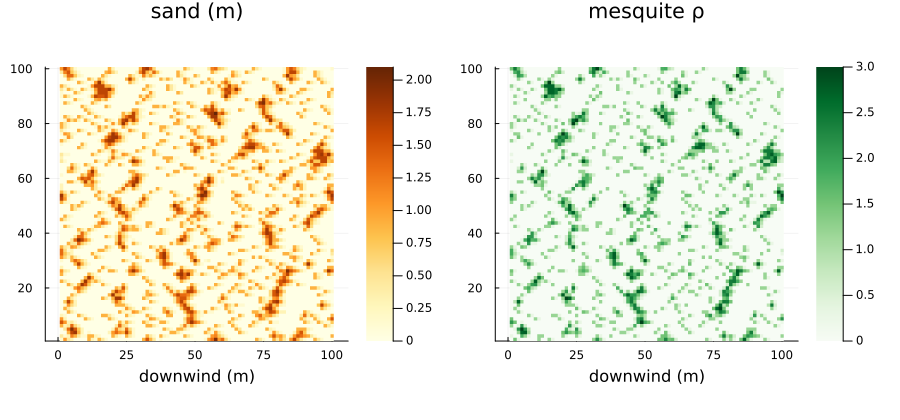
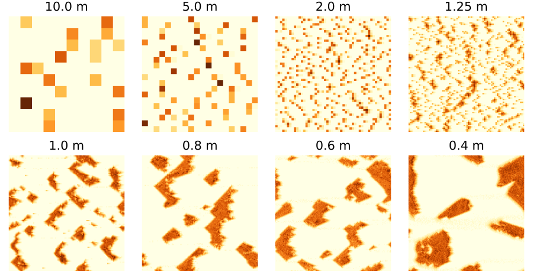
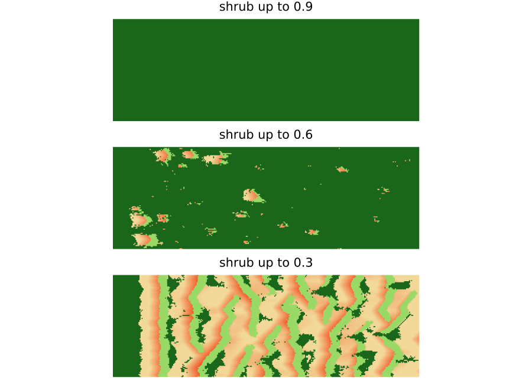

# Vegetated dunes with DECAL
Simon Frost

- [Overview](#overview)
- [The model](#the-model)
- [A nebkha field](#a-nebkha-field)
- [A characteristic size](#a-characteristic-size)
- [Blowouts and parabolic dunes](#blowouts-and-parabolic-dunes)
- [Summary](#summary)
- [Deviations from the source](#deviations-from-the-source)
- [References](#references)

## Overview

Dunes in coastal and semi-arid landscapes are shaped by plants as much
as by the wind. Baas and Nield ([2007](#ref-Baas2007)) and Nield and
Baas ([2008](#ref-Nield2008)) built DECAL, the Discrete Ecogeomorphic
Aeolian Landscapes model, by adding vegetation to the sand-slab
automaton of Werner ([1995](#ref-Werner1995)). Sand lies in stacks of
slabs; the wind picks slabs up and drops them downwind, never in the lee
of higher ground, and avalanches keep slopes within the angle of repose.
Plants make sand harder to pick up and easier to drop, and each year
they grow or decline according to how much sand buried or uncovered
them. With a burial-tolerant shrub such as mesquite, the model grows
fields of nebkhas: mounds trapped by shrubs, with tails of sand in their
lee. With a pioneer grass and a stabilizing shrub, it grows parabolic
dunes from blowouts, and over a range of plant vitality a series of
landscapes, from transverse ridges to stabilized dunes. DECAL is the
ancestor of the DuBeVeg model behind `dune_formation` and of MEEB
(`barrier_island`).

This implementation is an **adaptation**: no code was published, the
growth functions are given only as a figure, and the source leaves
several choices unstated (listed at the end). It reproduces the nebkha
field and the source’s finding that vegetation gives nebkhas a size of
their own, independent of the grid; with the source’s stated parabolic
setup it does not grow hairpin parabolic dunes.

``` julia
ENV["GKSwstype"] = "100"
using EcologicalCellularAutomata
using CellularAutomataCore
using Plots
using Statistics
```

## The model

Every iteration polls each cell once, in random order. A polled cell
with sand, outside a shadow zone (the lee of upwind topography, under a
15° line), loses its top slab with probability $p_e - \rho$, where
$\rho$ is the summed effectiveness of its plants, within $[0, 1]$. The
slab moves one cell downwind at a time and is deposited with probability
$p_d + \rho (1 - p_d)$, with $p_d = 0.6$ on sand and $0.4$ on a cell
with none, and always in a shadow zone. Avalanches follow each erosion
and deposition, moving slabs down the steepest slope until none is
steeper than 30°, or 40° where $\rho \ge 0.3$. At the end of each year
every plant type’s effectiveness changes by its growth function of the
cell’s net sedimentation balance, held to the type’s physiological
range.

``` julia
b = range(-1.5, 3.5; length=401)
plot(b, [decal_growth(DECAL_GRASS, x) for x in b] ./ 1; label="grass, range [0, 1]",
     color=:green, lw=2, xlabel="sedimentation balance (m)",
     ylabel="change in ρ (normalised)", size=(650, 380))
plot!(b, [decal_growth(DECAL_SHRUB, x) for x in b] ./ 2; label="shrub, range [-0.5, 1.5]",
      color=:black, lw=2)
plot!(b, [decal_growth(DECAL_MESQUITE, x) for x in b] ./ 4;
      label="mesquite, range [-1, 3]", color=:red, lw=2)
hline!([0]; color=:gray, ls=:dot, label="")
```

<div id="fig-growth">



Figure 1: The growth functions read from Figure 5 of the source: the
yearly change in effectiveness, normalised by each type’s physiological
range, against the year’s sedimentation balance.

</div>

## A nebkha field

The source’s nebkha field grows from a flat, bare bed of sand 0.3 m deep
under mesquite, on cells 1.25 m wide, with a flux of 5 m³ per metre per
year: 16 iterations a year with slabs of 0.15 m.

``` julia
prob = problem_decal_dunes(; scenario=:nebkha, years=40, seed=1)
integ = init(prob)
history = map(1:40) do year
    for _ in 1:(prob.p.iterations)
        step!(integ)
    end
    u = integ.u
    s = decal_mounds(u, prob.p; above=0.3)
    (; year, vegetated=mean(>(0.3), u.mesquite), bare=mean(==(0), u.sand),
     nebkhas=s.count, relief=s.relief)
end
u = integ.u
for h in history[[1, 2, 5, 10, 20, 40]]
    println("year ", lpad(h.year, 2), ": ", round(Int, 100h.vegetated), "% vegetated, ",
            round(Int, 100h.bare), "% bare base, ", h.nebkhas, " nebkhas over 0.3 m, relief ",
            round(h.relief; digits=2), " m")
end
```

    year  1: 12% vegetated, 13% bare base, 640 nebkhas over 0.3 m, relief 0.9 m
    year  2: 23% vegetated, 37% bare base, 374 nebkhas over 0.3 m, relief 1.8 m
    year  5: 23% vegetated, 51% bare base, 299 nebkhas over 0.3 m, relief 2.1 m
    year 10: 23% vegetated, 55% bare base, 298 nebkhas over 0.3 m, relief 2.1 m
    year 20: 23% vegetated, 56% bare base, 302 nebkhas over 0.3 m, relief 2.1 m
    year 40: 23% vegetated, 56% bare base, 302 nebkhas over 0.3 m, relief 2.1 m

``` julia
c = prob.p.cell
x = (1:size(u.sand, 2)) .* c
y = (1:size(u.sand, 1)) .* c
plot(heatmap(x, y, u.sand .* prob.p.slab; color=:YlOrBr, title="sand (m)",
             aspect_ratio=1, xlabel="downwind (m)"),
     heatmap(x, y, max.(u.mesquite, 0); color=:Greens, title="mesquite ρ", aspect_ratio=1,
             xlabel="downwind (m)"); layout=(1, 2), size=(900, 420))
```

<div id="fig-nebkha">



Figure 2: The nebkha field after 40 years (wind from left to right):
sand depth (left) and mesquite effectiveness (right). Mounds form where
mesquite took hold, each with a tail of sand in its lee; between them
the bare erosion base.

</div>

``` julia
s = decal_mounds(u, prob.p)
println(s.count, " patches of sand on the bare base: median length ", s.median_length,
        " m, 90% shorter than ", round(quantile(s.lengths, 0.9); digits=1), " m; ",
        round(Int, 100mean(2 .<= s.lengths .<= 10)), "% between 2 and 10 m long; highest ",
        round(maximum(u.sand) * prob.p.slab; digits=2), " m")
```

    136 patches of sand on the bare base: median length 5.0 m, 90% shorter than 17.5 m; 82% between 2 and 10 m long; highest 2.1 m

The source’s nebkhas are 2 to 10 m long and up to 2.4 m high, and change
little after 10 to 20 years: here most patches of sand fall in that
range of length, the highest stands about 2 m, and the field is fixed
within about ten years, once the sand is trapped and the shrubs’
effectiveness exceeds one, which stops all erosion.

## A characteristic size

Bare-sand automata have no scale of their own: change the cell size and
the iteration’s duration together and the same dunes appear at another
scale. The source argued that vegetation breaks this: with the same
physical conditions on a 100 m square, nebkhas kept the same size as the
cells went from 1.2 to 10 m, and changed at 0.8 m and below, once a cell
was smaller than a single shrub. Here the slabs stay 0.15 m thick and
the flux 5 m³ per metre per year, so the iterations a year scale
inversely with the cell size.

``` julia
cells = [10.0, 5.0, 2.0, 1.25, 1.0, 0.8, 0.6, 0.4]
runs = map(cells) do c
    pr = problem_decal_dunes(; scenario=:nebkha, cell=c, years=40, seed=2)
    v = final_state(solve(pr; save_everystep=false))
    (; cell=c, iterations=pr.p.iterations, u=v, p=pr.p, s=decal_mounds(v, pr.p; above=0.3))
end
println("cell (m)  iterations/yr  nebkhas  median length (m)  90% length (m)")
for r in runs
    println(lpad(r.cell, 8), lpad(r.iterations, 15), lpad(r.s.count, 9),
            lpad(r.s.median_length, 19), lpad(round(quantile(r.s.lengths, 0.9); digits=1), 16))
end
```

    cell (m)  iterations/yr  nebkhas  median length (m)  90% length (m)
        10.0              2       14               10.0            10.0
         5.0              4       54                5.0             5.0
         2.0             10      229                4.0             6.0
        1.25             16      274                2.5             7.5
         1.0             20       33                7.0            18.8
         0.8             25       12               14.4            29.2
         0.6             33       19               11.4            27.7
         0.4             50       20                0.4            33.3

``` julia
plot([heatmap(r.u.sand .* r.p.slab; color=:YlOrBr, title="$(r.cell) m", aspect_ratio=1,
              axis=false, colorbar=false, ticks=false) for r in runs]...; layout=(2, 4),
     size=(900, 470))
```

<div id="fig-scale">



Figure 3: The same 100 m square after 40 years at eight cell sizes (sand
depth, wind from left to right). From 10 m to 1.25 m the nebkhas keep
their size, single cells at the coarsest grids; at 0.8 m and below a few
large forms replace them.

</div>

From the coarsest grid down to 1.25 m the nebkhas over 0.3 m keep a
median length of 2.5 to 10 m (at 5 and 10 m each is a single cell, as
the source found, and the coarse grids hold fewer of them: tens rather
than hundreds); at 1 m the field is in transition, and at 0.8 m and
below a dozen or two large, wide forms remain. The change falls where
the source found it, between 1.2 and 0.8 m.

## Blowouts and parabolic dunes

For parabolic dunes the source started from a flat, vegetated surface
with five bare blowouts 6 m wide, with both a pioneer grass and a
stabilizing shrub, on 1 m cells with slabs of 0.1 m and 80 iterations a
year, and found hairpin parabolic dunes with trailing ridges after 50
years, forming only when shrub covered most of the surface at the start
(its Figure 11: shrub effectiveness drawn between 0 and 0.9). The depth
of sand, the size of the domain and the initial cover in the blowout
runs are not stated; here the bed is 2 m deep, the domain 100 m across
and 300 m downwind with an open downwind edge, and the initial
effectiveness of shrub is drawn uniformly up to `shrub_max` and of grass
up to 0.1.

``` julia
covers = [0.9, 0.6, 0.3]
blow = map(covers) do smax
    pr = problem_decal_dunes(; scenario=:parabolic, years=30, shrub_max=smax, seed=3)
    v = final_state(solve(pr; save_everystep=false))
    active = mean(I -> v.shrub[I] < 0.3 && v.grass[I] < 0.3, CartesianIndices(v.sand))
    (; smax, u=v, active, grass=mean(>(0.3), v.grass), shrub=mean(>(0.3), v.shrub))
end
for b in blow
    println("shrub up to ", b.smax, ": after 30 years ", round(Int, 100b.shrub), "% shrub, ",
            round(Int, 100b.grass), "% grass, ", round(Int, 100b.active), "% bare and active")
end
```

    shrub up to 0.9: after 30 years 100% shrub, 0% grass, 0% bare and active
    shrub up to 0.6: after 30 years 95% shrub, 10% grass, 3% bare and active
    shrub up to 0.3: after 30 years 20% shrub, 25% grass, 57% bare and active

``` julia
function cover_map(v)
    z = Float64.(v.sand) .* 0.1
    img = fill(RGB(0.95, 0.95, 0.95), size(z))
    for I in CartesianIndices(z)
        img[I] = v.shrub[I] > 0.3 ? RGB(0.1, 0.4, 0.1) :
                 v.grass[I] > 0.3 ? RGB(0.6, 0.85, 0.4) :
                 RGB(0.95, 0.85 - 0.08 * min(z[I], 8), 0.6 - 0.07 * min(z[I], 8))
    end
    return img
end
plot([plot(cover_map(b.u); title="shrub up to $(b.smax)", axis=false, ticks=false)
      for b in blow]...; layout=(3, 1), size=(900, 650))
```

<div id="fig-blowouts">



Figure 4: Thirty years after the blowouts (wind from left to right), for
initial shrub effectiveness up to 0.9, 0.6 and 0.3: sand depth, with
shrub (dark green) and grass (light green) where their effectiveness
exceeds 0.3.

</div>

With the surface mostly under shrub, as the source prescribes, the
blowouts heal: sand leaving them is caught by the first vegetated cells,
the pits fill from their walls and fall into the lee of their upwind
rims, and the shrub, which grows wherever the sand changes little,
closes over them within a decade. With less shrub the model passes
through the source’s other landscapes: at 0.6 a mostly stabilized
surface with small active lobes, at 0.3 transverse ridges with grass on
their crests and lee slopes, like the source’s vegetated transgressive
ridges. Weakening the shrub’s growth, the other axis of the source’s
phase diagram, gives hummocky, broken landscapes rather than hairpin
parabolics. The source’s trailing ridges need the shrub to colonize the
flanks of a migrating lobe while grass slows its nose; with this reading
of the growth functions and these unstated choices the lobes never
escape the shrub.

## Summary

| Claim of the source | Source | Here |
|:---|:---|:---|
| Mesquite grows a field of nebkhas with deposition tails from a flat bare bed | Fig. 6; 2 to 10 m long, up to 2.4 m high, stable after 10 to 20 years | yes: most patches 2 to 10 m long, about 2 m high, fixed within about ten years |
| Nebkhas keep their size from 1.2 to 10 m cells and change at 0.8 m and below | GRL Fig. 4b | yes: the change falls between 1.25 and 0.8 m |
| Hairpin parabolic dunes with trailing ridges grow from blowouts when shrub covers most of the surface | Figs. 10, 11; GRL Fig. 2 | no: the blowouts heal under dense shrub |
| Landscapes range from transverse ridges to stabilized dunes with plant vitality | GRL Fig. 3 (phase diagram) | partly: stabilized, hummocky and transverse landscapes appear as the cover and the shrub’s growth change; the phase diagram’s classification is not repeated |

## Deviations from the source

``` julia
foreach(d -> println("- ", d), model_info(:decal_dunes).deviations)
```

    - The growth functions' vertices are read from Figure 5 of Nield & Baas (2008), to about 0.05 on each axis; where a zero crossing (vertex B or D) is not marked it lies on the straight line through its neighbours. Beyond the drawn range the change stays at its last value.
    - Vegetation raises the deposition probability, pd + rho (1 - pd), as the flow diagram (Figure 4) and both texts say; Equation 9 prints pd - rho (1 - pd).
    - The summed effectiveness of all types, within [0, 1], sets both the transport probabilities and whether the 40 degree angle of repose applies; the angle of the higher cell governs an avalanche, which moves one slab at a time to the steepest lower von Neumann neighbour (ties at random), repeated until no slope exceeds the angle.
    - Shadow zones are tested at the moment of each erosion and each landing, against the heights then.
    - The nebkha setup keeps the physical flux at 5 m3 per m per year with slabs of 0.15 m at any cell size, so the iterations per year are round(5 pd / (slab cell)): 16 for 1.25 m cells, as in the source.
    - The parabolic setup's bed depth (2 m), domain (100 m by 300 m), open downwind edge, initial cover (shrub 0.9, grass 0.1) and blowout length (6 m downwind) are not given by the source; it says the surface was vegetated, the blowouts 6 m wide, and that dunes migrate out of the model space in long runs.
    - The phase diagram's 114 state variables are described only by example; the vignette classifies landscapes by a few stated measures instead.

## References

<div id="refs" class="references csl-bib-body hanging-indent">

<div id="ref-Baas2007" class="csl-entry">

Baas, Andreas C. W., and Joanna M. Nield. 2007. “Modelling Vegetated
Dune Landscapes.” *Geophysical Research Letters* 34 (6): L06405.
<https://doi.org/10.1029/2006GL029152>.

</div>

<div id="ref-Nield2008" class="csl-entry">

Nield, Joanna M., and Andreas C. W. Baas. 2008. “Investigating Parabolic
and Nebkha Dune Formation Using a Cellular Automaton Modelling
Approach.” *Earth Surface Processes and Landforms* 33 (5): 724–40.
<https://doi.org/10.1002/esp.1571>.

</div>

<div id="ref-Werner1995" class="csl-entry">

Werner, B. T. 1995. “Eolian Dunes: Computer Simulations and Attractor
Interpretation.” *Geology* 23 (12): 1107–10.
[https://doi.org/10.1130/0091-7613(1995)023\<1107:EDCSAA\>2.3.CO;2](https://doi.org/10.1130/0091-7613(1995)023<1107:EDCSAA>2.3.CO;2).

</div>

</div>
