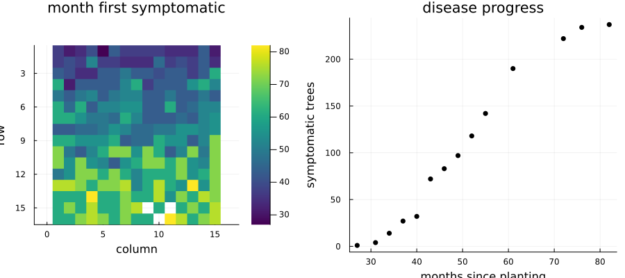
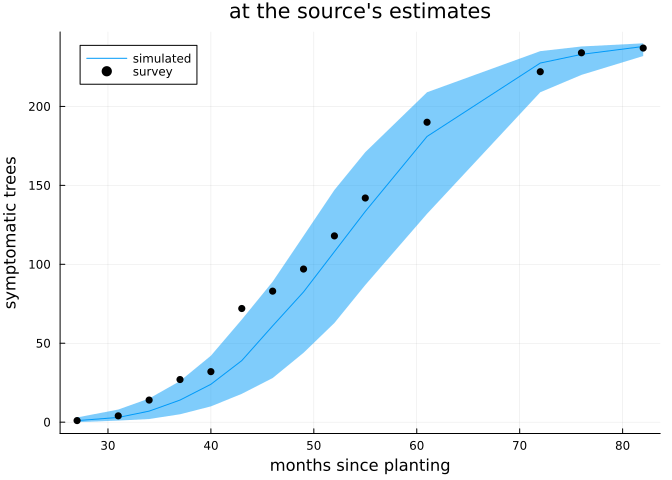
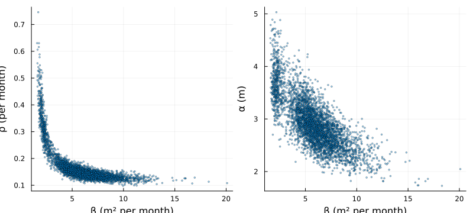
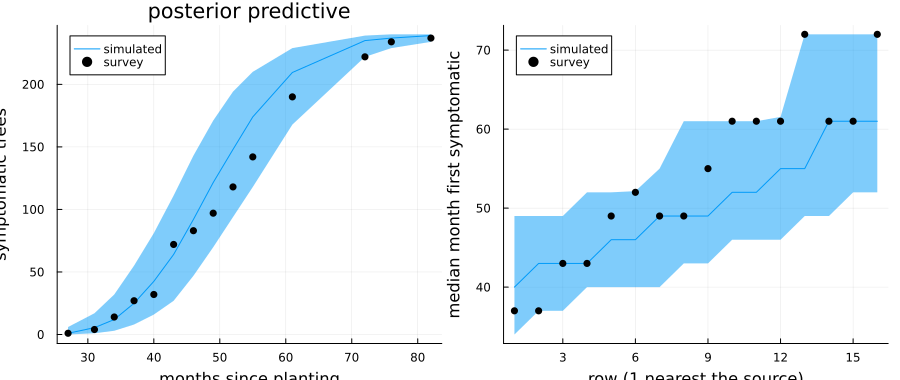

# Fitting Bahia bark scaling of citrus
Simon Frost

- [Overview](#overview)
- [The survey](#the-survey)
- [The model at the source’s
  estimates](#the-model-at-the-sources-estimates)
- [The exact likelihood](#the-exact-likelihood)
- [Data augmentation](#data-augmentation)
- [Does the fit reproduce the
  survey?](#does-the-fit-reproduce-the-survey)
- [Approximate Bayesian computation](#approximate-bayesian-computation)
- [The source trees](#the-source-trees)
- [Summary](#summary)
- [References](#references)

## Overview

Bahia bark scaling is a disease of grapefruit in north-eastern Brazil.
Laranjeira et al. ([2006](#ref-Laranjeira2006)) planted 240 young trees
in 16 rows of 15, 2 m apart, beside diseased adult trees, and inspected
them every few months for five years and less often for two more, noting
when each tree first showed symptoms. Cunniffe et al.
([2014](#ref-Cunniffe2014)) fitted a spatial epidemic model to that
survey: a susceptible tree is infected at a rate $\beta$ times the sum,
over symptomatic trees, of an exponential kernel
$(2\pi\alpha^2)^{-1} e^{-d/\alpha}$; an infected tree shows symptoms,
and becomes infectious, at rate $\rho$; and nothing happens before the
young trees reach epidemiological maturity at $\delta$ months. Because a
tree is seen only at inspections, and only once it shows symptoms, the
months at which trees were infected and became symptomatic are not
observed. They fitted the model by Markov chain Monte Carlo with data
augmentation, sampling those months alongside the parameters.

This vignette fits the zoo’s version of the model, `citrus_bark_scaling`
(a monthly-step adaptation of theirs), to the same survey, in two ways
with CellularAutomataInference: by data augmentation, with the exact
likelihood of the monthly path, and by approximate Bayesian computation,
with summaries of the survey.

``` julia
ENV["GKSwstype"] = "100"
using EcologicalCellularAutomata
using CellularAutomataCore
using CellularAutomataInference
using Distributions
using Plots
using Random
using Statistics
```

## The survey

``` julia
survey = citrus_survey()
insp = survey.inspections
println("inspections (months since planting): ", insp)
println("trees first seen with symptoms at each: ", survey.newly_symptomatic)
println("never seen with symptoms: ", count(ismissing, survey.first_symptomatic))
```

    inspections (months since planting): [27, 31, 34, 37, 40, 43, 46, 49, 52, 55, 61, 72, 76, 82]
    trees first seen with symptoms at each: [1, 3, 10, 13, 5, 40, 11, 14, 21, 24, 48, 32, 12, 3]
    never seen with symptoms: 3

``` julia
grid = [coalesce(survey.first_symptomatic[15(r - 1) + c], NaN) for r in 1:16, c in 1:15]
plot(heatmap(1:15, 1:16, grid; yflip=true, color=:viridis, xlabel="column", ylabel="row",
             title="month first symptomatic", aspect_ratio=1),
     scatter(insp, cumsum(survey.newly_symptomatic); xlabel="months since planting",
             ylabel="symptomatic trees", legend=false, color=:black,
             title="disease progress"); layout=(1, 2), size=(900, 400))
```

<div id="fig-survey">



Figure 1: The survey. Left: the month at which each tree was first seen
with symptoms (row 1 nearest the diseased adult trees; white, never).
Right: the number of trees seen with symptoms by each inspection.

</div>

## The model at the source’s estimates

The model’s defaults are the source’s posterior medians: $\alpha = 2.51$
m, $\beta = 4.42$ m² per month, $\rho = 0.170$ per month and
$\delta = 22.7$ months. Two hundred simulations of the grove from
planting:

``` julia
prob = problem_citrus_bark_scaling()
function progress(θ, seed)
    sol = solve(remake(prob; p=θ, seed); saveat=insp, save_start=false)
    return [citrus_symptomatic(u) for u in sol.u]
end
θsource = (α=2.51, β=4.42, ρ=0.170, δ=22.7)
runs = reduce(hcat, [progress(θsource, s) for s in 1:200])
band(runs, q) = [quantile(view(runs, k, :), q) for k in axes(runs, 1)]
```

    band (generic function with 1 method)

``` julia
function progress_plot(runs, title)
    plot(insp, band(runs, 0.5); ribbon=(band(runs, 0.5) .- band(runs, 0.05),
                                         band(runs, 0.95) .- band(runs, 0.5)),
         label="simulated", xlabel="months since planting", ylabel="symptomatic trees",
         title, legend=:topleft)
    return scatter!(insp, cumsum(survey.newly_symptomatic); color=:black, label="survey")
end
progress_plot(runs, "at the source's estimates")
```

<div id="fig-source">



Figure 2: Two hundred simulations at the source’s posterior medians
(median and 90% band) against the survey.

</div>

## The exact likelihood

The rule of `citrus_bark_scaling` states its transition probabilities,
so the core’s `path_logpdf` gives the exact probability of a monthly
path of the grove. Data augmentation needs it as a function of the
months of infection and symptoms; `citrus_loglik` computes the same
number from those months directly, in about the square of the number of
trees operations instead of that times the 82 months:

``` julia
fit = citrus_fit()
z = citrus_latent(fit)
println("citrus_loglik ", citrus_loglik(θsource, z, fit), "  path_logpdf ",
        path_logpdf(prob, citrus_path(z, prob)))
t1 = @elapsed for _ in 1:20
    citrus_loglik(θsource, z, fit)
end
t2 = @elapsed path_logpdf(prob, citrus_path(z, prob))
println("milliseconds: ", round(1000t1 / 20; digits=2), " against ", round(1000t2; digits=1))
```

    citrus_loglik -1572.5311951135523  path_logpdf -1572.5311951135577
    milliseconds: 0.25 against 6.4

## Data augmentation

The latent variables are each tree’s months of infection and of first
symptoms. A tree seen with symptoms at an inspection became symptomatic
after the previous one; a tree never seen with them may have been
infected or not. `citrus_latent_step!` updates each tree’s months in
turn by Metropolis-Hastings, and `DataAugmentation` alternates those
sweeps with adaptive Metropolis moves of the parameters. The priors are
the source’s: uniform on $[0, 1000]$ for $\alpha$ and $\beta$ and on
$[0, 26]$ for $\delta$, exponential with mean 1/12 for $\rho$. Four
chains of 220,000 iterations, the first 20,000 discarded and every tenth
kept:

``` julia
priors = (α=Uniform(0, 1000), β=Uniform(0, 1000), ρ=Exponential(1 / 12), δ=Uniform(0, 26))
function augmented(fit)
    return AugmentedModel((θ, z) -> citrus_loglik(θ, z, fit),
                          (rng, z, θ) -> citrus_latent_step!(rng, z, θ, fit), priors,
                          citrus_latent(fit; δ=20.0))
end
θ0 = (α=3.0, β=5.0, ρ=0.15, δ=20.0)
chains = sample(Xoshiro(1), augmented(fit), DataAugmentation(; parameter_steps=5, init_scale=0.05),
                MCMCThreads(), 20_000, 4; progress=false, initial_params=fill(θ0, 4),
                discard_initial=2_000, thinning=10)
da = posterior_summary(chains)
source = (α=(2.51, 1.96, 3.21), β=(4.42, 2.79, 7.31), ρ=(0.170, 0.135, 0.235),
          δ=(22.7, 17.9, 25.4))
r3(x) = round(x; sigdigits=3)
println("parameter  here: median [95%]          source: median [95%]     R-hat   ESS")
for k in keys(da)
    q = da[k].q
    println(rpad(k, 10), lpad("$(r3(q[2])) [$(r3(q[1])), $(r3(q[3]))]", 26),
            lpad("$(source[k][1]) [$(source[k][2]), $(source[k][3])]", 24),
            lpad(round(da[k].rhat; digits=3), 8), lpad(round(Int, da[k].ess), 7))
end
```

    parameter  here: median [95%]          source: median [95%]     R-hat   ESS
    α                  2.87 [2.14, 4.04]       2.51 [1.96, 3.21]   1.009    935
    β                  5.82 [1.95, 10.9]       4.42 [2.79, 7.31]    1.01    701
    ρ               0.147 [0.115, 0.397]     0.17 [0.135, 0.235]   1.016    414
    δ                  22.3 [17.5, 25.0]       22.7 [17.9, 25.4]     1.0   6824

``` julia
draws = reduce(vcat, [c.values for c in chains])
d = draws[1:20:end, :]
plot(scatter(d[:, 2], d[:, 3]; xlabel="β (m² per month)", ylabel="ρ (per month)",
             markersize=1.5, alpha=0.4, legend=false),
     scatter(d[:, 2], d[:, 1]; xlabel="β (m² per month)", ylabel="α (m)", markersize=1.5,
             alpha=0.4, legend=false); layout=(1, 2), size=(800, 360))
```

<div id="fig-pairs">



Figure 3: The joint posterior: β against ρ and against α (every 20th
draw of the four chains).

</div>

The chains agree (R-hat near one). The medians lie close to the
source’s, the infection rate a little higher and the dispersal scale a
little longer, and the intervals for $\beta$ and $\rho$ are wider, with
a long upper tail of $\rho$ paired with low $\beta$ (a tree infected
later shows symptoms sooner), and $\beta$ traded against $\alpha$.

## Does the fit reproduce the survey?

Simulations from 200 draws of the posterior, each with its own seed:

``` julia
idx = round.(Int, range(1, size(draws, 1); length=200))
post_runs = Matrix{Int}(undef, length(insp), 200)
row_first = Matrix{Float64}(undef, 16, 200)
for (j, i) in enumerate(idx)
    θ = (α=draws[i, 1], β=draws[i, 2], ρ=draws[i, 3], δ=draws[i, 4])
    sol = solve(remake(prob; p=θ, seed=1000 + j); saveat=insp, save_start=false)
    post_runs[:, j] = [citrus_symptomatic(u) for u in sol.u]
    first = [something(findfirst(u -> u[t] == Int8(2), sol.u), length(insp) + 1)
             for t in 1:240]
    row_first[:, j] = [median(insp[min.(first[15(r - 1) .+ (1:15)], length(insp))])
                       for r in 1:16]
end
obs_row = [median(skipmissing(survey.first_symptomatic[15(r - 1) .+ (1:15)])) for r in 1:16]
plot(progress_plot(post_runs, "posterior predictive"),
     plot(1:16, band(row_first, 0.5);
          ribbon=(band(row_first, 0.5) .- band(row_first, 0.05),
                  band(row_first, 0.95) .- band(row_first, 0.5)),
          label="simulated", xlabel="row (1 nearest the source)",
          ylabel="median month first symptomatic"); layout=(1, 2), size=(900, 380))
scatter!(1:16, obs_row; color=:black, label="survey", subplot=2)
```

<div id="fig-predictive">



Figure 4: Posterior predictive check: simulations from 200 posterior
draws (median and 90% band) against the survey; left, symptomatic trees
over time; right, the median inspection at which each row first showed
symptoms.

</div>

## Approximate Bayesian computation

ABC needs only simulations. The summaries are the share of trees
symptomatic at each inspection and each row’s median inspection of first
symptoms, the spatial wave of the source’s Figure 2c; the distance is
the mean absolute difference of each, added. Both are discrete, so many
parameter sets share a distance, and the inclusive kernel
(`strict=false`) keeps particles tied at the tolerance. Each simulation
saves the states at the inspections only (`save_start=false`), so the
$k$-th saved state is the $k$-th inspection. The source’s priors on
$[0, 1000]$ put almost no mass near the posterior, so that particles
drawn from them are wasted; here $\alpha$ and $\beta$ are uniform on
$[0, 20]$ and $[0, 50]$, far beyond the posterior found above.

``` julia
nins = length(insp)
first_inspection(sol) = [something(findfirst(u -> u[t] == Int8(2), sol.u), nins + 1)
                         for t in 1:240]
function summaries(first)
    counts = [count(<=(k), first) for k in 1:nins] ./ 240
    rows = [median(first[15(r - 1) .+ (1:15)]) for r in 1:16] ./ nins
    return (; counts, rows)
end
observed = summaries([ismissing(m) ? nins + 1 : findfirst(==(m), insp)
                      for m in survey.first_symptomatic])
function distance(sol, obs)
    s = summaries(first_inspection(sol))
    return mean(abs.(s.counts .- obs.counts)) + mean(abs.(s.rows .- obs.rows))
end
abc_priors = (α=Uniform(0, 20), β=Uniform(0, 50), ρ=Exponential(1 / 12), δ=Uniform(0, 26))
post = abc_smc(prob, abc_priors, distance, observed; tolerance=0.07, nparticles=300,
               rng=Xoshiro(2), solve_kwargs=(saveat=insp, save_start=false), strict=false, nsims_max=150_000)
abc = posterior_summary(post)
println(post)
for k in keys(abc)
    q = abc[k].q
    println(rpad(k, 4), "ABC ", r3(q[2]), " [", r3(q[1]), ", ", r3(q[3]), "]   data augmentation ",
            r3(da[k].q[2]), " [", r3(da[k].q[1]), ", ", r3(da[k].q[3]), "]")
end
```

    ABCPosterior: 295 live particles of 300 for α, β, ρ, δ; tolerance 0.0887, log evidence -7.206
    α   ABC 1.4 [0.779, 16.4]   data augmentation 2.87 [2.14, 4.04]
    β   ABC 18.3 [2.86, 47.9]   data augmentation 5.82 [1.95, 10.9]
    ρ   ABC 0.145 [0.0725, 0.301]   data augmentation 0.147 [0.115, 0.397]
    δ   ABC 20.0 [7.97, 25.7]   data augmentation 22.3 [17.5, 25.0]

Within its budget of 150,000 simulations the tolerance fell to about
0.09, not the 0.07 asked for. ABC then places $\rho$ where the
likelihood does, with a wider interval, bounds $\delta$ only loosely,
and cannot separate $\alpha$ from $\beta$: a shorter kernel with a
higher rate gives much the same counts and row medians, so the particles
spread along a ridge. The exact likelihood, which sees which trees were
infected when and how far each was from the infectious ones, pins both
down.

## The source trees

The source’s text says 25 diseased adult trees stood beside the grove;
its Figure 2a draws 30, which the model uses by default. Refitting with
25 (`sources=:text`), two chains:

``` julia
fit25 = citrus_fit(; sources=:text)
chains25 = sample(Xoshiro(3), augmented(fit25),
                  DataAugmentation(; parameter_steps=5, init_scale=0.05), MCMCThreads(),
                  10_000, 2; progress=false, initial_params=fill(θ0, 2),
                  discard_initial=2_000, thinning=10)
s25 = posterior_summary(chains25)
for k in keys(s25)
    println(rpad(k, 4), "25 sources ", r3(s25[k].q[2]), " [", r3(s25[k].q[1]), ", ",
            r3(s25[k].q[3]), "]   30 sources ", r3(da[k].q[2]))
end
```

    α   25 sources 2.88 [2.11, 4.1]   30 sources 2.87
    β   25 sources 5.77 [1.91, 11.8]   30 sources 5.82
    ρ   25 sources 0.147 [0.113, 0.418]   30 sources 0.147
    δ   25 sources 22.2 [17.2, 25.1]   30 sources 22.3

The posterior hardly moves: the number of source trees is not why the
fit’s intervals differ from the source’s.

## Summary

| Question | Answer here |
|:---|:---|
| Does the exact path likelihood equal the fast complete-data likelihood? | yes, to rounding |
| Does data augmentation recover the source’s estimates? | the medians, closely; the intervals for β and ρ are wider |
| Does the fitted model reproduce the survey? | yes, within the 90% bands, though the survey runs a little slower than the median simulation in mid-epidemic and in the rows far from the source |
| What can ABC on summaries learn? | ρ, with a wider interval; δ loosely; not α and β separately |
| Do 25 source trees instead of 30 change the fit? | no |

With the source trees ruled out, the monthly steps of this adaptation
(every tree spends at least a month infected before showing symptoms,
and a tree changes state at most once a month) are the main remaining
difference from the source’s continuous-time fit, and the likeliest
reason for the wider intervals of $\beta$ and $\rho$.

## References

<div id="refs" class="references csl-bib-body hanging-indent">

<div id="ref-Cunniffe2014" class="csl-entry">

Cunniffe, Nik J., Francisco F. Laranjeira, Franco M. Neri, R. Erik
DeSimone, and Christopher A. Gilligan. 2014. “Cost-Effective Control of
Plant Disease When Epidemiological Knowledge Is Incomplete: Modelling
Bahia Bark Scaling of Citrus.” *PLoS Computational Biology* 10 (8):
e1003753. <https://doi.org/10.1371/journal.pcbi.1003753>.

</div>

<div id="ref-Laranjeira2006" class="csl-entry">

Laranjeira, Francisco F., Cristiane J. Barbosa, Hermes P. Santos-Filho,
Tatiana F. Gonçalves, and Osmar Nickel. 2006. “Progress, Spread and
Natural Transmission of Bahia Bark Scaling of Citrus in Brazil.” *Annals
of Applied Biology* 148 (3): 187–95.
<https://doi.org/10.1111/j.1744-7348.2006.00057.x>.

</div>

</div>
